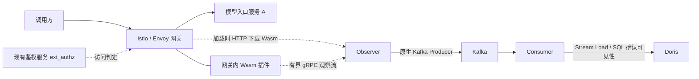

# LLM Token Stats

LLM Token Stats 在网关旁路观察大模型请求和响应，提取模型返回的 token usage，经 Kafka 写入 Doris，供用量统计和分析使用。系统保留请求明细、用量状态和消费恢复记录，目前支持 Chat Completions 的 JSON 与 SSE 响应。

业务请求直接经过网关到模型服务，采集通过独立的有界通道进行，采集失败时放行业务。未知用量保留 `null/unknown`，不按零用量计算。请求和响应正文只在采集过程中临时处理，不写入 Kafka、数据库或日志。

当前协议已移除 application_id。Wasm 仅从 Authorization: Bearer 提取临时 api_key，并发送入口 authority。Observer 使用配置的 cluster_name/deployment_environment，通过服务和客户查询接口解析归属。

两个归属接口支持配置 HTTP/HTTPS POST JSON 调用及 x-remote-data 认证；URI 为空时使用未实现占位。Observer 固定 prd/stg/dev 环境，在有界异步任务中取得 ID 和名称快照；service_name、provider_name、customer_name 经 Kafka 写入 Doris 独立列及 event_json。占位或失败侧的 ID、名称和版本为 null，不回源补写历史；原始 usage 保留，业务 token 不进入事件、数据库或日志。具体说明见[归属接口说明](docs/spec/plan/host-service-provider-implementation.md)。

## 架构与组件职责



| 组件 | 职责 | 运行方式与实现情况 |
| --- | --- | --- |
| Istio / Envoy 网关 | 执行鉴权、路由和业务转发，向 Wasm 提供入口 Host、路由和 Bearer 凭证 | 复用现有入口网关；本地使用 `istio/proxyv2:1.13.5` 中的 Envoy |
| Gateway Observer Wasm | 按 POST 与精确路径白名单选择请求，`route_name: "*"` 忽略路由名；在资源限制内观察正文，必要时补充 `stream_options.include_usage`，旁路发送观察消息 | 已实现；在网关内加载和运行，不单独部署，也不直接连接 Kafka |
| Observer | 接收观察流，分配请求 ID，解析 JSON / SSE usage，生成 `request_started`、`usage_observed` 事件，通过原生 Producer 发送 Kafka | 已实现；入口为 `cmd/observer/`，提供 gRPC、两类归属查询占位、健康检查、指标及独立 HTTP Wasm 下载端口 |
| Kafka | 缓冲结构化事件，按分区保存消费位置，为 Consumer 重放提供数据 | 外部基础设施；本地由 Compose 启动 |
| Consumer | 校验事件与摘要，去重并保留冲突证据；将明细、拒绝诊断、日期通知和批次凭据写入 Doris，确认全部可见后提交 offset | 已实现；入口为 `cmd/consumer/`，多个副本使用同一 consumer group 分摊分区 |
| Doris | 保存事件、请求视图、冲突标记和消费协调状态，支持 SQL 查询 | 已提供迁移；本地使用单 FE / BE，生产使用独立集群 |
| Fixture | 模拟 ext_authz 访问允许和模型 JSON / SSE 响应 | 已实现；仅用于开发和测试，不提供真实鉴权或模型调用 |
| Auth、usage-worker、平台 API / 门户 | 分别承担密钥鉴权、日/月汇总刷新、查询与管理交互 | 仓库包含相关设计或目录，尚无可部署的完整实现；采集接入需复用已有鉴权能力 |

采集范围是模型入口服务 A，不重复统计 A 调用内部 B / C 的请求。观察 ACK 和响应中的计量 ID 都不能证明事件已写入 Kafka / Doris。判断采集是否完整，还需要核对独立网关请求指标、Consumer 水位和缺口记录。

## 编译与构建镜像

### 工具与版本

主模块使用 Go 1.25.0，插件使用 TinyGo 0.40.1 和仓库内固定的 Proxy-Wasm SDK，Python 脚本需要 3.10+。`make test` 包含 Go 竞态测试，需要可用的 C 编译器；开发联调还需要 Docker Engine 和 Docker Compose v2。以下命令均在仓库根目录执行。

本地网关使用 Istio proxyv2 1.13.5，Kafka 和 Doris 分别使用 3.9.2、4.1.3。替换网关或 SDK 版本后，需要重新验证 ABI、hostcall 和过滤器行为。

```sh
make test       # 契约检查、Python 测试、主模块和独立插件模块的 Go 竞态测试
make build      # 生成 dist/observer、dist/consumer、dist/fixture
make wasm       # 生成 dist/gateway-observer-v1.wasm，并检查 ABI
make manifest   # 生成 dist/collection-manifest.json，记录工具版本与文件摘要
```

修改 Protobuf 后使用 `make generate` 重新生成代码；protoc 及插件的固定版本见[组件运行说明](docs/collection-components.md#协议生成与版本)。

### Observer 与 Consumer 镜像

两个 Dockerfile 都从源码构建 Go 服务二进制。Observer 镜像还会复制宿主机上 `make wasm` 生成的插件，因此必须先生成 Wasm，再构建镜像。

镜像版本由 `scripts/image_tag.py` 统一生成：当前提交有 Git tag 时使用该 tag，否则使用至少 12 位 commit 短 hash，例如 `observer:v1.2.3` 或 `observer:2d36b71036b8`。同一提交有多个 tag 时，按 Git 版本排序取最高项；历史提交的 tag 不用于当前版本。Git tag 不符合 Docker tag 的字符或长度限制时，脚本直接报错。

以下以 `linux/amd64` 为例，镜像仓库请按实际发布环境设置：

```sh
export IMAGE_REGISTRY=registry.example.com/llm-token-stats
export IMAGE_TAG="$(python3 scripts/image_tag.py)"
export OBSERVER_IMAGE="$IMAGE_REGISTRY/observer:$IMAGE_TAG"
export CONSUMER_IMAGE="$IMAGE_REGISTRY/consumer:$IMAGE_TAG"

make wasm
docker build --platform linux/amd64 -f deploy/observer/Dockerfile -t "$OBSERVER_IMAGE" .
docker build --platform linux/amd64 -f deploy/consumer/Dockerfile -t "$CONSUMER_IMAGE" .
docker push "$OBSERVER_IMAGE"
docker push "$CONSUMER_IMAGE"
```

### 离线分发镜像与完整 Kubernetes 清单

```sh
make package
# 指定目标集群、命名空间、StorageClass 和输出目录：
make package PACKAGE_DIR=dist/offline-package \
  PACKAGE_ARGS='--context kind-kind --namespace metering --cluster-name kind --storage-class standard'
```

`make package` 编译 Wasm、构建 Observer / Consumer 镜像，再通过 `docker save` 将 Observer、Consumer、Kafka 3.9.2、Doris 4.1.3、Istio proxyv2 1.13.5 这五个运行镜像保存到 `dist/package/images/images.tar`。缺少的依赖镜像会自动拉取，已有镜像会检查平台，默认使用 `linux/amd64`。

镜像构建使用本仓库 Kubernetes 测试所用的 host 网络，并传入代理环境变量；需要切换网络时可指定 `--build-network default`。服务镜像版本取自当前 Git tag / commit hash，Wasm 随 Observer 镜像分发。包内还包含镜像 ID、Wasm 摘要和全包文件校验和。输出目录非空时，打包脚本会拒绝覆盖，可通过 `PACKAGE_DIR` 指定新目录。

包内 `k8s/` 包含已渲染的完整 YAML：Namespace、持久化的单节点 Kafka / Doris、Observer / Consumer Deployment 与 Service、全部 ConfigMap / Secret、Kafka topic 初始化 Job，以及 Doris `001/002/004/005/006/007` 迁移和初始化 Job。

Kafka 默认使用 24 分区、单副本，数据保留 72 小时。存储默认使用集群 StorageClass，可通过 `--storage-class` 和 `--kafka-storage`、`--doris-fe-storage`、`--doris-be-storage` 调整。分发配置使用明文 Kafka、Doris root 空密码和 `development` 环境标识，适用于受控开发环境。生产环境的独立基础设施和认证配置见下文。

部署复用目标集群已有的 Istio 和网关。打包时，脚本默认只读查询当前 kubectl context 中 `istio-system` 下带 `istio=ingressgateway` 标签的实际 Pod；可通过 `--context`、`--gateway-namespace` 指定目标。打包机器无法访问目标集群时，使用 `PACKAGE_ARGS='--gateway-pod 实际Pod名=实际PodUID'` 提供目标 Pod，多个 Pod 需重复传参。

脚本为每个 Pod 生成 `gateway/disabled/`、`gateway/enabled/` 两种完整 EnvoyFilter。网关必须带有 `istio=ingressgateway` 标签，Pod 重建或扩容后需要重新打包。输出 YAML 不含 `REPLACE_*` 或 `RENDER_*`，部署时无需再次替换或渲染。

分发后进入包目录执行：

```sh
cd dist/package
sha256sum -c SHA256SUMS

# 在所有可能调度相关 Pod 的节点上导入镜像，按运行时选择一条：
docker load -i images/images.tar
# sudo ctr -n k8s.io images import images/images.tar
# kind load image-archive images/images.tar --name kind

kubectl apply -f k8s/
kubectl -n metering wait --for=condition=complete \
  job/metering-kafka-init job/metering-doris-init --timeout=20m
kubectl -n metering rollout status deployment/metering-consumer --timeout=5m
kubectl -n metering rollout status deployment/metering-observer --timeout=5m

# 确认 Wasm 下载摘要与过滤器顺序后启用；两种状态每次只 apply 一个目录。
kubectl apply -f gateway/disabled/
kubectl apply -f gateway/enabled/
```

目标集群需事先安装 Istio 1.13.5，配置好业务路由和鉴权，并准备足够的 PV / StorageClass。包内 `README.md` 会按打包参数生成完整部署命令，打包过程不会自动部署到集群。打包成功、清单校验通过后，仍需完成生产 G0 至 G5 验收。

### Wasm 打包、下载与摘要

Observer 镜像将同一份 `dist/gateway-observer-v1.wasm` 放在 `/usr/share/metering/wasm/gateway-observer-v1.wasm`。根目录 `.dockerignore` 只放行这份 Wasm，不将其他构建产物送入镜像。网关复用已有 Istio 镜像，通过 Observer 下载插件；插件随 Observer 镜像发布，无需独立 Deployment。

生产配置可启用以下下载服务；省略 `wasm_download` 时保留原有行为：

```json
"wasm_download": {
  "listen": ":9093",
  "file": "/usr/share/metering/wasm/gateway-observer-v1.wasm"
}
```

下载接口为 `GET/HEAD /wasm/gateway-observer-v1.wasm`，仅提供这一文件，默认集群地址为 `http://metering-observer.metering.svc.cluster.local:9093/wasm/gateway-observer-v1.wasm`。下载服务不调用 Kafka，最多允许 8 个并发下载，超限返回 503；读头超时为 3 秒，写超时为 30 秒。启用下载服务后，文件不可读、Wasm 文件头非法或端口绑定失败都会阻止 Observer 启动。

启动本地栈后，下载并核对实际内容；生产可先在另一个终端执行 `kubectl -n metering port-forward service/metering-observer 19093:9093`，再使用相同命令：

```sh
curl --noproxy '*' --fail --output dist/gateway-observer.download.wasm \
  http://127.0.0.1:19093/wasm/gateway-observer-v1.wasm
sha256sum dist/gateway-observer-v1.wasm dist/gateway-observer.download.wasm
```

两份摘要必须相同。渲染器读取打包时使用的同一份 Wasm，计算 `code.remote.sha256`，并配置 HTTP 下载集群和 5 秒下载超时，不额外重试。

Wasm 使用固定版本 Envoy 的原生远程加载，现有 EnvoyFilter 不依赖 Istio agent 将其重写为文件路径。下载只在插件加载时发生，首次加载需要等待下载完成，逐请求的业务转发不触发下载。

推送完成后记录两个服务镜像的仓库 digest，部署时使用完整的 `仓库地址@sha256:摘要`：

```sh
docker image inspect --format '{{json .RepoDigests}}' "$OBSERVER_IMAGE"
docker image inspect --format '{{json .RepoDigests}}' "$CONSUMER_IMAGE"
```

Kafka、Doris 使用基础设施镜像；Fixture 由本地 Compose 挂载编译产物运行，无需发布生产镜像。

## 开发环境一键启动与测试

工具安装完成、Docker 可用后，执行：

```sh
make test build wasm local-up local-test
```

该命令依次完成检查、编译和 Wasm ABI 验证，启动 Kafka、Doris、Fixture、Observer、Consumer、Envoy，最后执行真实链路集成测试。

`make local-up` 等待基础设施就绪后，应用 `001/002/004/005/006/007` Doris 迁移，在独立的 metering_development 库初始化新表，并创建 24 分区、保留 72 小时的 llm-metering-development topic。它不会编译代码，但会重新渲染下载摘要，重启使用挂载产物的 Fixture、Observer、Consumer，校验下载文件后重建网关。网关只挂载生成的配置，不挂载 Wasm。配置与编排见 [deploy/local/](deploy/local/compose.yaml)。

`make test` 检查代码和契约，不启动容器，也不写 Doris。`make local-test` 验证实际 Envoy → Observer → Kafka → Consumer → Doris 链路，覆盖 JSON / SSE、未知用量、重放去重、冲突、未知 schema 暂停、写入确认丢失和超时边界。测试使用合成数据，并保留诊断记录。

本地发布端口绑定 `0.0.0.0`，用于受控开发网络：

| 组件 | 宿主机端口 |
| --- | --- |
| 网关 / Envoy admin | `18080` / `19000` |
| Observer gRPC / 健康与指标 / Wasm 下载 | `19090` / `19091` / `19093` |
| Consumer 健康与指标 | `19092` |
| Kafka 外部客户端 | `29092` |
| Doris SQL / FE HTTP / BE HTTP | `19030` / `18030` / `18040` |
| Fixture 模型 HTTP / 模拟 ext_authz gRPC | `18081` / `19002` |

Kafka 默认公布自动识别的服务器 IPv4；多网卡或 NAT 环境在启动时指定客户端可达地址：

```sh
KAFKA_EXTERNAL_HOST=192.168.227.128 make local-up
```

手动发送合成请求、检查服务并查询入库结果：

```sh
curl -N -H 'Host: model.example.invalid' -H 'Authorization: Bearer synthetic-test-key' -H 'Content-Type: application/json' \
  --data '{"model":"fixture","stream":true,"messages":[{"role":"user","content":"synthetic fixture"}]}' \
  http://127.0.0.1:18080/v1/chat/completions
curl --fail http://127.0.0.1:19091/readyz
curl --fail http://127.0.0.1:19092/readyz
curl --fail http://127.0.0.1:19091/metrics
curl --fail http://127.0.0.1:19092/metrics

# Consumer 默认最多等待 15 秒攒批，查询时允许相应写入延迟。
docker compose -f deploy/local/compose.yaml exec -T doris \
  mysql -uroot -h127.0.0.1 -P9030 -e \
  'SELECT event_type, usage_status, input_tokens, output_tokens FROM metering_development.events_raw ORDER BY ingested_at DESC LIMIT 10;'
```

DBeaver 使用 MySQL 驱动连接 `服务器IP:19030`，数据库 `metering_development`、用户 `root`、密码为空。明文 Kafka、空密码和单副本只适用于此隔离联调环境。

```sh
# 查看状态和日志
docker compose -f deploy/local/compose.yaml ps
docker compose -f deploy/local/compose.yaml logs --tail=100 observer consumer gateway

# 修改代码后重新构建；local-up 重算下载摘要并重启相关进程
make build wasm local-up
GOFLAGS='-count=1' make local-test

# 停止全部联调组件，保留数据
python3 scripts/local_collection.py stop
```

Kafka、Doris 数据保存在命名卷中；不要用 `down -v` 清理需要保留的数据。启动脚本会在迁移旧容器数据时先备份到 `.tmp/local-storage-*`。服务配置修改后需要重启进程；本地配置位置、迁移行为和恢复边界见[组件运行说明](docs/collection-components.md)。

## Kubernetes 生产部署

按以下顺序部署：网关与鉴权 → Kafka / Doris → 数据库迁移 → 配置与 Secret → Consumer → Observer → 网关 Wasm 灰度启用。下面的命令用于在实际集群中渲染和发布采集组件，执行前需将地址、账号、镜像及容量替换为实际环境的值。

### 1. 准备网关与基础设施

| 组件 | Kubernetes 部署要求 |
| --- | --- |
| Istio / Envoy | 使用已验证的网关版本，准备独立灰度网关 Deployment；确保 `istio: ingressgateway` 标签与过滤器选择器一致。初始网关使用 2 Worker，实际并发数与热更新资源需验收 |
| ext_authz / Auth | 通过现有网关鉴权配置接入，独立负责业务访问判定；在 Wasm 读取前保留原 Authorization，采集不使用其身份元数据；Fixture 不用于生产 |
| Kafka | 使用平台维护的有持久卷、多 Broker 的集群或托管服务；配置 TLS / SASL、ACL 和监控。仓库未提供生产 Kafka 集群安装清单 |
| Doris | 使用 Doris Operator 或独立 FE / BE 集群，配置持久卷、备份、副本、动态分区与独立账号；[doris.yaml](deploy/doris/doris.yaml) 是单节点开发样例 |
| 网络与身份 | 网关访问 Observer gRPC（9090）和 Wasm HTTP 下载（9093）；Observer 仅生产指定 topic；Consumer 消费指定 topic/group，并访问 Doris SQL 和 Stream Load。通过 NetworkPolicy 与网格授权限制来源，放通必要 DNS 与基础设施流量 |

本文服务模板使用 `metering` 命名空间，网关过滤器使用 `istio-system`。如果环境使用其他名称，需要同步修改模板、服务 DNS、Wasm 的 `observer_cluster`，以及渲染参数 `--wasm-url`、`--wasm-cluster`。

请按现有 Istio 安装方式为 `metering` 配置 sidecar 注入和 mTLS。Observer 自身的 gRPC 和下载 HTTP 监听不提供 TLS，网关到 Observer 的认证与加密由网格承担；这些网格和网络策略需要另行配置，模板不会自动创建。

### 2. 初始化 Kafka 与 Doris

在具有管理权限的 Kafka 客户端环境创建 topic。`KAFKA_BOOTSTRAP` 是真实集群地址，`--command-config` 指向安全挂载的客户端认证配置：

```sh
kafka-topics.sh --bootstrap-server "$KAFKA_BOOTSTRAP" \
  --command-config /run/secrets/kafka/admin.properties \
  --create --if-not-exists --topic llm-metering-events \
  --partitions 24 --replication-factor 3 \
  --config min.insync.replicas=2 \
  --config retention.ms=259200000 --config cleanup.policy=delete

kafka-topics.sh --bootstrap-server "$KAFKA_BOOTSTRAP" \
  --command-config /run/secrets/kafka/admin.properties \
  --describe --topic llm-metering-events
```

上述副本配置需要至少 3 个可用 Broker；24 分区是容量验收初值。同一采集部署周期不在线调整分区数。为 Observer 配置 topic 生产权限，为 Consumer 配置 topic 消费和 group 权限；现有 topic 的参数要另行核对，`--if-not-exists` 不会更新已有配置。

Doris 新库按 `001 → 002 → 004 → 005 → 006 → 007` 的顺序执行迁移。仓库 SQL 使用开发环境的副本数 1，生产部署前需生成并审查生产用 SQL。以下示例将副本数改为 3，实际 BE 数量和存储资源必须满足要求：

```sh
export DEPLOY_DIR="$PWD/.private/deploy"
install -d -m 700 "$DEPLOY_DIR/doris"
python3 - <<'PY'
import os
import re
from pathlib import Path

target = Path(os.environ['DEPLOY_DIR']) / 'doris'
for name in ('001_init.sql', '002_usage_summaries.sql',
             '004_summary_coordination.sql', '005_consumer_recovery.sql',
             '006_optional_route_identity.sql', '007_schema_comments.sql'):
    sql = (Path('migrations/doris/metering') / name).read_text()
    sql = re.sub(r'("replication_num"\s*=\s*)"1"', r'\g<1>"3"', sql)
    (target / name).write_text(sql)
PY

# 在能够连接 FE SQL 的管理环境执行；认证配置由 Secret 安全提供。
for migration in 001_init.sql 002_usage_summaries.sql 004_summary_coordination.sql 005_consumer_recovery.sql 006_optional_route_identity.sql 007_schema_comments.sql; do
  mysql --defaults-extra-file=/run/secrets/doris/admin.cnf --default-character-set=utf8mb4 \
    --init-command="SET time_zone = '+00:00'" < "$DEPLOY_DIR/doris/$migration" || exit 1
done
mysql --defaults-extra-file=/run/secrets/doris/admin.cnf \
  -e 'SHOW BACKENDS; SHOW TABLES FROM metering; USE metering; SHOW DYNAMIC PARTITION TABLES;'
```

直接执行上述命令会初始化 metering 库。如需使用其他库，先通过 `python3 scripts/render_doris_sql.py --database 库名 SQL文件` 渲染全部迁移，并同步修改 doris.database 与 DSN 中的数据库名。标识符必须以字母开头，只能包含字母、数字和下划线，最多 64 字符。确认所有迁移成功后，再部署 Consumer。

已有库调整保留策略时，使用 [003 迁移](migrations/doris/metering/003_raw_retention_one_year.sql)，执行前先停止与之冲突的归档或分区清理任务。`CREATE TABLE IF NOT EXISTS` 不会修改已有表。所有 FE 都应持久化 `dynamic_partition_enable=true`，并确认 BE 为 Alive、当天及所需历史日期的分区已存在。副本、分桶等生产参数需逐项审查；仅修改副本数不足以完成容量验收。

明细按 UTC 请求日期保留 365 个日期。仓库已定义日 / 月汇总表和 SQL 模板，执行这些迁移不会启动汇总刷新任务。

### 3. 准备服务配置与 Secret

```sh
kubectl create namespace metering --dry-run=client -o yaml | kubectl apply -f -
cp configs/observer.production.example.json "$DEPLOY_DIR/observer.json"
cp configs/consumer.production.example.json "$DEPLOY_DIR/consumer.json"
cp configs/gateway-observer.example.json "$DEPLOY_DIR/gateway-observer.json"
```

修改这三份配置，并保持注册信息一致：

| 配置 | 必须确认的内容 |
| --- | --- |
| Observer | Kafka Broker、CA 和认证环境变量名；`accepted_config_versions`、`accepted_adapter_ids`、`accepted_service_ids`；固定 `cluster_name`、`deployment_environment`（prd/stg/dev）及两个查询 URI；资源预算；`wasm_download` 的镜像内路径与下载端口 |
| Consumer | 同一 Kafka topic、稳定的 `group_id`、历史配置版本及服务白名单；Doris `fe_url`、`allowed_load_hosts`；攒批大小与时间 |
| Wasm | 规则 `route_name`（当前为 `*`，忽略路由名）、方法、精确路径、`adapter_id`、`config_version`、Observer cluster；保持默认关闭，通过渲染器显式启用 |

`allowed_load_hosts` 必须包含实际 FE 和所有可能接收重定向的 BE 地址及端口，Consumer 也必须能访问这些地址。Consumer 只向登记的地址发送 Stream Load 凭据，并拒绝 HTTPS 降级。

首次使用新 consumer group 时，系统会登记 Kafka earliest。接管缺少起点记录的旧组时，需要明确指定 `initial_offsets`；不要随意更换 group 或跳到 latest。

由 Secret 管理系统在本地受保护目录准备以下文件，不把凭据填入 JSON 或提交仓库：

| 文件示例 | 内容 |
| --- | --- |
| `.private/secrets/kafka-ca.crt` | Kafka CA 证书 |
| `.private/secrets/observer-kafka-username`、`observer-kafka-password` | Observer 的 SASL PLAIN 账号与密码，无额外换行 |
| `.private/secrets/consumer.env` | Consumer 的 Kafka 与 Doris 凭据，键名见下例；文件权限设为 `0600` |

`consumer.env` 格式如下，所有占位值需由真实凭据替换：

```dotenv
KAFKA_USERNAME=替换为Consumer账号
KAFKA_PASSWORD=替换为Consumer密码
DORIS_DSN=用户名:密码@tcp(doris-fe.doris.svc.cluster.local:9030)/metering?timeout=5s&readTimeout=30s&writeTimeout=10s&interpolateParams=true&time_zone=%27%2B00%3A00%27
DORIS_USER=替换为StreamLoad用户名
DORIS_PASSWORD=替换为StreamLoad密码
```

Doris 使用独立账号，仅授予采集表所需的查询与写入权限。DSN 必须包含连接、读写超时和 UTC 会话设置；迁移需单独执行，服务不会代为运行。Kafka 如需客户端证书，在配置中增加 `cert_file`、`key_file`，并将对应文件加入下述 TLS Secret。

```sh
export SECRET_DIR="$PWD/.private/secrets"

kubectl -n metering create secret generic metering-kafka-tls \
  --from-file=ca.crt="$SECRET_DIR/kafka-ca.crt" \
  --dry-run=client -o yaml | kubectl apply -f -
kubectl -n metering create secret generic metering-kafka-sasl \
  --from-file=username="$SECRET_DIR/observer-kafka-username" \
  --from-file=password="$SECRET_DIR/observer-kafka-password" \
  --dry-run=client -o yaml | kubectl apply -f -
kubectl -n metering create secret generic metering-consumer-credentials \
  --from-env-file="$SECRET_DIR/consumer.env" \
  --dry-run=client -o yaml | kubectl apply -f -

kubectl -n metering create configmap metering-observer \
  --from-file=observer.json="$DEPLOY_DIR/observer.json" \
  --dry-run=client -o yaml | kubectl apply -f -
kubectl -n metering create configmap metering-consumer \
  --from-file=consumer.json="$DEPLOY_DIR/consumer.json" \
  --dry-run=client -o yaml | kubectl apply -f -
```

### 4. 部署 Consumer 与 Observer

使用构建时记录的真实 digest 替换以下示例值。部署模板已配置探针、资源预算和只读配置 / 证书挂载；私有仓库需要在集群配置 `imagePullSecrets`。

```sh
export OBSERVER_IMAGE_DIGEST='registry.example.com/llm-token-stats/observer@sha256:替换为实际摘要'
export CONSUMER_IMAGE_DIGEST='registry.example.com/llm-token-stats/consumer@sha256:替换为实际摘要'

python3 - <<'PY'
import os
import re
from pathlib import Path

target = Path(os.environ['DEPLOY_DIR'])
for component in ('observer', 'consumer'):
    image = os.environ[f'{component.upper()}_IMAGE_DIGEST']
    if not re.fullmatch(r'[^\s]+@sha256:[0-9a-f]{64}', image):
        raise SystemExit(f'{component}: 请填写真实镜像 digest')
    manifest = Path(f'deploy/{component}/{component}.yaml').read_text()
    manifest = manifest.replace(f'REPLACE_{component.upper()}_IMAGE_DIGEST', image)
    (target / f'{component}.yaml').write_text(manifest)
PY

kubectl apply -f "$DEPLOY_DIR/consumer.yaml"
kubectl -n metering rollout status deployment/metering-consumer --timeout=5m
kubectl apply -f "$DEPLOY_DIR/observer.yaml"
kubectl -n metering rollout status deployment/metering-observer --timeout=5m
kubectl -n metering get pods,svc
```

模板默认部署 2 个 Observer 副本和 1 个 Consumer 副本。扩容 Consumer 时保持同一 group，实际并行度受 topic 分区数限制；扩容 Observer 时，还需检查 HTTP/2 长连接的负载分布。

配置或 Secret 更新后，使用 `kubectl rollout restart deployment/对应名称 -n metering` 重启服务。升级配置版本时，先让 Observer 同时接受新旧版本，再更新网关；Consumer 需保留在线数据窗口内的历史注册信息。

### 5. 核对下载服务并按 Pod 渲染 Wasm 配置

确认所有 Observer 副本都已使用目标镜像，且下载内容与发布产物的摘要一致后，再通过现有 Istio 发布配置准备独立灰度网关。保留已有网关的镜像、服务、端口、路由、鉴权与网格设置。以下假设灰度网关的 Deployment 名为 `istio-ingressgateway-canary`，请按实际名称替换：

```sh
export GATEWAY_DEPLOYMENT=istio-ingressgateway-canary
kubectl -n istio-system rollout status deployment/"$GATEWAY_DEPLOYMENT" --timeout=5m
kubectl -n istio-system get pods -l istio=ingressgateway -o wide

# 从上述 Deployment 选取一个实际 Pod，替换名称。
export GATEWAY_POD=替换为灰度网关Pod名
export GATEWAY_POD_UID="$(kubectl -n istio-system get pod "$GATEWAY_POD" -o jsonpath='{.metadata.uid}')"

python3 scripts/render_gateway_filter.py \
  --config "$DEPLOY_DIR/gateway-observer.json" \
  --wasm-file dist/gateway-observer-v1.wasm \
  --wasm-url http://metering-observer.metering.svc.cluster.local:9093/wasm/gateway-observer-v1.wasm \
  --wasm-cluster 'outbound|9093||metering-observer.metering.svc.cluster.local' \
  --gateway-pod-name "$GATEWAY_POD" \
  --gateway-namespace istio-system \
  --gateway-pod-uid "$GATEWAY_POD_UID" \
  --output "$DEPLOY_DIR/envoyfilter.$GATEWAY_POD_UID.disabled.yaml"
kubectl apply -f "$DEPLOY_DIR/envoyfilter.$GATEWAY_POD_UID.disabled.yaml"
```

渲染器验证 Wasm 配置和产物文件头后，计算文件 SHA-256，写入实际 Pod UID，并生成唯一的 EnvoyFilter 名称。过滤器通过代理启动时的 `metadata.NAME/NAMESPACE` 精确匹配目标 Pod；`--gateway-pod-name` 必填，`--gateway-namespace` 默认为 `istio-system`。

请先渲染 [EnvoyFilter 模板](deploy/gateway/envoyfilter.yaml) 再发布，不要直接 apply 模板，也不要让整个 Deployment 共用一个实例 ID。Istio 1.13 的代理标签取自启动快照，Pod 启动后补加 UID 标签无法可靠匹配 EnvoyFilter，无需再添加 `metering-instance` 标签。

当前仅采集 `POST /v1/chat/completions`，不限制 VirtualService、HTTP 路由名或域名。入口使用以下规则，`route_name: "*"` 接受任意路由名及路由名不可读的情况，无需配置路由 metadata：

```json
{
  "routes": [{"route_name": "*", "enabled": true, "methods": ["POST"], "paths": ["/v1/chat/completions"], "adapter_id": "chat_completions_v1"}]
}
```

方法必须为 `POST`，路径去掉查询串后精确匹配，不做额外 URL 解码或大小写转换。其他方法和路径（包括尾斜杠、子路径）均会被忽略，不读取正文、不建立观察流，也不发送事件。`*` 只能作为完整的 `route_name` 值，不表示路径或其他字段也支持通配。采集时，全局和规则开关都必须开启。

配置中的 `route_name: "*"` 只用于筛选请求。事件的 `route_name` 记录请求头阶段可读的真实 Envoy HTTP 路由名；路由名缺失、超过 128 UTF-8 字节或无效时，记录为 `unknown`，不使用通配值或计量 metadata 替代。该字段仅用于诊断和审计，不作为客户归属、服务接纳、身份一致性或价格依据，也不代表 VirtualService 名称或实际后端。

`adapter_id` 取自命中规则；service_id/provider_id 及名称由 Observer 服务接口解析；配置 HTTP/HTTPS URI 和凭据后可返回已知归属，空 URI 为未知占位。配置仍支持精确路由名筛选，并按配置顺序选择第一个命中路由名的规则。

Observer / Consumer 使用 accepted_service_ids 精确匹配并接纳已映射服务。未映射事件的 service_id/provider_id 均为 null，仍可保留用于质量诊断。配置已移除旧 accepted_routes、Wasm identity_namespace/identity_fields 和规则 service_id，传入这些字段会被拒绝。配置版本、适配器及事件状态一致性检查仍会执行。

功能尚未上线，协议、代码、配置和新开发库统一使用当前格式，不接纳旧格式消息，也不双写旧表。001/002/004/005/006/007 共同初始化同一套新模型，006 不负责兼容旧数据。旧结构库无法通过 CREATE IF NOT EXISTS 直接升级，应保留旧数据，改用隔离库和独立 topic/group。

Bearer 仅临时用于归属查询。空 URI 占位或客户查询失败时归属未知；即使用量为 known，身份也为 invalid、usage_eligible=false。启用 HTTP/HTTPS 查询并成功解析后按冻结的客户归属和名称生成事件。使用以下命令检查实际代理配置：

```sh
istioctl proxy-config all "$GATEWAY_POD" -n istio-system -o json \
  > "$DEPLOY_DIR/gateway-config-dump.json"
```

确认过滤器顺序为 ext_authz → Wasm → router，且远程 Wasm 已加载成功。检查 HTTP 下载集群 `outbound|9093||metering-observer.metering.svc.cluster.local` 和 HTTP/2 采集集群 `outbound|9090||metering-observer.metering.svc.cluster.local` 是否均存在，并确认网格 mTLS、网络策略和授权允许访问相应端口。集群名称以实际服务发现结果为准；仅凭 Service 已创建或健康探针成功，无法确认下载和采集链路已就绪。

使用 Istio `outbound|端口||服务DNS` 集群时，插件自动将 gRPC authority 设置为 `服务DNS:端口`，保留路由集群与 mTLS/SNI。自定义 ext_authz 配置也应显式设置 `grpc_service.envoy_grpc.authority` 为有效服务 DNS，不能让带 `|` 的集群名作为 HTTP/2 authority。

### 6. 启用、验证与回退

完成[验收清单](docs/gateway-collection-design-closure.md)中 G0 / G1 的环境、鉴权与协议验证后，显式启用该 Pod：

```sh
python3 scripts/render_gateway_filter.py \
  --config "$DEPLOY_DIR/gateway-observer.json" \
  --wasm-file dist/gateway-observer-v1.wasm \
  --wasm-url http://metering-observer.metering.svc.cluster.local:9093/wasm/gateway-observer-v1.wasm \
  --wasm-cluster 'outbound|9093||metering-observer.metering.svc.cluster.local' \
  --gateway-pod-name "$GATEWAY_POD" \
  --gateway-namespace istio-system \
  --gateway-pod-uid "$GATEWAY_POD_UID" --enable \
  --output "$DEPLOY_DIR/envoyfilter.$GATEWAY_POD_UID.enabled.yaml"
kubectl apply -f "$DEPLOY_DIR/envoyfilter.$GATEWAY_POD_UID.enabled.yaml"
```

通过灰度入口发送已授权的 JSON / SSE 测试请求，检查业务响应、Observer / Consumer 的 `/metrics`、Kafka group lag，以及 Doris 中对应的 `events_raw`、`requests` 和 `consumer_batch_receipts`。

Observer 健康端口为 `9091`，Consumer 为 `9092`，均提供 `/livez`、`/readyz`、`/metrics`，可从受控终端通过 `kubectl port-forward` 访问。`readyz` 成功后，还需确认真实请求已经入库。

Consumer 按分区攒批，默认达到 5000 条、4 MiB 或等待 15 秒时写入。Doris 不可用时，Consumer 暂停相应分区并保留冻结批次；遇到未知 schema 时也会暂停，不会跳过。恢复位置落后于 Kafka earliest 时，系统会记录缺口并暂停，需按[恢复说明](docs/collection-components.md#consumer-恢复与统计边界)处理，不能跳到 latest 掩盖数据丢失。

Observer 只提供当前镜像内的一个 Wasm 版本。升级时，先发布 Observer，等待所有副本的下载摘要一致，再更新网关的 URL 和摘要配置。滚动升级期间，按旧摘要下载可能失败，采集允许暂时缺失；已加载的插件可以继续运行，但旧网关重启后不保证还能下载到旧文件。

下载服务恢复后，需要触发插件重新安装或重启网关，并按实际 Pod UID 重新渲染配置。原样重复 apply 同一配置不一定触发下载，不能依赖它自动恢复。版本回退时，先恢复对应的 Observer 镜像，再恢复对应的网关配置。

需要立即停止采集时，先重新应用同一 Pod 的关闭配置；若模块加载或 ABI 错误导致配置无法生效，再移除该 Pod 专属过滤器：

```sh
kubectl apply -f "$DEPLOY_DIR/envoyfilter.$GATEWAY_POD_UID.disabled.yaml"
# 必要时移除采集过滤器，并核验原有鉴权和业务路由仍有效。
kubectl -n istio-system delete envoyfilter "gateway-observer-$GATEWAY_POD_UID"
```

每个网关 Pod 都需要独立渲染配置。Pod 重建或扩容后，需获取实际 Pod 名称和 UID，重新渲染并发布对应过滤器，同时清理旧 UID 的资源。仓库尚未提供自动执行这些操作的控制器，需要将其纳入发布流程。关闭配置用于停止采集；底层模块加载失败时，即使配置了 `fail_open`，也不能保证网关成功启动。

本地集成结果仅覆盖本地环境。扩大灰度前，需在真实环境验证改写、解析和故障恢复；生产验收还包括性能、数据质量和回退检查。完整 G0 至 G5 要求见[闭环与验收清单](docs/gateway-collection-design-closure.md)，已有本地证据见[验证记录](docs/spec/plan/gateway-collection-verification.md)。

## 本地 Kubernetes / Istio 部署验证

项目已在 Kubernetes 1.22.17 + Istio 1.13.5 上完成实际部署验证，并整理为 K8S-WASM-001 用例。测试将 2 个 Observer 副本、Consumer、独立测试网关和合成鉴权 / 模型 fixture 部署到 Kubernetes，Kafka、Doris 复用本地 Compose。每次测试使用独立的 Doris 库、Kafka topic 和消费组，不依赖 Compose Consumer，也不发布到原 `istio-system` 网关。

```sh
# 仅启动 Kafka / Doris 并初始化本地迁移；已就绪可跳过。
make local-infra-up
# 构建并实际部署，验证 JSON、SSE、unknown、mTLS 下载及独立 Consumer 入库。
make k8s-test
```

默认 context 为 `kind-kind`，测试命名空间为 `metering-wasm-verify`。Observer、Consumer、fixture 镜像统一使用 Git tag 或 commit 短 hash 作为版本，测试 topic、消费组和诊断目录则使用随机 run-id。

测试结束后会保留资源和 `.tmp/k8s-collection/` 下的结果；再次执行时，会先清理归属于本测试的旧环境。网关使用原始 `istio/proxyv2:1.13.5`，不挂载或打包 Wasm。完整前置条件、断言和自定义参数见[测试用例](docs/kubernetes-collection-test.md)，实际结果见[验证记录](docs/spec/plan/gateway-collection-verification.md)。

```sh
kubectl --context kind-kind -n metering-wasm-verify get deployment,pod,svc
kubectl --context kind-kind -n metering-wasm-verify port-forward service/wasm-gateway 28080:8080
```

保持端口转发，在另一个终端发送合成 SSE 请求：

```sh
curl --noproxy '*' -N -H 'Host: wasm-verify.local' -H 'Authorization: Bearer synthetic-test-key' -H 'Content-Type: application/json' \
  --data '{"model":"fixture","stream":true,"messages":[{"role":"user","content":"synthetic Kubernetes verification"}]}' \
  http://127.0.0.1:28080/v1/chat/completions
```

该入口只用于合成验证，不提供真实 API Key 鉴权或模型调用。清理脚本删除本次测试命名空间及独立 Kafka topic / 消费组，保留共享 Compose 数据卷、Doris 历史测试记录和原网关：

```sh
make k8s-clean
# 或直接运行独立脚本；重复执行安全。
python3 scripts/cleanup_k8s_collection.py
```

## 目录与文档

| 目录 | 内容 |
| --- | --- |
| `cmd/`、`internal/`、`pkg/` | 服务入口、内部实现与共享代码 |
| `plugins/gateway-observer/`、`third_party/proxy-wasm-go-sdk/` | 独立 Go 模块的 Wasm 插件及固定 SDK 扩展 |
| `api/`、`gen/` | Protobuf、事件 Schema 与生成代码 |
| `configs/`、`deploy/`、`migrations/` | 配置样例、镜像与部署模板、数据库迁移 |
| `tests/`、`testdata/`、`scripts/` | 单元与集成测试、合成样例、构建及运维辅助脚本 |
| `docs/`、`docs/spec/plan/` | 架构设计、实现计划与验证记录 |
| `dist/` | 忽略提交的二进制、Wasm 与摘要清单 |

- [组件运行说明：配置、协议、资源及恢复边界](docs/collection-components.md)
- [归属接口实现与后续对接边界](docs/spec/plan/host-service-provider-implementation.md)
- [网关采集实现方案](docs/gateway-request-collection-implementation.md)
- [Kafka 事件接入说明](docs/kafka-event-integration-guide.md)
- [Doris 数据库表职责与完整字段字典](docs/doris-database-schema.md)
- [Doris 部署与迁移说明](deploy/doris/README.md)
- [日 / 月汇总设计](docs/daily-monthly-summary-design.md)、[Doris 协调设计](docs/doris-summary-coordination.md)
- [API Key 鉴权设计](docs/api-key-auth-service-implementation.md)
