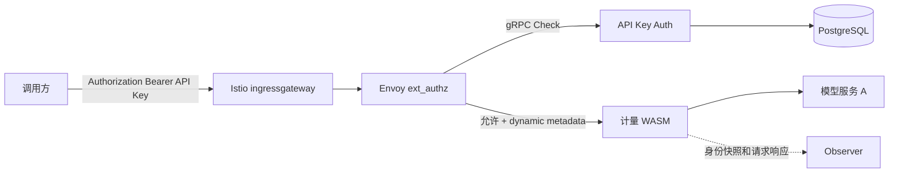

# API Key Auth 服务开发实现方案

版本：V1.1｜日期：2026-10-09｜状态：开发设计，尚未完成真实网关联调与性能验收。

依据：[功能设计概览及开发周期](token-metering-functional-overview-and-schedule.md)、[网关请求采集实现方案](gateway-request-collection-implementation.md)。本文设计新增的 API Key 鉴权与客户归属能力，解决当前网关没有鉴权、采集插件无法获得可信 `api_key_id` 和 `customer_id` 的问题。

## 1. 目标、范围与关键决策

| 项目 | 决策 |
| --- | --- |
| 网关接入 | Istio `CUSTOM` AuthorizationPolicy + Envoy gRPC ext_authz |
| 服务实现 | 独立 Go Auth 服务，实现 `envoy.service.auth.v3.Authorization.Check` |
| 主存储 | PostgreSQL，保存客户、应用、稳定 API Key 主体、密钥版本、访问范围与审计记录 |
| 客户凭证 | `Authorization: Bearer <platform_api_key>`，不接受客户声明的身份 ID |
| 密钥保存 | 只保存带服务端 pepper 的 HMAC-SHA-256，不保存或记录密钥原文 |
| 身份传递 | ext_authz `CheckResponse.dynamic_metadata`，namespace 为 `envoy.filters.http.ext_authz` |
| 故障策略 | Auth 超时或不可用返回 503；仅 PostgreSQL 不可用时，未过期的正向缓存仍可完成鉴权，缓存未命中或过期返回 503 |
| 采集关系 | ext_authz 在计量 WASM 前；只有鉴权成功请求进入采集和模型路由 |
| 扩容方式 | Auth 服务无本地持久状态、可横向扩容；PostgreSQL 是事实源，本地仅有界缓存 |
| 一期边界 | 支持 API Key 创建、查询、轮换、吊销、客户/应用归属和路由范围；不包含 OAuth、用户登录、余额或实时额度 |

Auth 与 Observer 必须独立部署。Auth 位于业务同步链路，决定请求是否能继续；Observer 是旁路采集，故障不能阻断业务。两者不得共用进程、健康状态或故障策略。

## 2. 总体架构和请求时序



正常时序：

1. 客户端把平台 API Key 放在 `Authorization: Bearer` 中。
2. ingressgateway 的 ext_authz 过滤器在请求头阶段暂停请求并发送 gRPC `CheckRequest`；不缓冲或发送请求正文。
3. Auth 校验凭证、客户/应用状态、有效期和访问范围。
4. Auth 返回 OK、可信身份动态元数据，并要求 Envoy 删除客户端 Authorization。
5. 后续计量 WASM 从动态元数据读取身份快照，补充 `stream_options.include_usage` 并执行旁路采集。
6. 路由层把请求发送到模型服务；若上游需要凭证，由网关的受信配置另行注入平台到上游的凭证。

鉴权拒绝请求在 ext_authz 结束，不进入计量 WASM，也不计入“鉴权后业务请求”的采集完整率分母。鉴权请求量、拒绝量和错误量使用独立网关/Auth 指标统计。

## 3. API Key 与身份模型

### 3.1 API Key 格式

一期格式固定为：

```text
skp_<public_prefix>_<secret>
```

- `public_prefix`：12 个大小写敏感 Base62 字符，用于索引候选记录，不是身份 ID。
- `secret`：32 个随机字节的 Base64URL 无填充编码，由 CSPRNG 生成。
- 完整 API Key 最大 128 字节；只在创建或轮换成功响应中显示一次。
- 客户不能自定义 secret，服务不提供找回原密钥功能。

内部标识分层：

| 字段 | 稳定性与用途 |
| --- | --- |
| `api_key_id` | API Key 主体的稳定外部 ID；轮换密钥版本时不变，写入计量事件 |
| `key_version_id` | 某次生成的凭证版本；轮换时变化，仅用于鉴权审计与排障 |
| `customer_id` | 请求发生时所属客户快照 |
| `application_id` | 请求发生时所属应用快照 |
| `identity_generation` | Auth 数据变更版本，帮助排查身份配置传播，不作为业务归属键 |

### 3.2 密钥摘要

服务端计算：

```text
secret_mac = HMAC-SHA-256(pepper[pepper_version], 完整 API Key 原始字节)
```

pepper 通过 Secret/KMS 注入 Auth Pod，不进入 PostgreSQL、日志或错误信息。数据库保存 `pepper_version` 和 32 字节 `secret_mac`。验证时先按 prefix 取得候选记录，再重新计算摘要并使用常量时间比较。

pepper 无法在不知道原密钥的情况下直接重算历史摘要。轮换 pepper 时保留旧版本用于验证，并逐步为 API Key 生成使用新 pepper 的密钥版本；所有旧版本失效后才能删除旧 pepper。

## 4. PostgreSQL 表结构

建议基线为 PostgreSQL 15；最终版本、HA、备份和参数在部署前固定。UUID 由应用生成，避免 DDL 依赖扩展。所有时间为 `timestamptz`，服务统一使用 UTC。

```sql
CREATE TABLE auth_customers (
    id uuid PRIMARY KEY,
    customer_id varchar(128) NOT NULL UNIQUE,
    display_name varchar(256) NOT NULL,
    status varchar(16) NOT NULL CHECK (status IN ('active', 'disabled')),
    created_at timestamptz NOT NULL,
    updated_at timestamptz NOT NULL,
    version bigint NOT NULL CHECK (version > 0)
);

COMMENT ON COLUMN auth_customers.id IS '应用生成的内部 UUID 主键，用于数据库关联';
COMMENT ON COLUMN auth_customers.customer_id IS '对外稳定且唯一的客户 ID，作为计量租户标识';
COMMENT ON COLUMN auth_customers.display_name IS '用于管理展示的名称';
COMMENT ON COLUMN auth_customers.status IS '客户状态：active 启用、disabled 禁用';
COMMENT ON COLUMN auth_customers.created_at IS '记录创建时间，统一使用 UTC';
COMMENT ON COLUMN auth_customers.updated_at IS '记录最后更新时间，统一使用 UTC';
COMMENT ON COLUMN auth_customers.version IS '记录版本号，正整数，用于并发变更控制';

CREATE TABLE auth_applications (
    id uuid PRIMARY KEY,
    application_id varchar(128) NOT NULL UNIQUE,
    customer_pk uuid NOT NULL REFERENCES auth_customers(id),
    display_name varchar(256) NOT NULL,
    status varchar(16) NOT NULL CHECK (status IN ('active', 'disabled')),
    created_at timestamptz NOT NULL,
    updated_at timestamptz NOT NULL,
    version bigint NOT NULL CHECK (version > 0),
    UNIQUE (id, customer_pk)
);

COMMENT ON COLUMN auth_applications.id IS '应用生成的内部 UUID 主键，用于数据库关联';
COMMENT ON COLUMN auth_applications.application_id IS '对外稳定且唯一的应用 ID';
COMMENT ON COLUMN auth_applications.customer_pk IS '所属客户的内部 UUID，关联 auth_customers.id';
COMMENT ON COLUMN auth_applications.display_name IS '用于管理展示的名称';
COMMENT ON COLUMN auth_applications.status IS '应用状态：active 启用、disabled 禁用';
COMMENT ON COLUMN auth_applications.created_at IS '记录创建时间，统一使用 UTC';
COMMENT ON COLUMN auth_applications.updated_at IS '记录最后更新时间，统一使用 UTC';
COMMENT ON COLUMN auth_applications.version IS '记录版本号，正整数，用于并发变更控制';

CREATE TABLE auth_api_keys (
    id uuid PRIMARY KEY,
    api_key_id varchar(128) NOT NULL UNIQUE,
    customer_pk uuid NOT NULL REFERENCES auth_customers(id),
    application_pk uuid NOT NULL,
    display_name varchar(256) NOT NULL,
    status varchar(16) NOT NULL CHECK (status IN ('active', 'disabled')),
    created_at timestamptz NOT NULL,
    updated_at timestamptz NOT NULL,
    version bigint NOT NULL CHECK (version > 0),
    FOREIGN KEY (application_pk, customer_pk)
        REFERENCES auth_applications(id, customer_pk)
);

COMMENT ON COLUMN auth_api_keys.id IS '应用生成的内部 UUID 主键，用于数据库关联';
COMMENT ON COLUMN auth_api_keys.api_key_id IS '对外稳定且唯一的 API Key 主体 ID，轮换密钥时保持不变，不含密钥';
COMMENT ON COLUMN auth_api_keys.customer_pk IS '所属客户的内部 UUID，关联 auth_customers.id';
COMMENT ON COLUMN auth_api_keys.application_pk IS '所属应用的内部 UUID，与 customer_pk 组成外键，保证应用和密钥归属同一客户';
COMMENT ON COLUMN auth_api_keys.display_name IS '用于管理展示的名称';
COMMENT ON COLUMN auth_api_keys.status IS 'API Key 主体状态：active 启用、disabled 禁用';
COMMENT ON COLUMN auth_api_keys.created_at IS '记录创建时间，统一使用 UTC';
COMMENT ON COLUMN auth_api_keys.updated_at IS '记录最后更新时间，统一使用 UTC';
COMMENT ON COLUMN auth_api_keys.version IS '记录版本号，正整数，用于并发变更控制';

CREATE TABLE auth_api_key_versions (
    id uuid PRIMARY KEY,
    key_version_id varchar(128) NOT NULL UNIQUE,
    api_key_pk uuid NOT NULL REFERENCES auth_api_keys(id),
    public_prefix varchar(32) NOT NULL UNIQUE,
    secret_mac bytea NOT NULL CHECK (octet_length(secret_mac) = 32),
    pepper_version smallint NOT NULL CHECK (pepper_version > 0),
    status varchar(16) NOT NULL CHECK (status IN ('active', 'revoked', 'expired')),
    valid_from timestamptz NOT NULL,
    expires_at timestamptz,
    revoked_at timestamptz,
    created_at timestamptz NOT NULL,
    last_used_at timestamptz,
    CHECK (expires_at IS NULL OR expires_at > valid_from),
    CHECK ((status = 'revoked') = (revoked_at IS NOT NULL))
);

COMMENT ON COLUMN auth_api_key_versions.id IS '应用生成的内部 UUID 主键，用于数据库关联';
COMMENT ON COLUMN auth_api_key_versions.key_version_id IS '对外稳定且唯一的密钥版本 ID，每次轮换创建新版本';
COMMENT ON COLUMN auth_api_key_versions.api_key_pk IS '所属 API Key 主体的内部 UUID，关联 auth_api_keys.id';
COMMENT ON COLUMN auth_api_key_versions.public_prefix IS '公开且唯一的密钥前缀，用于定位待验证记录，不能单独用于鉴权';
COMMENT ON COLUMN auth_api_key_versions.secret_mac IS '用于验证密钥的 32 字节带 pepper 摘要，不保存密钥明文';
COMMENT ON COLUMN auth_api_key_versions.pepper_version IS '验证该摘要所需的 pepper 版本号；pepper 本身由 Secret/KMS 提供';
COMMENT ON COLUMN auth_api_key_versions.status IS '密钥版本状态：active 有效、revoked 已吊销、expired 已过期；仍须检查有效期';
COMMENT ON COLUMN auth_api_key_versions.valid_from IS '密钥版本开始生效时间，UTC';
COMMENT ON COLUMN auth_api_key_versions.expires_at IS '密钥版本到期时间，UTC；NULL 表示未设置到期时间';
COMMENT ON COLUMN auth_api_key_versions.revoked_at IS '吊销时间，UTC；仅 revoked 状态非 NULL';
COMMENT ON COLUMN auth_api_key_versions.created_at IS '记录创建时间，统一使用 UTC';
COMMENT ON COLUMN auth_api_key_versions.last_used_at IS '异步按分钟聚合回写的最近使用时间，UTC；尚无记录为 NULL，不保证实时';

CREATE INDEX auth_api_key_versions_lookup_idx
    ON auth_api_key_versions (public_prefix)
    INCLUDE (api_key_pk, secret_mac, pepper_version, status, valid_from, expires_at, revoked_at);

CREATE INDEX auth_api_key_versions_api_key_idx
    ON auth_api_key_versions (api_key_pk, created_at DESC);

CREATE TABLE auth_api_key_scopes (
    api_key_pk uuid NOT NULL REFERENCES auth_api_keys(id) ON DELETE CASCADE,
    service_id varchar(128) NOT NULL,
    route_name varchar(128) NOT NULL,
    created_at timestamptz NOT NULL,
    PRIMARY KEY (api_key_pk, service_id, route_name)
);

COMMENT ON COLUMN auth_api_key_scopes.api_key_pk IS '所属 API Key 主体的内部 UUID，关联 auth_api_keys.id';
COMMENT ON COLUMN auth_api_key_scopes.service_id IS '允许访问的目标服务 ID，与 route_name 共同确定授权范围';
COMMENT ON COLUMN auth_api_key_scopes.route_name IS '允许访问的网关路由名称；无 scope 记录表示无权限';
COMMENT ON COLUMN auth_api_key_scopes.created_at IS '记录创建时间，统一使用 UTC';

CREATE TABLE auth_change_revisions (
    singleton boolean PRIMARY KEY DEFAULT true CHECK (singleton),
    revision bigint NOT NULL CHECK (revision > 0),
    updated_at timestamptz NOT NULL
);

COMMENT ON COLUMN auth_change_revisions.singleton IS '单行标记，仅允许 true，保证全局修订号表最多一行';
COMMENT ON COLUMN auth_change_revisions.revision IS '鉴权配置全局修订号，成功管理变更在事务内递增，用于缓存失效检测';
COMMENT ON COLUMN auth_change_revisions.updated_at IS '记录最后更新时间，统一使用 UTC';

INSERT INTO auth_change_revisions (singleton, revision, updated_at)
VALUES (true, 1, CURRENT_TIMESTAMP);

CREATE TABLE auth_audit_logs (
    id uuid PRIMARY KEY,
    occurred_at timestamptz NOT NULL,
    actor_type varchar(32) NOT NULL,
    actor_id varchar(128) NOT NULL,
    action varchar(64) NOT NULL,
    resource_type varchar(64) NOT NULL,
    resource_id varchar(128) NOT NULL,
    request_id varchar(128) NOT NULL UNIQUE,
    result varchar(16) NOT NULL CHECK (result IN ('success', 'failure')),
    reason_code varchar(64),
    before_data jsonb,
    after_data jsonb
);

COMMENT ON COLUMN auth_audit_logs.id IS '应用生成的审计记录 UUID 主键';
COMMENT ON COLUMN auth_audit_logs.occurred_at IS '管理操作发生时间，UTC';
COMMENT ON COLUMN auth_audit_logs.actor_type IS '操作主体类型';
COMMENT ON COLUMN auth_audit_logs.actor_id IS '操作主体标识';
COMMENT ON COLUMN auth_audit_logs.action IS '管理操作类型，例如创建、禁用、轮换或吊销';
COMMENT ON COLUMN auth_audit_logs.resource_type IS '被操作资源类型';
COMMENT ON COLUMN auth_audit_logs.resource_id IS '被操作资源标识';
COMMENT ON COLUMN auth_audit_logs.request_id IS '管理操作唯一请求 ID，用于变更幂等，不是推理请求的 X-Request-Id';
COMMENT ON COLUMN auth_audit_logs.result IS '操作结果：success 成功、failure 失败';
COMMENT ON COLUMN auth_audit_logs.reason_code IS '固定结果或失败原因码；无原因码为 NULL';
COMMENT ON COLUMN auth_audit_logs.before_data IS '变更前的非敏感状态 JSON；不适用为 NULL，禁止保存密钥、摘要、pepper 或 Authorization';
COMMENT ON COLUMN auth_audit_logs.after_data IS '变更后的非敏感状态 JSON；不适用为 NULL，禁止保存密钥、摘要、pepper 或 Authorization';

CREATE INDEX auth_audit_logs_resource_idx
    ON auth_audit_logs (resource_type, resource_id, occurred_at DESC);
```

约束说明：

- `customer_id`、`application_id`、`api_key_id` 是对外稳定 ID，UUID 主键只供数据库关联。
- 应用通过复合外键保证属于同一个客户，API Key 不能关联跨客户应用。
- `auth_api_key_versions` 允许短时间存在两个有效版本，以支持无中断轮换。
- `secret_mac`、pepper、Authorization 和完整 Key 不得写入审计 JSON；审计只保存非敏感状态变化。
- `last_used_at` 不在每次鉴权同步更新，避免热点写；由有界异步聚合按分钟回写，失败不影响鉴权。
- 删除客户、应用、API Key 主体不是正常业务操作；使用 `disabled/revoked` 保留历史归属。只有测试数据清理允许物理删除。

### 4.1 鉴权查询

缓存未命中时使用参数化查询，先按唯一 prefix 获取一条完整身份快照：

```sql
SELECT v.key_version_id,
       v.secret_mac,
       v.pepper_version,
       v.status AS key_version_status,
       v.valid_from,
       v.expires_at,
       v.revoked_at,
       k.api_key_id,
       k.status AS api_key_status,
       c.customer_id,
       c.status AS customer_status,
       a.application_id,
       a.status AS application_status,
       k.id AS api_key_pk,
       r.revision AS identity_generation
FROM auth_api_key_versions v
JOIN auth_api_keys k ON k.id = v.api_key_pk
JOIN auth_customers c ON c.id = k.customer_pk
JOIN auth_applications a ON a.id = k.application_pk
JOIN auth_change_revisions r ON r.singleton = true
WHERE v.public_prefix = $1;
```

scope 使用 `api_key_pk + service_id + route_name` 精确查询并缓存。不存在任何 scope 时默认拒绝，不解释为全权限；如需全服务权限，必须使用受控的显式通配记录并在实现中固定语义，一期不支持通配。

## 5. Auth 服务接口与处理逻辑

### 5.1 数据面 gRPC

实现 Envoy v3：

```proto
service Authorization {
  rpc Check(envoy.service.auth.v3.CheckRequest)
      returns (envoy.service.auth.v3.CheckResponse);
}
```

处理顺序固定：

1. 校验 CheckRequest 必需属性、目标 host/path/method 和配置映射；未知路由拒绝。
2. 只接受一个 `Authorization`，最大 256 字节；scheme 必须是大小写不敏感的 Bearer，token 格式严格匹配。
3. 解析 prefix，在有界缓存或 PostgreSQL 查询身份快照；数据库查询使用只读事务和短超时。
4. 用对应 pepper 计算完整 Key 的 HMAC，常量时间比较；任意凭证失败统一返回 `invalid_api_key`。
5. 依次检查密钥版本、API Key 主体、客户、应用的状态和有效期。
6. 将请求映射到固定 `service_id/route_name`，校验 scope。
7. 成功时返回动态元数据和删除 Authorization 的指令；失败时返回固定状态和有限错误正文。

Auth 只使用 Authorization、`:authority`/host、`:path` 和 `:method`。Istio 1.13.5 的 gRPC provider 实际会向 CheckRequest 放入哪些头必须在 PoC 检查；能配置发送白名单时收紧到必需字段，不能收紧时也必须在 Auth 入口忽略且不记录其余头。`with_request_body` 保持关闭，任何业务正文都不得进入 Auth。

成功返回的逻辑内容：

```json
{
  "api_key_id": "ak_01JXYZ",
  "customer_id": "customer_1001",
  "application_id": "app_2001",
  "key_version_id": "akv_01JABC",
  "identity_generation": "42"
}
```

这些字段写入 `CheckResponse.dynamic_metadata`，Envoy 将其放在 `envoy.filters.http.ext_authz` namespace。计量插件只读取 `api_key_id/customer_id/application_id`；`key_version_id` 和 generation 用于安全审计，不进入计费用量归属主键。

### 5.2 管理面

管理面与数据面使用不同 Kubernetes Service、NetworkPolicy 和认证策略。一期提供内部管理 API 或等价 CLI：

| 操作 | 关键规则 |
| --- | --- |
| 创建客户/应用 | 稳定 ID 唯一；重复 request_id 幂等返回已有资源 |
| 创建 API Key | 事务内创建主体、版本、scope 和审计；提交成功后完整 Key 只返回一次 |
| 轮换 API Key | 保持 `api_key_id`；创建新版本，可配置旧版本最迟失效时间 |
| 吊销版本 | 设置 revoked/revoked_at，提交后触发缓存失效通知 |
| 禁用 API Key/应用/客户 | 后续鉴权全部拒绝，历史计量归属不变 |
| 修改 scope | 事务更新并增加 revision；空 scope 表示无权限 |
| 查询 | 永不返回 `secret_mac`、pepper 或完整 Key |

写操作使用数据库事务和 `SELECT ... FOR UPDATE` 锁定目标主体；以 `request_id` 保证资源变更幂等。成功的数据变更和审计记录必须在同一事务提交，并递增 `auth_change_revisions.revision`。审计写入失败时业务变更回滚。

API Key 原文不落库，因此创建/轮换成功响应如果在网络中丢失，重复同一 `request_id` 只能返回已创建的资源元数据和 `secret_unavailable`，不能重放原密钥。调用方应执行轮换获得新密钥，并吊销未确认送达的版本；服务不得为了方便重试而持久化可恢复的原文。

管理面不能使用客户 API Key 自我授权。它接入平台已有的管理员登录/SSO，或使用只允许受控运维身份调用的 mTLS；至少区分只读审计、密钥运营和安全管理员角色。创建、轮换、吊销、启停和 scope 变更都记录真实操作者，批量禁用或恢复客户应支持审批策略。

### 5.3 路由映射

ext_authz CheckRequest 通常提供 host、path 和 method，但不能假设其中天然带有 Istio `route_name`。Auth 使用版本化只读配置把规范化后的 `(host, method, path)` 映射为唯一的 `(service_id, route_name)`，该配置与 VirtualService、AuthorizationPolicy 和计量插件路由配置作为同一发布单元校验。

配置重叠、同一请求匹配多个服务、受保护业务路径无法映射或映射版本不一致时默认拒绝。path 匹配不使用原始 query；重复斜杠、百分号编码、大小写、尾斜杠和 Envoy 路径规范化必须建立攻击测试，避免同一上游存在绕过鉴权的等价路径。

## 6. 缓存、一致性与数据库连接

Auth Pod 使用有界内存缓存降低 PostgreSQL 读取压力：

| 项目 | 初值 |
| --- | ---: |
| 正向缓存 TTL | 10 秒 |
| 负缓存 TTL | 1 秒 |
| 单 Pod 最大身份条目 | 100000 |
| 单 Pod 最大 scope 条目 | 200000 |
| PostgreSQL 查询超时 | 50 毫秒 |
| 单次 ext_authz 总超时 | 200 毫秒 |
| 数据库连接池 | 每 Pod 4–32，按压测调整 |

管理事务在提交过程中执行 PostgreSQL `NOTIFY`，通知随事务提交后才对监听者可见；Auth Pod 使用 `LISTEN` 尽快按 `api_key_id/public_prefix` 失效缓存。通知只用于加速，断线可能丢失。Pod 同时轮询 `auth_change_revisions`，发现 revision 跳变但没有收到对应明细通知时清空身份与 scope 缓存；TTL 是最终兜底。因此普通吊销传播目标不超过 10 秒，必须在验收中实测。

如业务要求“提交吊销后立即阻断”，不能依赖上述最终一致缓存，需要增加同步强失效通道或对已吊销 Key 绕过正向缓存查询主库，并重新评估可用性与时延。

数据库不可用时：已有未过期正向缓存仍可在其原 TTL 内完成鉴权；缓存未命中或过期则返回 Auth 内部错误，由网关按 fail-closed 返回 503。Auth 服务记录 SQLSTATE/驱动错误码、经脱敏的具体数据库错误及对应请求 ID、缓存命中状态，供内部排障；对外仍只返回固定的 `auth_service_unavailable`，日志不得包含 API Key、`secret_mac`、pepper 或请求头。不得无限延长缓存或把数据库故障当作未验证的鉴权通过。

## 7. 响应语义和失败策略

| 场景 | HTTP | 对外 code | 说明 |
| --- | ---: | --- | --- |
| 缺少或格式错误 | 401 | `invalid_api_key` | 不区分缺少、格式或不存在 |
| 摘要不匹配、过期、吊销 | 401 | `invalid_api_key` | 不泄露 Key 是否存在 |
| 客户/应用/API Key 被禁用 | 401 | `invalid_api_key` | 保持相同外部语义 |
| scope 不允许 | 403 | `permission_denied` | 凭证有效但无目标权限 |
| 请求路由不在鉴权配置 | 403 | `permission_denied` | 防止配置遗漏放行 |
| Auth 内部错误或超时；数据库错误且无有效正向缓存 | 503 | `auth_service_unavailable` | fail-closed，不伪装成无效 Key；有效正向缓存命中时按缓存结果鉴权 |

错误正文最大 1 KiB，只包含固定 code、通用 message 和不敏感 request ID。禁止回显 API Key、prefix、客户或应用信息。

## 8. Istio/Envoy 接入

Istio 1.13.5 使用 MeshConfig extension provider 和 `security.istio.io/v1beta1` AuthorizationPolicy。以下是模板，实际 Service、gateway label、host/path 和字段支持必须在固定版本验证：

```yaml
# MeshConfig 片段
extensionProviders:
  - name: api-key-authz
    envoyExtAuthzGrpc:
      service: api-key-authz.metering.svc.cluster.local
      port: 9000
      timeout: 0.2s
      failOpen: false
---
apiVersion: security.istio.io/v1beta1
kind: AuthorizationPolicy
metadata:
  name: gateway-api-key-authz
  namespace: istio-system
spec:
  selector:
    matchLabels:
      app: istio-ingressgateway
  action: CUSTOM
  provider:
    name: api-key-authz
  rules:
    - to:
        - operation:
            methods: ["POST"]
            paths: ["/v1/chat/completions"]
```

必须通过实际 `config_dump` 验证过滤器顺序：

```text
envoy.filters.http.ext_authz
→ metering.gateway_observer
→ envoy.filters.http.router
```

健康检查、网关内部管理路径和 ext_authz 自身路由按精确 host/path 排除；模型业务入口必须全部匹配鉴权策略。仅配置一个受保护路径但保留等价未保护路径属于上线阻断项。

Auth 成功响应删除下游 Authorization。若模型服务需要独立凭证，在 ext_authz 之后由受信网关配置注入，不把客户平台 Key 转发到上游。网关到 Auth 使用 mTLS；NetworkPolicy 和 AuthorizationPolicy 只允许 ingressgateway ServiceAccount 调用 gRPC 数据面。

## 9. 部署、扩容与高可用

- Auth 服务使用独立 Deployment，初始至少 3 副本，跨节点反亲和并配置 PodDisruptionBudget。
- 服务无本地持久状态，可横向扩容；单个 ext_authz gRPC 请求可由任一 Pod 处理。
- readiness 要求配置、pepper 和数据库连接初始化成功；liveness 只判断进程是否失去恢复能力，避免数据库短暂故障导致重启风暴。
- PostgreSQL 使用主从高可用、自动故障转移和定期恢复演练。鉴权读默认走主库，避免只读副本延迟导致已吊销 Key 继续生效；是否允许读副本须以吊销 SLA 验证。
- 数据库凭证使用只读运行账号和独立管理账号。数据面 Auth 账号不能写客户、Key 或 scope；`last_used_at` 由独立受限任务更新。
- schema migration 使用单独 Job 串行执行；应用遵循先扩展、后切换、最后清理的兼容迁移流程。

## 10. 指标、日志与审计

必需指标：

| 类别 | 指标 |
| --- | --- |
| 请求 | checks、allowed、denied、errors、active_checks、latency |
| 原因 | invalid_key、permission_denied、database_error、timeout、config_error |
| 缓存 | hit、miss、negative_hit、entries、evictions、revision、invalidation_delay |
| PostgreSQL | pool_active/idle/wait、query_latency、query_errors |
| 网关 | ext_authz.ok/denied/error、业务入口总请求、401/403/503 |

指标 label 只允许固定 route/service/reason/status，不使用 API Key、prefix、客户 ID 或应用 ID。数据库连接、查询和超时错误写入 Auth 服务结构化日志，包含 SQLSTATE/驱动错误码、经脱敏的具体错误、固定错误类别、请求 ID 和缓存状态，以便区分“缓存命中继续鉴权”和“无缓存返回 503”；对外响应不暴露内部错误。普通运行日志不记录 Authorization、完整 header map、`secret_mac`、pepper 或动态元数据值。

审计日志记录创建、轮换、吊销、启停和 scope 变更，包含操作者、request_id、资源 ID、前后非敏感状态和结果。数据库审计记录是事实源；应用日志不能代替审计表。

## 11. 测试与验收

| 场景 | 断言 |
| --- | --- |
| 正确、缺失、格式错误、随机和相似 Key | 只允许正确 Key；失败不泄露存在性，比较路径无明显可利用差异 |
| 客户/应用/API Key/版本状态组合 | 任一层禁用、过期或吊销都拒绝 |
| scope | 精确路由允许；未配置、跨服务和等价绕行路径拒绝 |
| 轮换 | 新旧版本在窗口内有效，窗口后旧版本拒绝；`api_key_id` 不变 |
| 并发创建/轮换/吊销 | 唯一约束、行锁和 request_id 幂等有效，无半写审计 |
| metadata | WASM 只能从 `envoy.filters.http.ext_authz` 读取可信身份，客户端同名头无效 |
| Header 处理 | 成功后客户 Authorization 不到达模型服务，受信上游凭证按配置注入 |
| Auth/数据库故障 | Auth 不可用返回 503；仅数据库不可用时，有效正向缓存继续鉴权，未命中或过期返回 503；Auth 日志可定位具体数据库错误且无密钥泄漏 |
| 缓存失效 | 吊销、禁用、scope 变更在承诺时间内对所有 Pod 生效 |
| 扩缩容/重启 | 无会话迁移需求；请求可继续由其他 Pod 处理 |
| 性能 | 峰值两倍持续压测；Auth P99、DB 连接、缓存命中和网关业务延迟达标 |
| 安全 | 日志、trace、错误、指标、审计和备份中无密钥原文或摘要泄漏 |

上线初始目标：Auth 内部处理 P99 ≤20 ms，网关 ext_authz 总等待 P99 ≤50 ms，单次硬超时 200 ms；目标需在真实峰值、数据库故障和多 Pod 场景验证，不是本文已完成结果。

## 12. 上线与回退

1. 先部署 PostgreSQL schema、Auth 管理面和数据面，完成备份恢复及 pepper 注入验证。
2. 签发测试 Key，在独立测试 host 验证 401/403/503、metadata、上游凭证和计量归属。
3. 为现有客户创建稳定客户/应用/API Key 主体并分发密钥，预留迁移期。
4. 在 canary gateway 或独立业务域名启用 CUSTOM 策略，不直接在匿名生产入口全量开启。
5. 验证过滤器顺序和全部等价业务路径均受保护后逐步扩流。
6. 回退优先切回已准备的旧入口或旧 Gateway 配置。不得临时把 `failOpen` 改为 true 作为常态回退；紧急开放匿名入口属于安全与业务负责人共同批准的显式降级。

## 13. 开发任务与完成条件

| 顺序 | 工作包 | 完成条件 |
| --- | --- | --- |
| 1 | PostgreSQL migration | 全部约束、索引、事务、备份恢复和版本迁移测试通过 |
| 2 | 密钥库与管理面 | 创建、一次显示、轮换、吊销、scope、幂等及审计通过 |
| 3 | ext_authz 数据面 | Check API、状态和 scope 校验、固定响应、metadata 通过 |
| 4 | 缓存与失效 | 有界缓存、NOTIFY/revision/TTL、吊销传播和 DB 故障验证通过 |
| 5 | Istio 接入 | 固定版本字段、filter 顺序、mTLS、网络策略和全路径保护通过 |
| 6 | 采集联调 | 身份快照进入 Kafka/ClickHouse，伪造头无效，拒绝请求不进入采集 |
| 7 | 压测与灰度 | 峰值两倍、故障注入、轮换、扩缩容、回退和安全检查归档 |

## 14. 待环境确认项

- PostgreSQL 实际版本、部署方式、HA、备份目标和连接地址。
- 客户与应用初始数据来源，以及稳定 ID 的命名规则。
- API Key 创建和审批的操作者身份来源；管理面不能使用待创建的客户 API Key 自我授权。
- 受保护的全部 host/path/method、route_name 与 service_id 映射。
- 模型服务是否需要独立上游凭证及注入方式。
- 可接受的吊销传播时间、客户端迁移窗口和匿名入口关闭时间。

## 15. 参考

- [Istio External Authorization](https://istio.io/latest/docs/tasks/security/authorization/authz-custom/)
- [Envoy ext_authz filter](https://www.envoyproxy.io/docs/envoy/v1.21.0/configuration/http/http_filters/ext_authz_filter)
- [Envoy Authorization v3 API](https://www.envoyproxy.io/docs/envoy/latest/api-v3/service/auth/v3/external_auth.proto)
- [PostgreSQL 15 documentation](https://www.postgresql.org/docs/15/)
