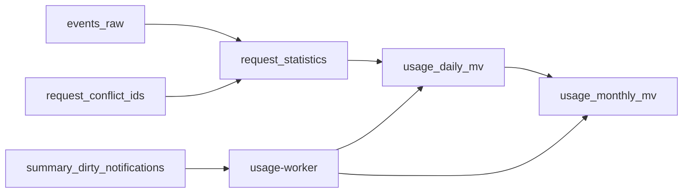

# 日/月用量物化视图

日/月统计使用 Doris 4.1.3 异步物化视图，独立 Go `usage-worker` 每天执行一轮。统计按 UTC 请求开始日期归属，当天只采集原始事件，日统计 T+1 生成。月视图嵌套读取日视图，当前月累计到昨日。统计 HTTP API 尚未实现。

## 数据流与维度

`request_statistics` 是请求级逻辑投影：日期加 logical_request_id 一行，先合并开始和结果事件、判断内容/身份/名称/开始时间及持久冲突，再进行分组。一个请求计一次，同内容重放不累计，冲突整请求排除。

两层物化视图保留 cluster_name、deployment_environment、customer_id、api_key_id、service_id、provider_id、model、usage_source 八个维度。服务、供应商、API Key 等报表从相同基础粒度再次 GROUP BY；不混存重复的总计行。

未知客户、服务或供应商保留 NULL。客户/API Key 报表要求对应 ID 已知；服务/供应商报表按已知服务/供应商 ID 查询，包含客户未知但归属服务已知的请求。名称保留于请求快照，不用最新名称覆盖历史，也不作为汇总键。

## 用量资格和指标

Observer 的 `usage_eligible` 不再依赖客户身份。观察完整、终态有效、输入输出用量已知且不存在质量异常时才能为 true；identity_invalid 只作为归属诊断，不能单独否决有效用量。下游仍需排除请求冲突，资格不表示收费。

历史事件按相同规则计算 `statistics_usage_eligible`：使用结果事件的 observation_status、terminal_observed、usage_status、输入输出和 anomaly_codes；只允许 invalid_model、identity_invalid 这两类非否决异常。原始 usage_eligible、event_json 和 payload_hash 保持原值，避免制造重放冲突。

日视图保存请求数、开始/结果/缺失结果数、有效/无效用量数、HTTP 状态计数、终态缺失数、输入输出及各 token 子项合计、各子项已知请求数。月视图对这些指标 SUM，不能用日分组行数作为请求数。

- request_count = usage_observed_request_count + usage_missing_request_count。
- request_count = eligible_usage_request_count + ineligible_usage_request_count。
- started_request_count <= request_count；各子项 known_requests <= eligible_usage_request_count。
- token 使用 DECIMAL(38,0)，先提升类型再相加；全未知保持 NULL，已知零保持 0。
- total_tokens 为有效输入加输出，不再次累加缓存、推理子项。

## 时间范围和生命周期

原始、日、月统计统一保留“前 12 个完整自然月＋当月”。例如 2026-10-28 保留起点为 2025-10-01，正常统计截止 2026-10-27。所有边界按 UTC，查询范围左闭右开。

明细继续按日分区，Doris 自动预建当天及未来两日；不再按固定 365 天自动删除。Worker 按月首边界清理过期分区。Doris 禁止在启用动态分区时手动删除，因此任务在清理单表期间暂停动态分区，退出时恢复自动创建；异常或崩溃后的下一轮也恢复该设置。冲突标记、通知及消费恢复凭据不随明细过期一起删除。

扩大保留范围不能恢复已删除数据。collection_start_date 必须是实际采集开始日期，不能由最早非空行或空分区推断。实际范围内缺失的源分区记为 GAP；不能创建空历史分区并报告零值。首个采集月份可以只有部分覆盖，并明确展示 coverage_start/coverage_end。

## 刷新和恢复

两层视图均 BUILD DEFERRED、REFRESH AUTO ON MANUAL、use_for_rewrite=false。定义不使用 CURRENT_DATE()，不启用 ON COMMIT 或 Doris 定时任务。Worker 只向显式的已结束日期分区提交刷新，月任务直接读取日物化视图。

正常执行优先昨日所在月份，再按时间处理历史通知和停机遗漏；回填模式按月顺序执行。本轮固定 UTC 今日，即使跨午夜也不扩大计算范围。当日和未来日期可以有空分区元数据，但不执行它们的计算。

日任务先持久保存精确通知集合，再提交刷新；SQL 提交成功不等于刷新完成。核对 Doris 任务 ID、手动触发类型、目标分区、SUCCESS 以及 CompletedPartitions 后，校验指标并记录日成功状态。只有成功任务捕获的通知得到确认，新通知留给下轮。

月任务要求采集范围内该月截至昨日的日覆盖完整，保存日成功版本集合，刷新后逐维度、逐指标与日合计对账。日成功后退出或月失败，下轮仍由日版本变化发现月刷新需求。日/月不提供跨分区原子发布保证。

[协调与任务恢复](doris-summary-coordination.md)给出运行入口、状态、并发和故障边界。[数据库对象与字段](doris-database-schema.md)提供字段字典。初始化仅创建当前统计对象；不再创建旧日/月汇总实体表或旧临时分区发布状态表。

## 验证边界

`make test` 验证契约和单元/竞态测试；`make summary-test` 使用独立 Doris 库验证日/月嵌套、历史资格、NULL/零、冲突撤回、空结果替换、自然月清理及任务恢复。`make local-test` 验证采集真实链路。生产资源、执行预算和 G0–G5 验收仍需在目标环境完成。
