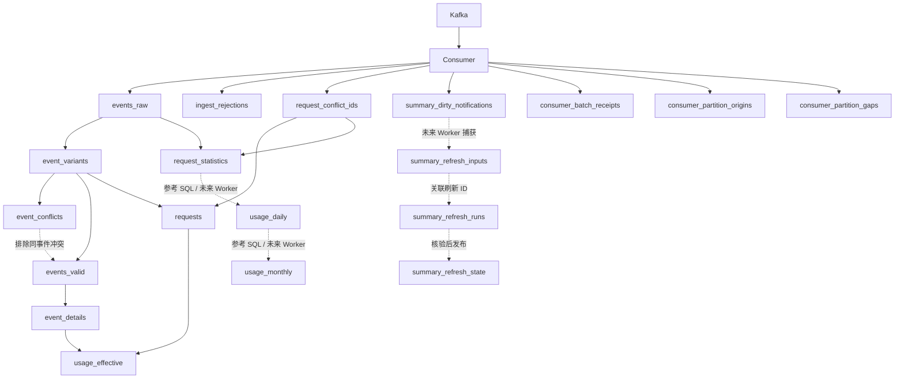

# Doris 数据库表与字段说明

本文描述当前唯一采集模型，面向开发、运维和数据使用者。实体表的类型、键、说明来自仓库 DDL；视图类型及可空性经 Doris 4.1.3 元数据核对。整数显示宽度和 DECIMALV3 名称归一化为 SQL 类型。

覆盖 12 张实体表、214 个实体字段，以及 7 个逻辑视图、318 个视图字段。当前本地 Consumer 写入 metering_development；旧 metering 及历史 Kubernetes 验证库不属于本次注释更新范围。

## 使用口径

- 一个逻辑请求最多包含 request_started、usage_observed 两类事件；查询调用量按 logical_request_id 统计，不能按事件行数统计。
- 原始用量 NULL 表示未知，0 表示已知零。输入/输出及缓存、推理子项不能重复相加。usage_eligible 表示统计候选，不表示收费资格。
- Observer 支持 HTTP/HTTPS 归属查询，环境仅接受 prd/stg/dev；ID 与服务、供应商和客户名称作为请求快照保存。空 URI 占位或查询失败侧为 NULL，不伪造归属。
- 观察取消后保留已完成的单侧归属，未返回侧在原查询截止时间标为 lookup_timeout；快照冻结后不接受迟到回写。
- 全部时间按 UTC。Unix 毫秒字段带 _ms；DATETIME(3) 是 UTC 审计时间。offset 仅在同一 topic/分区比较，first/last 包含，next 不包含。
- Unique Key 是 Doris 幂等键。下述关系是应用逻辑关联，没有声明数据库外键。协调表不是数据库锁，也不使 Kafka/Doris 成为分布式事务。
- usage-worker、统计 HTTP API 尚未实现。已有汇总 DDL 和合成 SQL 验证不代表生产发布状态、查询一致性或真实客户归属已经交付。

## 表与视图总览

| 名称 | 类型 | 作用 | 实现状态 |
| --- | --- | --- | --- |
| [events_raw](#events_raw) | 实体表 | 规范计量事件事实表；保留同事件不同内容的变体，支撑明细、重放与冲突核验 | 已实现 |
| [request_conflict_ids](#request_conflict_ids) | 实体表 | 请求级持久冲突标记表；证据过期后仍阻止冲突请求重新进入有效统计 | 已实现 |
| [ingest_rejections](#ingest_rejections) | 实体表 | Kafka 消息拒收诊断表；仅保存来源坐标、摘要及固定原因，不保存原始消息 | 已实现 |
| [usage_daily](#usage_daily) | 实体表 | 日用量汇总表；按客户、服务、供应商及部署维度保存统计，正式 Worker 尚未实现 | DDL 与参考 SQL 已验证；正式 Worker 尚未实现 |
| [usage_monthly](#usage_monthly) | 实体表 | 月用量汇总表；从日汇总生成独立保留的月统计，正式 Worker 尚未实现 | DDL 与参考 SQL 已验证；正式 Worker 尚未实现 |
| [summary_dirty_notifications](#summary_dirty_notifications) | 实体表 | 日期重算通知表；持久记录新增事件、冲突或修复影响的日期 | Consumer 通知已实现；Worker 消费待实现 |
| [consumer_batch_receipts](#consumer_batch_receipts) | 实体表 | 消费批次处理凭据表；证明入库、冲突维护和通知登记已确认可见 | 已实现 |
| [summary_refresh_inputs](#summary_refresh_inputs) | 实体表 | 汇总任务输入集合表；保存日任务捕获的精确通知，等待 Worker 实现 | 设计预留；Worker 尚未实现 |
| [summary_refresh_runs](#summary_refresh_runs) | 实体表 | 汇总任务执行审计表；保存阶段、输入与分区校验证据，等待 Worker 实现 | 设计预留；Worker 尚未实现 |
| [summary_refresh_state](#summary_refresh_state) | 实体表 | 统计期发布状态表；保存版本、覆盖及发布不确定状态，等待 Worker 实现 | 设计预留；Worker 与查询 API 尚未实现 |
| [consumer_partition_origins](#consumer_partition_origins) | 实体表 | 消费分区可信起点表；作为连续消费水位和恢复核验的基准 | 已实现 |
| [consumer_partition_gaps](#consumer_partition_gaps) | 实体表 | 消费分区缺口事实表；持久记录无法证明完整覆盖的 offset 区间 | 已实现 |
| [event_variants](#event_variants) | 逻辑视图 | 原始事件及内容变体的统一查询入口 | 已实现 |
| [event_conflicts](#event_conflicts) | 逻辑视图 | 同一逻辑请求及事件 ID 的内容冲突诊断 | 已实现 |
| [events_valid](#events_valid) | 逻辑视图 | 排除同事件内容冲突后的事件投影 | 已实现 |
| [event_details](#event_details) | 逻辑视图 | 事件业务字段明细投影 | 已实现 |
| [requests](#requests) | 逻辑视图 | 跨在线日期合并开始与结果事件的请求级诊断投影 | 已实现 |
| [usage_effective](#usage_effective) | 逻辑视图 | 无请求冲突的有效统计候选用量明细 | 已实现 |
| [request_statistics](#request_statistics) | 逻辑视图 | 按 UTC 请求日期组织的日汇总输入投影 | 已实现；正式 Worker 尚未实现 |

## 数据流与逻辑关联



消费屏障顺序为：原始/拒收记录可见 → 冲突维护可见 → 日期通知可见 → 批次凭据可见 → Kafka offset 提交。汇总是否完成由未来 Worker 的发布状态确认，Consumer 不等待汇总。

## events_raw

**作用：** 规范计量事件事实表；保留同事件不同内容的变体，支撑明细、重放与冲突核验。

开始事件与结果事件是同一请求的两个事实，不能计为两次调用。Unique Key 使同内容重放幂等，payload_hash 使不同内容保留。

| 属性 | 说明 |
| --- | --- |
| 类型 | 实体表，Unique Key Merge-on-Write |
| 写入者 | Consumer |
| 读取者 | 冲突核验、明细视图、统计投影 |
| 数据粒度 | 一条规范事件内容变体 |
| 唯一键 | request_date, logical_request_id, event_id, payload_hash |
| 分区、分桶及保留 | UTC 请求日期动态分区，保留当天及前 364 天；按请求 ID 分 16 桶 |
| 实现状态 | 已实现 |
| 定义来源 | [001_init.sql](../migrations/doris/metering/001_init.sql) |

| 字段 | 类型 | 可空 | 默认值 | 键属性 | 说明 |
| --- | --- | --- | --- | --- | --- |
| request_date | DATE | 否 | 未声明 | 唯一键 | UTC 请求日期，由 request_started_at_ms 换算，不由事件到达时间或 UUID 推导 |
| logical_request_id | VARCHAR(36) | 否 | 未声明 | 唯一键 | Observer 为一次观察生成的规范 UUIDv4；请求级主标识及 Kafka key |
| event_id | VARCHAR(42) | 否 | 未声明 | 唯一键 | 事件标识，逻辑请求 ID 加 :start 或 :usage；同 ID 不同内容属于冲突 |
| payload_hash | CHAR(64) | 否 | 未声明 | 唯一键 | 当前规范事件 JSON 的 SHA-256；与事件 ID 共同保留内容变体并实现幂等 |
| schema_version | INT | 否 | 未声明 | — | 唯一事件契约版本，当前为 1；未知版本由 Consumer 暂停对应分区 |
| event_type | VARCHAR(32) | 否 | 未声明 | — | 事件类型：request_started 或 usage_observed；两者合计仍是一次请求 |
| x_request_id | VARCHAR(128) | 是 | 未声明 | — | 网关可见的 X-Request-Id，仅辅助关联；可空、可重复，不用于授权或去重 |
| observation_id | VARCHAR(36) | 否 | 未声明 | — | 观察标识，当前与 logical_request_id 相同 |
| observation_scope | VARCHAR(32) | 否 | 未声明 | — | 观察范围，当前固定 gateway_response，不代表所有隐藏的上游尝试 |
| producer_id | VARCHAR(128) | 否 | 未声明 | — | 生成此事件的 Observer 实例标识，部署时使用实际 Pod UID |
| gateway_instance_id | VARCHAR(128) | 否 | 未声明 | — | 观察请求的网关实例标识，部署时使用实际 Pod UID |
| config_version | VARCHAR(128) | 否 | 未声明 | — | 请求开始时冻结的采集配置版本，需在 Observer 和 Consumer 登记 |
| adapter_id | VARCHAR(64) | 否 | 未声明 | — | 响应协议适配器，当前为 chat_completions_v1 |
| route_name | VARCHAR(128) | 否 | 未声明 | — | 实际 Envoy HTTP 路由名，不可读时为 unknown；仅诊断，不代表 VirtualService 或归属 |
| request_host | VARCHAR(253) | 是 | 未声明 | — | 规范入口 DNS 域名；转小写并去端口及末尾根点，非法输入为 NULL |
| cluster_name | VARCHAR(128) | 否 | 未声明 | — | Observer 配置固定的集群名称，业务请求不能覆盖 |
| deployment_environment | VARCHAR(16) | 否 | 未声明 | — | Observer 固定部署环境：prd、stg 或 dev |
| mapping_status | VARCHAR(32) | 否 | 未声明 | — | 服务解析状态：mapped、unknown_host、invalid_host、lookup_not_implemented、lookup_timeout、lookup_unavailable、lookup_invalid_response、lookup_overloaded、lookup_rate_limited；空 URI 为未实现占位，配置 HTTP/HTTPS 可解析 |
| mapping_version | CHAR(64) | 是 | 未声明 | — | 成功服务解析快照的规范 SHA-256，绑定 Host、集群、环境及服务和供应商；未知为 NULL |
| customer_mapping_status | VARCHAR(32) | 否 | 未声明 | — | 客户解析状态：mapped、unknown_api_key、invalid_api_key、lookup_not_implemented、lookup_timeout、lookup_unavailable、lookup_invalid_response、lookup_overloaded、lookup_rate_limited；空 URI 为未实现占位，配置 HTTP/HTTPS 可解析 |
| customer_mapping_version | CHAR(64) | 是 | 未声明 | — | 成功客户解析快照的规范 SHA-256，绑定部署上下文、API Key ID 和客户；未知为 NULL |
| service_id | VARCHAR(128) | 是 | 未声明 | — | 服务接口返回的服务 ID；未实现或失败为 NULL，不使用默认服务补值 |
| service_name | VARCHAR(512) | 是 | 未声明 | — | 请求发生时的服务名称快照；解析未知时为 NULL，不用最新名称覆盖历史 |
| provider_name | VARCHAR(512) | 是 | 未声明 | — | 请求发生时的供应商名称快照；解析未知时为 NULL，不用最新名称覆盖历史 |
| customer_name | VARCHAR(512) | 是 | 未声明 | — | 请求发生时的客户名称快照；解析未知时为 NULL，不用最新名称覆盖历史 |
| api_key_id | VARCHAR(128) | 是 | 未声明 | — | 客户接口返回的稳定 API Key ID；未知为 NULL，绝不是原始 Bearer token |
| customer_id | VARCHAR(128) | 是 | 未声明 | — | 与 api_key_id 同次成功解析得到的客户 ID；未知为 NULL，不采信客户端自报 ID |
| provider_id | VARCHAR(128) | 是 | 未声明 | — | 服务接口返回的服务所属供应商 ID；未知为 NULL，不代表隐藏的实际执行方 |
| identity_status | VARCHAR(16) | 否 | 未声明 | — | 客户归属状态：known 或 invalid；仅完整客户解析成功为 known，不表示鉴权判定 |
| identity_hash | CHAR(64) | 否 | 未声明 | — | 固定十五项归属与部署快照元组的规范 SHA-256，不含原始密钥或诊断路由 |
| request_started_at_ms | BIGINT | 否 | 未声明 | — | 网关观察到请求头的 Unix 毫秒时间；决定 UTC 统计日期 |
| observation_ended_at_ms | BIGINT | 是 | 未声明 | — | Observer 结束观察的 Unix 毫秒时间；start 为 NULL，不等于业务结束时间 |
| request_finished_at_ms | BIGINT | 是 | 未声明 | — | 有效网关 End 提供的请求结束 Unix 毫秒时间；未收到有效 End 时为 NULL |
| event_created_at_ms | BIGINT | 否 | 未声明 | — | Observer 创建此事件的 Unix 毫秒时间，不作为请求统计日期 |
| request_model | VARCHAR(1024) | 是 | 未声明 | — | 请求正文中可靠提取的模型名或 ID；未取得或非法时为 NULL |
| response_model | VARCHAR(1024) | 是 | 未声明 | — | 响应上报的模型名或 ID，可能不同于请求模型；未取得或非法时为 NULL |
| http_status | SMALLINT | 是 | 未声明 | — | 网关可见的 HTTP 响应状态码；未知或开始事件为 NULL |
| upstream_attempt_count | INT | 是 | 未声明 | — | 网关可靠取得的上游尝试次数；未知为 NULL，不据此推算隐藏消耗 |
| response_flags | STRING | 是 | 未声明 | — | 白名单内的网关响应标志；未可靠取得或未登记时为 NULL |
| response_code_details | STRING | 是 | 未声明 | — | 白名单内的网关响应诊断码；不保存任意错误文本，未知为 NULL |
| business_outcome | VARCHAR(32) | 是 | 未声明 | — | 有没有观察到响应完整结束？response_complete、stream_incomplete 或 unknown；start 为 NULL |
| terminal_observed | TINYINT | 否 | 未声明 | — | 是否收到有效网关 End：1 是、0 否；为 0 时请求结束时间必须为 NULL |
| observation_status | VARCHAR(16) | 是 | 未声明 | — | 观察完整度：complete、partial 或 unknown；start 为 NULL，不等于 HTTP 成功 |
| usage_status | VARCHAR(16) | 否 | 未声明 | — | token 数字有没有拿到，是否齐全、是否矛盾？known、partial、unknown、conflict；start 为 not_applicable |
| usage_eligible | TINYINT | 否 | 未声明 | — | 这条用量是否符合有效统计条件，可以作为统计候选？1 是、0 否；不表示可收费 |
| input_tokens | BIGINT | 是 | 未声明 | — | 输入 token 总量；NULL 表示未知，0 表示服务报告的有效零值；子项不与父项重复相加 |
| input_tokens_source | VARCHAR(16) | 是 | 未声明 | — | 输入 token 总量的来源：reported 或 unknown；开始事件为 NULL，不实现估算 |
| output_tokens | BIGINT | 是 | 未声明 | — | 输出 token 总量；NULL 表示未知，0 表示服务报告的有效零值；子项不与父项重复相加 |
| output_tokens_source | VARCHAR(16) | 是 | 未声明 | — | 输出 token 总量的来源：reported 或 unknown；开始事件为 NULL，不实现估算 |
| cached_read_tokens | BIGINT | 是 | 未声明 | — | 输入中的缓存读取 token 子项；NULL 表示未知，0 表示服务报告的有效零值；子项不与父项重复相加 |
| cached_read_tokens_source | VARCHAR(16) | 是 | 未声明 | — | 输入中的缓存读取 token 子项的来源：reported 或 unknown；开始事件为 NULL，不实现估算 |
| cached_write_tokens | BIGINT | 是 | 未声明 | — | 输入中的缓存写入 token 子项；NULL 表示未知，0 表示服务报告的有效零值；子项不与父项重复相加 |
| cached_write_tokens_source | VARCHAR(16) | 是 | 未声明 | — | 输入中的缓存写入 token 子项的来源：reported 或 unknown；开始事件为 NULL，不实现估算 |
| reasoning_tokens | BIGINT | 是 | 未声明 | — | 输出中的推理 token 子项；NULL 表示未知，0 表示服务报告的有效零值；子项不与父项重复相加 |
| reasoning_tokens_source | VARCHAR(16) | 是 | 未声明 | — | 输出中的推理 token 子项的来源：reported 或 unknown；开始事件为 NULL，不实现估算 |
| reported_total_tokens | BIGINT | 是 | 未声明 | — | 服务单独上报的总 token 数；NULL 表示未知，0 表示服务报告的有效零值；子项不与父项重复相加 |
| reported_total_tokens_source | VARCHAR(16) | 是 | 未声明 | — | 服务单独上报的总 token 数的来源：reported 或 unknown；开始事件为 NULL，不实现估算 |
| raw_usage_json | STRING | 否 | 未声明 | — | 仅含白名单数字用量字段的规范 JSON，不含正文或密钥；最多 4096 字节 |
| raw_usage_truncated | TINYINT | 否 | 未声明 | — | 原始用量 JSON 是否因界限截断：1 是、0 否 |
| anomaly_codes | ARRAY<VARCHAR(64)> | 否 | 未声明 | — | 固定、排序且去重的异常码数组；不包含任意错误文本 |
| event_json | STRING | 否 | 未声明 | — | 通过契约校验的规范事件 JSON，用于重放和冲突核验，不含正文或原始密钥 |
| kafka_topic | VARCHAR(249) | 否 | 未声明 | — | 事件或处理证据所属的 Kafka topic 名称 |
| kafka_partition | INT | 否 | 未声明 | — | Kafka 分区编号，offset 只在同一 topic 和分区内比较 |
| kafka_offset | BIGINT | 否 | 未声明 | — | 消息在 Kafka 分区内的 offset，0 是有效位置 |
| ingested_at | DATETIME(3) | 否 | 未声明 | — | Consumer 冻结批次的入库审计时间，UTC，不作为请求统计日期 |

## request_conflict_ids

**作用：** 请求级持久冲突标记表；证据过期后仍阻止冲突请求重新进入有效统计。

原始冲突证据过期后仍隔离请求，防止剩余变体重新进入有效统计。

| 属性 | 说明 |
| --- | --- |
| 类型 | 实体表，Unique Key Merge-on-Write |
| 写入者 | Consumer 批次处理及补偿巡检 |
| 读取者 | requests、request_statistics |
| 数据粒度 | 一个存在冲突的逻辑请求 |
| 唯一键 | logical_request_id |
| 分区、分桶及保留 | 按请求 ID 分 16 桶；长期保留，当前不自动清理 |
| 实现状态 | 已实现 |
| 定义来源 | [001_init.sql](../migrations/doris/metering/001_init.sql) |

| 字段 | 类型 | 可空 | 默认值 | 键属性 | 说明 |
| --- | --- | --- | --- | --- | --- |
| logical_request_id | VARCHAR(36) | 否 | 未声明 | 唯一键 | Observer 为一次观察生成的规范 UUIDv4；请求级主标识及 Kafka key |
| detected_at | DATETIME(3) | 否 | 未声明 | — | Consumer 发现冲突或消费缺口的 UTC 时间 |

## ingest_rejections

**作用：** Kafka 消息拒收诊断表；仅保存来源坐标、摘要及固定原因，不保存原始消息。

永久非法消息确认诊断写入后才能越过；未知 schema 会暂停分区，不按普通拒收跳过。原始消息不落库。

| 属性 | 说明 |
| --- | --- |
| 类型 | 实体表，Unique Key Merge-on-Write |
| 写入者 | Consumer |
| 读取者 | 运维诊断及消费核验 |
| 数据粒度 | 一个 Kafka 坐标和原始内容摘要 |
| 唯一键 | kafka_record_date, kafka_topic, kafka_partition, kafka_offset, payload_hash |
| 分区、分桶及保留 | UTC Kafka 消息日期动态分区，保留 365 个日期；按 topic/分区分 8 桶 |
| 实现状态 | 已实现 |
| 定义来源 | [001_init.sql](../migrations/doris/metering/001_init.sql) |

| 字段 | 类型 | 可空 | 默认值 | 键属性 | 说明 |
| --- | --- | --- | --- | --- | --- |
| kafka_record_date | DATE | 否 | 未声明 | 唯一键 | Kafka 消息时间戳对应的 UTC 日期，用于拒收诊断分区及保留 |
| kafka_topic | VARCHAR(249) | 否 | 未声明 | 唯一键 | 事件或处理证据所属的 Kafka topic 名称 |
| kafka_partition | INT | 否 | 未声明 | 唯一键 | Kafka 分区编号，offset 只在同一 topic 和分区内比较 |
| kafka_offset | BIGINT | 否 | 未声明 | 唯一键 | 消息在 Kafka 分区内的 offset，0 是有效位置 |
| payload_hash | CHAR(64) | 否 | 未声明 | 唯一键 | 被拒收的原始 Kafka value 字节的 SHA-256，仅保存摘要而不保存原始消息 |
| reason | VARCHAR(64) | 否 | 未声明 | — | 固定原因码，不包含原始消息、密钥或任意错误文本 |
| kafka_record_at | DATETIME(3) | 否 | 未声明 | — | Kafka 消息时间戳对应的 UTC 时间，不替代请求开始时间 |
| ingested_at | DATETIME(3) | 否 | 未声明 | — | Consumer 冻结批次的入库审计时间，UTC，不作为请求统计日期 |

## usage_daily

**作用：** 日用量汇总表；按客户、服务、供应商及部署维度保存统计，正式 Worker 尚未实现。

来源为 request_statistics。未知客户排除，已知客户的未知服务/供应商仅在汇总键使用空串桶。只累加有效统计候选用量，NULL 不补零。

| 属性 | 说明 |
| --- | --- |
| 类型 | 实体表，Unique Key Merge-on-Write |
| 写入者 | 未来 usage-worker |
| 读取者 | 未来统计查询及月汇总任务 |
| 数据粒度 | UTC 日期加八个统计维度 |
| 唯一键 | stat_date, cluster_name, deployment_environment, customer_id, provider_id, api_key_id, service_id, model, usage_source |
| 分区、分桶及保留 | 普通 RANGE 日分区，设计保留 730 个 UTC 日期；按客户/API Key 分 8 桶 |
| 实现状态 | DDL 与参考 SQL 已验证；正式 Worker 尚未实现 |
| 定义来源 | [002_usage_summaries.sql](../migrations/doris/metering/002_usage_summaries.sql) |

| 字段 | 类型 | 可空 | 默认值 | 键属性 | 说明 |
| --- | --- | --- | --- | --- | --- |
| stat_date | DATE | 否 | 未声明 | 唯一键 | 日统计或重算通知对应的 UTC 请求日期 |
| cluster_name | VARCHAR(128) | 否 | 未声明 | 唯一键 | Observer 配置固定的集群名称，业务请求不能覆盖 |
| deployment_environment | VARCHAR(16) | 否 | 未声明 | 唯一键 | Observer 固定部署环境：prd、stg 或 dev |
| customer_id | VARCHAR(128) | 否 | 未声明 | 唯一键 | 已成功解析的客户统计维度；未知客户不进入客户汇总，不创建空客户桶 |
| provider_id | VARCHAR(128) | 否 | 未声明 | 唯一键 | 供应商统计维度；空串仅代表未知汇总桶，不回写原始事件归属 |
| api_key_id | VARCHAR(128) | 否 | 未声明 | 唯一键 | 已成功解析的稳定 API Key 统计维度，不是原始密钥，必须与客户归属一起已知 |
| service_id | VARCHAR(128) | 否 | 未声明 | 唯一键 | 服务统计维度；空串仅代表未知汇总桶，不回写原始事件归属 |
| model | VARCHAR(1024) | 否 | 未声明 | 唯一键 | 统计模型维度，优先响应模型、其次请求模型；两者均缺失用空串表示未知 |
| usage_source | VARCHAR(32) | 否 | 未声明 | 唯一键 | 统计用量来源分组：reported、unknown、missing、mixed；estimated_model 和 estimated_generic 为预留估算分类 |
| request_count | BIGINT | 否 | 未声明 | — | 该分组无冲突且客户归属已知的已观察逻辑请求数，包含用量不完整请求 |
| started_request_count | BIGINT | 否 | 未声明 | — | 该分组中恰有一条 request_started 事件的逻辑请求数 |
| usage_observed_request_count | BIGINT | 否 | 未声明 | — | 该分组中恰有一条 usage_observed 事件的逻辑请求数 |
| usage_missing_request_count | BIGINT | 否 | 未声明 | — | 该分组中未观察到 usage_observed 事件的逻辑请求数 |
| eligible_usage_request_count | BIGINT | 否 | 未声明 | — | 该分组中有唯一结果、usage_eligible=1 且输入输出用量均非 NULL 的请求数 |
| ineligible_usage_request_count | BIGINT | 否 | 未声明 | — | 该分组中未满足有效用量统计条件的请求数，与有效请求数合计为 request_count |
| http_2xx_request_count | BIGINT | 否 | 未声明 | — | 该分组中网关可见 HTTP 状态为 200 至 299 的请求数 |
| http_error_request_count | BIGINT | 否 | 未声明 | — | 该分组中网关可见 HTTP 状态大于等于 400 的请求数 |
| terminal_missing_request_count | BIGINT | 否 | 未声明 | — | 该分组中 terminal_observed 为 0 或 NULL 的请求数 |
| input_tokens | DECIMAL(38, 0) | 是 | 未声明 | — | 有效统计候选的输入 token 总量之和；无已知贡献保持 NULL，已知零保持 0 |
| output_tokens | DECIMAL(38, 0) | 是 | 未声明 | — | 有效统计候选的输出 token 总量之和；无已知贡献保持 NULL，已知零保持 0 |
| total_tokens | DECIMAL(38, 0) | 是 | 未声明 | — | 有效统计候选的输入加输出 token 总量之和；全部未知保持 NULL，不包含子项重复相加 |
| cached_read_tokens | DECIMAL(38, 0) | 是 | 未声明 | — | 有效统计候选的输入中的缓存读取 token 子项之和；无已知贡献保持 NULL，已知零保持 0 |
| cached_write_tokens | DECIMAL(38, 0) | 是 | 未声明 | — | 有效统计候选的输入中的缓存写入 token 子项之和；无已知贡献保持 NULL，已知零保持 0 |
| reasoning_tokens | DECIMAL(38, 0) | 是 | 未声明 | — | 有效统计候选的输出中的推理 token 子项之和；无已知贡献保持 NULL，已知零保持 0 |
| reported_total_tokens | DECIMAL(38, 0) | 是 | 未声明 | — | 有效统计候选的服务单独上报的总 token 数之和；无已知贡献保持 NULL，已知零保持 0 |
| cached_read_known_requests | BIGINT | 否 | 未声明 | — | 该分组有效统计候选中 输入中的缓存读取 token 子项非 NULL 的请求数 |
| cached_write_known_requests | BIGINT | 否 | 未声明 | — | 该分组有效统计候选中 输入中的缓存写入 token 子项非 NULL 的请求数 |
| reasoning_known_requests | BIGINT | 否 | 未声明 | — | 该分组有效统计候选中 输出中的推理 token 子项非 NULL 的请求数 |
| reported_total_known_requests | BIGINT | 否 | 未声明 | — | 该分组有效统计候选中 服务单独上报的总 token 数非 NULL 的请求数 |
| refresh_id | VARCHAR(36) | 否 | 未声明 | — | 生成本次汇总结果或执行记录的刷新 UUID；Worker 发布版本关联标识 |
| source_watermark | CHAR(64) | 否 | 未声明 | — | 本次汇总输入及连续分区水位向量的规范 SHA-256，不是全局 Kafka 截止 offset |
| refreshed_at | DATETIME(3) | 否 | 未声明 | — | 本次汇总刷新或成功发布的 UTC 时间；尚未成功发布时状态表可为 NULL |

## usage_monthly

**作用：** 月用量汇总表；从日汇总生成独立保留的月统计，正式 Worker 尚未实现。

来源为已确认的 usage_daily 版本；月统计独立保留，原始或日数据过期不自动删除月统计。跨日/月发布一致性待 Worker 验收。

| 属性 | 说明 |
| --- | --- |
| 类型 | 实体表，Unique Key Merge-on-Write |
| 写入者 | 未来 usage-worker |
| 读取者 | 未来月统计查询 |
| 数据粒度 | UTC 自然月加八个统计维度 |
| 唯一键 | stat_month, cluster_name, deployment_environment, customer_id, provider_id, api_key_id, service_id, model, usage_source |
| 分区、分桶及保留 | 普通 RANGE 月分区，设计保留 24 个 UTC 自然月；按客户/API Key 分 8 桶 |
| 实现状态 | DDL 与参考 SQL 已验证；正式 Worker 尚未实现 |
| 定义来源 | [002_usage_summaries.sql](../migrations/doris/metering/002_usage_summaries.sql) |

| 字段 | 类型 | 可空 | 默认值 | 键属性 | 说明 |
| --- | --- | --- | --- | --- | --- |
| stat_month | DATE | 否 | 未声明 | 唯一键 | 月统计对应的 UTC 自然月首日 |
| cluster_name | VARCHAR(128) | 否 | 未声明 | 唯一键 | Observer 配置固定的集群名称，业务请求不能覆盖 |
| deployment_environment | VARCHAR(16) | 否 | 未声明 | 唯一键 | Observer 固定部署环境：prd、stg 或 dev |
| customer_id | VARCHAR(128) | 否 | 未声明 | 唯一键 | 已成功解析的客户统计维度；未知客户不进入客户汇总，不创建空客户桶 |
| provider_id | VARCHAR(128) | 否 | 未声明 | 唯一键 | 供应商统计维度；空串仅代表未知汇总桶，不回写原始事件归属 |
| api_key_id | VARCHAR(128) | 否 | 未声明 | 唯一键 | 已成功解析的稳定 API Key 统计维度，不是原始密钥，必须与客户归属一起已知 |
| service_id | VARCHAR(128) | 否 | 未声明 | 唯一键 | 服务统计维度；空串仅代表未知汇总桶，不回写原始事件归属 |
| model | VARCHAR(1024) | 否 | 未声明 | 唯一键 | 统计模型维度，优先响应模型、其次请求模型；两者均缺失用空串表示未知 |
| usage_source | VARCHAR(32) | 否 | 未声明 | 唯一键 | 统计用量来源分组：reported、unknown、missing、mixed；estimated_model 和 estimated_generic 为预留估算分类 |
| request_count | BIGINT | 否 | 未声明 | — | 同维度已确认日统计的月合计：该分组无冲突且客户归属已知的已观察逻辑请求数，包含用量不完整请求 |
| started_request_count | BIGINT | 否 | 未声明 | — | 同维度已确认日统计的月合计：该分组中恰有一条 request_started 事件的逻辑请求数 |
| usage_observed_request_count | BIGINT | 否 | 未声明 | — | 同维度已确认日统计的月合计：该分组中恰有一条 usage_observed 事件的逻辑请求数 |
| usage_missing_request_count | BIGINT | 否 | 未声明 | — | 同维度已确认日统计的月合计：该分组中未观察到 usage_observed 事件的逻辑请求数 |
| eligible_usage_request_count | BIGINT | 否 | 未声明 | — | 同维度已确认日统计的月合计：该分组中有唯一结果、usage_eligible=1 且输入输出用量均非 NULL 的请求数 |
| ineligible_usage_request_count | BIGINT | 否 | 未声明 | — | 同维度已确认日统计的月合计：该分组中未满足有效用量统计条件的请求数，与有效请求数合计为 request_count |
| http_2xx_request_count | BIGINT | 否 | 未声明 | — | 同维度已确认日统计的月合计：该分组中网关可见 HTTP 状态为 200 至 299 的请求数 |
| http_error_request_count | BIGINT | 否 | 未声明 | — | 同维度已确认日统计的月合计：该分组中网关可见 HTTP 状态大于等于 400 的请求数 |
| terminal_missing_request_count | BIGINT | 否 | 未声明 | — | 同维度已确认日统计的月合计：该分组中 terminal_observed 为 0 或 NULL 的请求数 |
| input_tokens | DECIMAL(38, 0) | 是 | 未声明 | — | 同维度已确认日统计的月合计；有效统计候选的输入 token 总量之和；无已知贡献保持 NULL，已知零保持 0 |
| output_tokens | DECIMAL(38, 0) | 是 | 未声明 | — | 同维度已确认日统计的月合计；有效统计候选的输出 token 总量之和；无已知贡献保持 NULL，已知零保持 0 |
| total_tokens | DECIMAL(38, 0) | 是 | 未声明 | — | 同维度已确认日统计的月合计；有效统计候选的输入加输出 token 总量之和；全部未知保持 NULL，不包含子项重复相加 |
| cached_read_tokens | DECIMAL(38, 0) | 是 | 未声明 | — | 同维度已确认日统计的月合计；有效统计候选的输入中的缓存读取 token 子项之和；无已知贡献保持 NULL，已知零保持 0 |
| cached_write_tokens | DECIMAL(38, 0) | 是 | 未声明 | — | 同维度已确认日统计的月合计；有效统计候选的输入中的缓存写入 token 子项之和；无已知贡献保持 NULL，已知零保持 0 |
| reasoning_tokens | DECIMAL(38, 0) | 是 | 未声明 | — | 同维度已确认日统计的月合计；有效统计候选的输出中的推理 token 子项之和；无已知贡献保持 NULL，已知零保持 0 |
| reported_total_tokens | DECIMAL(38, 0) | 是 | 未声明 | — | 同维度已确认日统计的月合计；有效统计候选的服务单独上报的总 token 数之和；无已知贡献保持 NULL，已知零保持 0 |
| cached_read_known_requests | BIGINT | 否 | 未声明 | — | 同维度已确认日统计的月合计：该分组有效统计候选中 输入中的缓存读取 token 子项非 NULL 的请求数 |
| cached_write_known_requests | BIGINT | 否 | 未声明 | — | 同维度已确认日统计的月合计：该分组有效统计候选中 输入中的缓存写入 token 子项非 NULL 的请求数 |
| reasoning_known_requests | BIGINT | 否 | 未声明 | — | 同维度已确认日统计的月合计：该分组有效统计候选中 输出中的推理 token 子项非 NULL 的请求数 |
| reported_total_known_requests | BIGINT | 否 | 未声明 | — | 同维度已确认日统计的月合计：该分组有效统计候选中 服务单独上报的总 token 数非 NULL 的请求数 |
| refresh_id | VARCHAR(36) | 否 | 未声明 | — | 生成本次汇总结果或执行记录的刷新 UUID；Worker 发布版本关联标识 |
| source_watermark | CHAR(64) | 否 | 未声明 | — | 本次汇总输入及连续分区水位向量的规范 SHA-256，不是全局 Kafka 截止 offset |
| refreshed_at | DATETIME(3) | 否 | 未声明 | — | 本次汇总刷新或成功发布的 UTC 时间；尚未成功发布时状态表可为 NULL |

## summary_dirty_notifications

**作用：** 日期重算通知表；持久记录新增事件、冲突或修复影响的日期。

新增事件、冲突、初始化或修复触发重算。通知不是用量增量，也不是已消费布尔位；Worker 仅确认成功任务捕获的通知集合。

| 属性 | 说明 |
| --- | --- |
| 类型 | 实体表，Unique Key Merge-on-Write |
| 写入者 | Consumer；未来初始化任务 |
| 读取者 | 未来 usage-worker |
| 数据粒度 | 某日期的一条幂等重算通知 |
| 唯一键 | stat_date, notification_id |
| 分区、分桶及保留 | 按日期/通知 ID 分 4 桶；独立于原始分区保留，当前不自动清理 |
| 实现状态 | Consumer 通知已实现；Worker 消费待实现 |
| 定义来源 | [004_summary_coordination.sql](../migrations/doris/metering/004_summary_coordination.sql) |

| 字段 | 类型 | 可空 | 默认值 | 键属性 | 说明 |
| --- | --- | --- | --- | --- | --- |
| stat_date | DATE | 否 | 未声明 | 唯一键 | 日统计或重算通知对应的 UTC 请求日期 |
| notification_id | CHAR(64) | 否 | 未声明 | 唯一键 | 版本化日期、原因、来源及证据元组的规范 SHA-256，实现重算通知幂等 |
| reason | VARCHAR(32) | 否 | 未声明 | — | 日期通知原因：INGEST、CONFLICT、INITIALIZE 或 REPAIR，不使用任意错误文本 |
| source_id | VARCHAR(512) | 否 | 未声明 | — | 通知来源标识；INGEST 为冻结批次 batch_id，其他原因按各自稳定来源定义 |
| evidence_hash | CHAR(64) | 否 | 未声明 | — | 触发本日期通知的事件或冲突证据集合的规范 SHA-256 |
| kafka_topic | VARCHAR(249) | 是 | 未声明 | — | 事件或处理证据所属的 Kafka topic 名称 |
| kafka_partition | INT | 是 | 未声明 | — | Kafka 分区编号，offset 只在同一 topic 和分区内比较 |
| first_offset | BIGINT | 是 | 未声明 | — | 所记录 Kafka 分区区间的起始 offset，包含该位置 |
| last_offset | BIGINT | 是 | 未声明 | — | 所记录 Kafka 分区批次的最后 offset，包含该位置 |
| created_at | DATETIME(3) | 否 | 未声明 | — | 本条恢复事实或通知的 UTC 创建审计时间，不参与稳定标识生成 |

## consumer_batch_receipts

**作用：** 消费批次处理凭据表；证明入库、冲突维护和通知登记已确认可见。

原始/拒收、冲突、日期通知和本凭据全部确认可见后才提交 Kafka offset。凭据可能领先于提交，MAX(next_offset) 不能证明连续覆盖。

| 属性 | 说明 |
| --- | --- |
| 类型 | 实体表，Unique Key Merge-on-Write |
| 写入者 | 拥有对应分区的 Consumer |
| 读取者 | Consumer 恢复、水位巡检；未来汇总覆盖核验 |
| 数据粒度 | 一个冻结 Kafka 批次及其通知集合凭据 |
| 唯一键 | kafka_topic, kafka_partition, first_offset, last_offset, batch_id |
| 分区、分桶及保留 | 按 topic/分区分 4 桶；当前不自动清理 |
| 实现状态 | 已实现 |
| 定义来源 | [004_summary_coordination.sql](../migrations/doris/metering/004_summary_coordination.sql) |

| 字段 | 类型 | 可空 | 默认值 | 键属性 | 说明 |
| --- | --- | --- | --- | --- | --- |
| kafka_topic | VARCHAR(249) | 否 | 未声明 | 唯一键 | 事件或处理证据所属的 Kafka topic 名称 |
| kafka_partition | INT | 否 | 未声明 | 唯一键 | Kafka 分区编号，offset 只在同一 topic 和分区内比较 |
| first_offset | BIGINT | 否 | 未声明 | 唯一键 | 所记录 Kafka 分区区间的起始 offset，包含该位置 |
| last_offset | BIGINT | 否 | 未声明 | 唯一键 | 所记录 Kafka 分区批次的最后 offset，包含该位置 |
| batch_id | CHAR(64) | 否 | 未声明 | 唯一键 | 冻结 Kafka 坐标范围及按 offset 排序的消息摘要和校验分类元组的规范 SHA-256 |
| next_offset | BIGINT | 否 | 未声明 | — | 本批最后 offset 加 1；凭据确认可领先于 Kafka 提交，不能直接当连续已提交水位 |
| notification_count | BIGINT | 否 | 未声明 | — | 该批次实际登记并确认可见的日期通知集合大小，可以为 0 |
| notification_digest | CHAR(64) | 否 | 未声明 | — | 该批次已确认通知集合按日期和通知 ID 排序后的规范 SHA-256 |
| confirmed_at | DATETIME(3) | 否 | 未声明 | — | 批次冻结时记录的 UTC 审计时间，重试沿用；不代表写入确认完成或 Kafka offset 提交的时间 |

## summary_refresh_inputs

**作用：** 汇总任务输入集合表；保存日任务捕获的精确通知，等待 Worker 实现。

关联 summary_dirty_notifications 与 summary_refresh_runs。只有已成功发布任务的输入才能被视为处理完成；月任务日版本向量保存在 runs/state。

| 属性 | 说明 |
| --- | --- |
| 类型 | 实体表，Unique Key Merge-on-Write |
| 写入者 | 未来 usage-worker |
| 读取者 | 未来 Worker 的通知确认及恢复 |
| 数据粒度 | 一次日任务捕获的一条日期通知 |
| 唯一键 | period_type, period_start, refresh_id, notification_id |
| 分区、分桶及保留 | 按统计期分 4 桶；独立保留，当前不自动清理 |
| 实现状态 | 设计预留；Worker 尚未实现 |
| 定义来源 | [004_summary_coordination.sql](../migrations/doris/metering/004_summary_coordination.sql) |

| 字段 | 类型 | 可空 | 默认值 | 键属性 | 说明 |
| --- | --- | --- | --- | --- | --- |
| period_type | VARCHAR(8) | 否 | 未声明 | 唯一键 | 统计期类型，设计预留 DAY 或 MONTH，结构由未来 Worker 校验 |
| period_start | DATE | 否 | 未声明 | 唯一键 | 统计期 UTC 起始日期；DAY 为当天，MONTH 为自然月首，等待 Worker 实现 |
| refresh_id | VARCHAR(36) | 否 | 未声明 | 唯一键 | 生成本次汇总结果或执行记录的刷新 UUID；Worker 发布版本关联标识 |
| notification_id | CHAR(64) | 否 | 未声明 | 唯一键 | 版本化日期、原因、来源及证据元组的规范 SHA-256，实现重算通知幂等 |
| captured_at | DATETIME(3) | 否 | 未声明 | — | 日任务捕获本条通知作为固定输入的 UTC 时间，等待 Worker 实现 |

## summary_refresh_runs

**作用：** 汇总任务执行审计表；保存阶段、输入与分区校验证据，等待 Worker 实现。

记录准备、发布、核验各阶段以及分区身份。用于恢复 REPLACE PARTITION 与状态写入之间的中断，不代表 Doris DDL 事务或锁。

| 属性 | 说明 |
| --- | --- |
| 类型 | 实体表，Unique Key Merge-on-Write |
| 写入者 | 未来受保护的单个 usage-worker |
| 读取者 | 未来 Worker 恢复、运维审计 |
| 数据粒度 | 一次统计期刷新尝试 |
| 唯一键 | period_type, period_start, refresh_id |
| 分区、分桶及保留 | 按统计期分 4 桶；保留活动任务与发布不确定证据，当前不自动清理 |
| 实现状态 | 设计预留；Worker 尚未实现 |
| 定义来源 | [004_summary_coordination.sql](../migrations/doris/metering/004_summary_coordination.sql) |

| 字段 | 类型 | 可空 | 默认值 | 键属性 | 说明 |
| --- | --- | --- | --- | --- | --- |
| period_type | VARCHAR(8) | 否 | 未声明 | 唯一键 | 统计期类型，设计预留 DAY 或 MONTH，结构由未来 Worker 校验 |
| period_start | DATE | 否 | 未声明 | 唯一键 | 统计期 UTC 起始日期；DAY 为当天，MONTH 为自然月首，等待 Worker 实现 |
| refresh_id | VARCHAR(36) | 否 | 未声明 | 唯一键 | 生成本次汇总结果或执行记录的刷新 UUID；Worker 发布版本关联标识 |
| status | VARCHAR(16) | 否 | 未声明 | — | 设计预留执行阶段：RUNNING、PREPARED、PUBLISHING、PUBLISHED 或 FAILED；Worker 尚未实现 |
| publisher_token | VARCHAR(128) | 否 | 未声明 | — | 受保护单个发布者的身份令牌，等待 Worker 实现；不是 Doris 强制 fencing |
| input_count | BIGINT | 否 | 未声明 | — | 本次捕获的输入项数；日任务为通知数，月任务为日版本项数，等待 Worker 实现 |
| input_digest | CHAR(64) | 否 | 未声明 | — | 本次排序后固定输入集合的规范 SHA-256，等待 Worker 实现 |
| source_watermark | CHAR(64) | 否 | 未声明 | — | 本次汇总输入及连续分区水位向量的规范 SHA-256，不是全局 Kafka 截止 offset |
| source_watermarks_json | STRING | 否 | 未声明 | — | 本次完整连续分区水位向量 JSON，供来源核验与恢复，等待 Worker 实现 |
| daily_versions_json | STRING | 是 | 未声明 | — | 月任务依赖的日发布版本和覆盖向量 JSON；非月任务可为 NULL，等待 Worker 实现 |
| old_partition_id | BIGINT | 是 | 未声明 | — | 刷新前正式分区的 Doris PartitionId，首次发布可为 NULL，等待 Worker 实现 |
| temp_partition_id | BIGINT | 是 | 未声明 | — | 准备完成的临时分区 Doris PartitionId，用于核验替换结果，等待 Worker 实现 |
| formal_partition_id | BIGINT | 是 | 未声明 | — | 当前或发布后正式分区的 Doris PartitionId，尚未确定时为 NULL，等待 Worker 实现 |
| temp_partition_name | VARCHAR(64) | 是 | 未声明 | — | 本次任务独有的临时分区名称，不接受客户输入，等待 Worker 实现 |
| expected_row_count | BIGINT | 是 | 未声明 | — | 准备完成时核验的预期结果行数，0 是有效空分区，等待 Worker 实现 |
| validation_digest | CHAR(64) | 是 | 未声明 | — | 准备或发布结果的校验摘要，待验证时为 NULL，等待 Worker 实现 |
| error_code | VARCHAR(64) | 是 | 未声明 | — | 固定刷新或发布错误码，无错误时为 NULL，不保存任意异常文本，等待 Worker 实现 |
| started_at | DATETIME(3) | 否 | 未声明 | — | 本次刷新任务开始的 UTC 时间，等待 Worker 实现 |
| updated_at | DATETIME(3) | 否 | 未声明 | — | 本条任务或统计期状态最近变更的 UTC 时间，等待 Worker 实现 |
| finished_at | DATETIME(3) | 是 | 未声明 | — | 本次刷新任务结束的 UTC 时间，尚未结束为 NULL，等待 Worker 实现 |

## summary_refresh_state

**作用：** 统计期发布状态表；保存版本、覆盖及发布不确定状态，等待 Worker 实现。

查询须核验成功版本、覆盖范围及 publication_uncertain。未发布、缺口或过期不能解释为确认零值；该表不是分布式锁。

| 属性 | 说明 |
| --- | --- |
| 类型 | 实体表，Unique Key Merge-on-Write |
| 写入者 | 未来受保护的单个 usage-worker |
| 读取者 | 未来查询 API、调度及恢复 |
| 数据粒度 | 一个统计期的当前发布状态 |
| 唯一键 | period_type, period_start |
| 分区、分桶及保留 | 按统计期分 4 桶；保留当前版本及覆盖状态，当前不自动清理 |
| 实现状态 | 设计预留；Worker 与查询 API 尚未实现 |
| 定义来源 | [004_summary_coordination.sql](../migrations/doris/metering/004_summary_coordination.sql) |

| 字段 | 类型 | 可空 | 默认值 | 键属性 | 说明 |
| --- | --- | --- | --- | --- | --- |
| period_type | VARCHAR(8) | 否 | 未声明 | 唯一键 | 统计期类型，设计预留 DAY 或 MONTH，结构由未来 Worker 校验 |
| period_start | DATE | 否 | 未声明 | 唯一键 | 统计期 UTC 起始日期；DAY 为当天，MONTH 为自然月首，等待 Worker 实现 |
| state_version | BIGINT | 否 | 未声明 | — | 统计期状态单调递增版本，每次状态转换递增，不使用墙上时钟，等待 Worker 实现 |
| status | VARCHAR(16) | 否 | 未声明 | — | 设计预留统计期发布状态，EXPIRED 表示覆盖已过期；Worker 与查询 API 尚未实现 |
| active_refresh_id | VARCHAR(36) | 是 | 未声明 | — | 当前活动刷新任务 UUID，无活动任务时为 NULL，等待 Worker 实现 |
| publication_uncertain | BOOLEAN | 否 | 未声明 | — | 正式分区替换结果是否尚未核验；为真时暂停该期成功查询，等待 Worker 实现 |
| published_refresh_id | VARCHAR(36) | 是 | 未声明 | — | 最近已确认成功发布的刷新 UUID，未发布时为 NULL，等待 Worker 实现 |
| published_version | BIGINT | 是 | 未声明 | — | 最近成功发布对应的 state_version，未发布时为 NULL，等待 Worker 实现 |
| source_watermark | CHAR(64) | 是 | 未声明 | — | 本次汇总输入及连续分区水位向量的规范 SHA-256，不是全局 Kafka 截止 offset |
| source_watermarks_json | STRING | 是 | 未声明 | — | 本次完整连续分区水位向量 JSON，供来源核验与恢复，等待 Worker 实现 |
| daily_versions_json | STRING | 是 | 未声明 | — | 月任务依赖的日发布版本和覆盖向量 JSON；非月任务可为 NULL，等待 Worker 实现 |
| formal_partition_id | BIGINT | 是 | 未声明 | — | 当前或发布后正式分区的 Doris PartitionId，尚未确定时为 NULL，等待 Worker 实现 |
| coverage_start | DATE | 是 | 未声明 | — | 已确认覆盖日期区间的 UTC 起点，包含该日期，等待 Worker 实现 |
| coverage_end | DATE | 是 | 未声明 | — | 已确认覆盖日期区间的 UTC 终点，不包含该日期且不包含未来日期，等待 Worker 实现 |
| error_code | VARCHAR(64) | 是 | 未声明 | — | 固定刷新或发布错误码，无错误时为 NULL，不保存任意异常文本，等待 Worker 实现 |
| refreshed_at | DATETIME(3) | 是 | 未声明 | — | 本次汇总刷新或成功发布的 UTC 时间；尚未成功发布时状态表可为 NULL |
| updated_at | DATETIME(3) | 否 | 未声明 | — | 本条任务或统计期状态最近变更的 UTC 时间，等待 Worker 实现 |

## consumer_partition_origins

**作用：** 消费分区可信起点表；作为连续消费水位和恢复核验的基准。

新组登记最早可用位置，已有组缺可信起点需显式接管；保留多份不兼容起点并阻塞处理，不做最后写入覆盖。

| 属性 | 说明 |
| --- | --- |
| 类型 | 实体表，Unique Key Merge-on-Write |
| 写入者 | Consumer 分区初始化或显式接管 |
| 读取者 | Consumer 恢复及连续水位巡检 |
| 数据粒度 | 消费组/分区的一份可信起点事实 |
| 唯一键 | group_id, kafka_topic, kafka_partition, origin_id |
| 分区、分桶及保留 | 按 topic/分区分 4 桶；独立保留，当前不自动清理 |
| 实现状态 | 已实现 |
| 定义来源 | [005_consumer_recovery.sql](../migrations/doris/metering/005_consumer_recovery.sql) |

| 字段 | 类型 | 可空 | 默认值 | 键属性 | 说明 |
| --- | --- | --- | --- | --- | --- |
| group_id | VARCHAR(128) | 否 | 未声明 | 唯一键 | Kafka Consumer 消费组标识，用于隔离各组的可信起点及缺口事实 |
| kafka_topic | VARCHAR(249) | 否 | 未声明 | 唯一键 | 事件或处理证据所属的 Kafka topic 名称 |
| kafka_partition | INT | 否 | 未声明 | 唯一键 | Kafka 分区编号，offset 只在同一 topic 和分区内比较 |
| origin_id | CHAR(64) | 否 | 未声明 | 唯一键 | 消费组、topic、分区及可信起点等固定事实的规范 SHA-256 |
| initial_offset | BIGINT | 否 | 未声明 | — | 本消费组分区的可信初始 offset，新组取最早可用位置，已有组需显式接管 |
| created_at | DATETIME(3) | 否 | 未声明 | — | 本条恢复事实或通知的 UTC 创建审计时间，不参与稳定标识生成 |

## consumer_partition_gaps

**作用：** 消费分区缺口事实表；持久记录无法证明完整覆盖的 offset 区间。

记录例如 Kafka 保留期导致的缺口。默认暂停，显式恢复位置必须符合恢复约定；恢复后仍保留历史缺口证据。

| 属性 | 说明 |
| --- | --- |
| 类型 | 实体表，Unique Key Merge-on-Write |
| 写入者 | Consumer |
| 读取者 | Consumer 恢复、运维及覆盖核验 |
| 数据粒度 | 消费组/分区的一条缺口事实 |
| 唯一键 | group_id, kafka_topic, kafka_partition, gap_id |
| 分区、分桶及保留 | 按 topic/分区分 4 桶；独立保留，当前不自动清理 |
| 实现状态 | 已实现 |
| 定义来源 | [005_consumer_recovery.sql](../migrations/doris/metering/005_consumer_recovery.sql) |

| 字段 | 类型 | 可空 | 默认值 | 键属性 | 说明 |
| --- | --- | --- | --- | --- | --- |
| group_id | VARCHAR(128) | 否 | 未声明 | 唯一键 | Kafka Consumer 消费组标识，用于隔离各组的可信起点及缺口事实 |
| kafka_topic | VARCHAR(249) | 否 | 未声明 | 唯一键 | 事件或处理证据所属的 Kafka topic 名称 |
| kafka_partition | INT | 否 | 未声明 | 唯一键 | Kafka 分区编号，offset 只在同一 topic 和分区内比较 |
| gap_id | CHAR(64) | 否 | 未声明 | 唯一键 | 消费组分区缺口固定事实的规范 SHA-256，实现同一缺口幂等记录 |
| first_offset | BIGINT | 否 | 未声明 | — | 所记录 Kafka 分区区间的起始 offset，包含该位置 |
| next_offset | BIGINT | 否 | 未声明 | — | 缺口区间的下一 offset，不包含该位置；与 first_offset 组成左闭右开区间 |
| reason | VARCHAR(64) | 否 | 未声明 | — | 消费缺口固定原因码；恢复新流量不清除此事实或将历史覆盖变为可信 |
| detected_at | DATETIME(3) | 否 | 未声明 | — | Consumer 发现冲突或消费缺口的 UTC 时间 |

## event_variants

**作用：** 原始事件及内容变体的统一查询入口。

原始事件及内容变体的统一入口，当前直接映射 events_raw；名称不表示旧契约或双版本兼容。

| 属性 | 说明 |
| --- | --- |
| 类型 | 逻辑视图，无物理数据副本 |
| 写入者 | 逻辑视图，无独立写入 |
| 读取者 | event_conflicts、events_valid、requests |
| 数据粒度 | events_raw 的同粒度映射 |
| 唯一键 | 无独立唯一键 |
| 分区、分桶及保留 | 无物理存储，继承基础表在线范围 |
| 实现状态 | 已实现 |
| 定义来源 | [001_init.sql](../migrations/doris/metering/001_init.sql) |

| 字段 | 类型 | 可空 | 默认值 | 键属性 | 说明 |
| --- | --- | --- | --- | --- | --- |
| request_date | DATE | 否 | —（派生） | — | UTC 请求日期，由 request_started_at_ms 换算，不由事件到达时间或 UUID 推导 |
| logical_request_id | VARCHAR(36) | 否 | —（派生） | — | Observer 为一次观察生成的规范 UUIDv4；请求级主标识及 Kafka key |
| event_id | VARCHAR(42) | 否 | —（派生） | — | 事件标识，逻辑请求 ID 加 :start 或 :usage；同 ID 不同内容属于冲突 |
| payload_hash | CHAR(64) | 否 | —（派生） | — | 当前规范事件 JSON 的 SHA-256；与事件 ID 共同保留内容变体并实现幂等 |
| schema_version | INT | 否 | —（派生） | — | 唯一事件契约版本，当前为 1；未知版本由 Consumer 暂停对应分区 |
| event_type | VARCHAR(32) | 否 | —（派生） | — | 事件类型：request_started 或 usage_observed；两者合计仍是一次请求 |
| x_request_id | VARCHAR(128) | 是 | —（派生） | — | 网关可见的 X-Request-Id，仅辅助关联；可空、可重复，不用于授权或去重 |
| observation_id | VARCHAR(36) | 否 | —（派生） | — | 观察标识，当前与 logical_request_id 相同 |
| observation_scope | VARCHAR(32) | 否 | —（派生） | — | 观察范围，当前固定 gateway_response，不代表所有隐藏的上游尝试 |
| producer_id | VARCHAR(128) | 否 | —（派生） | — | 生成此事件的 Observer 实例标识，部署时使用实际 Pod UID |
| gateway_instance_id | VARCHAR(128) | 否 | —（派生） | — | 观察请求的网关实例标识，部署时使用实际 Pod UID |
| config_version | VARCHAR(128) | 否 | —（派生） | — | 请求开始时冻结的采集配置版本，需在 Observer 和 Consumer 登记 |
| adapter_id | VARCHAR(64) | 否 | —（派生） | — | 响应协议适配器，当前为 chat_completions_v1 |
| route_name | VARCHAR(128) | 否 | —（派生） | — | 实际 Envoy HTTP 路由名，不可读时为 unknown；仅诊断，不代表 VirtualService 或归属 |
| request_host | VARCHAR(253) | 是 | —（派生） | — | 规范入口 DNS 域名；转小写并去端口及末尾根点，非法输入为 NULL |
| cluster_name | VARCHAR(128) | 否 | —（派生） | — | Observer 配置固定的集群名称，业务请求不能覆盖 |
| deployment_environment | VARCHAR(16) | 否 | —（派生） | — | Observer 固定部署环境：prd、stg 或 dev |
| mapping_status | VARCHAR(32) | 否 | —（派生） | — | 服务解析状态：mapped、unknown_host、invalid_host、lookup_not_implemented、lookup_timeout、lookup_unavailable、lookup_invalid_response、lookup_overloaded、lookup_rate_limited；空 URI 为未实现占位，配置 HTTP/HTTPS 可解析 |
| mapping_version | CHAR(64) | 是 | —（派生） | — | 成功服务解析快照的规范 SHA-256，绑定 Host、集群、环境及服务和供应商；未知为 NULL |
| customer_mapping_status | VARCHAR(32) | 否 | —（派生） | — | 客户解析状态：mapped、unknown_api_key、invalid_api_key、lookup_not_implemented、lookup_timeout、lookup_unavailable、lookup_invalid_response、lookup_overloaded、lookup_rate_limited；空 URI 为未实现占位，配置 HTTP/HTTPS 可解析 |
| customer_mapping_version | CHAR(64) | 是 | —（派生） | — | 成功客户解析快照的规范 SHA-256，绑定部署上下文、API Key ID 和客户；未知为 NULL |
| service_id | VARCHAR(128) | 是 | —（派生） | — | 服务接口返回的服务 ID；未实现或失败为 NULL，不使用默认服务补值 |
| service_name | VARCHAR(512) | 是 | —（派生） | — | 请求发生时的服务名称快照；解析未知时为 NULL，不用最新名称覆盖历史 |
| provider_name | VARCHAR(512) | 是 | —（派生） | — | 请求发生时的供应商名称快照；解析未知时为 NULL，不用最新名称覆盖历史 |
| customer_name | VARCHAR(512) | 是 | —（派生） | — | 请求发生时的客户名称快照；解析未知时为 NULL，不用最新名称覆盖历史 |
| api_key_id | VARCHAR(128) | 是 | —（派生） | — | 客户接口返回的稳定 API Key ID；未知为 NULL，绝不是原始 Bearer token |
| customer_id | VARCHAR(128) | 是 | —（派生） | — | 与 api_key_id 同次成功解析得到的客户 ID；未知为 NULL，不采信客户端自报 ID |
| provider_id | VARCHAR(128) | 是 | —（派生） | — | 服务接口返回的服务所属供应商 ID；未知为 NULL，不代表隐藏的实际执行方 |
| identity_status | VARCHAR(16) | 否 | —（派生） | — | 客户归属状态：known 或 invalid；仅完整客户解析成功为 known，不表示鉴权判定 |
| identity_hash | CHAR(64) | 否 | —（派生） | — | 固定十五项归属与部署快照元组的规范 SHA-256，不含原始密钥或诊断路由 |
| request_started_at_ms | BIGINT | 否 | —（派生） | — | 网关观察到请求头的 Unix 毫秒时间；决定 UTC 统计日期 |
| observation_ended_at_ms | BIGINT | 是 | —（派生） | — | Observer 结束观察的 Unix 毫秒时间；start 为 NULL，不等于业务结束时间 |
| request_finished_at_ms | BIGINT | 是 | —（派生） | — | 有效网关 End 提供的请求结束 Unix 毫秒时间；未收到有效 End 时为 NULL |
| event_created_at_ms | BIGINT | 否 | —（派生） | — | Observer 创建此事件的 Unix 毫秒时间，不作为请求统计日期 |
| request_model | VARCHAR(1024) | 是 | —（派生） | — | 请求正文中可靠提取的模型名或 ID；未取得或非法时为 NULL |
| response_model | VARCHAR(1024) | 是 | —（派生） | — | 响应上报的模型名或 ID，可能不同于请求模型；未取得或非法时为 NULL |
| http_status | SMALLINT | 是 | —（派生） | — | 网关可见的 HTTP 响应状态码；未知或开始事件为 NULL |
| upstream_attempt_count | INT | 是 | —（派生） | — | 网关可靠取得的上游尝试次数；未知为 NULL，不据此推算隐藏消耗 |
| response_flags | STRING | 是 | —（派生） | — | 白名单内的网关响应标志；未可靠取得或未登记时为 NULL |
| response_code_details | STRING | 是 | —（派生） | — | 白名单内的网关响应诊断码；不保存任意错误文本，未知为 NULL |
| business_outcome | VARCHAR(32) | 是 | —（派生） | — | 有没有观察到响应完整结束？response_complete、stream_incomplete 或 unknown；start 为 NULL |
| terminal_observed | TINYINT | 否 | —（派生） | — | 是否收到有效网关 End：1 是、0 否；为 0 时请求结束时间必须为 NULL |
| observation_status | VARCHAR(16) | 是 | —（派生） | — | 观察完整度：complete、partial 或 unknown；start 为 NULL，不等于 HTTP 成功 |
| usage_status | VARCHAR(16) | 否 | —（派生） | — | token 数字有没有拿到，是否齐全、是否矛盾？known、partial、unknown、conflict；start 为 not_applicable |
| usage_eligible | TINYINT | 否 | —（派生） | — | 这条用量是否符合有效统计条件，可以作为统计候选？1 是、0 否；不表示可收费 |
| input_tokens | BIGINT | 是 | —（派生） | — | 输入 token 总量；NULL 表示未知，0 表示服务报告的有效零值；子项不与父项重复相加 |
| input_tokens_source | VARCHAR(16) | 是 | —（派生） | — | 输入 token 总量的来源：reported 或 unknown；开始事件为 NULL，不实现估算 |
| output_tokens | BIGINT | 是 | —（派生） | — | 输出 token 总量；NULL 表示未知，0 表示服务报告的有效零值；子项不与父项重复相加 |
| output_tokens_source | VARCHAR(16) | 是 | —（派生） | — | 输出 token 总量的来源：reported 或 unknown；开始事件为 NULL，不实现估算 |
| cached_read_tokens | BIGINT | 是 | —（派生） | — | 输入中的缓存读取 token 子项；NULL 表示未知，0 表示服务报告的有效零值；子项不与父项重复相加 |
| cached_read_tokens_source | VARCHAR(16) | 是 | —（派生） | — | 输入中的缓存读取 token 子项的来源：reported 或 unknown；开始事件为 NULL，不实现估算 |
| cached_write_tokens | BIGINT | 是 | —（派生） | — | 输入中的缓存写入 token 子项；NULL 表示未知，0 表示服务报告的有效零值；子项不与父项重复相加 |
| cached_write_tokens_source | VARCHAR(16) | 是 | —（派生） | — | 输入中的缓存写入 token 子项的来源：reported 或 unknown；开始事件为 NULL，不实现估算 |
| reasoning_tokens | BIGINT | 是 | —（派生） | — | 输出中的推理 token 子项；NULL 表示未知，0 表示服务报告的有效零值；子项不与父项重复相加 |
| reasoning_tokens_source | VARCHAR(16) | 是 | —（派生） | — | 输出中的推理 token 子项的来源：reported 或 unknown；开始事件为 NULL，不实现估算 |
| reported_total_tokens | BIGINT | 是 | —（派生） | — | 服务单独上报的总 token 数；NULL 表示未知，0 表示服务报告的有效零值；子项不与父项重复相加 |
| reported_total_tokens_source | VARCHAR(16) | 是 | —（派生） | — | 服务单独上报的总 token 数的来源：reported 或 unknown；开始事件为 NULL，不实现估算 |
| raw_usage_json | STRING | 否 | —（派生） | — | 仅含白名单数字用量字段的规范 JSON，不含正文或密钥；最多 4096 字节 |
| raw_usage_truncated | TINYINT | 否 | —（派生） | — | 原始用量 JSON 是否因界限截断：1 是、0 否 |
| anomaly_codes | ARRAY<VARCHAR(64)> | 否 | —（派生） | — | 固定、排序且去重的异常码数组；不包含任意错误文本 |
| event_json | STRING | 否 | —（派生） | — | 通过契约校验的规范事件 JSON，用于重放和冲突核验，不含正文或原始密钥 |
| kafka_topic | VARCHAR(249) | 否 | —（派生） | — | 事件或处理证据所属的 Kafka topic 名称 |
| kafka_partition | INT | 否 | —（派生） | — | Kafka 分区编号，offset 只在同一 topic 和分区内比较 |
| kafka_offset | BIGINT | 否 | —（派生） | — | 消息在 Kafka 分区内的 offset，0 是有效位置 |
| ingested_at | DATETIME(3) | 否 | —（派生） | — | Consumer 冻结批次的入库审计时间，UTC，不作为请求统计日期 |

## event_conflicts

**作用：** 同一逻辑请求及事件 ID 的内容冲突诊断。

按逻辑请求和事件 ID 分组，只返回内容变体行数大于 1 的事件，并列出摘要。

| 属性 | 说明 |
| --- | --- |
| 类型 | 逻辑视图，无物理数据副本 |
| 写入者 | 逻辑视图，无独立写入 |
| 读取者 | events_valid、冲突诊断 |
| 数据粒度 | 同一逻辑请求和事件 ID 的冲突组 |
| 唯一键 | 无独立唯一键 |
| 分区、分桶及保留 | 跨全部在线日期分区查询，无物理存储 |
| 实现状态 | 已实现 |
| 定义来源 | [001_init.sql](../migrations/doris/metering/001_init.sql) |

| 字段 | 类型 | 可空 | 默认值 | 键属性 | 说明 |
| --- | --- | --- | --- | --- | --- |
| logical_request_id | VARCHAR(36) | 否 | —（派生） | — | Observer 为一次观察生成的规范 UUIDv4；请求级主标识及 Kafka key |
| event_id | VARCHAR(42) | 否 | —（派生） | — | 事件标识，逻辑请求 ID 加 :start 或 :usage；同 ID 不同内容属于冲突 |
| variant_count | BIGINT | 否 | —（派生） | — | 同一逻辑请求和事件 ID 在在线日期分区中的内容变体行数，大于 1 才进入此视图 |
| payload_hashes | ARRAY<CHAR(64)> | 否 | —（派生） | — | 同一事件的内容变体摘要集合，用于排查冲突，不含原始消息 |

## events_valid

**作用：** 排除同事件内容冲突后的事件投影。

从 event_variants 排除 event_conflicts；仍可能包含请求级时间、归属或跨日期冲突，不能直接当作最终有效用量。

| 属性 | 说明 |
| --- | --- |
| 类型 | 逻辑视图，无物理数据副本 |
| 写入者 | 逻辑视图，无独立写入 |
| 读取者 | event_details |
| 数据粒度 | 排除同事件内容冲突后的事件 |
| 唯一键 | 无独立唯一键 |
| 分区、分桶及保留 | 无物理存储，继承基础表在线范围 |
| 实现状态 | 已实现 |
| 定义来源 | [001_init.sql](../migrations/doris/metering/001_init.sql) |

| 字段 | 类型 | 可空 | 默认值 | 键属性 | 说明 |
| --- | --- | --- | --- | --- | --- |
| request_date | DATE | 否 | —（派生） | — | UTC 请求日期，由 request_started_at_ms 换算，不由事件到达时间或 UUID 推导 |
| logical_request_id | VARCHAR(36) | 否 | —（派生） | — | Observer 为一次观察生成的规范 UUIDv4；请求级主标识及 Kafka key |
| event_id | VARCHAR(42) | 否 | —（派生） | — | 事件标识，逻辑请求 ID 加 :start 或 :usage；同 ID 不同内容属于冲突 |
| payload_hash | CHAR(64) | 否 | —（派生） | — | 当前规范事件 JSON 的 SHA-256；与事件 ID 共同保留内容变体并实现幂等 |
| schema_version | INT | 否 | —（派生） | — | 唯一事件契约版本，当前为 1；未知版本由 Consumer 暂停对应分区 |
| event_type | VARCHAR(32) | 否 | —（派生） | — | 事件类型：request_started 或 usage_observed；两者合计仍是一次请求 |
| x_request_id | VARCHAR(128) | 是 | —（派生） | — | 网关可见的 X-Request-Id，仅辅助关联；可空、可重复，不用于授权或去重 |
| observation_id | VARCHAR(36) | 否 | —（派生） | — | 观察标识，当前与 logical_request_id 相同 |
| observation_scope | VARCHAR(32) | 否 | —（派生） | — | 观察范围，当前固定 gateway_response，不代表所有隐藏的上游尝试 |
| producer_id | VARCHAR(128) | 否 | —（派生） | — | 生成此事件的 Observer 实例标识，部署时使用实际 Pod UID |
| gateway_instance_id | VARCHAR(128) | 否 | —（派生） | — | 观察请求的网关实例标识，部署时使用实际 Pod UID |
| config_version | VARCHAR(128) | 否 | —（派生） | — | 请求开始时冻结的采集配置版本，需在 Observer 和 Consumer 登记 |
| adapter_id | VARCHAR(64) | 否 | —（派生） | — | 响应协议适配器，当前为 chat_completions_v1 |
| route_name | VARCHAR(128) | 否 | —（派生） | — | 实际 Envoy HTTP 路由名，不可读时为 unknown；仅诊断，不代表 VirtualService 或归属 |
| request_host | VARCHAR(253) | 是 | —（派生） | — | 规范入口 DNS 域名；转小写并去端口及末尾根点，非法输入为 NULL |
| cluster_name | VARCHAR(128) | 否 | —（派生） | — | Observer 配置固定的集群名称，业务请求不能覆盖 |
| deployment_environment | VARCHAR(16) | 否 | —（派生） | — | Observer 固定部署环境：prd、stg 或 dev |
| mapping_status | VARCHAR(32) | 否 | —（派生） | — | 服务解析状态：mapped、unknown_host、invalid_host、lookup_not_implemented、lookup_timeout、lookup_unavailable、lookup_invalid_response、lookup_overloaded、lookup_rate_limited；空 URI 为未实现占位，配置 HTTP/HTTPS 可解析 |
| mapping_version | CHAR(64) | 是 | —（派生） | — | 成功服务解析快照的规范 SHA-256，绑定 Host、集群、环境及服务和供应商；未知为 NULL |
| customer_mapping_status | VARCHAR(32) | 否 | —（派生） | — | 客户解析状态：mapped、unknown_api_key、invalid_api_key、lookup_not_implemented、lookup_timeout、lookup_unavailable、lookup_invalid_response、lookup_overloaded、lookup_rate_limited；空 URI 为未实现占位，配置 HTTP/HTTPS 可解析 |
| customer_mapping_version | CHAR(64) | 是 | —（派生） | — | 成功客户解析快照的规范 SHA-256，绑定部署上下文、API Key ID 和客户；未知为 NULL |
| service_id | VARCHAR(128) | 是 | —（派生） | — | 服务接口返回的服务 ID；未实现或失败为 NULL，不使用默认服务补值 |
| service_name | VARCHAR(512) | 是 | —（派生） | — | 请求发生时的服务名称快照；解析未知时为 NULL，不用最新名称覆盖历史 |
| provider_name | VARCHAR(512) | 是 | —（派生） | — | 请求发生时的供应商名称快照；解析未知时为 NULL，不用最新名称覆盖历史 |
| customer_name | VARCHAR(512) | 是 | —（派生） | — | 请求发生时的客户名称快照；解析未知时为 NULL，不用最新名称覆盖历史 |
| api_key_id | VARCHAR(128) | 是 | —（派生） | — | 客户接口返回的稳定 API Key ID；未知为 NULL，绝不是原始 Bearer token |
| customer_id | VARCHAR(128) | 是 | —（派生） | — | 与 api_key_id 同次成功解析得到的客户 ID；未知为 NULL，不采信客户端自报 ID |
| provider_id | VARCHAR(128) | 是 | —（派生） | — | 服务接口返回的服务所属供应商 ID；未知为 NULL，不代表隐藏的实际执行方 |
| identity_status | VARCHAR(16) | 否 | —（派生） | — | 客户归属状态：known 或 invalid；仅完整客户解析成功为 known，不表示鉴权判定 |
| identity_hash | CHAR(64) | 否 | —（派生） | — | 固定十五项归属与部署快照元组的规范 SHA-256，不含原始密钥或诊断路由 |
| request_started_at_ms | BIGINT | 否 | —（派生） | — | 网关观察到请求头的 Unix 毫秒时间；决定 UTC 统计日期 |
| observation_ended_at_ms | BIGINT | 是 | —（派生） | — | Observer 结束观察的 Unix 毫秒时间；start 为 NULL，不等于业务结束时间 |
| request_finished_at_ms | BIGINT | 是 | —（派生） | — | 有效网关 End 提供的请求结束 Unix 毫秒时间；未收到有效 End 时为 NULL |
| event_created_at_ms | BIGINT | 否 | —（派生） | — | Observer 创建此事件的 Unix 毫秒时间，不作为请求统计日期 |
| request_model | VARCHAR(1024) | 是 | —（派生） | — | 请求正文中可靠提取的模型名或 ID；未取得或非法时为 NULL |
| response_model | VARCHAR(1024) | 是 | —（派生） | — | 响应上报的模型名或 ID，可能不同于请求模型；未取得或非法时为 NULL |
| http_status | SMALLINT | 是 | —（派生） | — | 网关可见的 HTTP 响应状态码；未知或开始事件为 NULL |
| upstream_attempt_count | INT | 是 | —（派生） | — | 网关可靠取得的上游尝试次数；未知为 NULL，不据此推算隐藏消耗 |
| response_flags | STRING | 是 | —（派生） | — | 白名单内的网关响应标志；未可靠取得或未登记时为 NULL |
| response_code_details | STRING | 是 | —（派生） | — | 白名单内的网关响应诊断码；不保存任意错误文本，未知为 NULL |
| business_outcome | VARCHAR(32) | 是 | —（派生） | — | 有没有观察到响应完整结束？response_complete、stream_incomplete 或 unknown；start 为 NULL |
| terminal_observed | TINYINT | 否 | —（派生） | — | 是否收到有效网关 End：1 是、0 否；为 0 时请求结束时间必须为 NULL |
| observation_status | VARCHAR(16) | 是 | —（派生） | — | 观察完整度：complete、partial 或 unknown；start 为 NULL，不等于 HTTP 成功 |
| usage_status | VARCHAR(16) | 否 | —（派生） | — | token 数字有没有拿到，是否齐全、是否矛盾？known、partial、unknown、conflict；start 为 not_applicable |
| usage_eligible | TINYINT | 否 | —（派生） | — | 这条用量是否符合有效统计条件，可以作为统计候选？1 是、0 否；不表示可收费 |
| input_tokens | BIGINT | 是 | —（派生） | — | 输入 token 总量；NULL 表示未知，0 表示服务报告的有效零值；子项不与父项重复相加 |
| input_tokens_source | VARCHAR(16) | 是 | —（派生） | — | 输入 token 总量的来源：reported 或 unknown；开始事件为 NULL，不实现估算 |
| output_tokens | BIGINT | 是 | —（派生） | — | 输出 token 总量；NULL 表示未知，0 表示服务报告的有效零值；子项不与父项重复相加 |
| output_tokens_source | VARCHAR(16) | 是 | —（派生） | — | 输出 token 总量的来源：reported 或 unknown；开始事件为 NULL，不实现估算 |
| cached_read_tokens | BIGINT | 是 | —（派生） | — | 输入中的缓存读取 token 子项；NULL 表示未知，0 表示服务报告的有效零值；子项不与父项重复相加 |
| cached_read_tokens_source | VARCHAR(16) | 是 | —（派生） | — | 输入中的缓存读取 token 子项的来源：reported 或 unknown；开始事件为 NULL，不实现估算 |
| cached_write_tokens | BIGINT | 是 | —（派生） | — | 输入中的缓存写入 token 子项；NULL 表示未知，0 表示服务报告的有效零值；子项不与父项重复相加 |
| cached_write_tokens_source | VARCHAR(16) | 是 | —（派生） | — | 输入中的缓存写入 token 子项的来源：reported 或 unknown；开始事件为 NULL，不实现估算 |
| reasoning_tokens | BIGINT | 是 | —（派生） | — | 输出中的推理 token 子项；NULL 表示未知，0 表示服务报告的有效零值；子项不与父项重复相加 |
| reasoning_tokens_source | VARCHAR(16) | 是 | —（派生） | — | 输出中的推理 token 子项的来源：reported 或 unknown；开始事件为 NULL，不实现估算 |
| reported_total_tokens | BIGINT | 是 | —（派生） | — | 服务单独上报的总 token 数；NULL 表示未知，0 表示服务报告的有效零值；子项不与父项重复相加 |
| reported_total_tokens_source | VARCHAR(16) | 是 | —（派生） | — | 服务单独上报的总 token 数的来源：reported 或 unknown；开始事件为 NULL，不实现估算 |
| raw_usage_json | STRING | 否 | —（派生） | — | 仅含白名单数字用量字段的规范 JSON，不含正文或密钥；最多 4096 字节 |
| raw_usage_truncated | TINYINT | 否 | —（派生） | — | 原始用量 JSON 是否因界限截断：1 是、0 否 |
| anomaly_codes | ARRAY<VARCHAR(64)> | 否 | —（派生） | — | 固定、排序且去重的异常码数组；不包含任意错误文本 |
| event_json | STRING | 否 | —（派生） | — | 通过契约校验的规范事件 JSON，用于重放和冲突核验，不含正文或原始密钥 |
| kafka_topic | VARCHAR(249) | 否 | —（派生） | — | 事件或处理证据所属的 Kafka topic 名称 |
| kafka_partition | INT | 否 | —（派生） | — | Kafka 分区编号，offset 只在同一 topic 和分区内比较 |
| kafka_offset | BIGINT | 否 | —（派生） | — | 消息在 Kafka 分区内的 offset，0 是有效位置 |
| ingested_at | DATETIME(3) | 否 | —（派生） | — | Consumer 冻结批次的入库审计时间，UTC，不作为请求统计日期 |

## event_details

**作用：** 事件业务字段明细投影。

投影 events_valid 的业务字段，省去内部 Kafka 坐标、入库时间和事件摘要等字段；请求级冲突还需通过 requests 判断。

| 属性 | 说明 |
| --- | --- |
| 类型 | 逻辑视图，无物理数据副本 |
| 写入者 | 逻辑视图，无独立写入 |
| 读取者 | 明细查询、usage_effective |
| 数据粒度 | 一个无同事件内容冲突的事件 |
| 唯一键 | 无独立唯一键 |
| 分区、分桶及保留 | 无物理存储，继承基础表在线范围 |
| 实现状态 | 已实现 |
| 定义来源 | [001_init.sql](../migrations/doris/metering/001_init.sql) |

| 字段 | 类型 | 可空 | 默认值 | 键属性 | 说明 |
| --- | --- | --- | --- | --- | --- |
| request_date | DATE | 否 | —（派生） | — | UTC 请求日期，由 request_started_at_ms 换算，不由事件到达时间或 UUID 推导 |
| logical_request_id | VARCHAR(36) | 否 | —（派生） | — | Observer 为一次观察生成的规范 UUIDv4；请求级主标识及 Kafka key |
| event_id | VARCHAR(42) | 否 | —（派生） | — | 事件标识，逻辑请求 ID 加 :start 或 :usage；同 ID 不同内容属于冲突 |
| payload_hash | CHAR(64) | 否 | —（派生） | — | 当前规范事件 JSON 的 SHA-256；与事件 ID 共同保留内容变体并实现幂等 |
| schema_version | INT | 否 | —（派生） | — | 唯一事件契约版本，当前为 1；未知版本由 Consumer 暂停对应分区 |
| event_type | VARCHAR(32) | 否 | —（派生） | — | 事件类型：request_started 或 usage_observed；两者合计仍是一次请求 |
| x_request_id | VARCHAR(128) | 是 | —（派生） | — | 网关可见的 X-Request-Id，仅辅助关联；可空、可重复，不用于授权或去重 |
| observation_id | VARCHAR(36) | 否 | —（派生） | — | 观察标识，当前与 logical_request_id 相同 |
| observation_scope | VARCHAR(32) | 否 | —（派生） | — | 观察范围，当前固定 gateway_response，不代表所有隐藏的上游尝试 |
| producer_id | VARCHAR(128) | 否 | —（派生） | — | 生成此事件的 Observer 实例标识，部署时使用实际 Pod UID |
| gateway_instance_id | VARCHAR(128) | 否 | —（派生） | — | 观察请求的网关实例标识，部署时使用实际 Pod UID |
| config_version | VARCHAR(128) | 否 | —（派生） | — | 请求开始时冻结的采集配置版本，需在 Observer 和 Consumer 登记 |
| adapter_id | VARCHAR(64) | 否 | —（派生） | — | 响应协议适配器，当前为 chat_completions_v1 |
| route_name | VARCHAR(128) | 否 | —（派生） | — | 实际 Envoy HTTP 路由名，不可读时为 unknown；仅诊断，不代表 VirtualService 或归属 |
| request_host | VARCHAR(253) | 是 | —（派生） | — | 规范入口 DNS 域名；转小写并去端口及末尾根点，非法输入为 NULL |
| cluster_name | VARCHAR(128) | 否 | —（派生） | — | Observer 配置固定的集群名称，业务请求不能覆盖 |
| deployment_environment | VARCHAR(16) | 否 | —（派生） | — | Observer 固定部署环境：prd、stg 或 dev |
| mapping_status | VARCHAR(32) | 否 | —（派生） | — | 服务解析状态：mapped、unknown_host、invalid_host、lookup_not_implemented、lookup_timeout、lookup_unavailable、lookup_invalid_response、lookup_overloaded、lookup_rate_limited；空 URI 为未实现占位，配置 HTTP/HTTPS 可解析 |
| mapping_version | CHAR(64) | 是 | —（派生） | — | 成功服务解析快照的规范 SHA-256，绑定 Host、集群、环境及服务和供应商；未知为 NULL |
| customer_mapping_status | VARCHAR(32) | 否 | —（派生） | — | 客户解析状态：mapped、unknown_api_key、invalid_api_key、lookup_not_implemented、lookup_timeout、lookup_unavailable、lookup_invalid_response、lookup_overloaded、lookup_rate_limited；空 URI 为未实现占位，配置 HTTP/HTTPS 可解析 |
| customer_mapping_version | CHAR(64) | 是 | —（派生） | — | 成功客户解析快照的规范 SHA-256，绑定部署上下文、API Key ID 和客户；未知为 NULL |
| service_id | VARCHAR(128) | 是 | —（派生） | — | 服务接口返回的服务 ID；未实现或失败为 NULL，不使用默认服务补值 |
| service_name | VARCHAR(512) | 是 | —（派生） | — | 请求发生时的服务名称快照；解析未知时为 NULL，不用最新名称覆盖历史 |
| provider_name | VARCHAR(512) | 是 | —（派生） | — | 请求发生时的供应商名称快照；解析未知时为 NULL，不用最新名称覆盖历史 |
| customer_name | VARCHAR(512) | 是 | —（派生） | — | 请求发生时的客户名称快照；解析未知时为 NULL，不用最新名称覆盖历史 |
| api_key_id | VARCHAR(128) | 是 | —（派生） | — | 客户接口返回的稳定 API Key ID；未知为 NULL，绝不是原始 Bearer token |
| customer_id | VARCHAR(128) | 是 | —（派生） | — | 与 api_key_id 同次成功解析得到的客户 ID；未知为 NULL，不采信客户端自报 ID |
| provider_id | VARCHAR(128) | 是 | —（派生） | — | 服务接口返回的服务所属供应商 ID；未知为 NULL，不代表隐藏的实际执行方 |
| identity_status | VARCHAR(16) | 否 | —（派生） | — | 客户归属状态：known 或 invalid；仅完整客户解析成功为 known，不表示鉴权判定 |
| request_started_at_ms | BIGINT | 否 | —（派生） | — | 网关观察到请求头的 Unix 毫秒时间；决定 UTC 统计日期 |
| observation_ended_at_ms | BIGINT | 是 | —（派生） | — | Observer 结束观察的 Unix 毫秒时间；start 为 NULL，不等于业务结束时间 |
| request_finished_at_ms | BIGINT | 是 | —（派生） | — | 有效网关 End 提供的请求结束 Unix 毫秒时间；未收到有效 End 时为 NULL |
| event_created_at_ms | BIGINT | 否 | —（派生） | — | Observer 创建此事件的 Unix 毫秒时间，不作为请求统计日期 |
| request_model | VARCHAR(1024) | 是 | —（派生） | — | 请求正文中可靠提取的模型名或 ID；未取得或非法时为 NULL |
| response_model | VARCHAR(1024) | 是 | —（派生） | — | 响应上报的模型名或 ID，可能不同于请求模型；未取得或非法时为 NULL |
| http_status | SMALLINT | 是 | —（派生） | — | 网关可见的 HTTP 响应状态码；未知或开始事件为 NULL |
| upstream_attempt_count | INT | 是 | —（派生） | — | 网关可靠取得的上游尝试次数；未知为 NULL，不据此推算隐藏消耗 |
| response_flags | STRING | 是 | —（派生） | — | 白名单内的网关响应标志；未可靠取得或未登记时为 NULL |
| response_code_details | STRING | 是 | —（派生） | — | 白名单内的网关响应诊断码；不保存任意错误文本，未知为 NULL |
| business_outcome | VARCHAR(32) | 是 | —（派生） | — | 有没有观察到响应完整结束？response_complete、stream_incomplete 或 unknown；start 为 NULL |
| terminal_observed | TINYINT | 否 | —（派生） | — | 是否收到有效网关 End：1 是、0 否；为 0 时请求结束时间必须为 NULL |
| observation_status | VARCHAR(16) | 是 | —（派生） | — | 观察完整度：complete、partial 或 unknown；start 为 NULL，不等于 HTTP 成功 |
| usage_status | VARCHAR(16) | 否 | —（派生） | — | token 数字有没有拿到，是否齐全、是否矛盾？known、partial、unknown、conflict；start 为 not_applicable |
| usage_eligible | TINYINT | 否 | —（派生） | — | 这条用量是否符合有效统计条件，可以作为统计候选？1 是、0 否；不表示可收费 |
| input_tokens | BIGINT | 是 | —（派生） | — | 输入 token 总量；NULL 表示未知，0 表示服务报告的有效零值；子项不与父项重复相加 |
| input_tokens_source | VARCHAR(16) | 是 | —（派生） | — | 输入 token 总量的来源：reported 或 unknown；开始事件为 NULL，不实现估算 |
| output_tokens | BIGINT | 是 | —（派生） | — | 输出 token 总量；NULL 表示未知，0 表示服务报告的有效零值；子项不与父项重复相加 |
| output_tokens_source | VARCHAR(16) | 是 | —（派生） | — | 输出 token 总量的来源：reported 或 unknown；开始事件为 NULL，不实现估算 |
| cached_read_tokens | BIGINT | 是 | —（派生） | — | 输入中的缓存读取 token 子项；NULL 表示未知，0 表示服务报告的有效零值；子项不与父项重复相加 |
| cached_read_tokens_source | VARCHAR(16) | 是 | —（派生） | — | 输入中的缓存读取 token 子项的来源：reported 或 unknown；开始事件为 NULL，不实现估算 |
| cached_write_tokens | BIGINT | 是 | —（派生） | — | 输入中的缓存写入 token 子项；NULL 表示未知，0 表示服务报告的有效零值；子项不与父项重复相加 |
| cached_write_tokens_source | VARCHAR(16) | 是 | —（派生） | — | 输入中的缓存写入 token 子项的来源：reported 或 unknown；开始事件为 NULL，不实现估算 |
| reasoning_tokens | BIGINT | 是 | —（派生） | — | 输出中的推理 token 子项；NULL 表示未知，0 表示服务报告的有效零值；子项不与父项重复相加 |
| reasoning_tokens_source | VARCHAR(16) | 是 | —（派生） | — | 输出中的推理 token 子项的来源：reported 或 unknown；开始事件为 NULL，不实现估算 |
| reported_total_tokens | BIGINT | 是 | —（派生） | — | 服务单独上报的总 token 数；NULL 表示未知，0 表示服务报告的有效零值；子项不与父项重复相加 |
| reported_total_tokens_source | VARCHAR(16) | 是 | —（派生） | — | 服务单独上报的总 token 数的来源：reported 或 unknown；开始事件为 NULL，不实现估算 |
| raw_usage_json | STRING | 否 | —（派生） | — | 仅含白名单数字用量字段的规范 JSON，不含正文或密钥；最多 4096 字节 |
| raw_usage_truncated | TINYINT | 否 | —（派生） | — | 原始用量 JSON 是否因界限截断：1 是、0 否 |
| anomaly_codes | ARRAY<VARCHAR(64)> | 否 | —（派生） | — | 固定、排序且去重的异常码数组；不包含任意错误文本 |

## requests

**作用：** 跨在线日期合并开始与结果事件的请求级诊断投影。

合并开始/结果事件并检查内容、开始时间、日期、归属及持久冲突标记。它保留冲突行，通过 has_conflict 标识；冲突行的聚合归属不能作为可信归属使用。

| 属性 | 说明 |
| --- | --- |
| 类型 | 逻辑视图，无物理数据副本 |
| 写入者 | 逻辑视图，无独立写入 |
| 读取者 | 请求诊断、usage_effective |
| 数据粒度 | 一个逻辑请求，跨在线日期聚合 |
| 唯一键 | 无独立唯一键 |
| 分区、分桶及保留 | 无物理存储，查询会涉及全部在线日期证据 |
| 实现状态 | 已实现 |
| 定义来源 | [006_optional_route_identity.sql](../migrations/doris/metering/006_optional_route_identity.sql) |

| 字段 | 类型 | 可空 | 默认值 | 键属性 | 说明 |
| --- | --- | --- | --- | --- | --- |
| request_date | DATE | 否 | —（派生） | — | UTC 请求日期，由 request_started_at_ms 换算，不由事件到达时间或 UUID 推导 |
| logical_request_id | VARCHAR(36) | 否 | —（派生） | — | Observer 为一次观察生成的规范 UUIDv4；请求级主标识及 Kafka key |
| start_variants | BIGINT | 否 | —（派生） | — | 该逻辑请求的开始事件内容变体数；大于 1 表示冲突，不是调用次数 |
| usage_variants | BIGINT | 否 | —（派生） | — | 该逻辑请求的结果事件内容变体数；0 表示未观察结果，大于 1 表示冲突 |
| request_started_at_ms | BIGINT | 否 | —（派生） | — | 网关观察到请求头的 Unix 毫秒时间；决定 UTC 统计日期 |
| x_request_id | VARCHAR(128) | 是 | —（派生） | — | 网关可见的 X-Request-Id，仅辅助关联；可空、可重复，不用于授权或去重 |
| customer_id | VARCHAR(128) | 是 | —（派生） | — | 与 api_key_id 同次成功解析得到的客户 ID；未知为 NULL，不采信客户端自报 ID |
| service_id | VARCHAR(128) | 是 | —（派生） | — | 服务接口返回的服务 ID；未实现或失败为 NULL，不使用默认服务补值 |
| service_name | VARCHAR(512) | 是 | —（派生） | — | 请求发生时的服务名称快照；解析未知时为 NULL，不用最新名称覆盖历史 |
| provider_name | VARCHAR(512) | 是 | —（派生） | — | 请求发生时的供应商名称快照；解析未知时为 NULL，不用最新名称覆盖历史 |
| customer_name | VARCHAR(512) | 是 | —（派生） | — | 请求发生时的客户名称快照；解析未知时为 NULL，不用最新名称覆盖历史 |
| provider_id | VARCHAR(128) | 是 | —（派生） | — | 服务接口返回的服务所属供应商 ID；未知为 NULL，不代表隐藏的实际执行方 |
| cluster_name | VARCHAR(128) | 否 | —（派生） | — | Observer 配置固定的集群名称，业务请求不能覆盖 |
| deployment_environment | VARCHAR(16) | 否 | —（派生） | — | Observer 固定部署环境：prd、stg 或 dev |
| request_host | VARCHAR(253) | 是 | —（派生） | — | 规范入口 DNS 域名；转小写并去端口及末尾根点，非法输入为 NULL |
| mapping_status | VARCHAR(32) | 否 | —（派生） | — | 服务解析状态：mapped、unknown_host、invalid_host、lookup_not_implemented、lookup_timeout、lookup_unavailable、lookup_invalid_response、lookup_overloaded、lookup_rate_limited；空 URI 为未实现占位，配置 HTTP/HTTPS 可解析 |
| mapping_version | CHAR(64) | 是 | —（派生） | — | 成功服务解析快照的规范 SHA-256，绑定 Host、集群、环境及服务和供应商；未知为 NULL |
| customer_mapping_status | VARCHAR(32) | 否 | —（派生） | — | 客户解析状态：mapped、unknown_api_key、invalid_api_key、lookup_not_implemented、lookup_timeout、lookup_unavailable、lookup_invalid_response、lookup_overloaded、lookup_rate_limited；空 URI 为未实现占位，配置 HTTP/HTTPS 可解析 |
| customer_mapping_version | CHAR(64) | 是 | —（派生） | — | 成功客户解析快照的规范 SHA-256，绑定部署上下文、API Key ID 和客户；未知为 NULL |
| response_model | VARCHAR(1024) | 是 | —（派生） | — | 响应上报的模型名或 ID，可能不同于请求模型；未取得或非法时为 NULL |
| usage_status | STRING | 是 | —（派生） | — | 唯一结果事件的用量状态；无结果为 not_observed，多结果变体为 conflict |
| observation_status | STRING | 是 | —（派生） | — | 唯一结果事件的观察完整度；无结果为 not_observed，多结果变体为 conflict |
| input_tokens | BIGINT | 是 | —（派生） | — | 输入 token 总量；NULL 表示未知，0 表示服务报告的有效零值；子项不与父项重复相加 |
| output_tokens | BIGINT | 是 | —（派生） | — | 输出 token 总量；NULL 表示未知，0 表示服务报告的有效零值；子项不与父项重复相加 |
| request_finished_at_ms | BIGINT | 是 | —（派生） | — | 有效网关 End 提供的请求结束 Unix 毫秒时间；未收到有效 End 时为 NULL |
| terminal_observed | TINYINT | 是 | —（派生） | — | 是否收到有效网关 End：1 是、0 否；为 0 时请求结束时间必须为 NULL |
| business_outcome | VARCHAR(32) | 是 | —（派生） | — | 有没有观察到响应完整结束？response_complete、stream_incomplete 或 unknown；start 为 NULL |
| has_conflict | TINYINT | 否 | —（派生） | — | 请求是否有内容、时间、日期、归属或持久冲突标记：1 是、0 否；为 1 时禁止用于有效统计 |

## usage_effective

**作用：** 无请求冲突的有效统计候选用量明细。

连接 event_details 与 requests，仅保留 usage_observed、usage_eligible=1 且 has_conflict=0 的事件；统计候选不是收费资格。

| 属性 | 说明 |
| --- | --- |
| 类型 | 逻辑视图，无物理数据副本 |
| 写入者 | 逻辑视图，无独立写入 |
| 读取者 | 有效统计候选明细查询 |
| 数据粒度 | 一个无请求冲突的统计候选结果事件 |
| 唯一键 | 无独立唯一键 |
| 分区、分桶及保留 | 无物理存储，继承基础表在线范围 |
| 实现状态 | 已实现 |
| 定义来源 | [001_init.sql](../migrations/doris/metering/001_init.sql) |

| 字段 | 类型 | 可空 | 默认值 | 键属性 | 说明 |
| --- | --- | --- | --- | --- | --- |
| request_date | DATE | 否 | —（派生） | — | UTC 请求日期，由 request_started_at_ms 换算，不由事件到达时间或 UUID 推导 |
| logical_request_id | VARCHAR(36) | 否 | —（派生） | — | Observer 为一次观察生成的规范 UUIDv4；请求级主标识及 Kafka key |
| event_id | VARCHAR(42) | 否 | —（派生） | — | 事件标识，逻辑请求 ID 加 :start 或 :usage；同 ID 不同内容属于冲突 |
| payload_hash | CHAR(64) | 否 | —（派生） | — | 当前规范事件 JSON 的 SHA-256；与事件 ID 共同保留内容变体并实现幂等 |
| schema_version | INT | 否 | —（派生） | — | 唯一事件契约版本，当前为 1；未知版本由 Consumer 暂停对应分区 |
| event_type | VARCHAR(32) | 否 | —（派生） | — | 事件类型：request_started 或 usage_observed；两者合计仍是一次请求 |
| x_request_id | VARCHAR(128) | 是 | —（派生） | — | 网关可见的 X-Request-Id，仅辅助关联；可空、可重复，不用于授权或去重 |
| observation_id | VARCHAR(36) | 否 | —（派生） | — | 观察标识，当前与 logical_request_id 相同 |
| observation_scope | VARCHAR(32) | 否 | —（派生） | — | 观察范围，当前固定 gateway_response，不代表所有隐藏的上游尝试 |
| producer_id | VARCHAR(128) | 否 | —（派生） | — | 生成此事件的 Observer 实例标识，部署时使用实际 Pod UID |
| gateway_instance_id | VARCHAR(128) | 否 | —（派生） | — | 观察请求的网关实例标识，部署时使用实际 Pod UID |
| config_version | VARCHAR(128) | 否 | —（派生） | — | 请求开始时冻结的采集配置版本，需在 Observer 和 Consumer 登记 |
| adapter_id | VARCHAR(64) | 否 | —（派生） | — | 响应协议适配器，当前为 chat_completions_v1 |
| route_name | VARCHAR(128) | 否 | —（派生） | — | 实际 Envoy HTTP 路由名，不可读时为 unknown；仅诊断，不代表 VirtualService 或归属 |
| request_host | VARCHAR(253) | 是 | —（派生） | — | 规范入口 DNS 域名；转小写并去端口及末尾根点，非法输入为 NULL |
| cluster_name | VARCHAR(128) | 否 | —（派生） | — | Observer 配置固定的集群名称，业务请求不能覆盖 |
| deployment_environment | VARCHAR(16) | 否 | —（派生） | — | Observer 固定部署环境：prd、stg 或 dev |
| mapping_status | VARCHAR(32) | 否 | —（派生） | — | 服务解析状态：mapped、unknown_host、invalid_host、lookup_not_implemented、lookup_timeout、lookup_unavailable、lookup_invalid_response、lookup_overloaded、lookup_rate_limited；空 URI 为未实现占位，配置 HTTP/HTTPS 可解析 |
| mapping_version | CHAR(64) | 是 | —（派生） | — | 成功服务解析快照的规范 SHA-256，绑定 Host、集群、环境及服务和供应商；未知为 NULL |
| customer_mapping_status | VARCHAR(32) | 否 | —（派生） | — | 客户解析状态：mapped、unknown_api_key、invalid_api_key、lookup_not_implemented、lookup_timeout、lookup_unavailable、lookup_invalid_response、lookup_overloaded、lookup_rate_limited；空 URI 为未实现占位，配置 HTTP/HTTPS 可解析 |
| customer_mapping_version | CHAR(64) | 是 | —（派生） | — | 成功客户解析快照的规范 SHA-256，绑定部署上下文、API Key ID 和客户；未知为 NULL |
| service_id | VARCHAR(128) | 是 | —（派生） | — | 服务接口返回的服务 ID；未实现或失败为 NULL，不使用默认服务补值 |
| service_name | VARCHAR(512) | 是 | —（派生） | — | 请求发生时的服务名称快照；解析未知时为 NULL，不用最新名称覆盖历史 |
| provider_name | VARCHAR(512) | 是 | —（派生） | — | 请求发生时的供应商名称快照；解析未知时为 NULL，不用最新名称覆盖历史 |
| customer_name | VARCHAR(512) | 是 | —（派生） | — | 请求发生时的客户名称快照；解析未知时为 NULL，不用最新名称覆盖历史 |
| api_key_id | VARCHAR(128) | 是 | —（派生） | — | 客户接口返回的稳定 API Key ID；未知为 NULL，绝不是原始 Bearer token |
| customer_id | VARCHAR(128) | 是 | —（派生） | — | 与 api_key_id 同次成功解析得到的客户 ID；未知为 NULL，不采信客户端自报 ID |
| provider_id | VARCHAR(128) | 是 | —（派生） | — | 服务接口返回的服务所属供应商 ID；未知为 NULL，不代表隐藏的实际执行方 |
| identity_status | VARCHAR(16) | 否 | —（派生） | — | 客户归属状态：known 或 invalid；仅完整客户解析成功为 known，不表示鉴权判定 |
| request_started_at_ms | BIGINT | 否 | —（派生） | — | 网关观察到请求头的 Unix 毫秒时间；决定 UTC 统计日期 |
| observation_ended_at_ms | BIGINT | 是 | —（派生） | — | Observer 结束观察的 Unix 毫秒时间；start 为 NULL，不等于业务结束时间 |
| request_finished_at_ms | BIGINT | 是 | —（派生） | — | 有效网关 End 提供的请求结束 Unix 毫秒时间；未收到有效 End 时为 NULL |
| event_created_at_ms | BIGINT | 否 | —（派生） | — | Observer 创建此事件的 Unix 毫秒时间，不作为请求统计日期 |
| request_model | VARCHAR(1024) | 是 | —（派生） | — | 请求正文中可靠提取的模型名或 ID；未取得或非法时为 NULL |
| response_model | VARCHAR(1024) | 是 | —（派生） | — | 响应上报的模型名或 ID，可能不同于请求模型；未取得或非法时为 NULL |
| http_status | SMALLINT | 是 | —（派生） | — | 网关可见的 HTTP 响应状态码；未知或开始事件为 NULL |
| upstream_attempt_count | INT | 是 | —（派生） | — | 网关可靠取得的上游尝试次数；未知为 NULL，不据此推算隐藏消耗 |
| response_flags | STRING | 是 | —（派生） | — | 白名单内的网关响应标志；未可靠取得或未登记时为 NULL |
| response_code_details | STRING | 是 | —（派生） | — | 白名单内的网关响应诊断码；不保存任意错误文本，未知为 NULL |
| business_outcome | VARCHAR(32) | 是 | —（派生） | — | 有没有观察到响应完整结束？response_complete、stream_incomplete 或 unknown；start 为 NULL |
| terminal_observed | TINYINT | 否 | —（派生） | — | 是否收到有效网关 End：1 是、0 否；为 0 时请求结束时间必须为 NULL |
| observation_status | VARCHAR(16) | 是 | —（派生） | — | 观察完整度：complete、partial 或 unknown；start 为 NULL，不等于 HTTP 成功 |
| usage_status | VARCHAR(16) | 否 | —（派生） | — | token 数字有没有拿到，是否齐全、是否矛盾？known、partial、unknown、conflict；start 为 not_applicable |
| usage_eligible | TINYINT | 否 | —（派生） | — | 这条用量是否符合有效统计条件，可以作为统计候选？1 是、0 否；不表示可收费 |
| input_tokens | BIGINT | 是 | —（派生） | — | 输入 token 总量；NULL 表示未知，0 表示服务报告的有效零值；子项不与父项重复相加 |
| input_tokens_source | VARCHAR(16) | 是 | —（派生） | — | 输入 token 总量的来源：reported 或 unknown；开始事件为 NULL，不实现估算 |
| output_tokens | BIGINT | 是 | —（派生） | — | 输出 token 总量；NULL 表示未知，0 表示服务报告的有效零值；子项不与父项重复相加 |
| output_tokens_source | VARCHAR(16) | 是 | —（派生） | — | 输出 token 总量的来源：reported 或 unknown；开始事件为 NULL，不实现估算 |
| cached_read_tokens | BIGINT | 是 | —（派生） | — | 输入中的缓存读取 token 子项；NULL 表示未知，0 表示服务报告的有效零值；子项不与父项重复相加 |
| cached_read_tokens_source | VARCHAR(16) | 是 | —（派生） | — | 输入中的缓存读取 token 子项的来源：reported 或 unknown；开始事件为 NULL，不实现估算 |
| cached_write_tokens | BIGINT | 是 | —（派生） | — | 输入中的缓存写入 token 子项；NULL 表示未知，0 表示服务报告的有效零值；子项不与父项重复相加 |
| cached_write_tokens_source | VARCHAR(16) | 是 | —（派生） | — | 输入中的缓存写入 token 子项的来源：reported 或 unknown；开始事件为 NULL，不实现估算 |
| reasoning_tokens | BIGINT | 是 | —（派生） | — | 输出中的推理 token 子项；NULL 表示未知，0 表示服务报告的有效零值；子项不与父项重复相加 |
| reasoning_tokens_source | VARCHAR(16) | 是 | —（派生） | — | 输出中的推理 token 子项的来源：reported 或 unknown；开始事件为 NULL，不实现估算 |
| reported_total_tokens | BIGINT | 是 | —（派生） | — | 服务单独上报的总 token 数；NULL 表示未知，0 表示服务报告的有效零值；子项不与父项重复相加 |
| reported_total_tokens_source | VARCHAR(16) | 是 | —（派生） | — | 服务单独上报的总 token 数的来源：reported 或 unknown；开始事件为 NULL，不实现估算 |
| raw_usage_json | STRING | 否 | —（派生） | — | 仅含白名单数字用量字段的规范 JSON，不含正文或密钥；最多 4096 字节 |
| raw_usage_truncated | TINYINT | 否 | —（派生） | — | 原始用量 JSON 是否因界限截断：1 是、0 否 |
| anomaly_codes | ARRAY<VARCHAR(64)> | 否 | —（派生） | — | 固定、排序且去重的异常码数组；不包含任意错误文本 |

## request_statistics

**作用：** 按 UTC 请求日期组织的日汇总输入投影。

从 events_raw 聚合日期内开始/结果变体、归属和用量，连接持久冲突标记，派生模型和来源。视图保留冲突及未知客户；日汇总 SQL 才排除它们。

| 属性 | 说明 |
| --- | --- |
| 类型 | 逻辑视图，无物理数据副本 |
| 写入者 | 逻辑视图，无独立写入 |
| 读取者 | 日汇总参考 SQL；未来 usage-worker |
| 数据粒度 | UTC 请求日期内的一个逻辑请求 |
| 唯一键 | 无独立唯一键 |
| 分区、分桶及保留 | 无物理存储；查询应限制 request_date 以裁剪分区 |
| 实现状态 | 已实现；正式 Worker 尚未实现 |
| 定义来源 | [006_optional_route_identity.sql](../migrations/doris/metering/006_optional_route_identity.sql) |

| 字段 | 类型 | 可空 | 默认值 | 键属性 | 说明 |
| --- | --- | --- | --- | --- | --- |
| request_date | DATE | 否 | —（派生） | — | UTC 请求日期，由 request_started_at_ms 换算，不由事件到达时间或 UUID 推导 |
| logical_request_id | VARCHAR(36) | 否 | —（派生） | — | Observer 为一次观察生成的规范 UUIDv4；请求级主标识及 Kafka key |
| start_variants | BIGINT | 否 | —（派生） | — | 该逻辑请求的开始事件内容变体数；大于 1 表示冲突，不是调用次数 |
| usage_variants | BIGINT | 否 | —（派生） | — | 该逻辑请求的结果事件内容变体数；0 表示未观察结果，大于 1 表示冲突 |
| started_count | BIGINT | 否 | —（派生） | — | 该日期内同一逻辑请求的不同开始时间数量；大于 1 表示时间冲突 |
| identity_count | BIGINT | 否 | —（派生） | — | 该日期内同一逻辑请求的不同十五项归属与部署快照数量；大于 1 表示冲突 |
| name_count | BIGINT | 否 | —（派生） | — | 同请求不同名称快照元组数量；大于 1 表示冲突 |
| customer_id | VARCHAR(128) | 是 | —（派生） | — | 与 api_key_id 同次成功解析得到的客户 ID；未知为 NULL，不采信客户端自报 ID |
| provider_id | VARCHAR(128) | 是 | —（派生） | — | 服务接口返回的服务所属供应商 ID；未知为 NULL，不代表隐藏的实际执行方 |
| api_key_id | VARCHAR(128) | 是 | —（派生） | — | 客户接口返回的稳定 API Key ID；未知为 NULL，绝不是原始 Bearer token |
| service_id | VARCHAR(128) | 是 | —（派生） | — | 服务接口返回的服务 ID；未实现或失败为 NULL，不使用默认服务补值 |
| service_name | VARCHAR(512) | 是 | —（派生） | — | 请求发生时的服务名称快照；解析未知时为 NULL，不用最新名称覆盖历史 |
| provider_name | VARCHAR(512) | 是 | —（派生） | — | 请求发生时的供应商名称快照；解析未知时为 NULL，不用最新名称覆盖历史 |
| customer_name | VARCHAR(512) | 是 | —（派生） | — | 请求发生时的客户名称快照；解析未知时为 NULL，不用最新名称覆盖历史 |
| cluster_name | VARCHAR(128) | 否 | —（派生） | — | Observer 配置固定的集群名称，业务请求不能覆盖 |
| deployment_environment | VARCHAR(16) | 否 | —（派生） | — | Observer 固定部署环境：prd、stg 或 dev |
| request_host | VARCHAR(253) | 是 | —（派生） | — | 规范入口 DNS 域名；转小写并去端口及末尾根点，非法输入为 NULL |
| mapping_status | VARCHAR(32) | 否 | —（派生） | — | 服务解析状态：mapped、unknown_host、invalid_host、lookup_not_implemented、lookup_timeout、lookup_unavailable、lookup_invalid_response、lookup_overloaded、lookup_rate_limited；空 URI 为未实现占位，配置 HTTP/HTTPS 可解析 |
| mapping_version | CHAR(64) | 是 | —（派生） | — | 成功服务解析快照的规范 SHA-256，绑定 Host、集群、环境及服务和供应商；未知为 NULL |
| customer_mapping_status | VARCHAR(32) | 否 | —（派生） | — | 客户解析状态：mapped、unknown_api_key、invalid_api_key、lookup_not_implemented、lookup_timeout、lookup_unavailable、lookup_invalid_response、lookup_overloaded、lookup_rate_limited；空 URI 为未实现占位，配置 HTTP/HTTPS 可解析 |
| customer_mapping_version | CHAR(64) | 是 | —（派生） | — | 成功客户解析快照的规范 SHA-256，绑定部署上下文、API Key ID 和客户；未知为 NULL |
| identity_status | VARCHAR(16) | 否 | —（派生） | — | 客户归属状态：known 或 invalid；仅完整客户解析成功为 known，不表示鉴权判定 |
| request_model | VARCHAR(1024) | 是 | —（派生） | — | 请求正文中可靠提取的模型名或 ID；未取得或非法时为 NULL |
| response_model | VARCHAR(1024) | 是 | —（派生） | — | 响应上报的模型名或 ID，可能不同于请求模型；未取得或非法时为 NULL |
| usage_eligible | TINYINT | 是 | —（派生） | — | 这条用量是否符合有效统计条件，可以作为统计候选？1 是、0 否；不表示可收费 |
| http_status | SMALLINT | 是 | —（派生） | — | 网关可见的 HTTP 响应状态码；未知或开始事件为 NULL |
| terminal_observed | TINYINT | 是 | —（派生） | — | 是否收到有效网关 End：1 是、0 否；为 0 时请求结束时间必须为 NULL |
| input_tokens | BIGINT | 是 | —（派生） | — | 输入 token 总量；NULL 表示未知，0 表示服务报告的有效零值；子项不与父项重复相加 |
| output_tokens | BIGINT | 是 | —（派生） | — | 输出 token 总量；NULL 表示未知，0 表示服务报告的有效零值；子项不与父项重复相加 |
| input_tokens_source | VARCHAR(16) | 是 | —（派生） | — | 输入 token 总量的来源：reported 或 unknown；开始事件为 NULL，不实现估算 |
| output_tokens_source | VARCHAR(16) | 是 | —（派生） | — | 输出 token 总量的来源：reported 或 unknown；开始事件为 NULL，不实现估算 |
| cached_read_tokens | BIGINT | 是 | —（派生） | — | 输入中的缓存读取 token 子项；NULL 表示未知，0 表示服务报告的有效零值；子项不与父项重复相加 |
| cached_write_tokens | BIGINT | 是 | —（派生） | — | 输入中的缓存写入 token 子项；NULL 表示未知，0 表示服务报告的有效零值；子项不与父项重复相加 |
| reasoning_tokens | BIGINT | 是 | —（派生） | — | 输出中的推理 token 子项；NULL 表示未知，0 表示服务报告的有效零值；子项不与父项重复相加 |
| reported_total_tokens | BIGINT | 是 | —（派生） | — | 服务单独上报的总 token 数；NULL 表示未知，0 表示服务报告的有效零值；子项不与父项重复相加 |
| has_conflict | TINYINT | 否 | —（派生） | — | 日期内请求变体、时间或归属冲突，或命中跨日期持久冲突标记时为 1；汇总 SQL 据此排除 |
| model | STRING | 否 | —（派生） | — | 统计模型维度，优先响应模型、其次请求模型；两者均缺失用空串表示未知 |
| usage_source | STRING | 否 | —（派生） | — | 统计用量来源分组：reported、unknown、missing、mixed；estimated_model 和 estimated_generic 为预留估算分类 |

## 初始化、已有库更新与文档再生成

新库按 001 → 002 → 004 → 005 → 006 → 007 初始化。已有当前模型库先按 008_name_snapshots.sql 添加缺失名称列并重建视图，再执行 007 更新注释；新库 001 已含名称列，不重复执行 008。执行前确认目标库确为当前结构。更新当前开发库的注释与视图：

```sh
set -o pipefail
python3 scripts/render_doris_sql.py --database metering_development \
  migrations/doris/metering/007_schema_comments.sql | \
  docker compose -f deploy/local/compose.yaml exec -T doris \
  mysql --default-character-set=utf8mb4 -uroot -h127.0.0.1 -P9030
```

修改字段或注释后，保持初始化定义一致，再生成更新脚本、应用目标开发库并生成文档。文档命令只读取元数据，不读取业务记录：

```sh
python3 scripts/doris_schema.py migration > migrations/doris/metering/007_schema_comments.sql
python3 scripts/doris_schema.py document --database metering_development > docs/doris-database-schema.md
make test
```

文档生成要求 SQL 与目标库的全部关系、列顺序和注释一致，旧模型或未更新注释的库会拒绝生成。表和列的业务说明以 SQL COMMENT 为准；每个对象的职责和保留策略在生成器中维护。

相关说明：[Kafka 事件字段](kafka-event-integration-guide.md)、[日/月汇总口径](daily-monthly-summary-design.md)、[协调与恢复协议](doris-summary-coordination.md)。Doris 语法参考：[修改注释](https://doris.apache.org/docs/4.x/sql-manual/sql-statements/table-and-view/table/ALTER-TABLE-COMMENT/)、[视图字段注释](https://doris.apache.org/docs/4.x/sql-manual/sql-statements/table-and-view/view/ALTER-VIEW/)。
