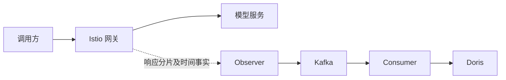

# 网关响应采集开发实现方案

日期：2026-11-10。本文描述当前实现，容量验收结果单独记录，配置额度不代表生产 RSS 已达标。

## 1. 范围与技术决策

业务仍直接经过 Istio 网关到模型服务。Wasm 有界旁路发送响应，Observer 解析后使用原生 Producer 写 Kafka；Consumer 确认 Doris 可见后提交 offset。采集故障放行业务，可以漏采，禁止拒绝、终止或无限暂停业务请求。插件加载使用 ECDS 透明兜底；`fail_open: true` 不能替代加载故障的真实转发验证。

支持 OpenAI 兼容 Chat Completions JSON/SSE。模型服务负责返回 usage；网关不添加或覆盖 include_usage，不读取、解析、复制或缓冲请求正文。未知用量保持 null/unknown，不估算、不补零。1M 上下文 token 不产生采集正文副本；32 MiB 只是透传边界测试，不是请求大小限制。网关原有请求上限继续由业务配置决定。

Wasm 保留请求头元数据、状态及时间事实，request_model 固定 null，response_model 仍来自响应。只观察入口服务的最终响应，不推测内部调用或隐藏重试的消耗。正文和密钥不写入日志、Kafka 或 Doris；响应只在有界旁路和 Observer 解析内存中临时存在。

当前基线为 Go 1.25.0、TinyGo 0.40.1、固定 SDK v0.24.0 本地扩展。Kubernetes E2E 使用 kind-kind、Istio 1.13.5 和 proxyv2:1.14.6（Envoy 1.22.7-dev）；本地结果不等于私有生产镜像或生产容量验收。

## 2. 架构与接入契约



### 2.1 路由、归属与过滤器顺序

ext_authz → Wasm → router。先匹配 enabled、POST、精确路径和 accepted_request_hosts，再分配观察和读取必要头。route_name 为 * 时忽略路由名；实际路由名仅诊断，不参与身份键。去掉查询串后按原始可见路径精确匹配，不额外解码或规范化。未命中时不读取凭据、不分配观察、不产生占位事件。

Host 从入口 authority 规范化，只接受合法 ASCII DNS 域名，不使用转发头。临时 token 只从单值 Authorization: Bearer 提取，最多 4096 字节。Observer 根据 cluster_name、deployment_environment、Host 查询服务和供应商，根据 token 查询客户及 API Key ID。归属查询独立、有界，结果冻结为两类事件的相同 ID、名称及版本快照，不回写历史事件。归属未知保留 identity_invalid 诊断，不单独否决有效 usage。

### 2.2 请求标识及时间

observation_id 由 Observer 在有效 Start 后生成规范 UUIDv4，事件 ID 为其加 :start/:usage。它是 Kafka key、去重和请求计数依据。logical_request_id 按候选请求头顺序提取，x_request_id 单独保留网关可见值；两者缺失时为 null，不能代替 observation_id。user_id、User-Agent 及白名单头按既有有界校验冻结。插件不注入、删除或覆盖业务响应计量头。

内部 capture_id 只用于共享传输内关联，新观察严格递增且关闭后不复用；不是逻辑请求 ID，不进入事件或持久化。request_started_at_ms 来自请求头回调；响应 observed_elapsed_us 来自网关原始回调，不使用 Observer 到达时间计算 TTFT/TPOT。

### 2.3 入口采集过滤强制约束

配置采用严格 JSON，拒绝未知旧字段。Host 名单、规则和元数据上限沿用 Schema。配置无效、SharedData 不可用或额度不足时停用/跳过采集，业务继续。任何运行时失败均不重发模型请求，也不重传采集记录。

## 3. WASM → Observer 协议

本次直接替换内部传输协议，Wasm 和 Observer 必须配套更新，不保留旧逐请求端点。Kafka/Doris 事件 schema_version 仍为 1。

### 3.1 Protobuf 定义

```proto
syntax = "proto3";
package metering.v1;
option go_package = "github.com/Fangyan33/llm-token-stats/gen/observation/v1;observationv1";

service ObservationService {
  rpc Observe(stream ObservationBatch) returns (stream ObservationAckBatch);
}

// 一个长期传输流承载多个独立观察；捕获键仅在该传输流内有效。
message ObservationBatch {
  uint64 batch_seq = 1;
  repeated CaptureFrame frames = 2;
}
message CaptureFrame {
  uint64 capture_id = 1; // 每个传输流内新观察严格递增，关闭后不复用
  ObservationFrame frame = 2;
}
message ObservationAckBatch {
  uint64 accepted_batch_seq = 1;
  repeated CaptureAck acks = 2;
}
message CaptureAck {
  uint64 capture_id = 1;
  ObservationAck ack = 2;
}

enum Direction {
  DIRECTION_UNSPECIFIED = 0;
  REQUEST = 1;
  RESPONSE = 2;
}

message ObservationFrame {
  uint32 schema_version = 1;       // 一期采集子项固定 1
  reserved 2;                      // 不复用原草案中由网关填写的请求 ID 字段
  uint64 frame_seq = 3;            // 每个 capture_id 从 1 开始，严格递增
  oneof payload {
    Start start = 10;
    ResponseHeaders response_headers = 11;
    BodyChunk body_chunk = 12;
    End end = 13;
    Cancel cancel = 14;
  }
}

// 采集取消不表示业务请求结束，不能替代有效 End。
message Cancel {}

message Start {
  reserved 5, 7, 8, 9, 10;
  reserved "service_id", "api_key_id", "customer_id", "application_id", "identity_status";
  int64 request_started_at_ms = 1;
  string gateway_instance_id = 2;  // 运行时 namespace/pod-name，不是客户端输入；历史数据可能为 Pod UID
  string config_version = 3;
  string route_name = 4;           // 真实 Envoy 路由名，仅诊断；不可读为 unknown，不作为接纳条件
  string adapter_id = 6;
  string method = 11;
  string request_content_type = 12;
  string request_content_encoding = 13;
  bool request_end_stream = 14;
  string request_authority = 16;   // Entry authority, at most 512 UTF-8 bytes
  bytes api_key = 17;              // Transient Bearer token, at most 4096 bytes; never log
  optional string x_request_id = 15; // 网关可见的 X-Request-Id，仅辅助关联
  optional string logical_request_id = 18; // Wasm 按配置从客户端请求头提取；未命中不设置
  optional string user_id = 19; // 按候选头顺序提取，最多 512 UTF-8 字节
  optional string user_agent = 20; // 标准 User-Agent，最多 2048 UTF-8 字节
  map<string, string> request_headers = 21; // 小写白名单头名，最多 16 项
}

message ResponseHeaders {
  uint32 http_status = 1;
  string content_type = 2;
  string content_encoding = 3;
  bool end_stream = 4;
}

message BodyChunk {
  Direction direction = 1;
  uint64 body_seq = 2;             // 每方向从 1 开始
  uint64 offset = 3;               // 每方向从 0 开始的正文绝对字节偏移
  bytes data = 4;
  bool end_stream = 5;             // 仅当前回调最后一个子片设置
  optional int64 observed_elapsed_us = 6; // 响应回调距请求头的微秒耗时；同回调拆片相同，缺失或负值不用于计时
}

message End {
  int64 request_finished_at_ms = 1;
  reserved 2;
  uint64 last_response_body_seq = 3;
  uint64 request_bytes_seen = 4;
  uint64 response_bytes_seen = 5;
  bool request_end_stream_seen = 6;
  bool response_end_stream_seen = 7;
  optional uint32 http_status = 8;
  optional uint32 upstream_attempt_count = 9;
  optional string response_flags = 10;
  optional string response_code_details = 11;
}

message ObservationAck {
  string observation_id = 1;       // Observer 在有效 Start 后分配，后续 ACK 保持一致
  uint64 accepted_frame_seq = 2;   // 连续处理完成的最高 frame_seq
  bool close_stream = 3;          // 仅关闭该观察，不关闭共享传输流
  string reason = 4;              // 固定原因码，禁止透传异常文本
}
```

### 3.2 消息顺序、ACK 与缺片

每 Worker 默认 4 条长期双向 gRPC 流。各流批次序号从 1 连续递增；单批最多 32 KiB、128 个 CaptureFrame，tick 每 10 ms 刷新未满批。每个 capture 的帧序号从 1 连续递增：Start、ResponseHeaders、RESPONSE BodyChunk、End。请求正文不在协议上传输；REQUEST 方向保留枚举编号但服务端拒绝该方向。响应片段最多 16 KiB；只有原回调最后一个分片带 EOS，拆片保留相同原回调时间。

ObservationAckBatch 累计确认已处理的最高批次序号，释放待发及未确认记录的逻辑额度。它不保证 Kafka/Doris 持久化。CaptureAck 返回 UUID 和该观察已处理帧序号；close_stream 仅关闭该观察，不关闭共享 gRPC。Observer 按递增 capture_id 的高水位忽略已关闭观察的迟到片段，无长期 tombstone 表。

Cancel 是独立控制帧，不声称业务 End 或 EOS。单条采集的解析/序号/超限错误定稿该观察，其他观察继续；批次协议错误或连接故障影响该传输中的观察。ACK 超过 2 秒关闭受影响传输，100 ms 后允许重新建立，不重传旧观察。Wasm 单条观察最长 600 秒，Observer 605 秒。有效 End 先保存，迟到 ACK 写失败不丢弃已见终态。

## 4. WASM 插件实现

### 4.1 SDK 最小扩展

固定 SDK 副本只增加 gRPC stream/send/cancel、Root token 回调和不 panic 的指标操作。更改记录在 third_party/proxy-wasm-go-sdk/PATCHES.md。不将 gRPC-Go、tokenizer 或 JSON/SSE 解析器编入 Wasm。

### 4.2 上下文和状态机

HTTP context 保存必要标志及轻量观察指针，Root 保存观察表、超时堆、固定传输及批次账本。Start 元数据最多 6144 字节。请求正文回调只统计 host 提供的字节数及 EOS，不读正文；所有回调 Continue。响应每次最多读取 16 KiB，逐片进入共享批次，不为每请求保留响应尾部窗口。

HTTP context 完成后发送 End，Root 在收到关闭 ACK 或超时后释放观察。共享流关闭后清理其观察和账本。指标失败不得 panic。主线程初始化共享账本，Worker 克隆后使用同一账本分块领取额度；vm_id 必须稳定且 Pod 只能安装一个本采集插件实例。

### 4.3 请求 usage 参数补充与回调伪代码

请求改写已取消。本节保留原锚点便于既有链接定位。服务端若未返回 usage，最终事件保存 null/unknown 和 missing_usage；不将它当作资源丢失，也不构造零用量。慢上传不触发采集改写超时，业务前缀可立即转发。

### 4.4 流控、内存与释放

Pod 级 SharedData CAS 账本同时限制观察数、待发及未确认载荷、记录数。Worker 分块额度为 1 MiB、1024 条记录、256 个观察；无额度立即放弃，不排队等待。额度包括尚未 flush 的批次，累计 ACK 后释放。Worker 不活动时归还空闲块，正常卸载归还剩余额度；不靠租约到期回收可能仍持有 native 缓冲的额度。额度配置不一致时新实例停用采集，调整额度须重启 Pod；异常 VM 无法清理时可能保守保留额度，恢复前允许漏采。

| 字段 | 类型 | 默认值 |
| --- | --- | --- |
| chunk_bytes | 整数 | 16384 |
| response_body_max_bytes | 整数 | 8388608 |
| ack_timeout_ms | 整数 | 2000 |
| end_ack_timeout_ms | 整数 | 2000 |
| observation_max_ms | 整数 | 600000 |
| tick_ms | 整数 | 10 |
| metadata_max_bytes | 整数 | 6144 |
| ack_max_bytes | 整数 | 32768 |
| pod_max_observations | 整数 | 131072 |
| pod_inflight_bytes | 整数 | 268435456 |
| pod_inflight_messages | 整数 | 524288 |
| transport_streams_per_worker | 整数 | 4 |
| transport_batch_max_bytes | 整数 | 32768 |
| transport_batch_max_frames | 整数 | 128 |

默认总量为 131072 个观察、256 MiB 载荷、524288 条记录。它们不随 Worker 数或发布代数成倍增大；运行时只能使用同 vm_id 的共享账本。发布中须控制同时存活代数，旧新 Wasm 代码可能拥有独立 VM 状态，不能仅凭逻辑额度宣称 RSS 达标。

额外 RSS 上限是每 Pod 2048 MiB，包含 Wasm heap、Envoy native 缓冲、HTTP/2 和元数据。256 MiB 载荷额度不是 RSS 硬上限。取消 hostcall 失败时保留未确认 native 缓冲的额度并重试；卸载时仍失败则保守保留共享额度直至 Pod 重启。VM/Envoy 故障和代码替换期 native 状态的实际释放仍须在目标镜像测量；业务优先。不要通过降低观察数来替代用户最新确认的单 Pod 200 QPS / 60 秒流容量目标。

## 5. Observer 解析及一次定稿

### 5.1 状态管理

每条共享流只有接收、ACK 写入协程及有界队列，不按观察创建永久协程、ticker 或 gRPC 流。归属查询只在开始时产生独立有界任务。观察表及超时堆独立定稿，单次 ACK 最多 32 KiB/128 项，阻塞写超过 2 秒结束传输。

取消累计 100 ms 墙钟解析期限和输入 16 倍累计预留。每观察按必要状态及实际保留响应缓冲计账；分配前做有界临时预留，解析后按保留容量归还，较大的已完成 SSE 行/事件立即释放。parser_budget_bytes 默认 10 GiB、最大 64 GiB，按内存实际需要配置 Observer 资源；超过额度只取消采集。max_active_observations 默认/最大 1048576，max_connections 默认 1024、最大 4096。

### 5.2 解析规则

支持 application/json 与 text/event-stream、identity 或空 Content-Encoding。JSON 最大 1 MiB，单 SSE 事件最大 256 KiB，每观察响应累计最大 8 MiB；这些限制是响应采集边界，不是上下文输入限制。SSE usage 仅接受 choices=[] 的有效数字字段。缺字段、非法字段、冲突与不完整流按事件契约保留 null/unknown 和异常码。

request_model 固定 null；response_model 及计时来自响应。解析不运行 tokenizer，也不以客户端请求值代替上游 reported usage。完整 End 与两个方向 EOS 用于判断业务完成；请求方向仅校验 End 的事实，不要求不存在的正文片序。

### 5.3 字段归一化

usage 六类 token 的 value/source、raw_usage_json 安全白名单、资格及冲突逻辑保持当前 Kafka/Doris 契约。reported 数值必须非负整数，0 是有效值；缺失与 0 不等价。identity_invalid 是归属诊断，其他完整性异常按资格规则处理。

## 6. Kafka 事件与发送

当前 Kafka 事件、Wasm 配置和观察流均使用 `schema_version=1`。项目尚未正式上线，请求标识字段直接按本文更新后的唯一契约实现，Kafka 字段定义见[事件 Schema](../api/events/v1/metering-event.schema.json)。

### 6.1 事件格式

正式固定字段集见 [事件 Schema](../api/events/v1/metering-event.schema.json)，字节/状态/来源/关联校验由[离线校验器](../scripts/validate_collection_contracts.py)补充。下游应用接入步骤、全部事件字段说明及 Go/Java 消费示例见 [Kafka 计量事件应用接入指南](kafka-event-integration-guide.md)。

生产 Topic 约定为 `llm-metering-events`，key 为 observation_id 的 UTF-8；初始 24 分区、3 副本、`min.insync.replicas=2`、保留 72 小时、`cleanup.policy=delete`。`kafka.topic` 接受合法 Kafka 名称（1–249 个 ASCII 字母、数字、点、下划线或短横线，排除 `.` / `..`），Observer 与 Consumer 必须配置一致；本地 Kubernetes 用例使用独立测试 topic，不与 Compose Consumer 共享数据。分区数属压测初值；同一部署周期不在线改分区数，变更需停采、排空在途后切换。Kafka 不接收正文片段。

两类事件自带请求开始时间与身份快照，缺少 start 也能解释合并结果；缺少结果时，已入队的 start 只表示曾收到请求。模型等后续才知道的字段允许在不同事件类型之间不同，不属于同 ID 内容冲突。

```json
{
  "schema_version": 1,
  "event_id": "7f6c2a90-4b13-4b68-9d21-67283e0c5f44:usage",
  "event_type": "usage_observed",
  "observation_id": "7f6c2a90-4b13-4b68-9d21-67283e0c5f44",
  "x_request_id": "b3e1fba5-16a4-4dfb-aa84-50141e80d473",
  "logical_request_id": "Client-Request-42",
  "observation_scope": "gateway_response",
  "producer_id": "observer-pod-uid",
  "gateway_instance_id": "istio-system/gateway-example",
  "config_version": "collection-v1",
  "adapter_id": "chat_completions_v1",
  "route_name": "llm-chat",
  "request_host": "model.example.invalid",
  "cluster_name": "fixture-cluster",
  "deployment_environment": "stg",
  "service_id": "model-service-a",
  "provider_id": "provider-a",
  "mapping_version": "e475bfa24c9f16841c8cb11f66586faf008e144eddc1fa7ff3595bae6999905b",
  "mapping_status": "mapped",
  "api_key_id": "key-42",
  "customer_id": "customer-7",
  "customer_mapping_version": "1713a45606930ab59d794cd8ddd92eff6ce2df588201f4df1ec8bf5354748081",
  "customer_mapping_status": "mapped",
  "identity_status": "known",
  "request_started_at_ms": 1789862400000,
  "observation_ended_at_ms": 1789862401200,
  "request_finished_at_ms": 1789862401195,
  "event_created_at_ms": 1789862401201,
  "request_model": null,
  "response_model": "model-a-2026",
  "http_status": 200,
  "upstream_attempt_count": null,
  "response_flags": null,
  "response_code_details": null,
  "business_outcome": "response_complete",
  "terminal_observed": true,
  "observation_status": "complete",
  "usage_status": "known",
  "usage_eligible": true,
  "usage": {
    "input_tokens": {
      "value": 1000,
      "source": "reported"
    },
    "output_tokens": {
      "value": 500,
      "source": "reported"
    },
    "cached_read_tokens": {
      "value": 200,
      "source": "reported"
    },
    "cached_write_tokens": {
      "value": 300,
      "source": "reported"
    },
    "reasoning_tokens": {
      "value": 100,
      "source": "reported"
    },
    "reported_total_tokens": {
      "value": 1500,
      "source": "reported"
    }
  },
  "raw_usage_json": "{\"prompt_tokens\":1000,\"completion_tokens\":500,\"total_tokens\":1500,\"prompt_tokens_details\":{\"cached_tokens\":200,\"cache_write_tokens\":300},\"completion_tokens_details\":{\"reasoning_tokens\":100}}",
  "raw_usage_truncated": false,
  "anomaly_codes": [],
  "service_name": "模型服务 A",
  "provider_name": "供应商 A",
  "customer_name": "客户 A"
}
```

两类事件使用相同固定字段集；`x_request_id` 在同一请求的开始与结果事件中相同，无法取得时显式为 null。start 的 `usage=null`、`usage_status=not_applicable`、`usage_eligible=false`、`raw_usage_json="{}"`，结束时间为 null、`terminal_observed=false`。结果事件同时保存用量、`terminal_observed` 和可取得的结束时间；未收到有效 End 时结束时间为 null，不填零或虚构完成状态。未获得模型、HTTP 状态等字段显式写 null；结果事件的 observation_status 反映采集完整性，不能因 HTTP 200 强行标 complete。

字段值由 Go 固定 struct 编码，字段顺序固定、无缩进，所有可选字段显式输出 null，字符串采用 Go encoding/json 默认转义；不接受同名重复 JSON key、未知顶层字段或自由扩展 map。Consumer 解码后按同一 schema struct 重编码为 `event_json`，计算 SHA-256 小写十六进制 `payload_hash`。摘要不含 Kafka 坐标/入库时间，包含 producer_id、事件时间和全部业务字段。重放保留原事件，不重新生成时间或 producer_id。

模型长度扩大后，两个模型字段在 JSON 转义情况下最多占约 12 KiB；单事件最大 **32 KiB**（按序列化后字节计），Observer 和 Consumer 使用同一上限，独立于 gRPC 单帧 32 KiB 限制；超限在发送前丢弃并计数。`anomaly_codes` 去重排序，最多 32 个固定枚举；不放异常堆栈、正文和密钥。v1 封闭枚举为 invalid_model、identity_invalid、invalid_usage、usage_conflict、missing_usage、missing_end、protocol_error、protocol_incomplete、unsupported_encoding、unsupported_content_type、parse_limit、transport_lost、observation_timeout、clock_anomaly。

### 6.2 Producer 策略

Observer 共享一个 producer，每事件先非阻塞申请执行槽，初值 256 个；无槽直接丢弃。不会创建一个等待 Kafka 恢复的应用队列。producer 内部网络在途内存仍存在，并受下面参数约束。

```go
// API 基于 franz-go v1.18.1；还需加入 SeedBrokers、TLS/SASL。
opts := []kgo.Opt{
    kgo.RequiredAcks(kgo.AllISRAcks()),
    kgo.DisableIdempotentWrite(),
    kgo.RecordRetries(1),
    kgo.UnknownTopicRetries(0),
    kgo.ProducerLinger(0),
    kgo.MaxBufferedRecords(256),
    kgo.MaxBufferedBytes(4 << 20),
    kgo.RecordDeliveryTimeout(2 * time.Second),
    kgo.ProduceRequestTimeout(time.Second),
    kgo.RequestTimeoutOverhead(time.Second),
    kgo.DialTimeout(time.Second),
}
// 获得槽后 TryProduce；在 promise 中释放槽。禁止失败后重新提交原事件。
```

固定 franz-go v1.18.1 的 RecordRetries 按总尝试次数比较，0 会阻止首次发送；实现使用 1，仅允许首次尝试、不重发事件。这里显式关闭 producer 幂等，是为了避免其序列号约束延后失败，业务幂等交给事件键。`RecordDeliveryTimeout` 是粗粒度期限，不是严格墙钟上限；必须测连接黑洞/元数据不可达。执行槽按 promise 完成释放，不能 context 超时就提前复用仍占客户端内存的槽。[固定配置源码](https://github.com/twmb/franz-go/blob/v1.18.1/pkg/kgo/config.go)

增加 3 秒 watchdog：发现超龄发送则进入熔断，停止接纳新事件，对当前 producer 执行有界取消/关闭，丢弃在途集合；重建 producer 后仅接收新事件。取消/关闭若不能在额外 1 秒内释放，Observer 进程退出由 Deployment 重建，不能保留旧 producer 并无限新建。该行为也属于 PoC 故障验收项。

发送结果分 success、definite_failure、uncertain。超时/断连发生在已发送后通常不能证明 broker 未写入，标 uncertain，不补发。熔断恢复只恢复新采集；正常处理期限内的首次网络发送不算恢复补传。鉴权和 metadata 连接可重新建立，但不能携带已丢弃事件恢复发送。

ACK 与 Kafka 发送完全解耦；即便两条事件只有一条成功入 Kafka，Consumer 也应处理。不要为了保持两条事件齐全引入同步等待或事务缓冲。

## 7. Apache Doris 表结构与查询

### 7.1 存储与字段

完整可执行 DDL 见 [Doris migration](../migrations/doris/metering/001_init.sql)。Consumer 校验规范事件后，一次解析并写入类型化列；`event_json` 只供冲突核验，不保存正文。`event_id` 是事件级逻辑键，`observation_id` 是请求级逻辑键；一笔请求最多有 `request_started` 与 `usage_observed` 两个事件。

`events_raw` 使用 Doris Unique Key `(request_date, observation_id, event_id, payload_hash)`。相同键的重放由 Merge-on-Write 合并；不同 `payload_hash` 保留为不同变体，查询可立即看到。分布键为 `observation_id`，请求日期由 `request_started_at_ms` 换算成 UTC 日期。只凭 UUIDv4 检索时不能从 ID 推导日期，必须覆盖全部在线分区。Doris 的 Unique Key 是写入幂等边界，不能省略摘要列，否则不同内容会被覆盖。[Unique Key 模型](https://doris.apache.org/docs/4.x/table-design/data-model/unique/)

| 字段组 | Doris 类型与规则 | 说明 |
| --- | --- | --- |
| 请求日期和 ID | DATE、VARCHAR(36/42) | 日期按 UTC；事件 ID 由请求 ID 加 :start / :usage 后缀组成 |
| 内容与身份摘要 | CHAR(64) | Consumer 对规范事件和稳定身份快照分别计算 SHA-256 |
| 身份/模型/诊断 | VARCHAR、STRING、ARRAY<VARCHAR> | 原事件 null 写 SQL NULL；模型最多 1024 UTF-8 字节 |
| token 和时间 | BIGINT、DATETIME(3) | 毫秒时间戳保留 BIGINT；数据库写入和 Kafka 记录时间用 UTC DATETIME(3) |
| 状态 | TINYINT、VARCHAR | 0 与 NULL 含义不同；布尔值在 SQL 列中用 0/1 |
| Kafka 坐标 | VARCHAR、INT、BIGINT | 重放后同一键可能保留任一次写入的坐标 |

`identity_hash` 对固定元组 `[service_id, provider_id, api_key_id, customer_id, identity_status, config_version, gateway_instance_id, adapter_id, x_request_id, logical_request_id, cluster_name, deployment_environment, mapping_status, mapping_version, customer_mapping_status, customer_mapping_version]` 规范 JSON 编码后取 SHA-256。null 保留，路由和模型不是独立身份字段；mapping_version 绑定规范 Host，版本不含原始密钥。Consumer 证据、巡检及 SQL 投影使用同一顺序。

001 与 003 直接定义当前请求诊断及统计投影，按唯一契约比较类型化身份字段；旧开发结构需在隔离空库重新初始化，不提供旧格式/hash 兼容。

事件表按 UTC 请求日期每日分区，拒收诊断表按 Kafka 记录 UTC 日期每日分区，均保留前 12 个完整自然月加当月。Doris 预建当天及未来两日分区，usage-worker 按月首清理；各 FE 须持久开启动态分区。Consumer 拒收窗口外历史事件，也不把过滤行视为成功。日/月统计采用嵌套物化视图并使用相同自然月窗口，见[日/月汇总设计](daily-monthly-summary-design.md)。`request_conflict_ids` 长期保留冲突 UUIDv4，避免较早证据过期后较晚变体恢复有效；UUIDv4 不得重用。

单 FE/BE 的 schema 仅供开发验证；生产需要确定副本数、BE 分桶数、分区数和容量。Doris 在分区和分桶间管理数据，跨日期或身份的冲突判断必须覆盖同一 `observation_id` 的全部在线变体。`requests` 是逻辑视图，并不预聚合；大规模查询的计划和延迟须在目标 Doris 集群验证。

### 7.2 事件与请求视图

迁移创建 `event_conflicts`、`event_details`、`requests`、`usage_effective` 和 `request_statistics` 五个逻辑视图。`event_conflicts` 按请求 ID 和事件 ID 跨在线日期诊断内容冲突；`event_details` 直接从原表排除这些事件冲突并投影业务字段。`requests.has_conflict` 还检查多开始/结果变体、开始时间/日期、身份与名称快照及持久冲突标记。`request_statistics` 提供按日期组织的物化视图输入。普通视图不存储副本，查询成本来自原表扫描、聚合和关联。

`requests` 一行代表一个已记录请求，不能直接对事件表 `COUNT(*)` 当调用量。有开始事件而没有结果事件时，`usage_status=not_observed`，token 为 NULL，不意味着零用量。`usage_effective` 只用于当前有效用量核验；未知、部分、冲突与未观察到的状态仍需分别展示。

Consumer 在提交 offset 前按本批 UUID 跨全部在线分区核对事件变体、开始时间和身份摘要，发现冲突即写 `request_conflict_ids` 并确认可见。每分钟补偿检测从持久消费水位及在线分区巡检恢复输入，不依赖内存中的最近 UUID；详见闭环清单第 5 节。当前变体共存时视图立即隔离；标记保证其中一份过期后仍隔离。检测器若无法在最早证据过期前持久化标记，暂停对外有效用量查询并报警。日志仅输出事件 ID/摘要，不输出 `event_json`。

### 7.3 查询样例

以下 `?` 由 MySQL 协议客户端的预处理语句绑定。查询服务必须注入经过认证的客户 ID，不能接受客户端指定租户。对外查询还须排除 `has_conflict=1`；先收集同一请求的所有变体、判断冲突，再做客户和模型筛选。

~~~sql
-- 按 UUIDv4 查询，覆盖全部在线分区。
SELECT * FROM metering.requests WHERE observation_id = ?;

-- 客户精查。第二个参数为自然月在线窗口的 Unix 毫秒下界。
SELECT r.observation_id, r.x_request_id, r.request_started_at_ms,
       r.service_id, r.response_model, r.usage_status,
       r.observation_status, r.input_tokens, r.output_tokens,
       r.terminal_observed, r.request_finished_at_ms, r.business_outcome
FROM metering.requests r
WHERE r.observation_id = ?
  AND r.request_started_at_ms >= ?
  AND r.has_conflict = 0
  AND r.customer_id = ?;

-- X-Request-Id 只是辅助关联，必须限制租户及时间，可能返回多行。
SELECT r.observation_id, r.request_started_at_ms, r.usage_status
FROM metering.requests r
WHERE r.request_date BETWEEN ? AND ?
  AND r.request_started_at_ms >= ? AND r.request_started_at_ms < ?
  AND r.x_request_id = ? AND r.customer_id = ? AND r.has_conflict = 0
ORDER BY r.request_started_at_ms, r.observation_id LIMIT 100;

-- 运维核验同一事件的变体。
SELECT event_id, payload_hash, event_json
FROM metering.events_raw
WHERE observation_id = ?
ORDER BY event_id, payload_hash;

-- 合成事件核验：重放不增加有效用量。
SELECT COUNT(*) AS eligible_requests,
       SUM(CAST(input_tokens AS DECIMAL(38, 0))) AS input_tokens,
       SUM(CAST(output_tokens AS DECIMAL(38, 0))) AS output_tokens
FROM metering.usage_effective
WHERE request_date = ? AND customer_id = ?;
~~~

仅凭 `X-Request-Id` 的辅助检索允许零到多条结果。客户接口先校验 UUIDv4 格式，再校验在线时间和认证主体；其他客户 ID 与不存在的 ID 返回相同未找到响应。查询结果应显示用量状态、token 的 NULL/有效值和数据水位；暂未查到不能推断为零消耗。数据库账号不直接交给客户。

日均约 1 亿事件、一年约 365 亿事件时，按请求聚合、跨分区冲突判断和客户筛选可能很贵。验收需测单 ID 精查和单客户 1 小时/24 小时分页，在 10 并发、100 行结果下 P95 ≤3 秒，并用 EXPLAIN 核对分区与扫描量。如不达标，增加经过冲突回查的检索结构或预聚合，并单独验收；不能跳过冲突隔离换性能。

## 8. Consumer 落库与异常事件

### 8.1 消费处理顺序

1. 使用独立 group `llm-metering-doris-v1`，禁用自动提交。每分区顺序处理，允许不同分区并行。遇到 Consumer 尚不支持的 Kafka 事件 `schema_version`，立即暂停该分区，保留当前未提交 offset，报警并等待 Consumer 升级；其他分区可继续处理。
2. 对已支持版本校验大小、schema、白名单、ID 为规范小写 UUIDv4（`^[0-9a-f]{8}-[0-9a-f]{4}-4[0-9a-f]{3}-[89ab][0-9a-f]{3}-[0-9a-f]{12}$`）、Kafka key 与 ID 一致、ID/类型后缀、`request_started_at_ms` 为合法 Unix 毫秒、身份类型、token 类型和来源组合；只接受 `request_started`（:start）和 `usage_observed`（:usage）。start 出现非 null usage 一律拒绝；结果事件必须带有用量状态和终态标识，即使 token 未知也不能省略状态。若 `terminal_observed=false`，`request_finished_at_ms` 必须为 null。开始时间超出消费者当前时间 5 分钟以上进入拒绝诊断，不让远期分区无限保留；所有拒绝都有原因计数。
3. 规范化并计算 `payload_hash` 与稳定身份 `identity_hash`，按 `request_started_at_ms` 的 UTC 日期确定 `request_date`，从同一个已校验的事件对象展开类型化列并准备 `events_raw` 行。校验 `event_id` 与 `observation_id`/`event_type` 一致，所有可空字段按原事件 null 写 SQL NULL，token source 不从数值猜测；类型化列与保留的 `event_json` 必须表达同一事件。不在 Consumer 中重新提取服务 usage、补估算或改变定稿。
4. 每个 Kafka 分区默认每批 5000 行/4 MiB，或等待 15 秒即通过 Doris Stream Load 写入；可配置上限分别为 20000 行、16 MiB、600000 ms（10 分钟），任一条件先满足即写入，计时不因后续事件重置。攒批不持续阻止分区移交，撤销时由新 owner 重放未提交记录；fetch 等待固定 5 秒，初次审计及分钟巡检不等待攒批清空。固定 label 为表名前缀加冻结批次规范元组（topic、partition、首末 offset、Stream Load 正文字节 SHA-256）的 SHA-256（前缀 + 64 位十六进制摘要，不超过 128 字符），重试沿用相同 label；设置 Expect: 100-continue、format=json、read_json_by_line=true、max_filter_ratio=0、timezone=+00:00，处理 FE 到 BE 的 307 重定向，并写入 UTC DATETIME(3) 字符串。响应成功、加载行数等于批次行数、过滤行数为 0 且事务可见后，才提交该分区连续成功记录的下一 offset。
5. Stream Load 失败、Publish Timeout、行数不符或确认丢失时不提交 offset；同一执行期查明事务状态后以原 label 和原内容重试；重启/新 owner 重新冻结的内容或范围变化时生成新 label，依赖 Unique Key 消除已成功写入的行。Label Already Exists 本身不等于成功，须核实原批已可见。label 有有限保留期，长期重放依赖事件表 Unique Key；同一事件的不同摘要不得合并。同一连续 offset 范围内若既有合法事件又有拒绝诊断，分别写入两表，两个事务均确认可见后才提交该范围的 offset。
6. 在提交 offset 前完成本批 UUID 的跨在线分区冲突回查，确认 request_conflict_ids 可见；再在 Doris summary_dirty_notifications 登记所有受影响日期的幂等通知，确认后写 consumer_batch_receipts。Worker 尚未启用也登记，跨日期冲突覆盖旧日期。任一步失败保留 offset 重试，不能只在内存通知 usage-worker；采集/汇总组件不连接 PostgreSQL。冻结批次及恢复顺序见[闭环清单第 5 节](gateway-collection-design-closure.md#5-consumer-提交与恢复屏障)，通知 ID、连续分区水位及单个 Go Worker 调度见[Doris 协调设计](doris-summary-coordination.md)。
7. rebalance 停止已撤销分区的新处理；未确认批次留待新 owner 重放，不能提交越过失败记录的 offset。

Consumer/Doris 故障可以依赖 Kafka 72 小时保留恢复，与禁止采集侧补传不冲突。数据库不可用时暂停分区获取、保持心跳与有界批次，不能无限增加消费内存。告警阈值初值 lag age >60 秒警告、>24 小时严重、>60 小时紧急；offset 已过期则显式报告数据缺口，不跳到最新并声称完整。

### 8.2 不合法事件的安全隔离

永久非法事件指已支持 schema 版本下经校验确定无法修复的字段、长度或类型错误；未知 `schema_version` 不属于此类。永久非法事件不放进 `events_raw`，防止类型化列产生默认 0、空串或错误租户归属。保存有限诊断表，仅含 Kafka 坐标、SHA-256 和固定原因；不保存原 payload，也不另建携带正文的死信 topic。仅永久非法事件的诊断成功写入后提交该 offset；诊断写入失败则不提交。未知版本分区在升级并通过兼容性验证后从原 offset 恢复；若停顿接近 Kafka 72 小时保留窗口，按 lag age 紧急告警并先阻止生产端发布新 schema，不能跳到最新位置声称完整。

诊断表的 Doris DDL 见 [migration](../migrations/doris/metering/001_init.sql)，包含从 Kafka 记录时间换算的 UTC 分区日期；永久非法事件的重放由 Kafka 坐标与摘要去重。

合法但同 `event_id` 不同内容的事件进入 `events_raw` 保留各变体；无需在写入前逐条 SELECT 查重，也不靠进程内缓存判断全历史冲突。离线重放必须保留原内容及对应类型化字段，不以新的 schema struct 静默重编码旧 schema；不支持的版本暂停对应 Kafka 分区并报警，保留未提交 offset，待 Consumer 升级后按原事件内容重放。增加或改变字段时按 schema 版本迁移表和 Consumer，历史行不以新默认值冒充已知数据。

## 9. 配置、构建与部署

### 9.1 插件配置

```json
{
  "schema_version": 1,
  "enabled": false,
  "config_version": "collection-v1",
  "observer_cluster": "outbound|9090||llm-token-stats-observer.metering.svc.cluster.local",
  "routes": [
    {
      "route_name": "*",
      "enabled": true,
      "methods": [
        "POST"
      ],
      "paths": [
        "/v1/chat/completions"
      ],
      "adapter_id": "chat_completions_v1"
    }
  ],
  "chunk_bytes": 16384,
  "response_body_max_bytes": 8388608,
  "ack_timeout_ms": 2000,
  "end_ack_timeout_ms": 2000,
  "observation_max_ms": 600000,
  "tick_ms": 10,
  "metadata_max_bytes": 6144,
  "ack_max_bytes": 32768,
  "accepted_request_hosts": [
    "model.example.invalid",
    "*.example.invalid"
  ],
  "logical_request_id_headers": [
    "x-client-request-id",
    "request_id"
  ],
  "user_id_header": [
    "user-id"
  ],
  "extra_request_headers": [],
  "pod_max_observations": 131072,
  "pod_inflight_bytes": 268435456,
  "pod_inflight_messages": 524288,
  "transport_streams_per_worker": 4,
  "transport_batch_max_bytes": 32768,
  "transport_batch_max_frames": 128
}
```

当前旧 request/rewrite、callback_max、per-stream/root 预算字段已删除，严格拒绝旧配置。部署 YAML 使用 block YAML，不嵌套整段 JSON 字符串。

### 9.2 Observer 和 Consumer 配置契约

生产样例以 configs/observer.production.example.json、configs/consumer.production.example.json 为准；Observer 使用 max_active_observations 表示观察数，与共享 gRPC 流数区分。配置严格校验。Consumer 和 Kafka/Doris 事件契约、DSN 唯一凭据来源、提交及重放逻辑不变。

### 9.3 EnvoyFilter 和服务发现

默认名称 llm-token-stats-envoyfilter-wasm，保留 proxy.metadata.NAMESPACE 隔离。远程 Wasm 保留 SHA-256、ECDS 透明兜底及 nack_on_code_cache_miss，模板不能原样用于生产；配套更新两端后验证配置实际激活和故障透传。

### 9.4 当前代码组织与构建

make generate、make build、make wasm、make test。网关变更另运行 make k8s-test，完整具名 PASS、无跳过才是全套 E2E 通过，不能以 Job 成功代替。测试资源由 make k8s-clean 按所有权清理。

## 10. 指标、故障及上线

active_streams 历史 Wasm 指标名现在表示观察数，inflight_bytes/messages 表示待发及未确认的逻辑载荷/记录。Observer 暴露 active_observations、parser_reserved_bytes、定稿、ACK 失败和 Producer 结果。日志只含固定原因及非敏感状态，不含正文、凭据或 capture_id 高基数标签。

资源不足、Observer 中断、ACK 超时、解析超限、Kafka/Doris 不可用都不阻塞业务。采集完整性和业务 200 必须分别检查。上游缺 usage 应产生完整终态、null 用量及 missing_usage；采集损失必须通过缺行、transport_lost、missing_end 等独立归因。

## 11. 验证样例、性能与任务拆分

执行入口为 [回归与容量工具](collection-capacity-test.md)。按用户最新确认的容量目标：单 Pod 开环 200 QPS、60 秒 SSE（约 12000 活跃流），预热 60 秒、稳定 300 秒、排空后对账。输入分布为 20% 1M、50% 200K、20% 500K、10% 100K，按实际字节生成合成正文并记录；token 数以独立 tokenizer 核验为证，不以字节数直接替代。对照不安装/启用插件，采样 Envoy RSS 峰值、平台期、排空值、CPU、业务错误和采集异常，额外 RSS <=2048 MiB。可控服务始终返回 usage 时必须 100% 采集并最终 Doris 可见；上游主动省略 usage 单独验证为 null。

本地回归另包括 100 请求/并发 2、16k 合成输入/1k 输出及超过旧 60 秒边界的流，32 MiB 透传、响应大片拆分、ACK 停滞、连接重建、Observer 重启、共享额度/多 Worker/卸载释放。容量工具和报告必须保留原始参数及失败，机器不足时不得降低目标后称容量通过。仅有本地环境无法证明生产 15c、原有约 12 GiB RSS 网关的最终容量。

## 请求性能时间事实

Wasm 在响应正文回调入口采集 `BodyChunk.observed_elapsed_us`，同一次回调拆片共用该时间。Observer 解析有效生成内容，仅在结果事件增加 `response_streaming`、`first_output_elapsed_us`、`last_output_elapsed_us`；开始事件均为 null。时间缺失或倒退只降级相应时间字段，不改变 usage 接纳。Consumer 按原值写入 Doris，明细视图计算 TTFT/TPOT；不使用 tokenizer，也不保存逐片段时间列表。详细口径、NULL 条件及查询示例见[请求性能指标](request-performance.md)。
