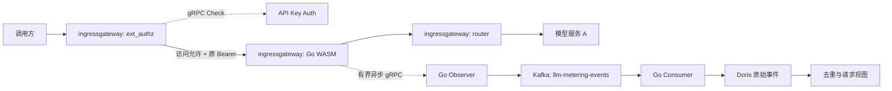
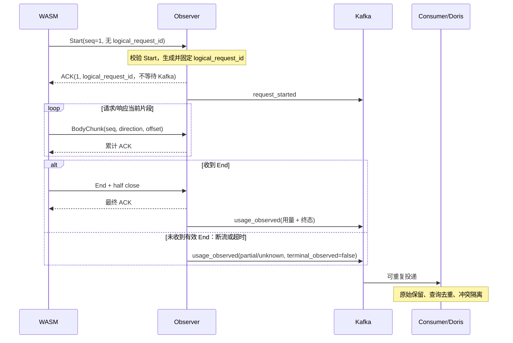

# 网关请求采集开发实现方案

版本：V1.9｜日期：2026-10-15｜状态：采集组件已实现，公开旧版 Envoy/Kafka/Doris 本地联调已通过；私有环境与性能验收待执行，详见[运行说明](collection-components.md)。

依据：[原技术方案](token-metering-design.md)、[功能设计概览及开发周期](token-metering-functional-overview-and-schedule.md)、[API Key Auth 服务方案](api-key-auth-service-implementation.md)。本文细化一期中“鉴权后采集到 Doris 明细入库”的采集子项；一期的估算、日/月汇总、客户查询与看板在后续子项完成；归档为后续可选项，不能以本文验收代替一期整体验收。本文的协议、配置和初始化 SQL 描述当前实现，Go 代码中明确标记的伪代码仅说明流程；汇总 Worker、估算和查询 API 的相关段落仍是待实施设计。

设计闭环交付物、协议业务校验、请求改写衔接、Consumer 恢复屏障与 G0–G5 上线证据见[闭环与验收清单](gateway-collection-design-closure.md)。正式契约文件为实施依据，本文片段由离线脚本检查一致性。

当前已删除 application_id。Wasm 只从 Authorization: Bearer 提取临时 api_key，并发送入口 authority；Observer 使用配置的 cluster_name/deployment_environment，分别通过服务和客户查询接口取得归属。两个归属接口支持配置 HTTP/HTTPS POST JSON 调用及 x-remote-data 认证；URI 为空时使用未实现占位。Observer 固定 prd/stg/dev 环境，在有界异步任务中取得 ID 和名称快照；service_name、provider_name、customer_name 经 Kafka 写入 Doris 独立列及 event_json。占位或失败侧的 ID、名称和版本为 null，不回源补写历史；原始 usage 保留，业务 token 不进入事件、数据库或日志。

## 1. 范围与技术决策

| 项目 | 一期采集子项决策 |
| --- | --- |
| 业务环境 | Istio 1.13.5、Kubernetes 1.22，先在实际私有网关镜像验证 |
| 网关插件 | Go + TinyGo、Proxy-Wasm；插件随 Observer 镜像发布，EnvoyFilter 原生 code.remote 下载并校验 SHA-256 |
| 接收与消费 | Go Observer、Go Consumer，独立部署 |
| 数据路径 | WASM → 双向 gRPC → Observer → Kafka → Consumer → Doris |
| 协议 | 兼容 Chat Completions 的 JSON 和 SSE，包括工具调用、多候选 |
| 用量 | 只提取有效服务 usage；缺失字段为 null/unknown；一期采集子项不估算，估算属于一期后续子项 |
| 配置 | 采集运行参数使用严格 JSON，通过 ConfigMap 挂载；Kubernetes 清单使用 YAML；采集组件不建设管理 API，归属由 Observer 的类型明确查询接口解析，当前占位，不访问 PostgreSQL |
| 存储 | Doris 保存类型化原始事件、冲突证据、去重/请求视图及汇总通知、消费凭据和发布状态；原始事件按 UTC 请求日期分区保留 365 个日期；采集与汇总无需额外 PostgreSQL |
| 故障策略 | 业务不等待采集，采集超限或失败放弃，无落盘、重传及恢复队列 |
| 查询交付 | 一期采集子项提供计量查询 ID、事件字段、SQL 和联调查询样例；一年内在线事件 HTTP API、门户和大范围导出任务属于一期后续子项；外部归档历史检索为可选项 |
| 阶段衔接 | 一期后续子项：tokenizer 估算、日汇总、月汇总、客户查询/导出和看板；对象存储归档为后续可选项；二期：计费、账单发布与调整单；三期：对账和结算确认；A 侧逐尝试观察为可选扩展 |

只观察入口直接访问的服务 A 及其最终响应；不还原 A 内部 B/C 调用、网关隐藏重试或客户端未收到的后端消耗。客户端重新发起请求形成新的采集请求 ID。

对白名单内支持该参数的 Chat Completions 路由，插件必须在流式请求转发前设置 `stream_options.include_usage=true`，客户端未传时主动添加、传 false 时覆盖。除这一明确改写外，保留业务字段、路由、重试和取消策略，不要求模型再执行一次；请求缓冲引入的时延纳入验收。上游仍未返回 usage 时只能产出未知用量，添加参数不等于保证获得 usage。

### 1.1 版本与兼容性基线

| 组件 | 开发基线与锁定方式 |
| --- | --- |
| Envoy | 原方案追溯到 Istio Envoy 提交 `e2e40d8d667e1b7c752d27980307f22d9f73e9ee`，标识为 `1.21.3-dev`；实际镜像另记 digest |
| SDK | 以 `github.com/tetratelabs/proxy-wasm-go-sdk v0.24.0` 为可复现 PoC 基底，在仓库内维护最小 gRPC 扩展，禁止直接依赖浮动 main |
| Go / TinyGo | 当前固定 Go 1.25.0、TinyGo 0.40.1，已通过公开 Istio 1.13.5 Envoy 与本地 Kubernetes 联调；私有镜像及生产性能仍须验收 |
| Kafka 客户端 | `github.com/twmb/franz-go v1.18.1` 为本文 API 核查基线，生产依赖按验证结果锁定 go.mod/go.sum |
| Kafka / Doris | 复用目标环境，实施前记录服务端实际版本；本文避免依赖新版 JSON 列、刷新物化视图等能力 |
| Protobuf / gRPC-Go | Observer 使用标准生成代码；WASM 使用小型定长上界编解码器，双方以同一 `.proto` 做兼容测试 |

上游 SDK v0.24.0 的 `abi_hostcalls.go` 没有 gRPC stream/send/cancel 封装，其普通 HTTP callout 在调用者 context 被删除后还会跳过回调。本仓库已在 third_party/proxy-wasm-go-sdk/ 实现所需扩展、Root token 注册和回调清理，变更见其中 PATCHES.md；构建必须使用该固定副本。[SDK 固定源码](https://github.com/tetratelabs/proxy-wasm-go-sdk/tree/v0.24.0/proxywasm/internal)

SDK 原仓库已归档，选它是为了固定可审查的最小基底；扩展代码、依赖审计及维护归本项目。PoC 若不能通过，停止发布，记录失败证据并重新评审语言/运行时方案，不自动改为逐片 HTTP 请求或同步 ext_proc。[SDK 仓库状态](https://github.com/tetratelabs/proxy-wasm-go-sdk)

## 2. 架构与接入契约



WASM 仅做有界 usage 参数编辑，不提取业务用量、不运行 tokenizer、不使用 Go 网络库直连 Kafka。Observer 不承接业务路由；接收正文只为当前解析，完成或放弃后释放。任何组件的日志、错误、trace、死信记录都不得含正文或密钥。

### 2.1 路由、归属与过滤器顺序

ext_authz → Wasm → router 以真实 config_dump 核验。鉴权只决定业务访问；Wasm 命中启用/POST/精确路径后才读取入口 authority 和 Authorization: Bearer token。旧身份 metadata 配置和静态 service_id 已删除，不接受客户端自报 ID。

Observer 使用固定 cluster_name、deployment_environment 和可空 service_lookup.uri/customer_lookup.uri。ServiceResolver 输入规范 Host/集群/环境，返回 service_id/provider_id；CustomerResolver 输入临时 token，返回 api_key_id/customer_id。当前两个占位立即返回 lookup_not_implemented；非法输入先为 invalid_host/invalid_api_key。事件中四项 ID 和版本均为 null，identity_status=invalid、usage_eligible=false，原始 usage 保留。两个事件固定同一归属快照，Consumer 不回源查询。

Host 原输入最多 512 UTF-8 字节，校验端口后剥离、转小写、去掉一个尾根点，仅接受最长 253 ASCII 字节的 DNS/Punycode 域名，拒绝 IP、通配、路径/query 或非法标签。token 最长 4096 字节，来源固定 Bearer，不回退其他头；重复 Authorization 的逗号合并值也拒绝。固定 Envoy 的[HeadersWrapper](https://raw.githubusercontent.com/istio/envoy/e2e40d8d667e1b7c752d27980307f22d9f73e9ee/source/extensions/filters/common/expr/context.h)提供指定请求头属性的合并语义，避开普通取头仅首值的行为。

原始 token 仅在受保护观察链路和必要内存中临时存在，处理后清理，绝不进入 Kafka、Doris、日志/追踪或错误；不修改业务原 Authorization。模型仍限定合法 UTF-8、最多 1024 字节，无效置 null/invalid_model，不影响合法 usage。除指定 authority、Bearer、方法、状态、Content-Type/Encoding 与 x-request-id 外不上传头集合，原 URL/query、Cookie、正文和工具参数不持久化。

### 2.2 请求标识及时间

`logical_request_id` **只由 Observer 生成**，使用 RFC 9562 UUIDv4 的 36 字符小写规范形式（`xxxxxxxx-xxxx-4xxx-[89ab]xxx-xxxxxxxxxxxx`）。它是不含日期的请求主键；Wasm、客户端和 Consumer 不生成或根据 `X-Request-Id` 推导它。生成流程如下：

1. Wasm 在请求头回调记录 UTC 毫秒 `request_started_at_ms`，放入首帧 `Start`。Observer 先校验 Start：时间必须是正的可表示 Unix 毫秒值，且不得比 Observer 当前时间超前 5 分钟以上；无有效 Start 不分配 ID、不发事件。时间落后超过 5 分钟记 `clock_anomaly` 并告警。
2. Observer 对每个有效 Start 从操作系统密码学安全随机源（Go `crypto/rand`）读取 16 字节，按 UUIDv4 设置版本位和变体位，再输出小写带连字符的规范文本。例如 `7f6c2a90-4b13-4b68-9d21-67283e0c5f44`。随机源失败时拒绝该观察流并报警；持续故障使 `/readyz` 不通过，不退化为时间戳、Pod UID 或客户端请求头。
3. ID 只分配一次并绑定该 gRPC 流。Observer 在首个有效 `ObservationAck` 中返回它，后续 ACK、`request_started` 和 `usage_observed` 都复用它；`observation_id` 一期等于它，Kafka key 是其 UTF-8 字节，`event_id` 分别追加 `:start` 和 `:usage`。Kafka 发送失败、End 缺失及重放均不重新生成 ID；客户端重新发起请求会形成新流和新 ID。

Go 实现的核心步骤如下；调用前须完成 Start 校验：

```go
func newLogicalRequestID() (string, error) {
    var raw [16]byte
    if _, err := rand.Read(raw[:]); err != nil { return "", err }
    raw[6] = (raw[6] & 0x0f) | 0x40 // version 4
    raw[8] = (raw[8] & 0x3f) | 0x80 // RFC 变体
    h := hex.EncodeToString(raw[:])
    return h[:8] + "-" + h[8:12] + "-" + h[12:16] + "-" +
        h[16:20] + "-" + h[20:], nil
}
```

`logical_request_id` 与 `request_started_at_ms` 相互独立。`request_date` 由 Consumer 将已校验的 `request_started_at_ms` 转为 UTC 日期，不从 UUID 解析。请求跨午夜结束时，两种事件仍使用同一个开始时间和日期；若同一 UUID 的事件给出不同开始时间或日期，按第 7 节跨日期冲突规则隔离。

- `observation_id` 一期采集子项等于 `logical_request_id`，`observation_scope` 固定 `gateway_response`。
- 两类 Kafka 事件的 `event_id` 分别为 `<logical_request_id>:start` 和 `<logical_request_id>:usage`，对应 `request_started` 和 `usage_observed`；`request_finished_at_ms` 只是结果事件字段，gRPC `End` 只是观察消息，不复用客户端 request ID。

Wasm 用本地流 token 关联异步 ACK 与 HTTP 请求，不把 token 当计量 ID，也不在观察帧中提交 `logical_request_id`。收到有效 Start ACK 后，Root 状态保存 Observer 返回的 UUID；响应头回调若此时已可读取该 ID，写入 `X-Metering-Request-Id`。响应头不得等待 ACK：ACK 迟到、Observer 不可用或旁路提前放弃时，此头可缺失，即使事件后来入 Kafka 也可能没有响应头。白名单请求始终尝试清除上游同名头，防止伪造；不改写 `X-Request-Id`。浏览器跨域调用如需读取此头，由网关 CORS 配置暴露。返回 ID 只说明 Observer 已分配标识，不保证事件已入库；缺少响应头也不证明没有事件。

可选 `x_request_id` 是插件在请求头回调读取的**网关当时可见**的 `x-request-id`，只接受 1–128 字节且符合 `[A-Za-z0-9._:-]+` 的值；缺失、过长或非法时为 null，并计数，不截断。插件只读取这个指定头，不枚举或上报其他请求头；重复头如何呈现依赖固定 Envoy 的处理，联调须覆盖，但无论如何该值都只是非唯一辅助关联。它随 `Start` 和两类事件保存，供访问日志/链路追踪辅助关联。Envoy 是否生成、替换或保留客户端 `X-Request-Id` 取决于实际 HTTP Connection Manager 配置；它可能来自客户端，也可能跨多跳复用，因此不作为计量主键、幂等键或授权依据。阶段 0 要在固定网关 `config_dump` 和实际请求中验证该行为及响应头可见性。[Envoy 1.21 HTTP Connection Manager](https://www.envoyproxy.io/docs/envoy/v1.21.0/api-v3/extensions/filters/network/http_connection_manager/v3/http_connection_manager.proto)

Consumer 校验 UUIDv4 格式和 Kafka key 后，以事件中的 `request_started_at_ms` 计算 UTC `request_date`；不使用 Observer/入库时间分区。相同 UUID 的开始、结果事件必须沿用同一个开始时间；跨日期不一致在请求级冲突视图中隔离。请求持续跨午夜时，正常事件仍进入开始日期分区。

持续时间使用可用的单调时钟；绝对时间使用 UTC。检测时间倒退时记录 `clock_anomaly`，不生成负 duration。网关时钟偏差超 5 分钟触发接入告警；不偷偷改为入库时间。

### 2.3 入口采集过滤强制约束

本节为实现和上线验收的强制约束；“白名单请求”均指命中以下完整条件的请求。

1. **默认忽略**：全局 enabled 必须为 true，命中规则显式 enabled=true、方法和路径同时命中，才标记 selected。当前单条规则使用 `route_name: "*"`，忽略实际路由名，路由属性或 metadata 不可读时仍按 method/path 匹配；缺少规则或规则禁用时不采集。只有整个值 `*` 具有通配含义，不支持 `llm-*` 等部分模式。精确路由模式先读 Envoy route_name 属性，缺失时兼容读取可信 route_metadata.filter_metadata.metering.route_name，二者都不可读才不命中；不接受客户端 Header 控制开关、路由名、service_id 或 adapter_id。事件的 adapter_id 固定为命中规则配置，service_id/provider_id 由 Observer 接口确定；route_name 单独读取真实 Envoy 属性，缺失、超过 128 UTF-8 字节、无效或通配值时写 `unknown`，不使用兼容计量 metadata 冒充真实路由。该诊断快照在请求内不变，不参与服务准入、身份一致性或价格选择。
2. **一期采集子项只允许 Chat Completions**：adapter_id 固定为 chat_completions_v1，methods 固定为 ["POST"]，paths 为非空精确路径列表，默认 ["/v1/chat/completions"]。部署使用自定义路径时必须逐条配置并验证；路径禁止通配符、前缀、包含或正则匹配。GET、HEAD、OPTIONS、指标、健康检查和模型列表接口不得进入采集；未来其他协议需独立适配器和评审。
3. **路径口径固定**：使用 Wasm 请求头回调当时可见的 :path，去掉第一个 ? 及其后的查询串后逐字节匹配；插件不额外 URL 解码、大小写折叠、合并斜杠或去除尾斜杠。网关此前已做的规范化以实际可见结果为准。路径和 query 不上报、不入库、不记日志或指标标签。规则按该观察位置配置，不使用上游重写后的路径猜测；路径重写及执行顺序须在固定镜像 PoC 验证。
4. **先过滤再分配**：HTTP context 初始 selected=false，只保存必要标志。未命中时不请求 Observer 分配 logical_request_id、不读取身份或正文、不申请改写/观察额度、不建立观察 gRPC 流、不发送 Start/BodyChunk/End、不添加计量响应头，所有后续回调直接 Continue（结束回调直接返回）。不得为这类请求产生两类 Kafka 事件，包括 unknown 占位事件；只增加本地忽略计数。Envoy/SDK 基础 HTTP context 的创建不等于分配计量状态。
5. **请求内固定结果**：命中后固定规则、config_version 和 selected，后续配置更新、响应状态、usage 缺失不得改变本次选择。Content-Type、Content-Encoding、请求体中的 model/stream、是否携带 API Key 均不能替代入口白名单。内容类型/压缩不支持仅影响改写和解析；命中的失败响应、非法正文或断流仍按现有有界流程尝试产生可观察事件，未知用量不得补零，不承诺两事件必达。
6. **鉴权独立**：不采集不代表免鉴权；普通查询按其自身鉴权策略处理。命中请求从 Bearer/Host 输入经 Observer 接口解析归属，当前接口未实现；鉴权前被拒绝的请求不在本观察位置的分母中。Observer/Consumer 的 schema、adapter_id/config_version 校验仅为防御性校验，不能替代入口过滤；现有事件不携带原始路径，不声称下游能重新验证全部匹配条件。

规则匹配先检查全局开关及 POST 方法，再按配置顺序选择首先命中路由名（精确名或 `*`）的规则，检查该规则开关及精确路径；先命中的规则禁用或路径不匹配时不会继续回退到后续规则。忽略原因分别为 disabled、method、route_disabled、path、route，指标为 `metering_requests_ignored_<原因>_total`，每请求只计一次；`*` 规则不会因缺少路由名而忽略。规则上限 128 条，每规则最多 16 个路径，每路径最多 1024 UTF-8 字节；请求头读取上限同时由网关配置约束，禁止无界复制。

## 3. WASM → Observer 协议

仅对命中入口白名单且取得观察额度的请求建立一个逻辑 gRPC 双向流，复用底层 HTTP/2 连接。服务名 `metering.v1.ObservationService`，方法名 `Observe`。一次流只承载一个请求，不跨请求复用应用层序号。

### 3.1 Protobuf 定义

正式观察契约见 [observation.proto](../api/observation/v1/observation.proto)，下列片段与该文件保持一致：

```proto
syntax = "proto3";
package metering.v1;
option go_package = "github.com/Fangyan33/llm-token-stats/gen/observation/v1;observationv1";

service ObservationService {
  rpc Observe(stream ObservationFrame) returns (stream ObservationAck);
}

enum Direction {
  DIRECTION_UNSPECIFIED = 0;
  REQUEST = 1;
  RESPONSE = 2;
}

message ObservationFrame {
  uint32 schema_version = 1;       // 一期采集子项固定 1
  reserved 2;                      // 不复用原草案中由网关填写的请求 ID 字段
  uint64 frame_seq = 3;            // 从 1 开始，整个流严格递增
  oneof payload {
    Start start = 10;
    ResponseHeaders response_headers = 11;
    BodyChunk body_chunk = 12;
    End end = 13;
  }
}

message Start {
  reserved 5, 7, 8, 9, 10;
  reserved "service_id", "api_key_id", "customer_id", "application_id", "identity_status";
  int64 request_started_at_ms = 1;
  string gateway_instance_id = 2;  // Pod UID，不是客户端输入
  string config_version = 3;
  string route_name = 4;           // 真实 Envoy 路由名，仅诊断；不可读为 unknown，不作为接纳条件
  string adapter_id = 6;
  string method = 11;
  string request_content_type = 12;
  string request_content_encoding = 13;
  bool request_end_stream = 14;
  string request_authority = 16;   // Entry authority, at most 512 UTF-8 bytes
  bytes api_key = 17;              // Transient Bearer token, at most 4096 bytes; never log
  optional string x_request_id = 15; // 网关可见的 X-Request-Id，仅辅助关联
}

message ResponseHeaders {
  uint32 http_status = 1;
  string content_type = 2;
  string content_encoding = 3;
  bool end_stream = 4;
}

message BodyChunk {
  Direction direction = 1;
  uint64 body_seq = 2;             // 每方向从 1 开始
  uint64 offset = 3;               // 每方向从 0 开始的正文绝对字节偏移
  bytes data = 4;
  bool end_stream = 5;             // 仅当前回调最后一个子片设置
}

message End {
  int64 request_finished_at_ms = 1;
  uint64 last_request_body_seq = 2;
  uint64 last_response_body_seq = 3;
  uint64 request_bytes_seen = 4;
  uint64 response_bytes_seen = 5;
  bool request_end_stream_seen = 6;
  bool response_end_stream_seen = 7;
  optional uint32 http_status = 8;
  optional uint32 upstream_attempt_count = 9;
  optional string response_flags = 10;
  optional string response_code_details = 11;
}

message ObservationAck {
  string logical_request_id = 1;   // Observer 在有效 Start 后分配，后续 ACK 保持一致
  uint64 accepted_frame_seq = 2;   // 连续处理完成的最高 frame_seq
  bool close_stream = 3;
  string reason = 4;              // 固定原因码，禁止透传异常文本
}
```

go_package 已固定为 `github.com/Fangyan33/llm-token-stats/gen/observation/v1`，不再使用 example.com 占位。字段号删除后标记 reserved，不复用。当前尚未上线的归属变更按新计划直接修改唯一契约；正式上线后的契约变更需另行制定版本演进与发布顺序。WASM → Observer 的观察流使用未知协议 `schema_version` 时拒绝该观察流，不影响业务；Kafka 事件的未知 `schema_version` 由 Consumer 暂停相应分区且不提交 offset，按第 8 节处理。

### 3.2 消息顺序、ACK 与缺片

- `Start` 必须为 frame 1，且每流仅一次；Observer 校验后分配 `logical_request_id`，在立即发送的 Start ACK 中回传。无有效 Start 的流直接关闭，不分配 ID 或制造请求事件。
- `ResponseHeaders` 发送最终业务响应头，忽略 1xx；请求和响应分片可交错，每方向独立累计偏移。
- 无正文时头消息的 `end_stream=true`；trailers 回调在方向尚未结束时发送一次零字节 BodyChunk 标记 EOS，不复制 trailers。`End` 仍是明确请求终态的唯一消息。
- Observer 校验 frame 序号、方向 body_seq、offset 和 End 总量；序号跳跃、重复或不一致均判 `protocol_error` 并定稿 partial/unknown 后关闭。gRPC 本身有序，一期采集子项不尝试乱序缓存或正文重传。
- ACK 在 Observer 已接纳并处理该消息、释放其临时缓冲后产生，不等待 Kafka。请求 JSON 的有界解析状态仍受 Observer 总额度约束。
- ACK 累计确认，最多每 8 帧或 10 毫秒发送一次，Start 与 End 立即确认。只保留一个可覆盖的“最新 ACK”槽；写阻塞超时即关闭流，不积压 ACK 队列。
- 插件用 Root token 定位本地观察状态，按发送账本释放 `<= accepted_frame_seq` 的字节/消息额度。首个有效 ACK 必须确认 Start 且携带规范小写 UUIDv4 格式的 Observer ID；后续 ACK 的 ID 必须相同。忽略重复 ACK；ID 缺失/变化、确认未发送序号或超大 ACK 视为协议错误并取消旁路。ACK 回调不访问已删除的 HTTP context。
- `End` 的 frame_seq 是最终序号。发送 End 使用 `end_of_stream=true` 半关闭发送方向，仍可接收最终 ACK；ACK 或超时后取消/清理剩余调用。

本协议没有恢复 token、补传 cursor、历史补报方法或逐片持久化确认。

## 4. WASM 插件实现

### 4.1 SDK 最小扩展

在固定 SDK 副本上实现以下 hostcall、导出回调、mock 与 Root token 注册表；请求改写使用下述有界 Pause/恢复流程，响应及旁路故障不等待采集端。

| 分类 | ABI 名称 / 项目封装 |
| --- | --- |
| 创建流 | `proxy_grpc_stream` → `OpenObservationStream` |
| 发送 | `proxy_grpc_send` → `SendObservationFrame` |
| 半关闭/取消 | `proxy_grpc_close`、`proxy_grpc_cancel` |
| 回调 | `proxy_on_grpc_receive_initial_metadata`、`proxy_on_grpc_receive`、`proxy_on_grpc_receive_trailing_metadata`、`proxy_on_grpc_close` |
| 读取 ACK | `proxy_get_buffer_bytes`，buffer type 为 gRPC receive buffer |
| 上下文切换 | `proxy_set_effective_context`，显式切到 Root 并恢复原 HTTP context |

签名逐项按 Proxy-Wasm ABI 和固定 Envoy host 实现核对，特别检查指针、长度、token、状态码与空消息。`proxy_grpc_stream` 的 upstream 参数是序列化 `envoy.config.core.v3.GrpcService`，不是直接传 cluster 名字符串；一期采集子项只编码 `envoy_grpc.cluster_name`。[ABI 规范](https://github.com/proxy-wasm/spec/blob/main/abi-versions/v0.2.1/README.md)

项目封装接口设计如下，均为新增接口：

```go
// 设计接口，不是现成 SDK API。
type GrpcCallbacks interface {
    OnReceive(token uint32, ackBytes []byte)
    OnClose(token uint32, status uint32)
}
type ObservationTransport interface {
    Open(rootID uint32, cluster, service, method string, cb GrpcCallbacks) (uint32, error)
    Send(token uint32, protobuf []byte, endStream bool) error
    Cancel(token uint32) error
}
```

回调注册以 `rootID + token` 定位，不能捕获 HTTP Context 指针。已清理 token 的迟到回调直接忽略；SDK 的全局 current context 及 host effective context 都要切换/恢复。Root 销毁时清空注册表并取消活动调用，`OnPluginDone` 返回 true，不延长代理退出。

WASM 中不引入 gRPC-Go、网络 goroutine、完整 Envoy protobuf 类型或反射式业务 JSON 解析。用有界 Protobuf 编码器写入 frame，ACK 解码跳过未知字段并校验长度；服务端标准生成代码与手工编码器双向对照测试。

### 4.2 上下文和状态机

| 层次 | 保存状态 |
| --- | --- |
| VM | 入口注册、构建版本 |
| Root / PluginContext | 不可变配置、token→采集状态（可含 Observer ACK 返回的 ID）、在途额度、deadline 最小堆、指标 |
| HTTP Context | selected（默认 false）、固定规则/config_version、采集状态 ID、方向累计字节/片序、EOS 标志、少量响应元数据、改写阶段及预算；正文只在有界改写期间临时持有 |
| 采集状态 | ACTIVE / END_SENT / DROPPED / CLOSED、token、frame_seq、未 ACK 帧长度与发送时刻、结束 deadline |

正常转移为 `ACTIVE → END_SENT → CLOSED`；任何资源或传输故障转 `DROPPED → CLOSED`。HTTP Context 删除不删除仍处在 END_SENT 的 Root 状态；其存活受结束 ACK 期限限制。禁止 `proxy_done` 延迟业务请求回收。

### 4.3 请求 usage 参数补充与回调伪代码

请求改写独立于 Observer 连接和采集额度：旁路不可用时，仍对符合条件的请求补充参数。插件启用后，`chat_completions_v1` 路由必须执行本规则；接入前验证上游支持该参数，不做自动重试或删除参数后重发。

1. 先按第 2.3 节完成入口过滤；仅对 selected 请求判断 JSON Content-Type 和 identity Content-Encoding。请求头已带 EOS（无正文）时直接 Continue，不进入缓冲。符合条件时，先申请独立改写预算，并在头尚未转发时调用 `RemoveHttpRequestHeader("content-length")`；成功后返回 Continue，允许请求头先到上游；正文回调再有界 Pause/改写。固定 Istio 1.13.5 的 ext_authz 恢复路径下暂停头会延迟已缓冲正文回调至超时，此调整已通过实施决策确认。HTTP/1.1 的消息定界交由 Envoy，插件不手写 Transfer-Encoding。非目标路由、非 JSON 或压缩请求直接透传并计数。
2. 请求体以 Envoy 累积缓冲为准，未 EOS 返回 Pause，不将每次累计 buffer 重复追加。原始请求上限 256 KiB，改写结果也必须不超过 256 KiB；每个待改写请求预留 1 MiB，覆盖 host buffer、WASM 读取副本、输出和解析索引，Root 总预算 16 MiB、最多 16 个并发。超过预算直接原样放行并记 `rewrite_resource_limit`；不等待额度。host 超限回调的额外字节及 native buffer 另计入网关预算。
3. 完整 JSON 有界校验后，仅对顶层布尔 `stream=true` 改写：没有 stream_options 或值为 null 时创建对象；已有对象时保留其他字段，把 include_usage 添加或替换为 true；原本为 true 时幂等。`stream=false` 或未设置 stream 的普通请求不添加该字段。stream_options 为其他类型、重复键、非法 JSON、深度超过 64、元素超过 100000 或单对象键超过 8192 时保持原文并记 `rewrite_invalid_json`。采用 token 位置编辑，避免重新编码 messages/tools、改变数值精度或其他业务字段。
4. 在最终 body 回调内调用 `ReplaceHttpRequestBody`，成功后返回 Continue。改写后的请求是唯一请求观察来源：从 offset=0 分片，只发送一次；按 16 KiB 拆片、在途不足时放弃旁路，不等待 ACK。这个有界完整请求路径不套用流式响应的 64 KiB/4 片回调限制。替换失败只在已验证 host 未修改原 buffer 时原文放行，不能转发部分改写内容。
5. 改写在请求头回调后 2000 ms 判到期，实际恢复还受 tick/Worker 调度影响，必须实测到期恢复延迟。Root tick 在 HTTP context 仍存活时切换有效上下文，超时则 `ResumeHttpRequest` 原文放行并转入永久透传状态；后续片段不再次缓冲或改写。超限、客户端断开、context 删除和热更新都释放改写预算；降级时只观察已缓冲原文一次；只有可证明尾片缓冲边界时才接续观察，超出正文上限或无法取得一致缓冲时直接取消旁路。固定旧版 Envoy 的 Root 异步恢复 PoC 显示尾片可能不完整经过 Wasm，因此当前超时恢复原文后取消观察，结果为 partial/unknown，详见闭环清单第 4 节；暂停期间的 trailers 结束路径须在真实 Envoy 验证正文改写 hostcall 是否可用，若不可用则原文恢复并记 `rewrite_trailers_unsupported`，不能无限 Pause。任何旁路网络操作不得延长暂停期限。

改写状态为 BYPASS / BUFFERING / REWRITTEN / PASSTHROUGH，与观察状态机独立。上述失败路径遵循业务 fail-open，但意味着 include_usage 未保证注入，必须单独统计 `rewrite_failed`（固定原因码），纳入采集完整率告警和灰度验收，不能静默宣称成功。压缩、非法 JSON、超限等不支持场景不承诺 usage 完整；正常支持范围内的缺字段/false 请求必须补充成功。

以下 requestRewrite 方法是按上述契约实现的项目封装，不是 SDK 现成接口。

以下省略注册和错误类型，`root.Try*` 均为项目实现函数。

```go
func (h *HTTPContext) OnHttpRequestHeaders(_ int, eos bool) types.Action {
    startMs := gatewayNowMillis() // 在其他处理前记录
    rule, reason, ok := h.root.MatchCollectionRequest() // 可信路由 + enabled + 方法 + 精确路径
    if !ok {
        h.root.CountIgnored(reason)
        return types.ActionContinue
    }
    h.selected = true // 固定规则和 config_version，后续不重新匹配
    h.root.CountSelected()
    h.xRequestID = readOptionalGatewayRequestID() // 有界校验；不影响鉴权和业务
    action := h.requestRewrite.OnHeaders(rule, eos)
    if !h.root.TryReserveStream() { return action }
    h.state = h.root.NewObservation(startMs, rule, readTrustedIdentity(), h.xRequestID, eos)
    if !h.root.TryOpenAndSendStart(h.state) { h.root.Drop(h.state, "open_failed") }
    return action
}

func (h *HTTPContext) OnHttpRequestBody(n int, eos bool) types.Action {
    if !h.selected { return types.ActionContinue }
    // 封装负责 Pause、完整改写、一次性分片观察或原文透传。
    return h.requestRewrite.OnBody(n, eos, h.state)
}
func (h *HTTPContext) OnHttpResponseBody(n int, eos bool) types.Action {
    if !h.selected { return types.ActionContinue }
    h.observeBody(Response, n, eos)
    return types.ActionContinue
}
func (h *HTTPContext) observeBody(dir Direction, n int, eos bool) {
    if !h.root.IsActive(h.state) { return }
    // Continue 模式下按当前回调 buffer 读取，不能用累计请求偏移去读当前 buffer。
    // 先检查整个回调的字节数、分片数和额度，再执行有界复制。
    if !h.root.ReserveCallbackBudget(h.state, dir, n) {
        h.root.Drop(h.state, "resource_limit"); return
    }
    for pos := 0; pos < n; {
        size := min(n-pos, h.root.cfg.ChunkBytes)
        b, err := readCurrentBody(dir, pos, size)
        if err != nil { h.root.Drop(h.state, "body_read_failed"); return }
        last := pos+size == n
        if !h.root.TrySendChunk(h.state, dir, b, eos && last) { return }
        pos += size
    }
    // ReserveCallbackBudget 将 n == 0 且 eos 的空分片也计入额度。
    if n == 0 && eos {
        if !h.root.TrySendChunk(h.state, dir, nil, true) { return }
    }
    h.root.RecordEOS(h.state, dir, eos, n)
}

func (h *HTTPContext) OnHttpResponseHeaders(_ int, eos bool) types.Action {
    if !h.selected { return types.ActionContinue }
    // 始终尝试清除上游伪造的同名头；仅在 Start ACK 已到达时写入 Observer ID。
    h.replaceMeteringRequestIDResponseHeader(h.root.AckedLogicalRequestID(h.state))
    h.root.TrySendResponseHeaders(h.state, readAllowedResponseMetadata(), eos)
    return types.ActionContinue
}
func (h *HTTPContext) OnHttpStreamDone() {
    if !h.selected { return }
    // 在 HTTP context 仍有效时读取结束属性，再交给 Root；不捕获 h。
    h.root.TrySendEnd(h.state, snapshotObservableEnd())
    h.requestRewrite.Release() // 释放改写预算和存活 context 注册
    h.state = 0
}
func (p *PluginContext) OnTick() {
    p.ExpireDueRewrites(256) // 有界恢复超时且仍存活的请求
    p.ExpireDueObservations(256) // 有界 deadline 堆，不能每 tick 全表扫描
}
```

`replaceMeteringRequestIDResponseHeader(id)` 对所有白名单请求先用 `RemoveHttpResponseHeader` 清除同名上游头的所有值；只有 `id` 是已校验的 Observer Start ACK 返回的 UUIDv4 时，才用 `AddHttpResponseHeader` 写入一个值。清除失败时不添加 ID，记录故障并继续业务；不能保证上游伪造的头已消失。ACK 未到或旁路失败时保持该头缺失，不等待、不断言事件不存在。不能只调用 `ReplaceHttpResponseHeader`，固定 SDK 的该接口在重复头时只替换第一个值。删除/添加失败计数并继续业务；重复头及不存在头的实际 hostcall 行为需在 PoC 验证。[固定 SDK 响应头接口](https://github.com/tetratelabs/proxy-wasm-go-sdk/blob/v0.24.0/proxywasm/hostcall.go) `readOptionalGatewayRequestID()` 只读取、校验这一指定头；读取失败只丢弃辅助字段，不影响业务或主 ID，且不能从 `X-Metering-Request-Id` 请求头读值。请求和响应 trailers 回调也必须先检查 selected，未命中直接 Continue。实际 `OnHttpRequestTrailers` 对命中请求必须先结束或降级请求改写状态，再记录 EOS；`OnHttpResponseTrailers` 只记录 EOS，返回 Continue。`snapshotObservableEnd()` 的字段读取失败即留空；上游尝试数来自 Envoy 已验证属性，不读取客户端伪造的 attempt-count 头。response flags/code details 只允许已登记的有界诊断码，不持久化可能夹带上游错误文本的任意字符串。

在实际 filter chain 中确认 bodySize 表示当前可见 buffer：请求改写期间使用累计 buffer；响应保持 Continue，但其他过滤器可能缓冲正文，导致单次回调很大。响应超过单回调额度直接放弃采集，不能先读取完整正文再检查大小；禁止跨回调保留 host buffer 引用。

### 4.4 流控、内存与释放

以下是测试初值，不是生产容量承诺；所有数字在配置中显式定义，0 不表示无限。

| 配置项 | 类型/单位 | 初值 | 超限动作 |
| --- | --- | ---: | --- |
| chunk_bytes | uint32/字节 | 16384 | 当前回调内拆片 |
| callback_max_bytes | uint32/字节 | 65536 | 复制前取消旁路 |
| callback_max_chunks | uint32/个 | 4 | 取消旁路 |
| request_body_max_bytes | uint64/字节 | 262144 | 取消旁路，Observer 以已见内容定稿 |
| rewrite_timeout_ms | uint32/毫秒 | 2000 | 原文恢复、永久透传 |
| rewrite_reservation_bytes | uint32/字节 | 1048576 | 单次改写固定预留 |
| root_rewrite_budget_bytes | uint64/字节 | 16777216 | 无额度原文透传并计数 |
| root_max_rewrites | uint32/个 | 16 | 同上 |
| response_body_max_bytes | uint64/字节 | 8388608 | 同上 |
| stream_inflight_bytes | uint32/字节 | 524288 | 取消旁路，不等待额度 |
| stream_inflight_messages | uint32/条 | 32 | 同上 |
| root_max_streams | uint32/流 | 512 | 新请求跳过采集 |
| root_inflight_bytes | uint64/字节 | 16777216 | 取消触发超限的旁路 |
| root_inflight_messages | uint32/条 | 8192 | 同上 |
| ack_timeout_ms | uint32/毫秒 | 2000 | 按最早未确认帧取消旁路 |
| end_ack_timeout_ms | uint32/毫秒 | 2000 | End 发送后清理旁路 |
| observation_max_ms | uint32/毫秒 | 600000 | 10 分钟后停止观察，业务继续 |
| tick_ms | uint32/毫秒 | 100 | 有界处理到期项 |
| metadata_max_bytes | uint32/字节 | 6144 | 无效元数据跳过/取消 |
| ack_max_bytes | uint32/字节 | 1024 | 取消旁路 |

在途字节按“Protobuf 序列化长度 + 5 字节 gRPC 消息头”计算；账本只留序号、长度与时间，不留可重传正文。发送成功只表示 hostcall 接纳。失败后释放未提交预留，取消已提交旁路并一次性清理账本；迟到 ACK 不得再次释放。

每流总额度内预留 4 条、8 KiB 给 Start/响应头/End，正文不能占用；默认单流 512 KiB 可容纳最大 256 KiB 改写请求及分片开销，完整请求观察必须先预留全部额度再复制，不能等 ACK 补额度；仍需同时满足 Root 总额度。控制消息没有无限通道。如果已取消旁路，不再另开流补报 End；Observer 通过断开或期限定稿。

每个 Worker/VM 有独立 Root，一期采集子项每 Worker 每代仅装一个插件实例。改写预留为独立预算，最多另加 `worker_count × root_rewrite_budget_bytes`，热更新同样按代数放大。稳态实例理论在途上界为 `worker_count × root_inflight_bytes`，还需加 VM heap、gRPC/HTTP2、Envoy native buffer 和元数据。热更新旧新代共存时还要乘以存活代数；发布节流保证最多两代采集状态，旧代退出前不连续发布。发布模板固定并核验 worker 数；初始灰度用 2 Worker，对应稳态 32 MiB 记账在途，不能声称整个网关只增加 32 MiB。

WASM 线性内存高水位未必返还操作系统；验收检查长时间复用是否有界，而不是要求 RSS 每次请求结束立即下降。给网关预算增加足够余量，比较 VM heap、native heap、RSS 和活跃 token 数。没有实测通过前不得靠提高限额解决丢采。

## 5. Observer 解析及一次定稿

### 5.1 状态管理

gRPC-Go 每流一个处理器，另有最多一个接收协程和一个 ACK 写协程，不为每片启动 goroutine。每个流在首次 Recv 前非阻塞申请活动流槽及 3 × 32 KiB = 96 KiB 固定接收预留，覆盖已解码帧、一个排队帧及正在接收的帧；解析缓冲另行记账，不能接收完所有消息才检查内存。gRPC 内部帧/连接缓冲不包含在这份预留中，需同时约束连接数、HTTP/2 窗口及并发流。ACK 写协程每流最多一个；状态由单流串行处理，写侧只读最新 ACK 快照。接收消息上限 32 KiB，活动流上限 4096，解析状态总预算 256 MiB，进程 memory limit 初值 1 GiB；额外运行时/连接内存纳入压测。活动流数量和 256 MiB 字节预算分别检查，不能承诺 4096 个流能同时取得固定预留及正文解析空间。

收到合法 Start 后调用不保留密钥的占位 resolver，固定 Host/集群/环境和两类状态并清理临时 token，并按第 2.2 节生成并固定 `logical_request_id`，立即回传带 ID 的 Start ACK，再尝试发送 `request_started`；ACK 和 Kafka 发送互不等待，Kafka 失败不重开观察流或重新分配 ID。请求 JSON 最多保存 256 KiB，以获得 model/stream；保存期间计入全局预算。响应普通 JSON 最多 1 MiB；SSE 只保存当前事件和 usage 候选，单事件最大 256 KiB。全流传入响应最多 8 MiB。限制 UTF-8、JSON 深度 64、JSON 元素数 100000；避免一次巨大对象耗尽 CPU。

Observer 每处理至多 64 KiB 解析数据检查 deadline 和资源预算。单流累计解析 CPU 预算以处理耗时近似限额 100 ms 做测试初值；这是协作式检查，不宣称能中断 Go 标准库中任意解析操作。小块解析、大小/深度上限和进程隔离共同限制风险。

Observer 的绝对观察期限为 605 秒，比插件长 5 秒，覆盖正常结束提交。无未确认消息但业务长时间静默时，不用短 ACK 期限误杀 SSE；绝对期限仍有效。断开、解析失败、期限到达只触发一次 finalize。完成后忽略迟到内容、不查询服务补算、不跨流恢复。

### 5.2 解析规则

| 输入 | 处理 |
| --- | --- |
| 请求 JSON | 完整、有界解析 model 和 stream，校验其类型；messages/tools 仅跳过，不持久化 |
| 普通响应 JSON | 验证完整 JSON，提取顶层 model、usage；不存 choices/message/error |
| SSE | 支持 LF/CRLF、注释、空行分隔、多行 data 拼接；UTF-8/JSON 可跨网络片段 |
| SSE 内容片段 | 遍历事件但不累计文本 token，不只处理 choices[0]；工具参数只验证结构/跳过 |
| SSE usage | `chat_completions_v1` 只接受终结 usage 块：usage 为对象且 choices 为空数组 |
| SSE 结束 | `[DONE]` 是协议结束标记，不等于网关请求结束；是否有 End 分别记录 |
| 多次 usage | 相同候选允许；不同终结候选标 `usage_conflict`，不取最大值，不相加 |
| 非 2xx | 仍按适配器解析可见合法 usage；HTTP 错误不自动等于零 token |
| 压缩正文 | 一期采集子项不解压；任一方向 Content-Encoding 非空且非 identity，标 `unsupported_encoding`，该方向用量/模型未知 |
| 不支持 Content-Type | 记录元数据，标 `unsupported_content_type`，不猜测协议 |
| SSE 中部分 UTF-8/JSON、超长事件 | 停止解析并关闭观察流，定稿 partial/unknown，不记录原始错误片段 |

不通过修改 Accept-Encoding 或插入解压过滤器改变业务。若既有过滤器链已解压，应验证插件实际见到的正文及 Content-Encoding 一致；否则按不支持处理。

`chat_completions_v1` 的终结 usage 语义要求服务样例验证。不符合上述语义的服务使用新的 adapter_id 和独立测试，不能把流内占位 0 当最终用量。

SSE 完整协议要求 `[DONE]`；缺少它但收到传输 EOS/End 时标 `protocol_incomplete`，仍可保留已解析的终结 usage，观察完整性降为 partial。`[DONE]` 后只允许空白/注释，出现额外业务 data 也判协议异常。同一次观察出现不同终结 usage 时，一期采集子项全部归一化用量置 null/unknown，usage_status=conflict；raw_usage_json 仅保留第一份白名单候选作为诊断依据，不把它作为选中的最终值。

### 5.3 字段归一化

| 输出字段 | 兼容协议来源 | 包含关系 |
| --- | --- | --- |
| input_tokens | usage.prompt_tokens | 输入总量 |
| output_tokens | usage.completion_tokens | 输出总量 |
| cached_read_tokens | usage.prompt_tokens_details.cached_tokens | 已包含于 input_tokens，不再相加 |
| cached_write_tokens | usage.prompt_tokens_details.cache_write_tokens（可选） | 本次请求的输入中，有多少 token 对应的可复用前缀被写入提示词缓存；已包含于 input_tokens，不再相加；缺失为 null/unknown，不从文本推断 |
| reasoning_tokens | usage.completion_tokens_details.reasoning_tokens | 已包含于 output_tokens |
| reported_total_tokens | usage.total_tokens | 原服务上报总量，不用推导值覆盖 |

每字段保存 `{value, source}`，一期采集子项 source 仅 `reported` 或 `unknown`。接受整数 JSON 数字，范围 `[0, 9223372036854775807]`；解析用 `json.Number`，拒绝字符串、布尔、负数、小数、溢出，不能先转 float64。缺失、非法值转换为 null，分别打原因码；有效 0 保留。

校验 `cached_read <= input`、`cached_write <= input`、两者都已知时 `cached_read + cached_write <= input`、`reasoning <= output`，以及两项都已知时 `input + output == reported_total`；加法用溢出检查。冲突保留合法数值和来源以便解释，但 `usage_status=conflict`、`usage_eligible=false`。禁止据总量倒推缺失字段。OpenAI 官方 Chat Completions 把 `cache_write_tokens` 定义为可选字段，接入的兼容服务仍须以实际返回值为准；缺失不是零。[OpenAI Chat Completions 用量字段](https://developers.openai.com/api/reference/resources/chat/subresources/completions/methods/create)

`raw_usage_json` 不是任意 usage 对象的转存：只白名单复制上表有效非负 Int64 数值字段及其 details 对象，最多 4 KiB，其余字段及非法类型/数值丢弃，设置 `raw_usage_truncated=true`。内容仅作为首次依据，不含正文、自由文本或服务原始错误。超限时保存 `{}` 并标记，不保存截断后的非法 JSON。

### 5.4 完整性与终态

来源、采集完整性、用量状态、业务结果分开建模：

- `observation_status`：complete（两方向 EOS、序号/总量正确、有 End）、partial（有缺失/截断）、unknown（只获得有限元数据）。
- `usage_status`：known（输入和输出均有效）、partial（输入输出尚未全部有效，但六个字段中至少一个有效）、unknown（六字段全未知）、conflict（优先于其他状态）。
- `usage_eligible`：仅当服务适配成功、observation_status=complete、输入输出均已知、无用量/身份冲突、无使结果失效的异常且身份 known 时为 true；它只表示一期采集子项有效统计候选，不代表允许收费。
- `business_outcome`：response_complete、stream_incomplete、unknown；HTTP 成败由 http_status 另查。不能把所有断流归因为客户主动取消。

普通 JSON 只有完整文档解析成功才能认定上报字段；已确认终结 SSE usage 即使后续流丢失也可以保留 reported 数值，但完整性标 partial，不进入有效统计候选。

收到有效 End 时，只生成一条同时包含用量和可观察终态的 `usage_observed`；明确流结束或超时但无 End 时仍尽力生成该结果事件，设置 `request_finished_at_ms=null`、`terminal_observed=false`，不伪造正常完成。finalize 先冻结结构化事件并释放解析正文，再尝试 Kafka 发送；ACK 写出和流关闭不等待 Kafka。每请求结果只定稿一次，之后不改写。Observer 进程退出可能连结果都没有，只能依赖已入队 start 显示缺失状态。



## 6. Kafka 事件与发送

### 6.1 事件格式

正式固定字段集见 [事件 Schema](../api/events/v1/metering-event.schema.json)，字节/状态/来源/关联校验由[离线校验器](../scripts/validate_collection_contracts.py)补充。下游应用接入步骤、全部事件字段说明及 Go/Java 消费示例见 [Kafka 计量事件应用接入指南](kafka-event-integration-guide.md)。

生产 Topic 约定为 `llm-metering-events`，key 为 logical_request_id 的 UTF-8；初始 24 分区、3 副本、`min.insync.replicas=2`、保留 72 小时、`cleanup.policy=delete`。`kafka.topic` 接受合法 Kafka 名称（1–249 个 ASCII 字母、数字、点、下划线或短横线，排除 `.` / `..`），Observer 与 Consumer 必须配置一致；本地 Kubernetes 用例使用独立测试 topic，不与 Compose Consumer 共享数据。分区数属压测初值；同一部署周期不在线改分区数，变更需停采、排空在途后切换。Kafka 不接收正文片段。

两类事件自带请求开始时间与身份快照，缺少 start 也能解释合并结果；缺少结果时，已入队的 start 只表示曾收到请求。模型等后续才知道的字段允许在不同事件类型之间不同，不属于同 ID 内容冲突。

```json
{
  "schema_version": 1,
  "event_id": "7f6c2a90-4b13-4b68-9d21-67283e0c5f44:usage",
  "event_type": "usage_observed",
  "logical_request_id": "7f6c2a90-4b13-4b68-9d21-67283e0c5f44",
  "x_request_id": "b3e1fba5-16a4-4dfb-aa84-50141e80d473",
  "observation_id": "7f6c2a90-4b13-4b68-9d21-67283e0c5f44",
  "observation_scope": "gateway_response",
  "producer_id": "observer-pod-uid",
  "gateway_instance_id": "gateway-pod-uid",
  "config_version": "collection-v1",
  "adapter_id": "chat_completions_v1",
  "route_name": "llm-chat",
  "request_host": "model.example.invalid",
  "cluster_name": "fixture-cluster",
  "deployment_environment": "stg",
  "service_id": "model-service-a",
  "provider_id": "provider-a",
  "mapping_version": "e475bfa24c9f16841c8cb11f66586faf008e144eddc1fa7ff3595bae6999905b",
  "mapping_status": "mapped",
  "api_key_id": "key-42",
  "customer_id": "customer-7",
  "customer_mapping_version": "1713a45606930ab59d794cd8ddd92eff6ce2df588201f4df1ec8bf5354748081",
  "customer_mapping_status": "mapped",
  "identity_status": "known",
  "request_started_at_ms": 1789862400000,
  "observation_ended_at_ms": 1789862401200,
  "request_finished_at_ms": 1789862401195,
  "event_created_at_ms": 1789862401201,
  "request_model": "model-a",
  "response_model": "model-a-2026",
  "http_status": 200,
  "upstream_attempt_count": null,
  "response_flags": null,
  "response_code_details": null,
  "business_outcome": "response_complete",
  "terminal_observed": true,
  "observation_status": "complete",
  "usage_status": "known",
  "usage_eligible": true,
  "usage": {
    "input_tokens": {
      "value": 1000,
      "source": "reported"
    },
    "output_tokens": {
      "value": 500,
      "source": "reported"
    },
    "cached_read_tokens": {
      "value": 200,
      "source": "reported"
    },
    "cached_write_tokens": {
      "value": 300,
      "source": "reported"
    },
    "reasoning_tokens": {
      "value": 100,
      "source": "reported"
    },
    "reported_total_tokens": {
      "value": 1500,
      "source": "reported"
    }
  },
  "raw_usage_json": "{\"prompt_tokens\":1000,\"completion_tokens\":500,\"total_tokens\":1500,\"prompt_tokens_details\":{\"cached_tokens\":200,\"cache_write_tokens\":300},\"completion_tokens_details\":{\"reasoning_tokens\":100}}",
  "raw_usage_truncated": false,
  "anomaly_codes": [],
  "service_name": "模型服务 A",
  "provider_name": "供应商 A",
  "customer_name": "客户 A"
}
```

两类事件使用相同固定字段集；`x_request_id` 在同一请求的开始与结果事件中相同，无法取得时显式为 null。start 的 `usage=null`、`usage_status=not_applicable`、`usage_eligible=false`、`raw_usage_json="{}"`，结束时间为 null、`terminal_observed=false`。结果事件同时保存用量、`terminal_observed` 和可取得的结束时间；未收到有效 End 时结束时间为 null，不填零或虚构完成状态。未获得模型、HTTP 状态等字段显式写 null；结果事件的 observation_status 反映采集完整性，不能因 HTTP 200 强行标 complete。

字段值由 Go 固定 struct 编码，字段顺序固定、无缩进，所有可选字段显式输出 null，字符串采用 Go encoding/json 默认转义；不接受同名重复 JSON key、未知顶层字段或自由扩展 map。Consumer 解码后按同一 schema struct 重编码为 `event_json`，计算 SHA-256 小写十六进制 `payload_hash`。摘要不含 Kafka 坐标/入库时间，包含 producer_id、事件时间和全部业务字段。重放保留原事件，不重新生成时间或 producer_id。

模型长度扩大后，两个模型字段在 JSON 转义情况下最多占约 12 KiB；单事件最大 **32 KiB**（按序列化后字节计），Observer 和 Consumer 使用同一上限，独立于 gRPC 单帧 32 KiB 限制；超限在发送前丢弃并计数。`anomaly_codes` 去重排序，最多 32 个固定枚举；不放异常堆栈、正文和密钥。v1 封闭枚举为 invalid_model、identity_invalid、invalid_usage、usage_conflict、missing_usage、missing_end、protocol_error、protocol_incomplete、unsupported_encoding、unsupported_content_type、parse_limit、transport_lost、observation_timeout、clock_anomaly。

### 6.2 Producer 策略

Observer 共享一个 producer，每事件先非阻塞申请执行槽，初值 256 个；无槽直接丢弃。不会创建一个等待 Kafka 恢复的应用队列。producer 内部网络在途内存仍存在，并受下面参数约束。

```go
// API 基于 franz-go v1.18.1；还需加入 SeedBrokers、TLS/SASL。
opts := []kgo.Opt{
    kgo.RequiredAcks(kgo.AllISRAcks()),
    kgo.DisableIdempotentWrite(),
    kgo.RecordRetries(1),
    kgo.UnknownTopicRetries(0),
    kgo.ProducerLinger(0),
    kgo.MaxBufferedRecords(256),
    kgo.MaxBufferedBytes(4 << 20),
    kgo.RecordDeliveryTimeout(2 * time.Second),
    kgo.ProduceRequestTimeout(time.Second),
    kgo.RequestTimeoutOverhead(time.Second),
    kgo.DialTimeout(time.Second),
}
// 获得槽后 TryProduce；在 promise 中释放槽。禁止失败后重新提交原事件。
```

固定 franz-go v1.18.1 的 RecordRetries 按总尝试次数比较，0 会阻止首次发送；实现使用 1，仅允许首次尝试、不重发事件。这里显式关闭 producer 幂等，是为了避免其序列号约束延后失败，业务幂等交给事件键。`RecordDeliveryTimeout` 是粗粒度期限，不是严格墙钟上限；必须测连接黑洞/元数据不可达。执行槽按 promise 完成释放，不能 context 超时就提前复用仍占客户端内存的槽。[固定配置源码](https://github.com/twmb/franz-go/blob/v1.18.1/pkg/kgo/config.go)

增加 3 秒 watchdog：发现超龄发送则进入熔断，停止接纳新事件，对当前 producer 执行有界取消/关闭，丢弃在途集合；重建 producer 后仅接收新事件。取消/关闭若不能在额外 1 秒内释放，Observer 进程退出由 Deployment 重建，不能保留旧 producer 并无限新建。该行为也属于 PoC 故障验收项。

发送结果分 success、definite_failure、uncertain。超时/断连发生在已发送后通常不能证明 broker 未写入，标 uncertain，不补发。熔断恢复只恢复新采集；正常处理期限内的首次网络发送不算恢复补传。鉴权和 metadata 连接可重新建立，但不能携带已丢弃事件恢复发送。

ACK 与 Kafka 发送完全解耦；即便两条事件只有一条成功入 Kafka，Consumer 也应处理。不要为了保持两条事件齐全引入同步等待或事务缓冲。

## 7. Apache Doris 表结构与查询

### 7.1 存储与字段

完整可执行 DDL 见 [Doris migration](../migrations/doris/metering/001_init.sql)。Consumer 校验规范事件后，一次解析并写入类型化列；`event_json` 只供冲突核验，不保存正文。`event_id` 是事件级逻辑键，`logical_request_id` 是请求级逻辑键；一笔请求最多有 `request_started` 与 `usage_observed` 两个事件。

`events_raw` 使用 Doris Unique Key `(request_date, logical_request_id, event_id, payload_hash)`。相同键的重放由 Merge-on-Write 合并；不同 `payload_hash` 保留为不同变体，查询可立即看到。分布键为 `logical_request_id`，请求日期由 `request_started_at_ms` 换算成 UTC 日期。只凭 UUIDv4 检索时不能从 ID 推导日期，必须覆盖全部在线分区。Doris 的 Unique Key 是写入幂等边界，不能省略摘要列，否则不同内容会被覆盖。[Unique Key 模型](https://doris.apache.org/docs/4.x/table-design/data-model/unique/)

| 字段组 | Doris 类型与规则 | 说明 |
| --- | --- | --- |
| 请求日期和 ID | DATE、VARCHAR(36/42) | 日期按 UTC；事件 ID 由请求 ID 加 :start / :usage 后缀组成 |
| 内容与身份摘要 | CHAR(64) | Consumer 对规范事件和稳定身份快照分别计算 SHA-256 |
| 身份/模型/诊断 | VARCHAR、STRING、ARRAY<VARCHAR> | 原事件 null 写 SQL NULL；模型最多 1024 UTF-8 字节 |
| token 和时间 | BIGINT、DATETIME(3) | 毫秒时间戳保留 BIGINT；数据库写入和 Kafka 记录时间用 UTC DATETIME(3) |
| 状态 | TINYINT、VARCHAR | 0 与 NULL 含义不同；布尔值在 SQL 列中用 0/1 |
| Kafka 坐标 | VARCHAR、INT、BIGINT | 重放后同一键可能保留任一次写入的坐标 |

`identity_hash` 对固定元组 `[service_id, provider_id, api_key_id, customer_id, identity_status, config_version, gateway_instance_id, adapter_id, x_request_id, cluster_name, deployment_environment, mapping_status, mapping_version, customer_mapping_status, customer_mapping_version]` 规范 JSON 编码后取 SHA-256。null 保留，路由和模型不是独立身份字段；mapping_version 绑定规范 Host，版本不含原始密钥。Consumer 证据、巡检及 SQL 投影使用同一顺序。

006 初始化当前请求视图，按唯一新契约比较类型化身份字段；不实现旧格式/hash 兼容。旧开发数据使用独立库保留，新契约不读取旧格式消息。

事件表按 UTC 请求日期每日分区，拒绝诊断表按 Kafka 记录 UTC 日期每日分区，均在线保留一年：365 个 UTC 日期（当天及前 364 天）。Doris 动态分区创建与清理，time_unit=DAY、start=-364、end=2、time_zone=UTC；各 FE 须开启并持久化动态分区配置。Consumer 不接收超出在线窗口的历史事件，也不把过滤行视为成功。日/月汇总独立保留并由 usage-worker 刷新，见[一期日/月汇总设计](daily-monthly-summary-design.md)；归档为[后续可选设计](archive-optional-design.md)，一期不部署。`request_conflict_ids` 长期保留冲突 UUIDv4，不随事件分区到期删除，避免较早冲突变体过期后较晚变体恢复有效。UUIDv4 不得重用。[动态分区](https://doris.apache.org/docs/4.x/table-design/data-partitioning/dynamic-partitioning/)

单 FE/BE 的 schema 仅供开发验证；生产需要确定副本数、BE 分桶数、分区数和容量。Doris 在分区和分桶间管理数据，跨日期或身份的冲突判断必须覆盖同一 `logical_request_id` 的全部在线变体。`requests` 是逻辑视图，并不预聚合；大规模查询的计划和延迟须在目标 Doris 集群验证。

### 7.2 事件与请求视图

Migration 创建 `event_variants`、`event_conflicts`、`events_valid`、`event_details`、`requests` 和 `usage_effective` 六个普通视图。`event_variants` 直接读取 Unique Key 表；无需 `FINAL`。`event_conflicts` 按请求 ID 和事件 ID 跨在线日期统计不同摘要；`events_valid` 排除事件级冲突；`requests.has_conflict` 还排除多开始/结果变体、开始时间/日期不一致、稳定身份摘要不一致及持久冲突标记。普通视图不存储副本，查询成本仍由原表扫描、聚合和关联决定。[CREATE VIEW](https://doris.apache.org/docs/4.x/sql-manual/sql-statements/table-and-view/view/CREATE-VIEW/)

`requests` 一行代表一个已记录请求，不能直接对事件表 `COUNT(*)` 当调用量。有开始事件而没有结果事件时，`usage_status=not_observed`，token 为 NULL，不意味着零用量。`usage_effective` 只用于当前有效用量核验；未知、部分、冲突与未观察到的状态仍需分别展示。

Consumer 在提交 offset 前按本批 UUID 跨全部在线分区核对事件变体、开始时间和身份摘要，发现冲突即写 `request_conflict_ids` 并确认可见。每分钟补偿检测从持久消费水位及在线分区巡检恢复输入，不依赖内存中的最近 UUID；详见闭环清单第 5 节。当前变体共存时视图立即隔离；标记保证其中一份过期后仍隔离。检测器若无法在最早证据过期前持久化标记，暂停对外有效用量查询并报警。日志仅输出事件 ID/摘要，不输出 `event_json`。

### 7.3 查询样例

以下 `?` 由 MySQL 协议客户端的预处理语句绑定。查询服务必须注入经过认证的客户 ID，不能接受客户端指定租户。对外查询还须排除 `has_conflict=1`；先收集同一请求的所有变体、判断冲突，再做客户和模型筛选。

~~~sql
-- 按 UUIDv4 查询，覆盖全部在线分区。
SELECT * FROM metering.requests WHERE logical_request_id = ?;

-- 客户精查。第二个参数为 365 日在线窗口的 Unix 毫秒下界。
SELECT r.logical_request_id, r.x_request_id, r.request_started_at_ms,
       r.service_id, r.response_model, r.usage_status,
       r.observation_status, r.input_tokens, r.output_tokens,
       r.terminal_observed, r.request_finished_at_ms, r.business_outcome
FROM metering.requests r
WHERE r.logical_request_id = ?
  AND r.request_started_at_ms >= ?
  AND r.has_conflict = 0
  AND r.customer_id = ?;

-- X-Request-Id 只是辅助关联，必须限制租户及时间，可能返回多行。
SELECT r.logical_request_id, r.request_started_at_ms, r.usage_status
FROM metering.requests r
WHERE r.request_date BETWEEN ? AND ?
  AND r.request_started_at_ms >= ? AND r.request_started_at_ms < ?
  AND r.x_request_id = ? AND r.customer_id = ? AND r.has_conflict = 0
ORDER BY r.request_started_at_ms, r.logical_request_id LIMIT 100;

-- 运维核验同一事件的变体。
SELECT event_id, payload_hash, event_json
FROM metering.event_variants
WHERE logical_request_id = ?
ORDER BY event_id, payload_hash;

-- 合成事件核验：重放不增加有效用量。
SELECT COUNT(*) AS eligible_requests,
       SUM(CAST(input_tokens AS DECIMAL(38, 0))) AS input_tokens,
       SUM(CAST(output_tokens AS DECIMAL(38, 0))) AS output_tokens
FROM metering.usage_effective
WHERE request_date = ? AND customer_id = ?;
~~~

仅凭 `X-Request-Id` 的辅助检索允许零到多条结果。客户接口先校验 UUIDv4 格式，再校验在线时间和认证主体；其他客户 ID 与不存在的 ID 返回相同未找到响应。查询结果应显示用量状态、token 的 NULL/有效值和数据水位；暂未查到不能推断为零消耗。数据库账号不直接交给客户。

日均约 1 亿事件、一年约 365 亿事件时，按请求聚合、跨分区冲突判断和客户筛选可能很贵。验收需测单 ID 精查和单客户 1 小时/24 小时分页，在 10 并发、100 行结果下 P95 ≤3 秒，并用 EXPLAIN 核对分区与扫描量。如不达标，增加经过冲突回查的检索结构或预聚合，并单独验收；不能跳过冲突隔离换性能。

## 8. Consumer 落库与异常事件

### 8.1 消费处理顺序

1. 使用独立 group `llm-metering-doris-v1`，禁用自动提交。每分区顺序处理，允许不同分区并行。遇到 Consumer 尚不支持的 Kafka 事件 `schema_version`，立即暂停该分区，保留当前未提交 offset，报警并等待 Consumer 升级；其他分区可继续处理。
2. 对已支持版本校验大小、schema、白名单、ID 为规范小写 UUIDv4（`^[0-9a-f]{8}-[0-9a-f]{4}-4[0-9a-f]{3}-[89ab][0-9a-f]{3}-[0-9a-f]{12}$`）、Kafka key 与 ID 一致、ID/类型后缀、`request_started_at_ms` 为合法 Unix 毫秒、身份类型、token 类型和来源组合；只接受 `request_started`（:start）和 `usage_observed`（:usage）。start 出现非 null usage 一律拒绝；结果事件必须带有用量状态和终态标识，即使 token 未知也不能省略状态。若 `terminal_observed=false`，`request_finished_at_ms` 必须为 null。开始时间超出消费者当前时间 5 分钟以上进入拒绝诊断，不让远期分区无限保留；所有拒绝都有原因计数。
3. 规范化并计算 `payload_hash` 与稳定身份 `identity_hash`，按 `request_started_at_ms` 的 UTC 日期确定 `request_date`，从同一个已校验的事件对象展开类型化列并准备 `events_raw` 行。校验 `event_id` 与 `logical_request_id`/`event_type` 一致，所有可空字段按原事件 null 写 SQL NULL，token source 不从数值猜测；类型化列与保留的 `event_json` 必须表达同一事件。不在 Consumer 中重新提取服务 usage、补估算或改变定稿。
4. 每个 Kafka 分区每批最多 5000 行/4 MiB，或默认等待 15 秒即通过 Doris Stream Load 写入。固定 label 为表名前缀加冻结批次规范元组（topic、partition、首末 offset、Stream Load 正文字节 SHA-256）的 SHA-256（前缀 + 64 位十六进制摘要，不超过 128 字符），重试沿用相同 label；设置 Expect: 100-continue、format=json、read_json_by_line=true、max_filter_ratio=0、timezone=+00:00，处理 FE 到 BE 的 307 重定向，并写入 UTC DATETIME(3) 字符串。响应成功、加载行数等于批次行数、过滤行数为 0 且事务可见后，才提交该分区连续成功记录的下一 offset。
5. Stream Load 失败、Publish Timeout、行数不符或确认丢失时不提交 offset；同一执行期查明事务状态后以原 label 和原内容重试；重启/新 owner 重新冻结的内容或范围变化时生成新 label，依赖 Unique Key 消除已成功写入的行。Label Already Exists 本身不等于成功，须核实原批已可见。label 有有限保留期，长期重放依赖事件表 Unique Key；同一事件的不同摘要不得合并。同一连续 offset 范围内若既有合法事件又有拒绝诊断，分别写入两表，两个事务均确认可见后才提交该范围的 offset。
6. 在提交 offset 前完成本批 UUID 的跨在线分区冲突回查，确认 request_conflict_ids 可见；再在 Doris summary_dirty_notifications 登记所有受影响日期的幂等通知，确认后写 consumer_batch_receipts。Worker 尚未启用也登记，跨日期冲突覆盖旧日期。任一步失败保留 offset 重试，不能只在内存通知 usage-worker；采集/汇总组件不连接 PostgreSQL。冻结批次及恢复顺序见[闭环清单第 5 节](gateway-collection-design-closure.md#5-consumer-提交与恢复屏障)，通知 ID、连续分区水位及单个 Go Worker 调度见[Doris 协调设计](doris-summary-coordination.md)。
7. rebalance 停止已撤销分区的新处理；未确认批次留待新 owner 重放，不能提交越过失败记录的 offset。

Consumer/Doris 故障可以依赖 Kafka 72 小时保留恢复，与禁止采集侧补传不冲突。数据库不可用时暂停分区获取、保持心跳与有界批次，不能无限增加消费内存。告警阈值初值 lag age >60 秒警告、>24 小时严重、>60 小时紧急；offset 已过期则显式报告数据缺口，不跳到最新并声称完整。

### 8.2 不合法事件的安全隔离

永久非法事件指已支持 schema 版本下经校验确定无法修复的字段、长度或类型错误；未知 `schema_version` 不属于此类。永久非法事件不放进 `events_raw`，防止类型化列产生默认 0、空串或错误租户归属。保存有限诊断表，仅含 Kafka 坐标、SHA-256 和固定原因；不保存原 payload，也不另建携带正文的死信 topic。仅永久非法事件的诊断成功写入后提交该 offset；诊断写入失败则不提交。未知版本分区在升级并通过兼容性验证后从原 offset 恢复；若停顿接近 Kafka 72 小时保留窗口，按 lag age 紧急告警并先阻止生产端发布新 schema，不能跳到最新位置声称完整。

诊断表的 Doris DDL 见 [migration](../migrations/doris/metering/001_init.sql)，包含从 Kafka 记录时间换算的 UTC 分区日期；永久非法事件的重放由 Kafka 坐标与摘要去重。

合法但同 `event_id` 不同内容的事件进入 `events_raw` 保留各变体；无需在写入前逐条 SELECT 查重，也不靠进程内缓存判断全历史冲突。离线重放必须保留原内容及对应类型化字段，不以新的 schema struct 静默重编码旧 schema；不支持的版本暂停对应 Kafka 分区并报警，保留未提交 offset，待 Consumer 升级后按原事件内容重放。增加或改变字段时按 schema 版本迁移表和 Consumer，历史行不以新默认值冒充已知数据。

## 9. 配置、构建与部署

### 9.1 插件配置

正式配置见 [Schema](../configs/gateway-observer.schema.json) 与[默认关闭样例](../configs/gateway-observer.example.json)。预发布执行校验器并核对跨字段额度。JSON 是插件的唯一配置输入；ConfigMap/Helm 只负责渲染同一结构。配置不可在活动请求内热改；发布新版本后新请求使用新配置，旧 Root 有界结束。

```json
{
  "schema_version": 1,
  "enabled": false,
  "config_version": "collection-v1",
  "gateway_instance_id": "RENDER_FROM_POD_UID",
  "observer_cluster": "outbound|9090||metering-observer.metering.svc.cluster.local",
  "routes": [
    {
      "route_name": "*",
      "enabled": true,
      "methods": [
        "POST"
      ],
      "paths": [
        "/v1/chat/completions"
      ],
      "adapter_id": "chat_completions_v1"
    }
  ],
  "chunk_bytes": 16384,
  "callback_max_bytes": 65536,
  "callback_max_chunks": 4,
  "request_body_max_bytes": 262144,
  "rewrite_timeout_ms": 2000,
  "rewrite_reservation_bytes": 1048576,
  "root_rewrite_budget_bytes": 16777216,
  "root_max_rewrites": 16,
  "response_body_max_bytes": 8388608,
  "stream_inflight_bytes": 524288,
  "stream_inflight_messages": 32,
  "root_max_streams": 512,
  "root_inflight_bytes": 16777216,
  "root_inflight_messages": 8192,
  "ack_timeout_ms": 2000,
  "end_ack_timeout_ms": 2000,
  "observation_max_ms": 600000,
  "tick_ms": 100,
  "metadata_max_bytes": 6144,
  "ack_max_bytes": 1024,
  "accepted_request_hosts": [
    "model.example.invalid",
    "*.example.invalid"
  ]
}
```

`gateway_instance_id` 由发布渲染器从目标 Kubernetes Pod 的实际 UID 注入插件配置，生产不得给多个 Pod 写同一个常量。EnvoyFilter 使用代理启动元数据 `NAME/NAMESPACE` 精确匹配目标 Pod，不依赖启动后补加的 UID 标签；Pod 重建后获取新名称、UID 重新渲染。UID 不从 HTTP 请求头读取。

顶层 `accepted_request_hosts` 是唯一采集 Host 白名单，支持精确域名、`*.example.com`（任意层级子域名，不含根域名）和 `*`（所有合法 DNS Host）；缺省或空名单不采集。规则最多 1024 项，且整体 Wasm 配置仍须满足 64 KiB 上限；转小写并去末尾点，拒绝 IP、端口、URL、其他通配符及规范化后的重复项。Wasm 读取 `:authority`，先拒绝非 ASCII 字符再规范化，不使用转发头；未匹配或无效 Host 在凭据提取、正文改写资源分配和建流之前直接透传，不产生事件。Observer / Consumer 不维护服务或 Host 白名单，保留配置版本、协议与字段一致性校验。升级先启用新 Wasm Host 筛选，再移除下游旧名单；需重新构建产物、更新摘要和渲染 EnvoyFilter。

配置校验：规则 enabled 缺省为 false；空 routes 表示全部忽略。route_name 必须唯一，可使用完整值 `*` 忽略路由名；methods/paths 缺失、为空、重复、超限，路径不是以 / 开头、含查询串/片段标识或匹配模式，及非一期采集子项方法/适配器均为无效配置；不得把空列表解释为全匹配。遵循第 2.3 节的数量和长度上限。未知字段拒绝；ID、cluster、route 长度有界；每流额度必须小于等于 Root 额度；改写单次预留乘以并发上限不得大于 Root 改写预算；分片连同保守 256 字节 Protobuf 开销能装入 32 KiB gRPC 消息；最大完整改写请求必须连同全部分片开销和控制预留装入单流额度；改写预留至少覆盖原始请求上限的 4 倍。控制预留必须小于总额度。预发布严格校验失败即阻止发布；运行时语义配置无效时进入 disabled 并返回初始化成功，暴露 config_invalid 指标。模块无法加载、ABI 不兼容等底层错误仍可能 NACK/启动失败，fail_open 无法兜底。

### 9.2 Observer 和 Consumer 配置契约

服务只读取严格 JSON，不读取 YAML，也不接受未定义字段。以下两个完整样例分别与 [Observer 配置](../configs/observer.production.example.json)、[Consumer 配置](../configs/consumer.production.example.json)一致；地址和 Secret 环境变量仍需按实际部署准备。

Observer：

```json
{
  "kafka": {
    "bootstrap_servers": [
      "kafka.kafka.svc.cluster.local:9093"
    ],
    "topic": "llm-metering-events",
    "ca_file": "/secrets/kafka/ca.crt",
    "username_env": "KAFKA_USERNAME",
    "password_env": "KAFKA_PASSWORD"
  },
  "observer": {
    "wasm_download": {
      "listen": ":9093",
      "file": "/usr/share/metering/wasm/gateway-observer-v1.wasm"
    },
    "listen": ":9090",
    "health_listen": ":9091",
    "max_connections": 128,
    "max_active_streams": 4096,
    "parser_budget_bytes": 268435456,
    "max_observation_ms": 605000,
    "accepted_config_versions": [
      "collection-v1"
    ],
    "accepted_adapter_ids": [
      "chat_completions_v1"
    ],
    "cluster_name": "REPLACE_CLUSTER_NAME",
    "deployment_environment": "prd",
    "service_lookup": {
      "uri": "",
      "credential_env": "METERING_SERVICE_LOOKUP_TOKEN",
      "ca_file": "",
      "max_requests_per_second": 1000
    },
    "customer_lookup": {
      "uri": "",
      "credential_env": "METERING_CUSTOMER_LOOKUP_TOKEN",
      "ca_file": "",
      "max_requests_per_second": 1000
    },
    "lookup_timeout_ms": 200,
    "lookup_max_concurrency": 64
  }
}
```

Consumer：

```json
{
  "kafka": {
    "bootstrap_servers": [
      "kafka.kafka.svc.cluster.local:9093"
    ],
    "topic": "llm-metering-events",
    "ca_file": "/secrets/kafka/ca.crt",
    "username_env": "KAFKA_USERNAME",
    "password_env": "KAFKA_PASSWORD"
  },
  "consumer": {
    "health_listen": ":9092",
    "group_id": "llm-metering-doris-v1",
    "max_batch_rows": 5000,
    "max_batch_bytes": 4194304,
    "flush_interval_ms": 15000,
    "accepted_config_versions": [
      "collection-v1"
    ],
    "initial_offsets": [],
    "gap_resume_offsets": []
  },
  "doris": {
    "fe_url": "http://doris-fe.doris.svc.cluster.local:8030",
    "allowed_load_hosts": [
      "doris-fe.doris.svc.cluster.local:8030",
      "doris-be-0.doris-be.doris.svc.cluster.local:8040"
    ],
    "database": "metering",
    "dsn_env": "DORIS_DSN",
    "username_env": "DORIS_USER",
    "password_env": "DORIS_PASSWORD"
  }
}
```

max_recv_message_bytes=32768、request_json_max_bytes=262144、response_json_max_bytes=1048576、sse_event_max_bytes=262144、response_total_max_bytes=8388608、JSON 深度 64/元素 100000、parser_work_budget_ms=100、每 8 帧或 10ms 累计 ACK、ACK 写超时 2000ms，以及 Producer 的 256 槽/3000ms watchdog/1000ms 关闭期限均是当前代码中的固定限制，不是可配置字段。不能把这些名字写入服务 JSON。Kafka 使用 ca_file/cert_file/key_file 与 username_env/password_env，不接受 tls_secret/sasl_secret；Doris 使用独立 doris 对象，不接受 consumer.doris_database 或可自定义的通知/凭据表名。

Observer 的 producer_id 未配置时取 POD_UID，Deployment 已通过 Downward API 注入。Consumer 的 doris.database 接受经过白名单语法校验的库名；DSN 必须与它一致。Store、巡检、Stream Load 和经 render_doris_sql.py 渲染的初始化 SQL 使用同一个库，本地为 metering_development，K8s 每次另建独立库。

Consumer 使用同一 Doris 集群完成通知和批次凭据写入，不配置汇总 PostgreSQL DSN。usage-worker 尚未实现；每分钟 CronJob --once、发布者保护及状态表属于[Doris 协调设计](doris-summary-coordination.md#4-单个-go-发布-worker-与调度)中的待实施部分。

Secret 只通过挂载/环境引用，不写入配置。Observer 的 adapter/config/service 登记须与 Wasm 配置同步；随机源失败拒绝观察流并使 readyz 失败。Kafka 故障不阻塞 ACK 或业务，只有 watchdog 发现客户端关闭超过期限才退出进程；livez/readyz/metrics 边界见运行说明。

### 9.3 EnvoyFilter 和服务发现

下面是**模板片段**，必须替换 `PLUGIN_JSON` 后才能发布。Auth 使用 Istio extension provider 与 CUSTOM AuthorizationPolicy 安装；本 patch 只把采集插件插在标准 ext_authz 后面。示例 Service 应由集群服务发现生成 observer cluster；不另造一个绕过 mesh TLS 策略的明文 cluster。

```yaml
apiVersion: networking.istio.io/v1alpha3
kind: EnvoyFilter
metadata:
  name: llm-request-observer
  namespace: istio-system
spec:
  workloadSelector:
    labels:
      metering-canary: "true"
  configPatches:
    - applyTo: HTTP_FILTER
      match:
        context: GATEWAY
        listener:
          filterChain:
            filter:
              name: envoy.filters.network.http_connection_manager
              subFilter:
                name: envoy.filters.http.ext_authz
      patch:
        operation: INSERT_AFTER
        value:
          name: metering.gateway_observer
          typed_config:
            "@type": type.googleapis.com/envoy.extensions.filters.http.wasm.v3.Wasm
            config:
              name: metering.gateway_observer
              root_id: metering.gateway_observer
              fail_open: true
              vm_config:
                vm_id: metering.gateway_observer.v1
                runtime: envoy.wasm.runtime.v8
                code:
                  local:
                    filename: /etc/istio/extensions/gateway-observer-v1.wasm
              configuration:
                "@type": type.googleapis.com/google.protobuf.StringValue
                value: 'PLUGIN_JSON'
---
apiVersion: v1
kind: Service
metadata:
  name: metering-observer
  namespace: metering
spec:
  selector:
    app: metering-observer
  ports:
    - name: grpc-observation
      port: 9090
      targetPort: 9090
      protocol: TCP
```

观察调用使用 Envoy GrpcService 的 Envoy gRPC client，连到该 outbound cluster；检查 HTTP/2、mTLS、连接池/并发 stream 限制和实际负载均衡是否覆盖多个 Observer Pod。HTTP/2 长连接可能造成 Pod 分布不均，扩容不能只看平均 CPU。用 NetworkPolicy/mesh 授权仅允许网关访问 Observer，防止任意工作负载伪造采集身份。

部署前运行 `istioctl analyze` 和实际镜像配置验证，检查 filter 顺序、WASM 路径及 SHA-256、cluster 存在、路由名称、指标导出及 canary selector。EnvoyFilter 的 fail_open 仅解决适用的运行故障，不覆盖错误安装。[固定 Wasm 配置](https://github.com/istio/envoy/blob/e2e40d8d667e1b7c752d27980307f22d9f73e9ee/api/envoy/extensions/wasm/v3/wasm.proto)

### 9.4 当前代码组织与构建

```text
api/observation/v1/observation.proto
plugins/gateway-observer/           # 独立 go.mod，TinyGo 插件
third_party/proxy-wasm-go-sdk/       # 固定基底+最小 gRPC patch，保留许可证
cmd/observer/                       # gRPC 接收、解析、一次定稿
cmd/consumer/                       # 事件校验、批量写入、offset
internal/events/                    # 固定事件 struct、校验与规范编码
internal/adapters/chatcompletions/  # JSON/SSE usage 语义
deploy/                            # EnvoyFilter、ConfigMap、Deployment 模板
migrations/doris/              # 本文 SQL
testdata/                          # 合成协议样例，无真实业务正文
```

插件的 go.mod 以 `replace` 指向仓库 SDK 扩展目录。根目录执行 `make build wasm`；单独构建插件的等价命令：

```bash
# 在 plugins/gateway-observer/ 目录执行；使用仓库内已实现的 SDK patch。
tinygo build -target=wasi -scheduler=none -o ../../dist/gateway-observer-v1.wasm .
sha256sum ../../dist/gateway-observer-v1.wasm
```

使用 TinyGo 默认 GC 首先验证长期内存复用，不用 `-gc=leaking` 回避兼容问题。产物检查 imports/exports、ABI marker、gRPC 回调和随机源；然后在真实 Envoy 镜像跑加载/请求测试。固定 Go、TinyGo、SDK patch、依赖锁、构建镜像 digest 和 wasm SHA-256 到发布清单。构建成功不等于旧运行时已兼容。

WASM 随 Observer 镜像打包到 `/usr/share/metering/wasm/gateway-observer-v1.wasm`，通过可选 `observer.wasm_download` 服务的 9093 HTTP 端口提供 `GET/HEAD /wasm/gateway-observer-v1.wasm`。网关使用 EnvoyFilter 原生 `code.remote`，指定 HTTP 下载集群、实际文件 SHA-256、5 秒超时和 0 次额外重试，保留 `fail_open: true`；不用将插件构建进网关镜像。下载服务独立于 Kafka/采集解析，最多 8 个并发下载；读头超时 3 秒、写超时 30 秒。首次加载有下载等待，文件不可读、文件头非法或下载端口绑定失败阻止 Observer 启动；省略下载配置保持旧行为。仅提供当前版本，发布先更新 Observer 所有副本并核对摘要，再更新网关；期间下载失败允许缺少采集，恢复后需显式重新加载。回退先恢复匹配的 Observer 镜像再恢复网关配置，具体命令见[组件运行说明](collection-components.md#observer-wasm-下载服务)。Observer/Consumer 使用普通 apps/v1 Deployment，起步至少两个 Observer 副本；Consumer 副本数不超过有效分区数。资源初值和副本数通过第 11 节容量模型修正。

## 10. 指标、故障及上线

### 10.1 指标

| 组件 | 必需指标 |
| --- | --- |
| ext_authz/Auth | allowed/denied/error、401/403/503、check_latency、cache、DB query、invalidation_delay；详见 Auth 方案 |
| WASM | metering_requests_selected_total、metering_requests_ignored_total{reason}（替代 matched/skipped，每请求只计一次）、dropped 按有限原因分类；active_streams、inflight_bytes/messages、ack_latency、callback_duration、config_invalid |
| Observer | active_streams、parser_bytes、parse_failures、finalized_by_reason、missing_usage、usage_conflict、ack_write_failures |
| Producer | success/definite_failure/uncertain/dropped、active_slots、oldest_inflight_age、circuit_open、watchdog_restarts |
| Consumer | consumed/inserted/rejected、insert_latency、commit_failures、lag_records、lag_age、conflict_requests |
| 网关原有指标 | 同路由启用规则/方法/路径/同观察位置请求基数、业务错误率、首包/持续流式延迟、连接数和资源 |

指标 label 禁止使用请求 ID、API Key、客户 ID、任意模型字符串及请求 Host；当前固定指标不带动态路由或服务标签，原因码为固定枚举。Envoy 自定义 WASM 指标是否被 Istio stats matcher/prometheus 暴露属于接入检查项。

完整率用独立网关同口径请求量与 requests 去重行数比较；分母必须与路由启用、方法、路径和观察位置一致，不能使用全网关流量或仅路由请求总数。插件 selected 指标用于诊断，不能替代独立基数；匹配不到可信分母时显示未知。已记录请求不等于 token 完整，分别展示 known/partial/unknown 和终态缺失。99.99% 是正常时段待验证目标，全日及故障时段不能隐去。

### 10.2 故障行为

| 故障 | 业务 | 采集/存储 |
| --- | --- | --- |
| Auth 超时或不可用；数据库故障且无有效正向缓存 | 返回 503 | 请求不进入采集；Auth 记录具体内部错误，单独统计鉴权错误 |
| 数据库故障但未过期正向缓存命中 | 按缓存结果继续鉴权 | 鉴权允许的请求照常采集，缓存不得超出原 TTL |
| Key 无效、吊销或越权 | 返回 401/403，不到达模型服务 | 请求不进入采集；鉴权指标保留固定原因码 |
| 客户查询未实现、失败或 Bearer 输入非法 | 业务按独立鉴权结果继续 | 标 `identity_status=invalid`、`usage_eligible=false` 并记录固定解析状态；保留观察用量，不从客户端自报 ID 补齐 |
| Observer 拒绝/无 ACK | 原链路继续 | 额度/期限到达取消，不重连原请求 |
| 单回调/正文超限 | 原链路继续 | 取消观察，已有内容只按 partial/unknown 定稿 |
| 插件 trap | 按 fail_open 实际行为验证 | 本次数据可能全部缺失 |
| WASM 路径/初始化错误 | 可能 NACK 或启动失败 | 禁止上线，不能宣传完全无业务风险 |
| Kafka 不可用 | 原链路继续 | 有界首次发送，熔断丢弃，不积压 |
| Observer 重启 | 原链路继续 | 活动正文状态丢失，已入 Kafka 事件保留 |
| Consumer/Doris 不可用 | 原链路继续 | 从 Kafka 保留窗口恢复；去重保证结果不增加 |
| 网关退出/客户端断开 | 遵循现有业务链路 | 能看到什么就记什么，不伪造结束或取消原因 |

### 10.3 灰度与回退

1. 在独立测试网关核对已有鉴权与 ext_authz → Wasm → router 顺序，确认 Wasm 能读取入口 authority 和原始 Bearer。当前使用仅允许访问的 Auth fixture 与合成 token，不部署 PG 或第三方 API；真实 Auth 单独验收。
2. 验证 SDK/ABI、身份与路由、旁路故障、初始化失败；所有阻断项通过后才能灰度。
3. 先发布 Doris（含冲突 ID 标记表）和 Consumer，再发布 Observer；以合成事件验证表和 offset，再启用带 `metering-canary=true` 的少量网关、单路由。
4. 采集开关默认关闭，通过发布配置打开。监控相同请求负载下业务 P99 首包差值、错误率、RSS/CPU、drop 比例；累计至少 24 小时长流测试。
5. 额外 P99 首包 >10 ms、业务错误率相对基线持续上升、在途/内存不回落时立即关闭采集；阈值观测窗口初值 5 分钟。
6. 正常回退发布 `enabled=false`，必要时移除对应 EnvoyFilter patch；保存上一版网关镜像、WASM 和配置。配置 NACK 时验证实际生效版本，不能把控制面已提交当回退完成。关闭采集不关闭鉴权，Auth 回退按独立方案执行。
7. 不删除已有 Kafka 数据或切换前的旧库数据，不重写历史用量。旧采集状态在既定期限释放，回退不能等待全部模型 SSE 结束。

## 11. 验证样例、性能与任务拆分

### 11.1 最小协议样例

普通 JSON 响应：

```json
{"model":"model-a","choices":[{"index":0,"message":{"role":"assistant","content":"ok"}}],"usage":{"prompt_tokens":1000,"completion_tokens":500,"total_tokens":1500}}
```

对应结果：正常收到 End 时两事件、请求一行；合并结果中 input=1000、output=500、total=1500、terminal_observed=true；再次消费相同两事件，有效用量保持不变。

SSE 响应（测试时对每个字节位置切片，特别是 UTF-8 和 JSON 字符串）：

```text
data: {"choices":[{"index":0,"delta":{"content":"你好"}},{"index":1,"delta":{"tool_calls":[{"index":0,"function":{"arguments":"{}"}}]}}]}

data: {"choices":[],"usage":{"prompt_tokens":10,"completion_tokens":4,"total_tokens":14}}

data: [DONE]

```

仅使用终结 usage=10/4，不把两个 choice 或工具参数再换算相加。缺少 usage 块时，值为 null/source=unknown，即使文本完整也不估算。

### 11.2 测试矩阵

| 场景 | 明确断言 |
| --- | --- |
| 同一路由 POST 推理与 GET /metrics、/healthz、/v1/models、GET/OPTIONS 推理路径混合 | 只有命中的 POST 进入采集；其他请求无计量 ID、无正文读取/改写、无旁路流及 Kafka 事件 |
| 全局关闭、空规则、规则禁用、未知路由、属性不可用、伪造采集 Header | 默认忽略；每请求单次固定原因计数；鉴权仍按原策略执行 |
| 查询参数、尾斜杠、大小写、编码路径、前缀及路径重写 | query 不影响精确匹配且不上报；其余按插件可见路径逐字节匹配，实际网关规范化/重写顺序有记录 |
| 重复路由、缺方法/路径、通配配置、未知适配器、超限列表 | 预发布拒绝；运行时语义无效时 disabled，不扩大采集范围 |
| 命中后 4xx/5xx、非法正文、无 usage、断流、配置更新 | 保留可观察事件，未知不补零；活动请求匹配结果和配置版本不变 |
| 大量普通 GET 与推理混合压测 | 普通查询不占改写/观察额度；Kafka 只含目标请求事件；统计分母排除普通查询 |
| 流式请求缺 stream_options / 缺 include_usage / false / true / null | 上游实际收到 include_usage=true；其他字段保留，重复执行幂等 |
| 非流式请求、非目标路由 | 不添加 usage 参数，正文原样透传 |
| 分块上传、HTTP/1.1 与 HTTP/2、Content-Length、trailers | 头与正文定界正确，无累计正文重复；暂停、恢复、EOS 一致 |
| 改写超限/超时/非法 JSON/重复键/断开/Observer 不可用 | 改写预算有界且释放；失败计数；旁路故障不阻止正常参数补充 |
| 模型名 128/129/1024/1025 字节、多字节 UTF-8、JSON 转义 | ≤1024 字节端到端完整保留；超限为 null/invalid_model，不截断；两模型最大长度事件可入库 |
| 正常 JSON / SSE / 空响应 / trailers | 响应正文 Continue、字节不变；Start ACK 先于响应头回调时计量 ID 可见，迟到时可缺失；消息序号、EOS 和终态一致 |
| 有/无/重复/伪造的 X-Request-Id、超长或非法值 | 仅保存校验通过的网关可见值；记录固定 Envoy 对重复头的呈现；无效写 null，任何值都不作为主键或授权条件 |
| 响应头计量 ID、上游伪造同名头、Observer 故障及 Start ACK 迟到 | 白名单请求清除上游同名头；仅当响应头回调前已收到有效 Start ACK 才返回 Observer ID，且等于事件主键；无 ACK 可缺失，有头也不承诺事件已入库 |
| UTF-8、CRLF、data 多行跨片 | 与完整输入解析结果一致；网络片数不影响 token |
| 工具调用、多候选、usage 空 choices | 提取顶层终结 usage，不按 choices[0] 或片段累加 |
| prompt_tokens=0、缺失、负数、浮点、超 Int64 | 0 合法，缺失/非法为 null；异常原因可区分 |
| cache/reasoning 包含量、total 冲突 | 不重复相加；冲突保留依据并排除有效用量 |
| 多个不同终结 usage | usage_conflict，一次定稿，不“最后覆盖” |
| 身份伪造头、非法 Bearer 与未实现查询 | 不采信自报 ID；非法输入不调用接口，合法输入返回 `lookup_not_implemented`；客户未知时记录 `identity_invalid`，不跨客户猜归属 |
| 正确/无效/吊销/越权 API Key | 正确 Key 的身份快照进入两类事件；其余请求在 WASM 前被拒绝 |
| 请求体大于回调/累计上限 | 读取前判超限；业务字节不丢；采集有界放弃 |
| 不支持压缩/协议 | 元数据可记录，usage 未知，不尝试业务改写 |
| 重复帧/序号跳跃/End 总量错误 | 关闭观察，partial/unknown；不制造完整结果 |
| HTTP context 删除后 ACK 到达 | 仅 Root 状态被访问；无 use-after-delete、重复释放；迟到 ID 不修改已发响应头 |
| 无 End、End 丢失、Observer 崩溃 | 已定稿结果标记 terminal_observed=false、结束时间为空；若结果未发出，已有 start 仍可查询 |
| 有 End 且 usage 完整，或有 End 但 usage 缺失 | 均只发送一条 `usage_observed` 结果，分别标记用量已知或未知；两种情况都不发送独立 finish 事件 |
| 客户端断开/网关隐藏重试 | 不猜取消责任；不宣称每次尝试的用量已覆盖 |
| start 写 Kafka 失败但合并结果成功 | 结果自带快照可查请求，start_variants=0 |
| 同 ID 同内容重复、INSERT 成功 commit 失败 | 事件/请求/有效 token 不增加，后台 merge 前也正确 |
| 同 UUID 不同内容、跨 UTC 日期，先后到达及后台 merge | 按 UUID 跨日期保留并识别变体；有效视图排除；冲突标记持续到剩余在线窗口结束，不能先筛客户藏掉冲突 |
| 两事件身份快照不同 | requests.has_conflict=1，不选任意客户归属 |
| 两事件 X-Request-Id 不同、同 X-Request-Id 多次请求 | 前者隔离为冲突；后者保持不同 logical_request_id，辅助查询返回多个候选 |
| 空 usage / SQL Nullable / 只有 start | SQL 不把 null 变零，不把两条事件计为两次请求 |
| 跨 UTC 午夜、一年分区边界、超过 365 日重放 | 分区按 `request_started_at_ms` 的 UTC 开始日；跨日期同 UUID 冲突全局可见，冲突标记跨原始行到期仍保留至在线窗口结束 |
| 多 Observer Pod、进程重启、并发 Start、随机源故障 | 每个有效 Start 从安全随机源生成独立 UUIDv4；故障拒绝该观察且不回退由网关生成 ID；同流两事件和所有 ACK 的 ID 一致 |
| 已支持 schema 下的永久非法事件/正文混入事件 | 拒绝表只有坐标/摘要/原因，不保存原 payload；未知版本须暂停分区 |
| Producer 黑洞/metadata 故障/确认丢失 | 有界执行槽；watchdog 可释放；uncertain 不重发 |
| Consumer 遇到未知 Kafka `schema_version` | 暂停对应分区、不提交该 offset 并报警；升级后原位恢复，其他分区可继续 |
| Consumer 遇到永久非法事件 | 有限诊断成功落库后才提交 offset，不保存原 payload |
| 独立网关基数缺失 | 完整率未知，不用结果/开始比例替代 |

SDK 单元测试验证 hostcall 签名和回调注册/清理；标准 Protobuf 与 WASM 编解码器做 golden 互操作测试；SQL 测试在目标 Doris 版本执行全套 DDL、插入合成事件并在重放前后比较结果。数据库测试还须核对规范 JSON 与类型化列逐字段一致，覆盖合法 0、缺失/null、start 无 usage、同 UUID 同摘要重放及同 UUID 跨日期不同摘要冲突、原始行先后到期后冲突标记持续有效，并用 EXPLAIN 核查请求 ID 精查、客户分页与冲突隔离的实际扫描量。不能只用 SDK mock 代替真实 Envoy 测试。

### 11.3 容量与性能验收

以下请求量仅指命中采集白名单的请求，不含普通 GET 等被过滤流量；网关总体负载另行压测。日均 5000 万请求约 579 RPS，正常两事件约 1157 events/s、1 亿 events/天。若暂按 1 KiB/事件举例，则约 100 GB/天、在线 365 天约 36.5 TB 未压缩且未计副本；合并后的结果事件可能更大，实际 JSON 大小需分别实测，不能用示例作为磁盘报价。

活跃观察流约 `峰值 RPS × 平均时长`。579 RPS、30 秒已约 17370 流，明显超过单 Root/单 Observer 初值，因此需要按网关 Worker 和 Observer 分片扩容；初值用于验证资源边界，不是全量接入配置。

至少覆盖：实测峰值两倍、24 小时持续运行、最长 10 分钟 SSE、usage 全缺失、最大回调、慢 Observer、无 ACK、Kafka 黑洞、频繁网关配置更新。分别记录旁路消息/字节率、CPU、heap、RSS、连接、在途状态和业务吞吐。

验收目标：正常结束后 ≤60 秒明细可查；相同业务负载下观察引入的首包额外 P99 ≤10 ms；规定范围/10 并发查询 P95 ≤3 秒；停止压力后活跃状态和在途计数按期限归零，内存高水位稳定；消费恢复速率大于生产速率且能在 72 小时窗口内追平。以上均为目标，不是文档编写阶段已测得结果。

请求改写必须另做慢上传和大请求测试。以相同 Envoy、Auth、上游、并发和请求样本分别运行采集关闭与开启两组，按客户端发出请求头到收到响应首字节计算两组端到端首包延迟分布及对应分位数差值，同时记录网关收到最后一字节、向上游发出首字节和收到上游首字节的时间，区分客户端上传耗时与插件缓冲耗时。正常样本与实际生产流量混合样本均报告 P50/P95/P99，不得只剔除慢上传后宣称满足额外 P99 ≤10 ms。

| 专项样本 | 固定测试口径 | 必须验证 |
| --- | --- | --- |
| 慢上传 | HTTP/1.1 chunked 与 HTTP/2；64 KiB、256 KiB JSON；分别按 32 KiB/s 匀速上传及正文中途停顿超过 2 秒 | 改写等待到 2000 ms 后按有界 tick 恢复原文透传，不无限 Pause；报告额外首包延迟、`rewrite_failed`、内存和上游收到的实际正文 |
| 大请求 | 256 KiB 边界、256 KiB + 1 字节和 1 MiB JSON；覆盖 `stream=true`、`stream=false` 以及 `include_usage` 缺失/false/true | 界内合法请求只改目标字段；超限原文透传且计数；不截断、不重复发送正文，释放改写预算 |
| 故障交叉 | 慢上传和大请求分别叠加 Observer 不可用、客户端断开与网关热更新 | 业务不因旁路网络等待；超时、断开和热更新后预算按期限释放，业务内容和状态与基线一致（允许约定的 usage 块及计量响应头差异），或明确记录已有业务失败 |

慢上传和大请求结果单独列示，并按它们在实际流量中的占比计算总体 P99；若总体目标未达到，应调整改写实现或明确修订验收目标，不能只调整样本筛选口径。

### 11.4 开发任务与完成条件

| 顺序 | 工作包 | 完成条件 |
| --- | --- | --- |
| 1 | 入口与归属边界 | 核对已有鉴权顺序、Bearer/Host 和网格 mTLS；部署查询占位，真实 Auth 及第三方对接另行实施 |
| 2 | 真实镜像与身份接入核查 | 固定镜像/过滤器顺序/元数据/路由样例，提供最小 JSON/SSE 服务 |
| 3 | SDK gRPC 扩展、TinyGo PoC | 编译、加载、Continue、ACK、Root 生命周期、取消与长时内存验证通过 |
| 4 | 协议和插件 | 配置校验、白名单、ID、usage 参数改写与有界 Pause/恢复、分片、资源额度与指标实现，旁路故障不等待 |
| 5 | Observer | 有界 JSON/SSE、usage 规则、一次定稿、两事件 golden 样例通过 |
| 6 | Kafka 与 Consumer | producer 故障限制、offset 提交、非法事件隔离、重放验证通过 |
| 7 | Doris | DDL/视图/查询在目标版本执行；重放及跨日期冲突均正确 |
| 8 | 联调与灰度 | Auth/采集压测、故障演练、独立基数、回退验证和发布清单归档 |

需要环境提供的事实是镜像 digest、入口 Host/Bearer 可见性、固定集群/环境、mTLS、路由名、服务协议样例、Kafka/Doris 版本及地址、峰值与流长。真实 Auth 与第三方 API 合同、凭据及轮换策略在各自工作包确认；当前占位不要求 PG、外部凭据或假客户目录。

## 12. 文档核查状态与参考

设计交付包括正式 Protobuf、事件与配置 Schema、六种合成事件、离线校验及边界测试，完整索引见[闭环与验收清单](gateway-collection-design-closure.md)。离线检查覆盖协议/文档一致性、20 项数值默认值、固定事件字段与 Doris 类型化列、严格 JSON、UTF-8 字节长度、来源/状态组合、Int64 算术冲突和资源关系。

Consumer、Observer、插件和 SDK 扩展已实现，标准代码已由 protoc 生成，公开固定 Envoy/Kafka/Doris 本地链路与 DDL 已验证，证据见[本地验证记录](spec/plan/gateway-collection-verification.md)。私有 Istio 环境与业务性能验收仍待执行；已通过的本地检查不能代替 G0–G5 完整门槛和生产容量测试。

关键区别：Envoy host 有 gRPC 能力不等于 Go SDK 已有完整封装；发送成功不等于持久化成功；请求有记录不等于 usage 已知；Doris Unique Key 重放幂等不等于跨事件冲突隔离。

- [Istio 1.13.5 依赖](https://github.com/istio/istio/blob/1.13.5/istio.deps)、[对应 proxy WORKSPACE](https://github.com/istio/proxy/blob/725ec273d665639aa9f6e0e9014af562a457c2f4/WORKSPACE)
- [固定 Envoy Wasm 实现](https://github.com/istio/envoy/blob/e2e40d8d667e1b7c752d27980307f22d9f73e9ee/source/extensions/common/wasm/context.cc)、[host ABI 导出](https://github.com/proxy-wasm/proxy-wasm-cpp-host/blob/2be7a2800770cceb40c7a22cba342fde59d21e5e/src/exports.cc)
- [Proxy-Wasm ABI 0.2.1](https://github.com/proxy-wasm/spec/blob/main/abi-versions/v0.2.1/README.md)、[SDK v0.24.0 生命周期回调](https://github.com/tetratelabs/proxy-wasm-go-sdk/blob/v0.24.0/proxywasm/internal/abi_callback_lifecycle.go)、[HTTP callout 回调](https://github.com/tetratelabs/proxy-wasm-go-sdk/blob/v0.24.0/proxywasm/internal/abi_callback_l7.go)
- [franz-go v1.18.1 配置实现](https://github.com/twmb/franz-go/blob/v1.18.1/pkg/kgo/config.go)、[producer 实现](https://github.com/twmb/franz-go/blob/v1.18.1/pkg/kgo/producer.go)
- [Doris Unique Key](https://doris.apache.org/docs/4.x/table-design/data-model/unique/)、[普通视图](https://doris.apache.org/docs/4.x/sql-manual/sql-statements/table-and-view/view/CREATE-VIEW/)
