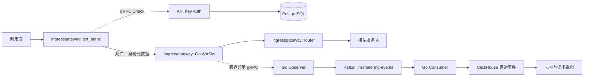
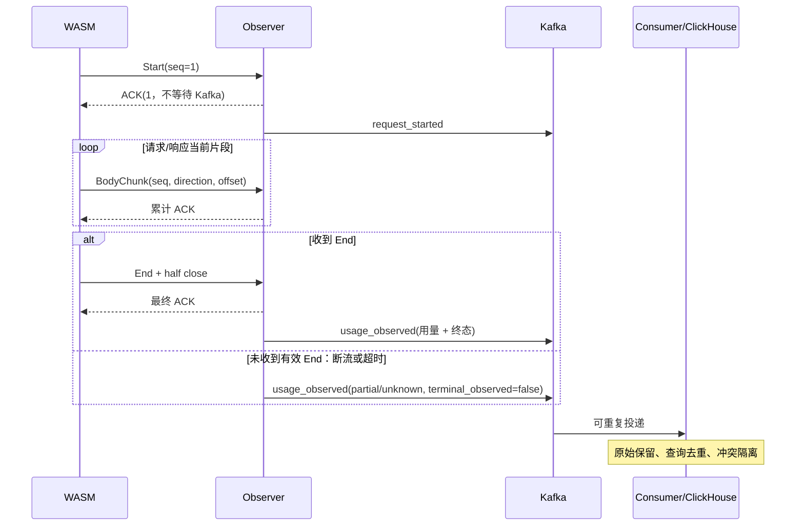

# 网关请求采集开发实现方案

版本：V1.4｜日期：2026-10-09｜状态：开发设计，尚未完成真实网关 PoC 和性能验收。

依据：[原技术方案](token-metering-design.md)、[产品方案 V2](token-metering-design-v2.md)、[API Key Auth 服务方案](api-key-auth-service-implementation.md)。本文细化第一批“鉴权后采集到明细入库”工作，不代表原方案的一期功能全部交付。本文中的 SQL、协议和配置供后续实现使用；Go 代码标明为伪代码的部分不能直接编译。

## 1. 范围与技术决策

| 项目 | 本批决策 |
| --- | --- |
| 业务环境 | Istio 1.13.5、Kubernetes 1.22，先在实际私有网关镜像验证 |
| 网关插件 | Go + TinyGo，Proxy-Wasm，EnvoyFilter 加载本地固定文件 |
| 接收与消费 | Go Observer、Go Consumer，独立部署 |
| 数据路径 | WASM → 双向 gRPC → Observer → Kafka → Consumer → ClickHouse |
| 协议 | 兼容 Chat Completions 的 JSON 和 SSE，包括工具调用、多候选 |
| 用量 | 只提取有效服务 usage；缺失字段为 null/unknown，本批不估算 |
| 配置 | 采集参数使用版本化 JSON/YAML、ConfigMap；采集组件不建设管理 API，身份与 API Key 由独立 Auth + PostgreSQL 管理 |
| 存储 | 类型化原始计量事件（保留规范 JSON 作冲突证据）、去重视图、请求关联视图，在线保留 30 天 |
| 故障策略 | 业务不等待采集，采集超限或失败放弃，无落盘、重传及恢复队列 |
| 查询交付 | 本批提供计量查询 ID、事件字段、SQL 和联调查询样例；客户查询 HTTP API、门户和导出任务仍属后续一期工作 |
| 后续工作 | tokenizer、小时/日汇总、对象存储归档、看板、计费账单、A 侧逐尝试观察 |

只观察入口直接访问的服务 A 及其最终响应；不还原 A 内部 B/C 调用、网关隐藏重试或客户端未收到的后端消耗。客户端重新发起请求形成新的采集请求 ID。

对白名单内支持该参数的 Chat Completions 路由，插件必须在流式请求转发前设置 `stream_options.include_usage=true`，客户端未传时主动添加、传 false 时覆盖。除这一明确改写外，保留业务字段、路由、重试和取消策略，不要求模型再执行一次；请求缓冲引入的时延纳入验收。上游仍未返回 usage 时只能产出未知用量，添加参数不等于保证获得 usage。

### 1.1 版本与兼容性基线

| 组件 | 开发基线与锁定方式 |
| --- | --- |
| Envoy | 原方案追溯到 Istio Envoy 提交 `e2e40d8d667e1b7c752d27980307f22d9f73e9ee`，标识为 `1.21.3-dev`；实际镜像另记 digest |
| SDK | 以 `github.com/tetratelabs/proxy-wasm-go-sdk v0.24.0` 为可复现 PoC 基底，在仓库内维护最小 gRPC 扩展，禁止直接依赖浮动 main |
| Go / TinyGo | 当前工作环境为 Go 1.25.0、TinyGo 0.40.1；仅作为首轮编译候选，不宣称已兼容旧 Envoy；通过后记录构建镜像 digest |
| Kafka 客户端 | `github.com/twmb/franz-go v1.18.1` 为本文 API 核查基线，生产依赖按验证结果锁定 go.mod/go.sum |
| Kafka / ClickHouse | 复用目标环境，实施前记录服务端实际版本；本文避免依赖新版 JSON 列、刷新物化视图等能力 |
| Protobuf / gRPC-Go | Observer 使用标准生成代码；WASM 使用小型定长上界编解码器，双方以同一 `.proto` 做兼容测试 |

本地 SDK v0.24.0 的 `abi_hostcalls.go` 未实现 gRPC stream/send/cancel，不能直接写一个不存在的 `DispatchGrpcStream` 调用。其普通 HTTP callout 在调用者 context 被删除后还会跳过回调。因此本方案明确包含 SDK 扩展工作，而不是只写业务过滤器。[SDK 固定源码](https://github.com/tetratelabs/proxy-wasm-go-sdk/tree/v0.24.0/proxywasm/internal)

SDK 原仓库已归档，选它是为了固定可审查的最小基底；扩展代码、依赖审计及维护归本项目。PoC 若不能通过，停止发布，记录失败证据并重新评审语言/运行时方案，不自动改为逐片 HTTP 请求或同步 ext_proc。[SDK 仓库状态](https://github.com/tetratelabs/proxy-wasm-go-sdk)

## 2. 架构与接入契约



WASM 不解析业务 JSON、不运行 tokenizer、不使用 Go 网络库直连 Kafka。Observer 不承接业务路由；接收正文只为当前解析，完成或放弃后释放。任何组件的日志、错误、trace、死信记录都不得含正文或密钥。

### 2.1 路由、身份与过滤器顺序

1. 在 ingressgateway HTTP filter chain 中，把插件放在 `envoy.filters.http.ext_authz` 之后、router 之前；顺序以真实 `config_dump` 确认。Auth 及 PostgreSQL 设计见独立文档。
2. 必须在请求头阶段按第 2.3 节执行“可信路由显式启用 + 方法 + 路径”联合白名单，仅匹配 route_name 不足以启用采集。服务 ID 来自配置，不从客户端路径推断；Observer 服务路由永远排除。
3. 本批统计基数为到达该观察位置且命中完整白名单的请求，不包含同路由上的普通查询。鉴权前被拒绝的请求可能不经过插件，单列网关指标，不混入完整率分母。
4. 可信身份来自 Auth 的 `CheckResponse.dynamic_metadata`，由 Envoy 写入 `filter_metadata.envoy.filters.http.ext_authz` namespace。
5. 不信任客户端传入的 API Key ID、客户 ID、应用 ID；本批不支持把任意请求头配置为身份来源。

| 逻辑字段 | 示例元数据叶子 | 处理规则 |
| --- | --- | --- |
| api_key_id | `envoy.filters.http.ext_authz.api_key_id` | Auth 返回的稳定 ID；不记录密钥原文 |
| customer_id | `envoy.filters.http.ext_authz.customer_id` | 鉴权时的客户快照 |
| application_id | `envoy.filters.http.ext_authz.application_id` | 鉴权时的应用快照 |
| identity_status | 插件生成 | 三项齐全为 known；鉴权成功却缺失任一字段时标记 invalid 并报警，不猜归属 |
| service_id / adapter_id | 路由配置 | 必填；不在配置中的路由不采集 |
| config_version | 插件配置 | 开始时固定，同一请求后续不切换版本 |

SDK `GetProperty` 路径候选为 `metadata/filter_metadata/envoy.filters.http.ext_authz/api_key_id` 等叶子路径；namespace 含点号时的实际路径分段、返回值编码及鉴权执行顺序必须在固定 Envoy PoC 验证。鉴权成功但元数据缺失属于接入错误，该请求可继续业务，但计量身份标 invalid，不能从普通请求头补齐。[属性读取接口](https://github.com/tetratelabs/proxy-wasm-go-sdk/blob/v0.24.0/proxywasm/hostcall.go)

模型名称/模型 ID（`request_model`、`response_model`）只接受合法 UTF-8，上限统一为 **1024 字节**，按解码后的字符串 UTF-8 字节数计量，不按字符数或 JSON 转义文本长度计量。其他身份 ID 保持 128 字节上限。超长或非法编码标为无效、不截断；模型字段写 null 并记录 `invalid_model`，合法 usage 仍可采集。模型名不承担鉴权职责。Observer 和 Consumer 必须使用同一模型长度校验契约；ClickHouse 使用 `Nullable(String)`，不使用 FixedString 或 VARCHAR(128)。只读取明确列出的头：`:method`、仅用于本地过滤的 `:path`、状态、Content-Type、Content-Encoding，以及用于辅助关联的 `x-request-id`；不发送原始头集合、路径、URL query、Authorization、Cookie、工具参数或错误响应文本。记录路由名代替原始 URL。

### 2.2 请求标识及时间

`logical_request_id = <start_unix_ms>-<root_nonce_32hex>-<counter_16hex>`。

- `start_unix_ms`：网关进入请求头回调的 UTC 毫秒时间；所有事件携带相同值。
- `root_nonce`：Root 初始化时用经 PoC 验证的 WASI `random_get` 生成 128 位随机值；不可用则禁用本 Root 采集并报警，不能退化为单独时间戳。
- `counter`：Root 内从 1 递增的 uint64；用完则停止新采集，不回绕。多 Worker、重启、热更新由不同 nonce 隔离。
- `observation_id` 本批等于 `logical_request_id`，`observation_scope` 固定 `gateway_response`。
- `event_id` 分别为 `<logical_request_id>:start`、`:usage`、`:finish`；不复用客户端 request ID。

`logical_request_id` 是计量主键。匹配白名单后，插件在请求头回调生成并保存于 HTTP context；即使 Observer 无法接收，也应独立于旁路额度尝试在最终响应头写入 `X-Metering-Request-Id: <logical_request_id>`。该头由网关覆盖上游同名响应头，不改写 `X-Request-Id`。浏览器跨域调用如需读取此头，由网关 CORS 配置暴露；客户端应记录响应头以供一期查询接口使用。鉴权前拒绝、插件未执行或客户端未收到响应头时，不能保证取得计量 ID；返回了 ID 也只表示插件生成了标识，不保证事件成功入库。

可选 `x_request_id` 是插件在请求头回调读取的**网关当时可见**的 `x-request-id`，只接受 1–128 字节且符合 `[A-Za-z0-9._:-]+` 的值；缺失、过长或非法时为 null，并计数，不截断。插件只读取这个指定头，不枚举或上报其他请求头；重复头如何呈现依赖固定 Envoy 的处理，联调须覆盖，但无论如何该值都只是非唯一辅助关联。它随 `Start` 和两类事件保存，供访问日志/链路追踪辅助关联。Envoy 是否生成、替换或保留客户端 `X-Request-Id` 取决于实际 HTTP Connection Manager 配置；它可能来自客户端，也可能跨多跳复用，因此不作为计量主键、幂等键或授权依据。阶段 0 要在固定网关 `config_dump` 和实际请求中验证该行为及响应头可见性。[Envoy 1.21 HTTP Connection Manager](https://www.envoyproxy.io/docs/envoy/v1.21.0/api-v3/extensions/filters/network/http_connection_manager/v3/http_connection_manager.proto)

Consumer 校验 ID 时间前缀与 `request_started_at_ms` 完全一致，以 ID 时间计算存储分区，不使用 Observer/入库时间分区。这样同一事件不能通过更改时间字段逃离冲突检查。请求持续跨午夜时全部事件仍进入开始日期分区。

持续时间使用可用的单调时钟；绝对时间使用 UTC。检测时间倒退时记录 `clock_anomaly`，不生成负 duration。网关时钟偏差超 5 分钟触发接入告警；不偷偷改为入库时间。

### 2.3 入口采集过滤强制约束

本节为实现和上线验收的强制约束；“白名单请求”均指命中以下完整条件的请求。

1. **默认忽略**：全局 enabled 必须为 true，且可信 route_name 对应规则显式 enabled=true、方法和路径同时命中，才标记 selected。缺少规则、规则禁用、属性读取失败均不采集，不得回退为全量采集。route_name 必须从 Envoy 可信路由属性取得，不接受客户端 Header 控制开关、路由名、service_id 或 adapter_id。
2. **首批只允许 Chat Completions**：adapter_id 固定为 chat_completions_v1，methods 固定为 ["POST"]，paths 为非空精确路径列表，默认 ["/v1/chat/completions"]。部署使用自定义前缀时必须逐条配置并验证；禁止通配符、前缀、包含或正则匹配。GET、HEAD、OPTIONS、指标、健康检查和模型列表接口不得进入采集；未来其他协议需独立适配器和评审。
3. **路径口径固定**：使用 Wasm 请求头回调当时可见的 :path，去掉第一个 ? 及其后的查询串后逐字节匹配；插件不额外 URL 解码、大小写折叠、合并斜杠或去除尾斜杠。网关此前已做的规范化以实际可见结果为准。路径和 query 不上报、不入库、不记日志或指标标签。规则按该观察位置配置，不使用上游重写后的路径猜测；路径重写、路由属性及执行顺序须在固定镜像 PoC 验证，读取不到可信属性时禁止扩大匹配范围。
4. **先过滤再分配**：HTTP context 初始 selected=false，只保存必要标志。未命中时不生成 logical_request_id、不读取身份或正文、不申请改写/观察额度、不建立观察 gRPC 流、不发送 Start/BodyChunk/End、不添加计量响应头，所有后续回调直接 Continue（结束回调直接返回）。不得为这类请求产生两类 Kafka 事件，包括 unknown 占位事件；只增加本地忽略计数。Envoy/SDK 基础 HTTP context 的创建不等于分配计量状态。
5. **请求内固定结果**：命中后固定规则、config_version 和 selected，后续配置更新、响应状态、usage 缺失不得改变本次选择。Content-Type、Content-Encoding、请求体中的 model/stream、是否携带 API Key 均不能替代入口白名单。内容类型/压缩不支持仅影响改写和解析；命中的失败响应、非法正文或断流仍按现有有界流程尝试产生可观察事件，未知用量不得补零，不承诺两事件必达。
6. **鉴权独立**：不采集不代表免鉴权；普通查询按其自身鉴权策略处理。命中请求仍从 ext_authz 获取可信身份；鉴权前被拒绝的请求不在本观察位置的分母中。Observer/Consumer 的 schema、adapter_id/config_version 校验仅为防御性校验，不能替代入口过滤；现有事件不携带原始路径，不声称下游能重新验证全部匹配条件。

规则匹配按全局禁用、路由缺失/不匹配、规则禁用、方法不匹配、路径不匹配的顺序判定；属性读取异常记 attribute_unavailable，其他首次失败原因分别为 disabled、route_not_allowed、route_disabled、method_not_allowed、path_not_allowed，每请求只计一次。路由规则上限 128 条，每路由最多 16 个路径，每路径最多 1024 UTF-8 字节；请求头读取上限同时由网关配置约束，禁止无界复制。

## 3. WASM → Observer 协议

仅对命中入口白名单且取得观察额度的请求建立一个逻辑 gRPC 双向流，复用底层 HTTP/2 连接。服务名 `metering.v1.ObservationService`，方法名 `Observe`。一次流只承载一个请求，不跨请求复用应用层序号。

### 3.1 Protobuf 定义

以下内容作为后续 `api/observation/v1/observation.proto` 的初始契约：

```proto
syntax = "proto3";
package metering.v1;
option go_package = "example.com/llm-token-stats/gen/observation/v1;observationv1";

service ObservationService {
  rpc Observe(stream ObservationFrame) returns (stream ObservationAck);
}

enum Direction {
  DIRECTION_UNSPECIFIED = 0;
  REQUEST = 1;
  RESPONSE = 2;
}

message ObservationFrame {
  uint32 schema_version = 1;       // 本批固定 1
  string logical_request_id = 2;
  uint64 frame_seq = 3;            // 从 1 开始，整个流严格递增
  oneof payload {
    Start start = 10;
    ResponseHeaders response_headers = 11;
    BodyChunk body_chunk = 12;
    End end = 13;
  }
}

message Start {
  int64 request_started_at_ms = 1;
  string gateway_instance_id = 2;  // Pod UID，不是客户端输入
  string config_version = 3;
  string route_name = 4;
  string service_id = 5;
  string adapter_id = 6;
  optional string api_key_id = 7;
  optional string customer_id = 8;
  optional string application_id = 9;
  string identity_status = 10;
  string method = 11;
  string request_content_type = 12;
  string request_content_encoding = 13;
  bool request_end_stream = 14;
  optional string x_request_id = 15; // 网关可见的 X-Request-Id，仅辅助关联
}

message ResponseHeaders {
  uint32 http_status = 1;
  string content_type = 2;
  string content_encoding = 3;
  bool end_stream = 4;
}

message BodyChunk {
  Direction direction = 1;
  uint64 body_seq = 2;             // 每方向从 1 开始
  uint64 offset = 3;               // 每方向从 0 开始的正文绝对字节偏移
  bytes data = 4;
  bool end_stream = 5;             // 仅当前回调最后一个子片设置
}

message End {
  int64 request_finished_at_ms = 1;
  uint64 last_request_body_seq = 2;
  uint64 last_response_body_seq = 3;
  uint64 request_bytes_seen = 4;
  uint64 response_bytes_seen = 5;
  bool request_end_stream_seen = 6;
  bool response_end_stream_seen = 7;
  optional uint32 http_status = 8;
  optional uint32 upstream_attempt_count = 9;
  optional string response_flags = 10;
  optional string response_code_details = 11;
}

message ObservationAck {
  string logical_request_id = 1;
  uint64 accepted_frame_seq = 2;   // 连续处理完成的最高 frame_seq
  bool close_stream = 3;
  string reason = 4;              // 固定原因码，禁止透传异常文本
}
```

`example.com` 仅为仓库尚无正式 Go module path 时的占位符；建工程时一次性替换。字段号发布后不复用，新增字段保持向后兼容；未知 `schema_version` 拒绝观察流，不影响业务。

### 3.2 消息顺序、ACK 与缺片

- `Start` 必须为 frame 1，且每流仅一次；无有效 Start 的流直接关闭，不制造请求事件。
- `ResponseHeaders` 发送最终业务响应头，忽略 1xx；请求和响应分片可交错，每方向独立累计偏移。
- 无正文时头消息的 `end_stream=true`；trailers 回调只更新方向结束标志，不复制 trailers。`End` 仍是明确请求终态的唯一消息。
- Observer 校验 frame 序号、方向 body_seq、offset 和 End 总量；序号跳跃、重复或不一致均判 `protocol_error` 并定稿 partial/unknown 后关闭。gRPC 本身有序，本批不尝试乱序缓存或正文重传。
- ACK 在 Observer 已接纳并处理该消息、释放其临时缓冲后产生，不等待 Kafka。请求 JSON 的有界解析状态仍受 Observer 总额度约束。
- ACK 累计确认，最多每 8 帧或 10 毫秒发送一次，Start 与 End 立即确认。只保留一个可覆盖的“最新 ACK”槽；写阻塞超时即关闭流，不积压 ACK 队列。
- 插件按本地发送账本释放 `<= accepted_frame_seq` 的字节/消息额度；忽略重复 ACK。ID 不符、确认未发送序号或超大 ACK 视为协议错误并取消旁路。
- `End` 的 frame_seq 是最终序号。发送 End 使用 `end_of_stream=true` 半关闭发送方向，仍可接收最终 ACK；ACK 或超时后取消/清理剩余调用。

本协议没有恢复 token、补传 cursor、历史补报方法或逐片持久化确认。

## 4. WASM 插件实现

### 4.1 SDK 最小扩展

在固定 SDK 副本上实现以下 hostcall、导出回调、mock 与 Root token 注册表；请求改写使用下述有界 Pause/恢复流程，响应及旁路故障不等待采集端。

| 分类 | ABI 名称 / 项目封装 |
| --- | --- |
| 创建流 | `proxy_grpc_stream` → `OpenObservationStream` |
| 发送 | `proxy_grpc_send` → `SendObservationFrame` |
| 半关闭/取消 | `proxy_grpc_close`、`proxy_grpc_cancel` |
| 回调 | `proxy_on_grpc_receive_initial_metadata`、`proxy_on_grpc_receive`、`proxy_on_grpc_receive_trailing_metadata`、`proxy_on_grpc_close` |
| 读取 ACK | `proxy_get_buffer_bytes`，buffer type 为 gRPC receive buffer |
| 上下文切换 | `proxy_set_effective_context`，显式切到 Root 并恢复原 HTTP context |

签名逐项按 Proxy-Wasm ABI 和固定 Envoy host 实现核对，特别检查指针、长度、token、状态码与空消息。`proxy_grpc_stream` 的 upstream 参数是序列化 `envoy.config.core.v3.GrpcService`，不是直接传 cluster 名字符串；本批只编码 `envoy_grpc.cluster_name`。[ABI 规范](https://github.com/proxy-wasm/spec/blob/main/abi-versions/v0.2.1/README.md)

项目封装接口设计如下，均为新增接口：

```go
// 设计接口，不是现成 SDK API。
type GrpcCallbacks interface {
    OnReceive(token uint32, ackBytes []byte)
    OnClose(token uint32, status uint32)
}
type ObservationTransport interface {
    Open(rootID uint32, cluster, service, method string, cb GrpcCallbacks) (uint32, error)
    Send(token uint32, protobuf []byte, endStream bool) error
    Cancel(token uint32) error
}
```

回调注册以 `rootID + token` 定位，不能捕获 HTTP Context 指针。已清理 token 的迟到回调直接忽略；SDK 的全局 current context 及 host effective context 都要切换/恢复。Root 销毁时清空注册表并取消活动调用，`OnPluginDone` 返回 true，不延长代理退出。

WASM 中不引入 gRPC-Go、网络 goroutine、完整 Envoy protobuf 类型或反射式业务 JSON 解析。用有界 Protobuf 编码器写入 frame，ACK 解码跳过未知字段并校验长度；服务端标准生成代码与手工编码器双向对照测试。

### 4.2 上下文和状态机

| 层次 | 保存状态 |
| --- | --- |
| VM | 入口注册、构建版本 |
| Root / PluginContext | 不可变配置、nonce/计数器、token→采集状态、在途额度、deadline 最小堆、指标 |
| HTTP Context | selected（默认 false）、固定规则/config_version、采集状态 ID、方向累计字节/片序、EOS 标志、少量响应元数据、改写阶段及预算；正文只在有界改写期间临时持有 |
| 采集状态 | ACTIVE / END_SENT / DROPPED / CLOSED、token、frame_seq、未 ACK 帧长度与发送时刻、结束 deadline |

正常转移为 `ACTIVE → END_SENT → CLOSED`；任何资源或传输故障转 `DROPPED → CLOSED`。HTTP Context 删除不删除仍处在 END_SENT 的 Root 状态；其存活受结束 ACK 期限限制。禁止 `proxy_done` 延迟业务请求回收。

### 4.3 请求 usage 参数补充与回调伪代码

请求改写独立于 Observer 连接和采集额度：旁路不可用时，仍对符合条件的请求补充参数。插件启用后，`chat_completions_v1` 路由必须执行本规则；接入前验证上游支持该参数，不做自动重试或删除参数后重发。

1. 先按第 2.3 节完成入口过滤；仅对 selected 请求判断 JSON Content-Type 和 identity Content-Encoding。请求头已带 EOS（无正文）时直接 Continue，不进入缓冲。符合条件时，先申请独立改写预算，并在头尚未转发时调用 `RemoveHttpRequestHeader("content-length")`；成功后返回 Pause，阻止请求头提前到达上游。HTTP/1.1 的消息定界交由 Envoy，插件不手写 Transfer-Encoding。非目标路由、非 JSON 或压缩请求直接透传并计数。
2. 请求体以 Envoy 累积缓冲为准，未 EOS 返回 Pause，不将每次累计 buffer 重复追加。原始请求上限 256 KiB，改写结果也必须不超过 256 KiB；每个待改写请求预留 1 MiB，覆盖 host buffer、WASM 读取副本、输出和解析索引，Root 总预算 16 MiB、最多 16 个并发。超过预算直接原样放行并记 `rewrite_resource_limit`；不等待额度。host 超限回调的额外字节及 native buffer 另计入网关预算。
3. 完整 JSON 有界校验后，仅对顶层布尔 `stream=true` 改写：没有 stream_options 或值为 null 时创建对象；已有对象时保留其他字段，把 include_usage 添加或替换为 true；原本为 true 时幂等。`stream=false` 或未设置 stream 的普通请求不添加该字段。stream_options 为其他类型、重复键、非法 JSON、深度超过 64 或元素超过 100000 时保持原文并记 `rewrite_invalid_json`。采用 token 位置编辑，避免重新编码 messages/tools、改变数值精度或其他业务字段。
4. 在最终 body 回调内调用 `ReplaceHttpRequestBody`，成功后返回 Continue。改写后的请求是唯一请求观察来源：从 offset=0 分片，只发送一次；按 16 KiB 拆片、在途不足时放弃旁路，不等待 ACK。这个有界完整请求路径不套用流式响应的 64 KiB/4 片回调限制。替换失败只在已验证 host 未修改原 buffer 时原文放行，不能转发部分改写内容。
5. 改写等待最多 2000 ms（从请求头回调开始）。Root tick 在 HTTP context 仍存活时切换有效上下文，超时则 `ResumeHttpRequest` 原文放行并转入永久透传状态；后续片段不再次缓冲或改写。超限、客户端断开、context 删除和热更新都释放改写预算；暂停期间的 trailers 结束路径须在真实 Envoy 验证正文改写 hostcall 是否可用，若不可用则原文恢复并记 `rewrite_trailers_unsupported`，不能无限 Pause。任何旁路网络操作不得延长暂停期限。

改写状态为 BYPASS / BUFFERING / REWRITTEN / PASSTHROUGH，与观察状态机独立。上述失败路径遵循业务 fail-open，但意味着 include_usage 未保证注入，必须单独统计 `rewrite_failed`（固定原因码），纳入采集完整率告警和灰度验收，不能静默宣称成功。压缩、非法 JSON、超限等不支持场景不承诺 usage 完整；正常支持范围内的缺字段/false 请求必须补充成功。

以下 requestRewrite 方法是按上述契约实现的项目封装，不是 SDK 现成接口。

以下省略注册和错误类型，`root.Try*` 均为项目实现函数。

```go
func (h *HTTPContext) OnHttpRequestHeaders(_ int, eos bool) types.Action {
    startMs := gatewayNowMillis() // 在其他处理前记录
    rule, reason, ok := h.root.MatchCollectionRequest() // 可信路由 + enabled + 方法 + 精确路径
    if !ok {
        h.root.CountIgnored(reason)
        return types.ActionContinue
    }
    h.selected = true // 固定规则和 config_version，后续不重新匹配
    h.root.CountSelected()
    h.logicalRequestID = h.root.NewLogicalRequestID(startMs)
    h.xRequestID = readOptionalGatewayRequestID() // 有界校验；不影响鉴权和业务
    action := h.requestRewrite.OnHeaders(rule, eos)
    if !h.root.TryReserveStream() { return action }
    h.state = h.root.NewObservation(startMs, rule, readTrustedIdentity(), h.logicalRequestID, h.xRequestID, eos)
    if !h.root.TryOpenAndSendStart(h.state) { h.root.Drop(h.state, "open_failed") }
    return action
}

func (h *HTTPContext) OnHttpRequestBody(n int, eos bool) types.Action {
    if !h.selected { return types.ActionContinue }
    // 封装负责 Pause、完整改写、一次性分片观察或原文透传。
    return h.requestRewrite.OnBody(n, eos, h.state)
}
func (h *HTTPContext) OnHttpResponseBody(n int, eos bool) types.Action {
    if !h.selected { return types.ActionContinue }
    h.observeBody(Response, n, eos)
    return types.ActionContinue
}
func (h *HTTPContext) observeBody(dir Direction, n int, eos bool) {
    if !h.root.IsActive(h.state) { return }
    // Continue 模式下按当前回调 buffer 读取，不能用累计请求偏移去读当前 buffer。
    // 先检查整个回调的字节数、分片数和额度，再执行有界复制。
    if !h.root.ReserveCallbackBudget(h.state, dir, n) {
        h.root.Drop(h.state, "resource_limit"); return
    }
    for pos := 0; pos < n; {
        size := min(n-pos, h.root.cfg.ChunkBytes)
        b, err := readCurrentBody(dir, pos, size)
        if err != nil { h.root.Drop(h.state, "body_read_failed"); return }
        last := pos+size == n
        if !h.root.TrySendChunk(h.state, dir, b, eos && last) { return }
        pos += size
    }
    // ReserveCallbackBudget 将 n == 0 且 eos 的空分片也计入额度。
    if n == 0 && eos {
        if !h.root.TrySendChunk(h.state, dir, nil, true) { return }
    }
    h.root.RecordEOS(h.state, dir, eos, n)
}

func (h *HTTPContext) OnHttpResponseHeaders(_ int, eos bool) types.Action {
    if !h.selected { return types.ActionContinue }
    // 即使旁路流建立失败，也尝试向客户端返回本次计量查询 ID。
    h.replaceMeteringRequestIDResponseHeader()
    h.root.TrySendResponseHeaders(h.state, readAllowedResponseMetadata(), eos)
    return types.ActionContinue
}
func (h *HTTPContext) OnHttpStreamDone() {
    if !h.selected { return }
    // 在 HTTP context 仍有效时读取结束属性，再交给 Root；不捕获 h。
    h.root.TrySendEnd(h.state, snapshotObservableEnd())
    h.requestRewrite.Release() // 释放改写预算和存活 context 注册
    h.state = 0
}
func (p *PluginContext) OnTick() {
    p.ExpireDueRewrites(256) // 有界恢复超时且仍存活的请求
    p.ExpireDueObservations(256) // 有界 deadline 堆，不能每 tick 全表扫描
}
```

`replaceMeteringRequestIDResponseHeader()` 只对已生成 ID 的白名单请求执行；先用 `RemoveHttpResponseHeader` 清除同名上游头的所有值，确认成功后再用 `AddHttpResponseHeader` 写入一个网关生成值。不能只调用 `ReplaceHttpResponseHeader`，固定 SDK 的该接口在重复头时只替换第一个值。删除/添加失败计数并继续业务；重复头及不存在头的实际 hostcall 行为需在 PoC 验证。[固定 SDK 响应头接口](https://github.com/tetratelabs/proxy-wasm-go-sdk/blob/v0.24.0/proxywasm/hostcall.go) `readOptionalGatewayRequestID()` 只读取、校验这一指定头；读取失败只丢弃辅助字段，不影响业务或主 ID，且不能从 `X-Metering-Request-Id` 请求头读值。请求和响应 trailers 回调也必须先检查 selected，未命中直接 Continue。实际 `OnHttpRequestTrailers` 对命中请求必须先结束或降级请求改写状态，再记录 EOS；`OnHttpResponseTrailers` 只记录 EOS，返回 Continue。`snapshotObservableEnd()` 的字段读取失败即留空；上游尝试数来自 Envoy 已验证属性，不读取客户端伪造的 attempt-count 头。response flags/code details 只允许已登记的有界诊断码，不持久化可能夹带上游错误文本的任意字符串。

在实际 filter chain 中确认 bodySize 表示当前可见 buffer：请求改写期间使用累计 buffer；响应保持 Continue，但其他过滤器可能缓冲正文，导致单次回调很大。响应超过单回调额度直接放弃采集，不能先读取完整正文再检查大小；禁止跨回调保留 host buffer 引用。

### 4.4 流控、内存与释放

以下是测试初值，不是生产容量承诺；所有数字在配置中显式定义，0 不表示无限。

| 配置项 | 类型/单位 | 初值 | 超限动作 |
| --- | --- | ---: | --- |
| chunk_bytes | uint32/字节 | 16384 | 当前回调内拆片 |
| callback_max_bytes | uint32/字节 | 65536 | 复制前取消旁路 |
| callback_max_chunks | uint32/个 | 4 | 取消旁路 |
| request_body_max_bytes | uint64/字节 | 262144 | 取消旁路，Observer 以已见内容定稿 |
| rewrite_timeout_ms | uint32/毫秒 | 2000 | 原文恢复、永久透传 |
| rewrite_reservation_bytes | uint32/字节 | 1048576 | 单次改写固定预留 |
| root_rewrite_budget_bytes | uint64/字节 | 16777216 | 无额度原文透传并计数 |
| root_max_rewrites | uint32/个 | 16 | 同上 |
| response_body_max_bytes | uint64/字节 | 8388608 | 同上 |
| stream_inflight_bytes | uint32/字节 | 131072 | 取消旁路，不等待额度 |
| stream_inflight_messages | uint32/条 | 32 | 同上 |
| root_max_streams | uint32/流 | 512 | 新请求跳过采集 |
| root_inflight_bytes | uint64/字节 | 16777216 | 取消触发超限的旁路 |
| root_inflight_messages | uint32/条 | 8192 | 同上 |
| ack_timeout_ms | uint32/毫秒 | 2000 | 按最早未确认帧取消旁路 |
| end_ack_timeout_ms | uint32/毫秒 | 2000 | End 发送后清理旁路 |
| observation_max_ms | uint32/毫秒 | 600000 | 10 分钟后停止观察，业务继续 |
| tick_ms | uint32/毫秒 | 100 | 有界处理到期项 |
| metadata_max_bytes | uint32/字节 | 4096 | 无效元数据跳过/取消 |
| ack_max_bytes | uint32/字节 | 1024 | 取消旁路 |

在途字节按“Protobuf 序列化长度 + 5 字节 gRPC 消息头”计算；账本只留序号、长度与时间，不留可重传正文。发送成功只表示 hostcall 接纳。失败后释放未提交预留，取消已提交旁路并一次性清理账本；迟到 ACK 不得再次释放。

每流总额度内预留 4 条、8 KiB 给 Start/响应头/End，正文不能占用；仍需同时满足 Root 总额度。控制消息没有无限通道。如果已取消旁路，不再另开流补报 End；Observer 通过断开或期限定稿。

每个 Worker/VM 有独立 Root，本批每 Worker 每代仅装一个插件实例。改写预留为独立预算，最多另加 `worker_count × root_rewrite_budget_bytes`，热更新同样按代数放大。稳态实例理论在途上界为 `worker_count × root_inflight_bytes`，还需加 VM heap、gRPC/HTTP2、Envoy native buffer 和元数据。热更新旧新代共存时还要乘以存活代数；发布节流保证最多两代采集状态，旧代退出前不连续发布。发布模板固定并核验 worker 数；初始灰度用 2 Worker，对应稳态 32 MiB 记账在途，不能声称整个网关只增加 32 MiB。

WASM 线性内存高水位未必返还操作系统；验收检查长时间复用是否有界，而不是要求 RSS 每次请求结束立即下降。给网关预算增加足够余量，比较 VM heap、native heap、RSS 和活跃 token 数。没有实测通过前不得靠提高限额解决丢采。

## 5. Observer 解析及一次定稿

### 5.1 状态管理

gRPC-Go 每流一个处理器，不为每片启动 goroutine。每个流在首次 Recv 前非阻塞申请活动流槽及一份 32 KiB 接收预留，再把消息转入另行记账的解析状态；不能接收完所有消息才检查内存。gRPC 内部帧/连接缓冲不包含在这份预留中，需同时约束连接数、HTTP/2 窗口及并发流。ACK 写协程每流最多一个；状态由单流串行处理，写侧只读最新 ACK 快照。接收消息上限 32 KiB，活动流上限 4096，解析状态总预算 256 MiB，进程 memory limit 初值 1 GiB；额外运行时/连接内存纳入压测。

收到合法 Start 后尝试发送 `request_started`；Kafka 失败不重开观察流。请求 JSON 最多保存 256 KiB，以获得 model/stream；保存期间计入全局预算。响应普通 JSON 最多 1 MiB；SSE 只保存当前事件和 usage 候选，单事件最大 256 KiB。全流传入响应最多 8 MiB。限制 UTF-8、JSON 深度 64、JSON 元素数 100000；避免一次巨大对象耗尽 CPU。

Observer 每处理至多 64 KiB 解析数据检查 deadline 和资源预算。单流累计解析 CPU 预算以处理耗时近似限额 100 ms 做测试初值；这是协作式检查，不宣称能中断 Go 标准库中任意解析操作。小块解析、大小/深度上限和进程隔离共同限制风险。

Observer 的绝对观察期限为 605 秒，比插件长 5 秒，覆盖正常结束提交。无未确认消息但业务长时间静默时，不用短 ACK 期限误杀 SSE；绝对期限仍有效。断开、解析失败、期限到达只触发一次 finalize。完成后忽略迟到内容、不查询服务补算、不跨流恢复。

### 5.2 解析规则

| 输入 | 处理 |
| --- | --- |
| 请求 JSON | 完整、有界解析 model 和 stream，校验其类型；messages/tools 仅跳过，不持久化 |
| 普通响应 JSON | 验证完整 JSON，提取顶层 model、usage；不存 choices/message/error |
| SSE | 支持 LF/CRLF、注释、空行分隔、多行 data 拼接；UTF-8/JSON 可跨网络片段 |
| SSE 内容片段 | 遍历事件但不累计文本 token，不只处理 choices[0]；工具参数只验证结构/跳过 |
| SSE usage | `chat_completions_v1` 只接受终结 usage 块：usage 为对象且 choices 为空数组 |
| SSE 结束 | `[DONE]` 是协议结束标记，不等于网关请求结束；是否有 End 分别记录 |
| 多次 usage | 相同候选允许；不同终结候选标 `usage_conflict`，不取最大值，不相加 |
| 非 2xx | 仍按适配器解析可见合法 usage；HTTP 错误不自动等于零 token |
| 压缩正文 | 本批不解压；任一方向 Content-Encoding 非空且非 identity，标 `unsupported_encoding`，该方向用量/模型未知 |
| 不支持 Content-Type | 记录元数据，标 `unsupported_content_type`，不猜测协议 |
| SSE 中部分 UTF-8/JSON、超长事件 | 停止解析并关闭观察流，定稿 partial/unknown，不记录原始错误片段 |

不通过修改 Accept-Encoding 或插入解压过滤器改变业务。若既有过滤器链已解压，应验证插件实际见到的正文及 Content-Encoding 一致；否则按不支持处理。

`chat_completions_v1` 的终结 usage 语义要求服务样例验证。不符合上述语义的服务使用新的 adapter_id 和独立测试，不能把流内占位 0 当最终用量。

SSE 完整协议要求 `[DONE]`；缺少它但收到传输 EOS/End 时标 `protocol_incomplete`，仍可保留已解析的终结 usage，观察完整性降为 partial。`[DONE]` 后只允许空白/注释，出现额外业务 data 也判协议异常。同一次观察出现不同终结 usage 时，本批全部归一化用量置 null/unknown，usage_status=conflict；raw_usage_json 仅保留第一份白名单候选作为诊断依据，不把它作为选中的最终值。

### 5.3 字段归一化

| 输出字段 | 兼容协议来源 | 包含关系 |
| --- | --- | --- |
| input_tokens | usage.prompt_tokens | 输入总量 |
| output_tokens | usage.completion_tokens | 输出总量 |
| cached_read_tokens | usage.prompt_tokens_details.cached_tokens | 已包含于 input_tokens，不再相加 |
| cached_write_tokens | 本适配器无标准来源 | null/unknown，不从文本推断 |
| reasoning_tokens | usage.completion_tokens_details.reasoning_tokens | 已包含于 output_tokens |
| reported_total_tokens | usage.total_tokens | 原服务上报总量，不用推导值覆盖 |

每字段保存 `{value, source}`，本批 source 仅 `reported` 或 `unknown`。接受整数 JSON 数字，范围 `[0, 9223372036854775807]`；解析用 `json.Number`，拒绝字符串、布尔、负数、小数、溢出，不能先转 float64。缺失、非法值转换为 null，分别打原因码；有效 0 保留。

校验 `cached_read <= input`、`reasoning <= output`，以及两项都已知时 `input + output == reported_total`；加法用溢出检查。冲突保留合法数值和来源以便解释，但 `usage_status=conflict`、`usage_eligible=false`。禁止据总量倒推缺失字段。

`raw_usage_json` 不是任意 usage 对象的转存：只白名单复制上表数值字段及其 details 对象，最多 4 KiB，其余字段丢弃，设置 `raw_usage_truncated=true`。内容仅作为首次依据，不含正文、自由文本或服务原始错误。超限时保存 `{}` 并标记，不保存截断后的非法 JSON。

### 5.4 完整性与终态

来源、采集完整性、用量状态、业务结果分开建模：

- `observation_status`：complete（两方向 EOS、序号/总量正确、有 End）、partial（有缺失/截断）、unknown（只获得有限元数据）。
- `usage_status`：known（输入和输出均有效）、partial（只知道部分字段）、unknown、conflict。
- `usage_eligible`：仅当服务适配成功、observation_status=complete、输入输出均已知、无用量/身份冲突且身份 known 时为 true；它只表示本批有效统计候选，不代表允许收费。
- `business_outcome`：response_complete、stream_incomplete、unknown；HTTP 成败由 http_status 另查。不能把所有断流归因为客户主动取消。

普通 JSON 只有完整文档解析成功才能认定上报字段；已确认终结 SSE usage 即使后续流丢失也可以保留 reported 数值，但完整性标 partial，不进入有效统计候选。

收到有效 End 时，只生成一条同时包含用量和可观察终态的 `usage_observed`；明确流结束或超时但无 End 时仍尽力生成该结果事件，设置 `request_finished_at_ms=null`、`terminal_observed=false`，不伪造正常完成。finalize 先冻结结构化事件并释放解析正文，再尝试 Kafka 发送；ACK 写出和流关闭不等待 Kafka。每请求结果只定稿一次，之后不改写。Observer 进程退出可能连结果都没有，只能依赖已入队 start 显示缺失状态。



## 6. Kafka 事件与发送

### 6.1 事件格式

Topic 固定 `llm-metering-events`，key 为 logical_request_id 的 UTF-8；初始 24 分区、3 副本、`min.insync.replicas=2`、保留 72 小时、`cleanup.policy=delete`。分区数属压测初值；同一部署周期不在线改分区数，变更需停采、排空在途后切换。Kafka 不接收正文片段。

两类事件自带请求开始时间与身份快照，缺少 start 也能解释合并结果；缺少结果时，已入队的 start 只表示曾收到请求。模型等后续才知道的字段允许在不同事件类型之间不同，不属于同 ID 内容冲突。

```json
{
  "schema_version": 1,
  "event_id": "1789862400000-00112233445566778899aabbccddeeff-0000000000000001:usage",
  "event_type": "usage_observed",
  "logical_request_id": "1789862400000-00112233445566778899aabbccddeeff-0000000000000001",
  "x_request_id": "b3e1fba5-16a4-4dfb-aa84-50141e80d473",
  "observation_id": "1789862400000-00112233445566778899aabbccddeeff-0000000000000001",
  "observation_scope": "gateway_response",
  "producer_id": "observer-pod-uid",
  "gateway_instance_id": "gateway-pod-uid",
  "config_version": "collection-v1",
  "adapter_id": "chat_completions_v1",
  "route_name": "llm-chat",
  "service_id": "model-service-a",
  "api_key_id": "key-42",
  "customer_id": "customer-7",
  "application_id": "app-3",
  "identity_status": "known",
  "request_started_at_ms": 1789862400000,
  "observation_ended_at_ms": 1789862401200,
  "request_finished_at_ms": 1789862401195,
  "event_created_at_ms": 1789862401201,
  "request_model": "model-a",
  "response_model": "model-a-2026",
  "http_status": 200,
  "upstream_attempt_count": null,
  "response_flags": null,
  "response_code_details": null,
  "business_outcome": "response_complete",
  "terminal_observed": true,
  "observation_status": "complete",
  "usage_status": "known",
  "usage_eligible": true,
  "usage": {
    "input_tokens": {"value": 1000, "source": "reported"},
    "output_tokens": {"value": 500, "source": "reported"},
    "cached_read_tokens": {"value": 200, "source": "reported"},
    "cached_write_tokens": {"value": null, "source": "unknown"},
    "reasoning_tokens": {"value": 100, "source": "reported"},
    "reported_total_tokens": {"value": 1500, "source": "reported"}
  },
  "raw_usage_json": "{\"prompt_tokens\":1000,\"completion_tokens\":500,\"total_tokens\":1500}",
  "raw_usage_truncated": false,
  "anomaly_codes": []
}
```

两类事件使用相同固定字段集；`x_request_id` 在同一请求的开始与结果事件中相同，无法取得时显式为 null。start 的 `usage=null`、`usage_status=not_applicable`、`usage_eligible=false`、`raw_usage_json="{}"`，结束时间为 null、`terminal_observed=false`。结果事件同时保存用量、`terminal_observed` 和可取得的结束时间；未收到有效 End 时结束时间为 null，不填零或虚构完成状态。未获得模型、HTTP 状态等字段显式写 null；结果事件的 observation_status 反映采集完整性，不能因 HTTP 200 强行标 complete。

字段值由 Go 固定 struct 编码，字段顺序固定、无缩进，所有可选字段显式输出 null，字符串采用 Go encoding/json 默认转义；不接受同名重复 JSON key、未知顶层字段或自由扩展 map。Consumer 解码后按同一 schema struct 重编码为 `event_json`，计算 SHA-256 小写十六进制 `payload_hash`。摘要不含 Kafka 坐标/入库时间，包含 producer_id、事件时间和全部业务字段。重放保留原事件，不重新生成时间或 producer_id。

模型长度扩大后，两个模型字段在 JSON 转义情况下最多占约 12 KiB；单事件最大 **32 KiB**（按序列化后字节计），Observer 和 Consumer 使用同一上限，独立于 gRPC 单帧 32 KiB 限制；超限在发送前丢弃并计数。`anomaly_codes` 去重排序，最多 32 个固定枚举；不放异常堆栈、正文和密钥。首次版本至少包含 invalid_model、identity_unknown、invalid_usage、usage_conflict、missing_usage、missing_end、protocol_error、protocol_incomplete、unsupported_encoding、unsupported_content_type、parse_limit、transport_lost、observation_timeout、clock_anomaly。

### 6.2 Producer 策略

Observer 共享一个 producer，每事件先非阻塞申请执行槽，初值 256 个；无槽直接丢弃。不会创建一个等待 Kafka 恢复的应用队列。producer 内部网络在途内存仍存在，并受下面参数约束。

```go
// API 基于 franz-go v1.18.1；还需加入 SeedBrokers、TLS/SASL。
opts := []kgo.Opt{
    kgo.RequiredAcks(kgo.AllISRAcks()),
    kgo.DisableIdempotentWrite(),
    kgo.RecordRetries(0),
    kgo.UnknownTopicRetries(0),
    kgo.ProducerLinger(0),
    kgo.MaxBufferedRecords(256),
    kgo.MaxBufferedBytes(4 << 20),
    kgo.RecordDeliveryTimeout(2 * time.Second),
    kgo.ProduceRequestTimeout(time.Second),
    kgo.RequestTimeoutOverhead(time.Second),
    kgo.DialTimeout(time.Second),
}
// 获得槽后 TryProduce；在 promise 中释放槽。禁止失败后重新提交原事件。
```

这里显式关闭 producer 幂等，是为了避免其序列号约束延后失败，业务幂等交给事件键。`RecordDeliveryTimeout` 是粗粒度期限，不是严格墙钟上限；必须测连接黑洞/元数据不可达。执行槽按 promise 完成释放，不能 context 超时就提前复用仍占客户端内存的槽。[固定配置源码](https://github.com/twmb/franz-go/blob/v1.18.1/pkg/kgo/config.go)

增加 3 秒 watchdog：发现超龄发送则进入熔断，停止接纳新事件，对当前 producer 执行有界取消/关闭，丢弃在途集合；重建 producer 后仅接收新事件。取消/关闭若不能在额外 1 秒内释放，Observer 进程退出由 Deployment 重建，不能保留旧 producer 并无限新建。该行为也属于 PoC 故障验收项。

发送结果分 success、definite_failure、uncertain。超时/断连发生在已发送后通常不能证明 broker 未写入，标 uncertain，不补发。熔断恢复只恢复新采集；正常处理期限内的首次网络发送不算恢复补传。鉴权和 metadata 连接可重新建立，但不能携带已丢弃事件恢复发送。

ACK 与 Kafka 发送完全解耦；即便两条事件只有一条成功入 Kafka，Consumer 也应处理。不要为了保持两条事件齐全引入同步等待或事务缓冲。

## 7. ClickHouse 表结构与查询

### 7.1 存储选择与字段字典

Consumer 在校验规范事件时一次解析字段，直接写入 `events_raw` 的类型化列；保留规范 `event_json` 仅供冲突核验，常规 SQL 不执行 JSONExtract。`event_id` 是事件级逻辑键，`logical_request_id` 是请求级逻辑键：一笔请求最多有 start 和合并后的 usage 两条事件。物理主键采用请求日期、请求 ID、事件 ID 的前缀，以支持请求精查；ClickHouse 主键不是唯一约束，排序键还必须包含 `payload_hash`，让同一 `event_id`、不同内容的变体都留下。相同事件重放由 `FINAL` 在查询时即时去重，不能只依赖后台 merge。[ReplacingMergeTree 机制](https://clickhouse.com/docs/engines/table-engines/mergetree-family/replacingmergetree)

| 字段组 | 存储/逻辑类型 | 来源与说明 |
| --- | --- | --- |
| request_date | Date | 从请求 ID 的开始时间计算；分区键 |
| logical_request_id / event_id / event_type | String / String / LowCardinality(String) | 插件生成请求 ID / Observer 固定后缀 / 两种固定事件类型；Consumer 校验三者一致 |
| x_request_id | Nullable(String) | 网关可见的 `X-Request-Id`，辅助关联；可能缺失或重复 |
| payload_hash | FixedString(64) | Consumer 对规范事件计算 SHA-256 |
| event_json | String | 规范化事件副本，仅供冲突证据和迁移核验，禁止正文；常规查询不读取 |
| kafka_topic/partition/offset | String / Int32 / Int64 | 一次物理写入的 Kafka 坐标；重放后 `FINAL` 不保证选中最初一条 |
| ingested_at | DateTime64(3, UTC) | Consumer 写入时刻，不参与事件摘要 |
| 身份/模型/诊断码 | String、Nullable(String)、Array(String) | 固定字段直接落列；原事件 null 对应 SQL NULL |
| input/output/cache/reasoning/total | Nullable(Int64) | 有效服务上报，null 不等于零 |
| 各 token source | Nullable(String) | reported / unknown；start 的 `usage=null`，source 也为 NULL |
| started/ended/finished/created | Int64 / Nullable(Int64) 毫秒 | finished/ended 可空；开始时间是统计归属 |
| 状态/异常 | String、UInt8、Array(String) | 由协议/解析判断，见第 5 节 |

以下 SQL 是单节点/单分片初始定义，后续生产使用相同结构的 ReplicatedReplacingMergeTree 和 Distributed 表。分片键固定 `cityHash64(logical_request_id)`；任何写入都须通过同一分片路由。分片数变更需迁移方案，不假定重放会自动落回旧位置。生产的查询入口必须覆盖同一请求的全部变体，不能在各分片分别判断冲突后直接相加。`FINAL` 与普通 View 的执行计划及性能须在目标 ClickHouse 版本验证。

### 7.2 原始事件表与事件视图

```sql
CREATE DATABASE IF NOT EXISTS metering;

CREATE TABLE IF NOT EXISTS metering.events_raw
(
    request_date Date COMMENT '请求开始时间对应的 UTC 日期，从 logical_request_id 提取，用于分区和保留期',
    logical_request_id String COMMENT 'Wasm 生成的请求级唯一标识，同一请求的两类事件共用',
    event_id String COMMENT '事件级逻辑标识，由请求 ID 和 start/usage 后缀组成，不是数据库唯一约束',
    payload_hash FixedString(64) COMMENT 'Consumer 对规范事件计算的 SHA-256 十六进制摘要，区分重放与内容冲突',
    schema_version UInt32 COMMENT '规范事件结构版本，Consumer 据此校验和映射字段',
    event_type LowCardinality(String) COMMENT '事件类型：request_started 或 usage_observed；后者合并用量与终态',
    x_request_id Nullable(String) COMMENT '网关可见的 X-Request-Id，非唯一辅助关联值；缺失或非法为 NULL',
    observation_id String COMMENT '本次观察标识，本期与 logical_request_id 相同',
    observation_scope LowCardinality(String) COMMENT '观察范围，本期固定 gateway_response，仅统计网关可见响应',
    producer_id String COMMENT '生成事件的 Observer 实例标识',
    gateway_instance_id String COMMENT '采集请求的网关实例标识',
    config_version String COMMENT '该请求使用的采集配置版本',
    adapter_id LowCardinality(String) COMMENT '解析与归一化协议适配器标识，例如 chat_completions_v1',
    route_name LowCardinality(String) COMMENT '网关路由名称',
    service_id LowCardinality(String) COMMENT '配置确定的目标业务服务标识',
    api_key_id Nullable(String) COMMENT '可信鉴权元数据中的稳定 API Key ID，不是密钥；未知为 NULL',
    customer_id Nullable(String) COMMENT '可信鉴权元数据中的客户 ID，用于租户归属；未知为 NULL',
    application_id Nullable(String) COMMENT '可信鉴权元数据中的应用 ID；未知为 NULL',
    identity_status LowCardinality(String) COMMENT '身份识别状态，known 表示具有可信身份，其他状态不进入有效统计',
    request_started_at_ms Int64 COMMENT '请求开始时间，Unix 毫秒，也是统计归属时间',
    observation_ended_at_ms Nullable(Int64) COMMENT 'Observer 结束本次观察的 Unix 毫秒时间；尚未结束为 NULL',
    request_finished_at_ms Nullable(Int64) COMMENT '网关上报的请求结束时间，Unix 毫秒；未获得有效 End 为 NULL',
    event_created_at_ms Int64 COMMENT 'Observer 创建本事件的 Unix 毫秒时间',
    request_model Nullable(String) COMMENT '请求中的模型名称或 ID，最多 1024 UTF-8 字节；未获得为 NULL',
    response_model Nullable(String) COMMENT '响应上报的模型名称或 ID，最多 1024 UTF-8 字节；未获得为 NULL',
    http_status Nullable(UInt16) COMMENT '网关可见的 HTTP 响应状态码；未获得为 NULL',
    upstream_attempt_count Nullable(UInt32) COMMENT '可可靠获得的上游尝试次数；未知为 NULL，不据此推算隐藏重试用量',
    response_flags Nullable(String) COMMENT '网关响应标志；未获得为 NULL',
    response_code_details Nullable(String) COMMENT '网关响应状态诊断信息，按采集规则限制；未获得为 NULL',
    business_outcome Nullable(String) COMMENT '业务请求结果分类；尚未确定为 NULL，不代表观察完整性',
    terminal_observed UInt8 COMMENT '是否收到有效的网关 End：1 是、0 否',
    observation_status Nullable(String) COMMENT '观察完整性：complete、partial 或 unknown；start 尚未确定时为 NULL',
    usage_status LowCardinality(String) COMMENT '用量状态：known、partial、unknown、conflict；start 为 not_applicable',
    usage_eligible UInt8 COMMENT '是否满足本期有效统计候选条件：1 是、0 否；不表示可以收费，查询仍须排除请求冲突',
    input_tokens Nullable(Int64) COMMENT '输入总 token 数，来自 usage.prompt_tokens，包含缓存命中部分；未知为 NULL',
    input_tokens_source Nullable(String) COMMENT '对应 token 数值来源：reported 为有效上游上报，unknown 为未知；start 不携带 usage 时为 NULL',
    output_tokens Nullable(Int64) COMMENT '输出总 token 数，来自 usage.completion_tokens，包含推理部分；未知为 NULL',
    output_tokens_source Nullable(String) COMMENT '对应 token 数值来源：reported 为有效上游上报，unknown 为未知；start 不携带 usage 时为 NULL',
    cached_read_tokens Nullable(Int64) COMMENT '缓存命中 token 数，来自 usage.prompt_tokens_details.cached_tokens，已包含于输入；未知为 NULL',
    cached_read_tokens_source Nullable(String) COMMENT '对应 token 数值来源：reported 为有效上游上报，unknown 为未知；start 不携带 usage 时为 NULL',
    cached_write_tokens Nullable(Int64) COMMENT '缓存写入 token 数；当前适配器尚未映射该字段，保存 NULL，不以零代替未知',
    cached_write_tokens_source Nullable(String) COMMENT '对应 token 数值来源：reported 为有效上游上报，unknown 为未知；start 不携带 usage 时为 NULL',
    reasoning_tokens Nullable(Int64) COMMENT '推理 token 数，来自 usage.completion_tokens_details.reasoning_tokens，已包含于输出；未知为 NULL',
    reasoning_tokens_source Nullable(String) COMMENT '对应 token 数值来源：reported 为有效上游上报，unknown 为未知；start 不携带 usage 时为 NULL',
    reported_total_tokens Nullable(Int64) COMMENT '上游 usage.total_tokens 原样上报的总量；缺失为 NULL，不用输入输出之和覆盖',
    reported_total_tokens_source Nullable(String) COMMENT '对应 token 数值来源：reported 为有效上游上报，unknown 为未知；start 不携带 usage 时为 NULL',
    raw_usage_json String COMMENT '白名单保留的 usage JSON 依据，最多 4 KiB，不含正文；超限或不适用保存 {}',
    raw_usage_truncated UInt8 COMMENT 'usage 依据是否因过滤或大小限制丢弃内容：1 是、0 否，不表示回答被截断',
    anomaly_codes Array(String) COMMENT '采集、解析和校验的固定异常码列表，无异常为空数组',
    event_json String COMMENT '规范事件 JSON 副本，供冲突和迁移核验，不含正文，常规查询使用类型化列',
    kafka_topic LowCardinality(String) COMMENT '该次物理写入对应的 Kafka topic',
    kafka_partition Int32 COMMENT '该次物理写入对应的 Kafka 分区号',
    kafka_offset Int64 COMMENT '该次物理写入对应的 Kafka offset，重放去重后不保证保留最初写入坐标',
    ingested_at DateTime64(3, 'UTC') DEFAULT now64(3) COMMENT 'Consumer 写入数据库的 UTC 时间，毫秒精度，不参与规范事件摘要'
)
ENGINE = ReplacingMergeTree
PARTITION BY request_date
PRIMARY KEY (request_date, logical_request_id, event_id)
ORDER BY (request_date, logical_request_id, event_id, payload_hash)
TTL toDateTime(request_date, 'UTC') + INTERVAL 31 DAY DELETE;

-- 同 ID 同摘要的业务字段完全相同；FINAL 即时去除重放的物理行。
-- 不把 payload_hash 从 ORDER BY 中删除，否则同 ID 的冲突变体会被后台覆盖。
CREATE VIEW IF NOT EXISTS metering.event_variants AS
SELECT * FROM metering.events_raw FINAL;

CREATE VIEW IF NOT EXISTS metering.event_conflicts AS
SELECT request_date, logical_request_id, event_id,
       count() AS variant_count,
       groupArray(payload_hash) AS payload_hashes
FROM metering.event_variants
GROUP BY request_date, logical_request_id, event_id
HAVING count() > 1;

CREATE VIEW IF NOT EXISTS metering.events_valid AS
SELECT v.*
FROM metering.event_variants AS v
LEFT ANTI JOIN metering.event_conflicts AS c
    ON v.request_date = c.request_date AND v.event_id = c.event_id;
```

TTL 按天清理设 31 天，保证同一开始日期的全部变体同时到期，避免不同毫秒 TTL 先删一个变体后冲突“自动消失”。产品在线访问严格限制为 `request_started_at >= now()-30 DAY`；额外不足一天属于清理余量，不作为可查保留期。Consumer 拒绝已超过 30 天的历史事件重新进入在线表并记录原因，不用重放刷新 TTL。

`payload_hash` 只标识内容变体，Consumer 必须重算并验证业务字段。类型化列必须直接来自同一个规范事件对象，不能从另一次解析或默认值推断；`usage=null` 时 token 和 source 列均为 SQL NULL，有效的 token 0 则保留为 0。上游输入若含非白名单字段、正文或不合法 schema，按第 8 节处理，不把原始 payload 无条件写入 `event_json`。同一键、同一摘要的重放可能保留任一 Kafka 坐标，因此它只供诊断，不表示首次接收位置。

### 7.3 去重后的类型化事件明细视图

`event_details` 只为有效事件提供统一查询入口；字段已在原始表中类型化，不再查询时解析 JSON。冲突事件仍可通过 `event_variants` 和 `event_conflicts` 核验。普通 View 不存储副本，读取仍须执行 `FINAL` 和冲突隔离；类型化不等于免费去重。[ClickHouse 普通视图](https://clickhouse.com/docs/reference/statements/create/view)

```sql
CREATE VIEW IF NOT EXISTS metering.event_details AS
SELECT
    request_date, logical_request_id, event_id, payload_hash,
    schema_version, event_type, x_request_id, observation_id,
    observation_scope, producer_id, gateway_instance_id, config_version,
    adapter_id, route_name, service_id, api_key_id, customer_id,
    application_id, identity_status, request_started_at_ms,
    observation_ended_at_ms, request_finished_at_ms, event_created_at_ms,
    request_model, response_model, http_status, upstream_attempt_count,
    response_flags, response_code_details, business_outcome,
    terminal_observed, observation_status, usage_status, usage_eligible,
    input_tokens, input_tokens_source, output_tokens, output_tokens_source,
    cached_read_tokens, cached_read_tokens_source,
    cached_write_tokens, cached_write_tokens_source,
    reasoning_tokens, reasoning_tokens_source,
    reported_total_tokens, reported_total_tokens_source,
    raw_usage_json, raw_usage_truncated, anomaly_codes
FROM metering.events_valid;
```

### 7.4 请求关联视图与冲突隔离

请求视图从全部变体生成开始和结果两个槽，每槽有且只有一个变体才能展示该事件；没有事件及冲突事件都不选任意一份结果。`has_conflict` 还检查跨事件不应变化的身份快照。模型字段属于后续观察数据，不纳入身份快照比较。下面的 `any` 只选择同一请求中经校验应相同的字段；发生差异时 `has_conflict=1`，对外查询必须先排除该请求。

```sql
CREATE VIEW IF NOT EXISTS metering.requests AS
SELECT
    v.request_date, v.logical_request_id,
    countIf(v.event_type = 'request_started') AS start_variants,
    countIf(v.event_type = 'usage_observed') AS usage_variants,
    any(v.request_started_at_ms) AS request_started_at_ms,
    any(v.x_request_id) AS x_request_id,
    any(v.customer_id) AS customer_id,
    any(v.service_id) AS service_id,
    if(usage_variants = 1,
       anyIf(v.response_model, v.event_type = 'usage_observed'),
       CAST(NULL AS Nullable(String))) AS response_model,
    if(usage_variants = 0, 'not_observed',
       if(usage_variants = 1,
          anyIf(v.usage_status, v.event_type = 'usage_observed'), 'conflict')) AS usage_status,
    if(usage_variants = 0, 'not_observed',
       if(usage_variants = 1,
          anyIf(v.observation_status, v.event_type = 'usage_observed'), 'conflict')) AS observation_status,
    if(usage_variants = 1,
       anyIf(v.input_tokens, v.event_type = 'usage_observed'),
       CAST(NULL AS Nullable(Int64))) AS input_tokens,
    if(usage_variants = 1,
       anyIf(v.output_tokens, v.event_type = 'usage_observed'),
       CAST(NULL AS Nullable(Int64))) AS output_tokens,
    if(usage_variants = 1,
       anyIf(v.request_finished_at_ms, v.event_type = 'usage_observed'),
       CAST(NULL AS Nullable(Int64))) AS request_finished_at_ms,
    if(usage_variants = 1,
       anyIf(v.terminal_observed, v.event_type = 'usage_observed'),
       toUInt8(0)) AS terminal_observed,
    if(usage_variants = 1,
       anyIf(v.business_outcome, v.event_type = 'usage_observed'),
       CAST(NULL AS Nullable(String))) AS business_outcome,
    toUInt8(
      start_variants > 1 OR usage_variants > 1
      OR uniqExact(tuple(
        v.service_id, v.api_key_id, v.customer_id, v.application_id,
        v.identity_status, v.config_version, v.gateway_instance_id,
        v.route_name, v.adapter_id, v.x_request_id
      )) > 1
    ) AS has_conflict
FROM metering.event_variants AS v
GROUP BY v.request_date, v.logical_request_id;

CREATE VIEW IF NOT EXISTS metering.usage_effective AS
SELECT d.*
FROM metering.event_details AS d
INNER JOIN metering.requests AS r
    ON d.request_date = r.request_date
   AND d.logical_request_id = r.logical_request_id
WHERE d.event_type = 'usage_observed'
  AND r.has_conflict = 0
  AND d.usage_eligible = 1;
```

`requests` 中一行代表一个已记录请求，不能对 events 表 count 作为调用量。`usage_effective` 用于当前有效用量核验，不能把未满足条件的记录数当零用量请求；完整事件明细仍可查询 unknown/partial 等状态。冲突一旦到达即从有效视图排除，原记录不覆盖；本批不做物化累计，因此没有重复加法或冲突后减账问题。

`event_conflicts` 是事件级隔离入口；跨事件身份冲突通过 `requests.has_conflict` 查询。每分钟按最近消费到的请求日期范围执行冲突检测并报警，日志只包含事件 ID/摘要，不输出 `event_json`。

### 7.5 查询样例

以下参数为 ClickHouse 客户端命名参数。业务查询必须带时间边界；事件级 view 的筛选要在去重/冲突判断之后应用，不能先按某个变体的客户或模型筛掉冲突证据。优化器执行计划在目标版本核验。

```sql
-- 请求 ID 精查：request_date 从 ID 前缀推导。
SELECT * FROM metering.requests
WHERE request_date = {day:Date}
  AND logical_request_id = {request_id:String};

-- 客户查询用量：customer_id 由可信查询服务根据登录主体注入，不接受客户端指定。
-- 只有 start 而无结果时仍返回请求，token 为 NULL，状态为 not_observed。
SELECT r.logical_request_id, r.x_request_id, r.request_started_at_ms,
       r.service_id, r.response_model, r.usage_status,
       r.observation_status, r.input_tokens, r.output_tokens,
       r.terminal_observed, r.request_finished_at_ms, r.business_outcome
FROM metering.requests AS r
WHERE r.request_date = {day:Date}
  AND r.logical_request_id = {request_id:String}
  AND r.has_conflict = 0
  AND r.customer_id = {authenticated_customer_id:String};

-- 只拿到 X-Request-Id 时，必须同时限定客户和时间窗口，返回候选列表而非假定唯一。
SELECT r.logical_request_id, r.request_started_at_ms, r.usage_status
FROM metering.requests AS r
WHERE r.request_date BETWEEN {from_day:Date} AND {to_day:Date}
  AND r.has_conflict = 0
  AND r.request_started_at_ms >= {from_ms:Int64}
  AND r.request_started_at_ms < {to_ms:Int64}
  AND r.x_request_id = {x_request_id:String}
  AND r.customer_id = {authenticated_customer_id:String}
ORDER BY r.request_started_at_ms, r.logical_request_id LIMIT 100;

-- 同一事件的冲突证据（运维权限）。
SELECT event_id, payload_hash, event_json
FROM metering.event_variants
WHERE request_date = {day:Date}
  AND logical_request_id = {request_id:String}
ORDER BY event_id, payload_hash;

-- 有已记录开始但缺少结果；不据此断言业务仍在执行。
SELECT logical_request_id, start_variants, usage_variants
FROM metering.requests
WHERE request_date = {day:Date}
  AND start_variants = 1 AND usage_variants = 0
ORDER BY logical_request_id LIMIT 100;

-- 内部联调分页：需回查请求冲突状态；调用方提供严格 30 天窗口。
SELECT d.logical_request_id, d.request_started_at_ms, d.service_id,
       d.api_key_id, d.response_model, d.input_tokens, d.output_tokens,
       d.usage_status, d.anomaly_codes
FROM metering.event_details AS d
INNER JOIN metering.requests AS r
    ON d.request_date = r.request_date
   AND d.logical_request_id = r.logical_request_id
WHERE d.request_date BETWEEN {from_day:Date} AND {to_day:Date}
  AND d.request_started_at_ms >= {from_ms:Int64}
  AND d.request_started_at_ms < {to_ms:Int64}
  AND d.event_type = 'usage_observed'
  AND d.customer_id = {customer_id:String}
  AND r.has_conflict = 0
  AND (d.request_started_at_ms, d.logical_request_id) > ({cursor_ms:Int64}, {cursor_id:String})
ORDER BY d.request_started_at_ms, d.logical_request_id LIMIT 100;

-- 验证重复消费不会改变有效用量；不是本批要上线的全量汇总看板。
SELECT count() AS eligible_requests,
       sum(toDecimal128(input_tokens, 0)) AS input_tokens,
       sum(toDecimal128(output_tokens, 0)) AS output_tokens
FROM metering.usage_effective
WHERE request_date = {day:Date}
  AND customer_id = {customer_id:String};
```

一期客户查询接口按 `X-Metering-Request-Id` 提供的 `logical_request_id` 精查，先校验 ID 格式及 30 天在线窗口，再验证登录主体的客户身份并强制注入 `customer_id` 条件；对其他客户 ID 与不存在的 ID 给出相同未找到响应。按 `X-Request-Id` 查询是辅助入口，要求客户身份和有限时间窗口，允许零到多条结果，不据此跨客户查找或做结算幂等。接口展示 `usage_status`、各 token 的 null/有效值、完整性与数据水位：观察事件尚未入库时只能返回“暂未查到”，不能推断零消耗；旁路可丢采，超过水位仍无记录也不能保证原请求不存在。在线明细按 30 天窗口，过期按归档异步检索方案处理。按客户的正式对外查询必须排除 `requests.has_conflict=1` 的全部记录，并由可信服务注入客户条件；上面的明细 SQL 用于内部联调。数据库账号不直接发给客户。本批只有内部 SQL 验收，不声称已经实现租户隔离产品 API。

日均约 1 亿事件意味着 30 天约 30 亿事件。类型化列将 JSON 解析成本移到写入阶段，也允许按列读取；但 `FINAL`、冲突检测、按请求关联及非排序键的客户筛选仍可能很贵。保留 `event_json` 会增加写入与存储成本，需与旧方案比较磁盘、写入 CPU 和查询延迟。首批验收先测请求 ID 精查、单客户 1 小时/24 小时分页，10 并发、返回 100 行，P95 目标 ≤3 秒。`X-Request-Id` 辅助查询的 SQL 先用于联调，一期客户接口上线前还须压测客户+时间+该字段的检索路径；如现有排序键不达标，建设以客户和时间为前缀的检索结构，候选结果仍回查 `requests.has_conflict`，不能用辅助索引绕过去重和租户隔离。若不达标，记录方案阻塞并单独设计物化检索明细或预聚合，不绕过去重来换性能。

## 8. Consumer 落库与异常事件

### 8.1 消费处理顺序

1. 使用独立 group `llm-metering-clickhouse-v1`，禁用自动提交。每分区顺序处理，允许不同分区并行。
2. 校验大小、schema、白名单、ID/类型后缀、开始时间、身份类型、token 类型和来源组合；只接受 `request_started`（:start）和 `usage_observed`（:usage）。start 出现非 null usage 一律拒绝；结果事件必须带有用量状态和终态标识，即使 token 未知也不能省略状态。若 `terminal_observed=false`，`request_finished_at_ms` 必须为 null。开始时间超出消费者当前时间 5 分钟以上进入拒绝诊断，不让远期分区无限保留；所有拒绝都有原因计数。
3. 规范化并计算摘要，按 ID 时间确定 `request_date`，从同一个已校验的事件对象展开类型化列并准备 `events_raw` 行。校验 `event_id` 与 `logical_request_id`/`event_type` 一致，所有可空字段按原事件 null 写 SQL NULL，token source 不从数值猜测；类型化列与保留的 `event_json` 必须表达同一事件。不在 Consumer 中重新提取服务 usage、补估算或改变定稿。
4. 每批最多 5000 行/4 MiB，或等待 1 秒即写入；同步 INSERT 确认后，才提交该分区连续成功记录的下一 offset。
5. INSERT 部分成功或确认丢失时不提交，原批重试允许重复插入；查询去重保持结果一致。若使用 ClickHouse async insert，必须等待持久化确认，不能默认接纳即提交。
6. rebalance 停止已撤销分区的新处理；未确认批次留待新 owner 重放，不能提交越过失败记录的 offset。

Consumer/ClickHouse 故障可以依赖 Kafka 72 小时保留恢复，与禁止采集侧补传不冲突。数据库不可用时暂停分区获取、保持心跳与有界批次，不能无限增加消费内存。告警阈值初值 lag age >60 秒警告、>24 小时严重、>60 小时紧急；offset 已过期则显式报告数据缺口，不跳到最新并声称完整。

### 8.2 不合法事件的安全隔离

结构非法事件不放进 `events_raw`，防止类型化列产生默认 0、空串或错误租户归属。保存有限诊断表，仅含 Kafka 坐标、SHA-256 和固定原因；不保存原 payload，也不另建携带正文的死信 topic。诊断成功写入后提交该 offset；诊断写入失败则不提交。

```sql
CREATE TABLE IF NOT EXISTS metering.ingest_rejections
(
    kafka_topic LowCardinality(String) COMMENT '该次物理写入对应的 Kafka topic',
    kafka_partition Int32 COMMENT '该次物理写入对应的 Kafka 分区号',
    kafka_offset Int64 COMMENT '该次物理写入对应的 Kafka offset，重放去重后不保证保留最初写入坐标',
    payload_hash FixedString(64) COMMENT '被拒绝原始 Kafka payload 的 SHA-256 十六进制摘要，仅留摘要不保存原文',
    reason LowCardinality(String) COMMENT '拒绝写入规范事件表的固定原因码，不含原 payload 或自由文本',
    kafka_record_at DateTime64(3, 'UTC') COMMENT '被拒绝 Kafka 记录的时间，UTC 毫秒精度，用于分区和保留期',
    ingested_at DateTime64(3, 'UTC') DEFAULT now64(3) COMMENT 'Consumer 写入数据库的 UTC 时间，毫秒精度，不参与规范事件摘要'
)
ENGINE = ReplacingMergeTree
PARTITION BY toDate(kafka_record_at)
ORDER BY (kafka_topic, kafka_partition, kafka_offset, payload_hash)
TTL kafka_record_at + INTERVAL 30 DAY DELETE;
```

合法但同 `event_id` 不同内容的事件进入 `events_raw` 保留各变体；无需在写入前逐条 SELECT 查重，也不靠进程内缓存判断全历史冲突。离线重放必须保留原内容及对应类型化字段，不以新的 schema struct 静默重编码旧 schema；不支持的版本进入拒绝诊断并告警。增加或改变字段时按 schema 版本迁移表和 Consumer，历史行不以新默认值冒充已知数据。

## 9. 配置、构建与部署

### 9.1 插件配置

JSON 是插件的唯一配置输入；ConfigMap/Helm 只负责渲染同一结构。配置不可在活动请求内热改；发布新版本后新请求使用新配置，旧 Root 有界结束。

```json
{
  "schema_version": 1,
  "enabled": false,
  "config_version": "collection-v1",
  "gateway_instance_id": "RENDER_FROM_POD_UID",
  "observer_cluster": "outbound|9090||metering-observer.metering.svc.cluster.local",
  "identity_namespace": "envoy.filters.http.ext_authz",
  "identity_fields": {"api_key_id": "api_key_id", "customer_id": "customer_id", "application_id": "application_id"},
  "routes": [{"route_name": "llm-chat", "enabled": true, "methods": ["POST"], "paths": ["/v1/chat/completions"], "service_id": "model-service-a", "adapter_id": "chat_completions_v1"}],
  "chunk_bytes": 16384,
  "callback_max_bytes": 65536,
  "callback_max_chunks": 4,
  "request_body_max_bytes": 262144,
  "rewrite_timeout_ms": 2000,
  "rewrite_reservation_bytes": 1048576,
  "root_rewrite_budget_bytes": 16777216,
  "root_max_rewrites": 16,
  "response_body_max_bytes": 8388608,
  "stream_inflight_bytes": 131072,
  "stream_inflight_messages": 32,
  "root_max_streams": 512,
  "root_inflight_bytes": 16777216,
  "root_inflight_messages": 8192,
  "ack_timeout_ms": 2000,
  "end_ack_timeout_ms": 2000,
  "observation_max_ms": 600000,
  "tick_ms": 100,
  "metadata_max_bytes": 4096,
  "ack_max_bytes": 1024
}
```

`gateway_instance_id` 由插件读取已验证的 Envoy node metadata 中 Pod UID；配置示例的占位值用于联调替换，生产不得给多个 Pod 写同一个常量。若环境未暴露 Pod UID，通过网关启动配置注入 node metadata，插件读取后校验；不从 HTTP 请求头读。

配置校验：路由 enabled 缺省为 false；空 routes 表示全部忽略。route_name 必须唯一；methods/paths 缺失、为空、重复、超限，路径不是以 / 开头、含查询串/片段标识或匹配模式，及非首批方法/适配器均为无效配置；不得把空列表解释为全匹配。遵循第 2.3 节的数量和长度上限。未知字段拒绝；ID、cluster、route 长度有界；每流额度必须小于等于 Root 额度；改写单次预留乘以并发上限不得大于 Root 改写预算；分片能装入 32 KiB gRPC 消息；控制预留不得大于总额度。预发布严格校验失败即阻止发布；运行时语义配置无效时进入 disabled 并返回初始化成功，暴露 config_invalid 指标。模块无法加载、ABI 不兼容等底层错误仍可能 NACK/启动失败，fail_open 无法兜底。

### 9.2 Observer 和 Consumer 配置契约

```yaml
observer:
  listen: ":9090"
  max_recv_message_bytes: 32768
  max_active_streams: 4096
  parser_budget_bytes: 268435456
  request_json_max_bytes: 262144
  response_json_max_bytes: 1048576
  sse_event_max_bytes: 262144
  response_total_max_bytes: 8388608
  json_max_depth: 64
  json_max_elements: 100000
  parser_work_budget_ms: 100
  max_observation_ms: 605000
  ack_every_frames: 8
  ack_interval_ms: 10
  ack_write_timeout_ms: 2000
  producer_slots: 256
  producer_watchdog_ms: 3000
  producer_close_timeout_ms: 1000
kafka:
  topic: llm-metering-events
  bootstrap_servers: ["kafka.example.internal:9093"]
  tls_secret: metering-kafka-tls
  sasl_secret: metering-kafka-sasl
consumer:
  group_id: llm-metering-clickhouse-v1
  max_batch_rows: 5000
  max_batch_bytes: 4194304
  flush_interval_ms: 1000
  clickhouse_database: metering
```

Secret 只通过挂载/环境引用，不写入 ConfigMap 或文档样例。Observer 配置可接纳的 adapter_id/config_version 白名单与插件配置一起发布，避免未知适配器被静默当通用 JSON。健康检查分 `/livez`（进程可运行）和 `/readyz`（可接纳观察）；Kafka 故障触发发送熔断和指标，不通过 liveness 造成无限重启风暴，除非 watchdog 已确认客户端不能释放。

### 9.3 EnvoyFilter 和服务发现

下面是**模板片段**，必须替换 `PLUGIN_JSON` 后才能发布。Auth 使用 Istio extension provider 与 CUSTOM AuthorizationPolicy 安装；本 patch 只把采集插件插在标准 ext_authz 后面。示例 Service 应由集群服务发现生成 observer cluster；不另造一个绕过 mesh TLS 策略的明文 cluster。

```yaml
apiVersion: networking.istio.io/v1alpha3
kind: EnvoyFilter
metadata:
  name: llm-request-observer
  namespace: istio-system
spec:
  workloadSelector:
    labels:
      metering-canary: "true"
  configPatches:
    - applyTo: HTTP_FILTER
      match:
        context: GATEWAY
        listener:
          filterChain:
            filter:
              name: envoy.filters.network.http_connection_manager
              subFilter:
                name: envoy.filters.http.ext_authz
      patch:
        operation: INSERT_AFTER
        value:
          name: metering.gateway_observer
          typed_config:
            "@type": type.googleapis.com/envoy.extensions.filters.http.wasm.v3.Wasm
            config:
              name: metering.gateway_observer
              root_id: metering.gateway_observer
              fail_open: true
              vm_config:
                vm_id: metering.gateway_observer.v1
                runtime: envoy.wasm.runtime.v8
                code:
                  local:
                    filename: /etc/istio/extensions/gateway-observer-v1.wasm
              configuration:
                "@type": type.googleapis.com/google.protobuf.StringValue
                value: 'PLUGIN_JSON'
---
apiVersion: v1
kind: Service
metadata:
  name: metering-observer
  namespace: metering
spec:
  selector:
    app: metering-observer
  ports:
    - name: grpc-observation
      port: 9090
      targetPort: 9090
      protocol: TCP
```

观察调用使用 Envoy GrpcService 的 Envoy gRPC client，连到该 outbound cluster；检查 HTTP/2、mTLS、连接池/并发 stream 限制和实际负载均衡是否覆盖多个 Observer Pod。HTTP/2 长连接可能造成 Pod 分布不均，扩容不能只看平均 CPU。用 NetworkPolicy/mesh 授权仅允许网关访问 Observer，防止任意工作负载伪造采集身份。

部署前运行 `istioctl analyze` 和实际镜像配置验证，检查 filter 顺序、WASM 路径及 SHA-256、cluster 存在、路由名称、指标导出及 canary selector。EnvoyFilter 的 fail_open 仅解决适用的运行故障，不覆盖错误安装。[固定 Wasm 配置](https://github.com/istio/envoy/blob/e2e40d8d667e1b7c752d27980307f22d9f73e9ee/api/envoy/extensions/wasm/v3/wasm.proto)

### 9.4 后续代码组织与构建

```text
api/observation/v1/observation.proto
plugins/gateway-observer/           # 独立 go.mod，TinyGo 插件
third_party/proxy-wasm-go-sdk/       # 固定基底+最小 gRPC patch，保留许可证
cmd/observer/                       # gRPC 接收、解析、一次定稿
cmd/consumer/                       # 事件校验、批量写入、offset
internal/events/                    # 固定事件 struct、校验与规范编码
internal/adapters/chatcompletions/  # JSON/SSE usage 语义
deploy/                            # EnvoyFilter、ConfigMap、Deployment 模板
migrations/clickhouse/              # 本文 SQL
testdata/                          # 合成协议样例，无真实业务正文
```

插件的 go.mod 以 `replace` 指向仓库 SDK 扩展目录。构建命令候选：

```bash
# 在插件模块目录执行；SDK patch 完成后才有可构建目标。
tinygo build -target=wasi -scheduler=none -o ../../dist/gateway-observer-v1.wasm .
sha256sum ../../dist/gateway-observer-v1.wasm
```

使用 TinyGo 默认 GC 首先验证长期内存复用，不用 `-gc=leaking` 回避兼容问题。产物检查 imports/exports、ABI marker、gRPC 回调和随机源；然后在真实 Envoy 镜像跑加载/请求测试。固定 Go、TinyGo、SDK patch、依赖锁、构建镜像 digest 和 wasm SHA-256 到发布清单。构建成功不等于旧运行时已兼容。

WASM 预置到带版本文件名的网关镜像或只读挂载，不运行时远程下载。Observer/Consumer 使用普通 apps/v1 Deployment，起步至少两个 Observer 副本；Consumer 副本数不超过有效分区数。资源初值和副本数通过第 11 节容量模型修正。

## 10. 指标、故障及上线

### 10.1 指标

| 组件 | 必需指标 |
| --- | --- |
| ext_authz/Auth | allowed/denied/error、401/403/503、check_latency、cache、DB query、invalidation_delay；详见 Auth 方案 |
| WASM | metering_requests_selected_total、metering_requests_ignored_total{reason}（替代 matched/skipped，每请求只计一次）、dropped 按有限原因分类；active_streams、inflight_bytes/messages、ack_latency、callback_duration、config_invalid |
| Observer | active_streams、parser_bytes、parse_failures、finalized_by_reason、missing_usage、usage_conflict、ack_write_failures |
| Producer | success/definite_failure/uncertain/dropped、active_slots、oldest_inflight_age、circuit_open、watchdog_restarts |
| Consumer | consumed/inserted/rejected、insert_latency、commit_failures、lag_records、lag_age、conflict_requests |
| 网关原有指标 | 同路由启用规则/方法/路径/同观察位置请求基数、业务错误率、首包/持续流式延迟、连接数和资源 |

指标 label 禁止使用请求 ID、API Key、客户 ID、任意模型字符串；route/service 只允许配置白名单，原因码为固定枚举。Envoy 自定义 WASM 指标是否被 Istio stats matcher/prometheus 暴露属于接入检查项。

完整率用独立网关同口径请求量与 requests 去重行数比较；分母必须与路由启用、方法、路径和观察位置一致，不能使用全网关流量或仅路由请求总数。插件 selected 指标用于诊断，不能替代独立基数；匹配不到可信分母时显示未知。已记录请求不等于 token 完整，分别展示 known/partial/unknown 和终态缺失。99.99% 是正常时段待验证目标，全日及故障时段不能隐去。

### 10.2 故障行为

| 故障 | 业务 | 采集/存储 |
| --- | --- | --- |
| Auth/数据库超时或不可用 | ext_authz fail-closed，返回 503 | 请求不进入采集；单独统计鉴权错误，不计为采集丢失 |
| Key 无效、吊销或越权 | 返回 401/403，不到达模型服务 | 请求不进入采集；鉴权指标保留固定原因码 |
| 鉴权成功但身份 metadata 缺失 | 业务按 ext_authz 结果继续 | 标 identity invalid 并告警，不从客户端头补齐 |
| Observer 拒绝/无 ACK | 原链路继续 | 额度/期限到达取消，不重连原请求 |
| 单回调/正文超限 | 原链路继续 | 取消观察，已有内容只按 partial/unknown 定稿 |
| 插件 trap | 按 fail_open 实际行为验证 | 本次数据可能全部缺失 |
| WASM 路径/初始化错误 | 可能 NACK 或启动失败 | 禁止上线，不能宣传完全无业务风险 |
| Kafka 不可用 | 原链路继续 | 有界首次发送，熔断丢弃，不积压 |
| Observer 重启 | 原链路继续 | 活动正文状态丢失，已入 Kafka 事件保留 |
| Consumer/ClickHouse 不可用 | 原链路继续 | 从 Kafka 保留窗口恢复；去重保证结果不增加 |
| 网关退出/客户端断开 | 遵循现有业务链路 | 能看到什么就记什么，不伪造结束或取消原因 |

### 10.3 灰度与回退

1. 先按 Auth 方案部署 PostgreSQL、Auth 和测试 Key，在独立测试网关验证 ext_authz、身份 metadata、401/403/503、上游凭证与过滤器顺序。
2. 验证 SDK/ABI、身份与路由、旁路故障、初始化失败；所有阻断项通过后才能灰度。
3. 先发布 ClickHouse 和 Consumer，再发布 Observer；以合成事件验证表和 offset，再启用带 `metering-canary=true` 的少量网关、单路由。
4. 采集开关默认关闭，通过发布配置打开。监控相同请求负载下业务 P99 首包差值、错误率、RSS/CPU、drop 比例；累计至少 24 小时长流测试。
5. 额外 P99 首包 >10 ms、业务错误率相对基线持续上升、在途/内存不回落时立即关闭采集；阈值观测窗口初值 5 分钟。
6. 正常回退发布 `enabled=false`，必要时移除对应 EnvoyFilter patch；保存上一版网关镜像、WASM 和配置。配置 NACK 时验证实际生效版本，不能把控制面已提交当回退完成。关闭采集不关闭鉴权，Auth 回退按独立方案执行。
7. 不删除已有 Kafka/ClickHouse 数据，不重写历史用量。旧采集状态在既定期限释放，回退不能等待全部模型 SSE 结束。

## 11. 验证样例、性能与任务拆分

### 11.1 最小协议样例

普通 JSON 响应：

```json
{"model":"model-a","choices":[{"index":0,"message":{"role":"assistant","content":"ok"}}],"usage":{"prompt_tokens":1000,"completion_tokens":500,"total_tokens":1500}}
```

对应结果：正常收到 End 时两事件、请求一行；合并结果中 input=1000、output=500、total=1500、terminal_observed=true；再次消费相同两事件，有效用量保持不变。

SSE 响应（测试时对每个字节位置切片，特别是 UTF-8 和 JSON 字符串）：

```text
data: {"choices":[{"index":0,"delta":{"content":"你好"}},{"index":1,"delta":{"tool_calls":[{"index":0,"function":{"arguments":"{}"}}]}}]}

data: {"choices":[],"usage":{"prompt_tokens":10,"completion_tokens":4,"total_tokens":14}}

data: [DONE]

```

仅使用终结 usage=10/4，不把两个 choice 或工具参数再换算相加。缺少 usage 块时，值为 null/source=unknown，即使文本完整也不估算。

### 11.2 测试矩阵

| 场景 | 明确断言 |
| --- | --- |
| 同一路由 POST 推理与 GET /metrics、/healthz、/v1/models、GET/OPTIONS 推理路径混合 | 只有命中的 POST 进入采集；其他请求无计量 ID、无正文读取/改写、无旁路流及 Kafka 事件 |
| 全局关闭、空规则、规则禁用、未知路由、属性不可用、伪造采集 Header | 默认忽略；每请求单次固定原因计数；鉴权仍按原策略执行 |
| 查询参数、尾斜杠、大小写、编码路径、前缀及路径重写 | query 不影响精确匹配且不上报；其余按插件可见路径逐字节匹配，实际网关规范化/重写顺序有记录 |
| 重复路由、缺方法/路径、通配配置、未知适配器、超限列表 | 预发布拒绝；运行时语义无效时 disabled，不扩大采集范围 |
| 命中后 4xx/5xx、非法正文、无 usage、断流、配置更新 | 保留可观察事件，未知不补零；活动请求匹配结果和配置版本不变 |
| 大量普通 GET 与推理混合压测 | 普通查询不占改写/观察额度；Kafka 只含目标请求事件；统计分母排除普通查询 |
| 流式请求缺 stream_options / 缺 include_usage / false / true / null | 上游实际收到 include_usage=true；其他字段保留，重复执行幂等 |
| 非流式请求、非目标路由 | 不添加 usage 参数，正文原样透传 |
| 分块上传、HTTP/1.1 与 HTTP/2、Content-Length、trailers | 头与正文定界正确，无累计正文重复；暂停、恢复、EOS 一致 |
| 改写超限/超时/非法 JSON/重复键/断开/Observer 不可用 | 改写预算有界且释放；失败计数；旁路故障不阻止正常参数补充 |
| 模型名 128/129/1024/1025 字节、多字节 UTF-8、JSON 转义 | ≤1024 字节端到端完整保留；超限为 null/invalid_model，不截断；两模型最大长度事件可入库 |
| 正常 JSON / SSE / 空响应 / trailers | 响应正文 Continue、字节不变；计量 ID 响应头可见；消息序号、EOS 和终态一致 |
| 有/无/重复/伪造的 X-Request-Id、超长或非法值 | 仅保存校验通过的网关可见值；记录固定 Envoy 对重复头的呈现；无效写 null，任何值都不作为主键或授权条件 |
| 响应头计量 ID、上游伪造同名头、Observer 故障 | 白名单请求的 `X-Metering-Request-Id` 等于事件主键并覆盖上游值；旁路失败时仍尝试返回；不承诺事件已入库 |
| UTF-8、CRLF、data 多行跨片 | 与完整输入解析结果一致；网络片数不影响 token |
| 工具调用、多候选、usage 空 choices | 提取顶层终结 usage，不按 choices[0] 或片段累加 |
| prompt_tokens=0、缺失、负数、浮点、超 Int64 | 0 合法，缺失/非法为 null；异常原因可区分 |
| cache/reasoning 包含量、total 冲突 | 不重复相加；冲突保留依据并排除有效用量 |
| 多个不同终结 usage | usage_conflict，一次定稿，不“最后覆盖” |
| 身份伪造头、可信元数据缺失 | 不接受头；鉴权成功但缺 metadata 标 identity invalid 并报警，不跨客户猜归属 |
| 正确/无效/吊销/越权 API Key | 正确 Key 的身份快照进入两类事件；其余请求在 WASM 前被拒绝 |
| 请求体大于回调/累计上限 | 读取前判超限；业务字节不丢；采集有界放弃 |
| 不支持压缩/协议 | 元数据可记录，usage 未知，不尝试业务改写 |
| 重复帧/序号跳跃/End 总量错误 | 关闭观察，partial/unknown；不制造完整结果 |
| HTTP context 删除后 ACK 到达 | 仅 Root 状态被访问；无 use-after-delete、重复释放 |
| 无 End、End 丢失、Observer 崩溃 | 已定稿结果标记 terminal_observed=false、结束时间为空；若结果未发出，已有 start 仍可查询 |
| 有 End 且 usage 完整，或有 End 但 usage 缺失 | 均只发送一条 `usage_observed` 结果，分别标记用量已知或未知；两种情况都不发送独立 finish 事件 |
| 客户端断开/网关隐藏重试 | 不猜取消责任；不宣称每次尝试的用量已覆盖 |
| start 写 Kafka 失败但合并结果成功 | 结果自带快照可查请求，start_variants=0 |
| 同 ID 同内容重复、INSERT 成功 commit 失败 | 事件/请求/有效 token 不增加，后台 merge 前也正确 |
| 同 ID 不同内容，先后到达及后台 merge | 保留两个变体；有效视图排除；不能先筛客户藏掉冲突 |
| 两事件身份快照不同 | requests.has_conflict=1，不选任意客户归属 |
| 两事件 X-Request-Id 不同、同 X-Request-Id 多次请求 | 前者隔离为冲突；后者保持不同 logical_request_id，辅助查询返回多个候选 |
| 空 usage / SQL Nullable / 只有 start | SQL 不把 null 变零，不把两条事件计为两次请求 |
| 跨 UTC 午夜、TTL 边界、超过 30 天重放 | 分区按开始日；无冲突因单变体早到期而复活 |
| 无效 schema/正文混入事件 | 拒绝表只有坐标/摘要/原因，不保存原 payload |
| Producer 黑洞/metadata 故障/确认丢失 | 有界执行槽；watchdog 可释放；uncertain 不重发 |
| 独立网关基数缺失 | 完整率未知，不用结果/开始比例替代 |

SDK 单元测试验证 hostcall 签名和回调注册/清理；标准 Protobuf 与 WASM 编解码器做 golden 互操作测试；SQL 测试在目标 ClickHouse 版本执行全套 DDL、插入合成事件并在 merge 前后比较结果。数据库测试还须核对规范 JSON 与类型化列逐字段一致，覆盖合法 0、缺失/null、start 无 usage、同 ID 同摘要重放及同 ID 不同摘要冲突，并用 EXPLAIN 核查请求 ID 精查、客户分页与冲突隔离的实际扫描量。不能只用 SDK mock 代替真实 Envoy 测试。

### 11.3 容量与性能验收

以下请求量仅指命中采集白名单的请求，不含普通 GET 等被过滤流量；网关总体负载另行压测。日均 5000 万请求约 579 RPS，正常两事件约 1157 events/s、1 亿 events/天。若暂按 1 KiB/事件举例，则约 100 GB/天、在线 30 天约 3 TB 未压缩且未计副本；合并后的结果事件可能更大，实际 JSON 大小需分别实测，不能用示例作为磁盘报价。

活跃观察流约 `峰值 RPS × 平均时长`。579 RPS、30 秒已约 17370 流，明显超过单 Root/单 Observer 初值，因此需要按网关 Worker 和 Observer 分片扩容；初值用于验证资源边界，不是全量接入配置。

至少覆盖：实测峰值两倍、24 小时持续运行、最长 10 分钟 SSE、usage 全缺失、最大回调、慢 Observer、无 ACK、Kafka 黑洞、频繁网关配置更新。分别记录旁路消息/字节率、CPU、heap、RSS、连接、在途状态和业务吞吐。

验收目标：正常结束后 ≤60 秒明细可查；相同业务负载下观察引入的首包额外 P99 ≤10 ms；规定范围/10 并发查询 P95 ≤3 秒；停止压力后活跃状态和在途计数按期限归零，内存高水位稳定；消费恢复速率大于生产速率且能在 72 小时窗口内追平。以上均为目标，不是文档编写阶段已测得结果。

### 11.4 开发任务与完成条件

| 顺序 | 工作包 | 完成条件 |
| --- | --- | --- |
| 1 | Auth 前置能力 | 按独立方案完成 PostgreSQL、ext_authz、API Key 生命周期和可信 metadata |
| 2 | 真实镜像与身份接入核查 | 固定镜像/过滤器顺序/元数据/路由样例，提供最小 JSON/SSE 服务 |
| 3 | SDK gRPC 扩展、TinyGo PoC | 编译、加载、Continue、ACK、Root 生命周期、取消与长时内存验证通过 |
| 4 | 协议和插件 | 配置校验、白名单、ID、usage 参数改写与有界 Pause/恢复、分片、资源额度与指标实现，旁路故障不等待 |
| 5 | Observer | 有界 JSON/SSE、usage 规则、一次定稿、两事件 golden 样例通过 |
| 6 | Kafka 与 Consumer | producer 故障限制、offset 提交、非法事件隔离、重放验证通过 |
| 7 | ClickHouse | DDL/视图/查询在目标版本执行；重复及冲突在 merge 前后均正确 |
| 8 | 联调与灰度 | Auth/采集压测、故障演练、独立基数、回退验证和发布清单归档 |

需要环境提供的事实是镜像 digest、固定版本 ext_authz 元数据读取结果、路由名、服务协议样例、Kafka/ClickHouse 版本及地址、峰值与流长。Auth 还需要 PostgreSQL、客户/应用初始数据、受保护入口和上游凭证策略，详见独立方案。未提供项记录在接入清单，不用虚构生产配置填补。

## 12. 文档核查状态与参考

本次交付是开发设计。已读取两篇原方案、检查本地 Go/TinyGo 和 SDK v0.24.0 源码，并核查 Kafka 客户端固定配置语义。未连接实际 Istio、Kafka 或 ClickHouse 集群，未完成 SDK 扩展，也未执行真实 DDL/业务性能验收。此次修订将原始事件改为类型化落列，但 SQL 的 JOIN/FINAL 执行计划和写读性能仍需目标 ClickHouse 版本验证。请求有界 Pause/恢复、trailers 和改写行为仍需真实 Envoy 验证。

文档静态检查已通过：3 个 JSON 示例、2 个 YAML 代码块（共 3 个 YAML 文档）可解析；20 项插件数值默认值与参数表一致；6 个 Protobuf message 的字段号无重复；8 个 SQL 表/视图的内部引用完整；Markdown 代码围栏与本地文档链接有效。这些检查不替代 protoc 编译、SQL 执行或 Envoy 配置验证。

关键区别：Envoy host 有 gRPC 能力不等于 Go SDK 已有完整封装；发送成功不等于持久化成功；请求有记录不等于 usage 已知；ReplacingMergeTree 后台去重不等于即时查询去重。

- [Istio 1.13.5 依赖](https://github.com/istio/istio/blob/1.13.5/istio.deps)、[对应 proxy WORKSPACE](https://github.com/istio/proxy/blob/725ec273d665639aa9f6e0e9014af562a457c2f4/WORKSPACE)
- [固定 Envoy Wasm 实现](https://github.com/istio/envoy/blob/e2e40d8d667e1b7c752d27980307f22d9f73e9ee/source/extensions/common/wasm/context.cc)、[host ABI 导出](https://github.com/proxy-wasm/proxy-wasm-cpp-host/blob/2be7a2800770cceb40c7a22cba342fde59d21e5e/src/exports.cc)
- [Proxy-Wasm ABI 0.2.1](https://github.com/proxy-wasm/spec/blob/main/abi-versions/v0.2.1/README.md)、[SDK v0.24.0 生命周期回调](https://github.com/tetratelabs/proxy-wasm-go-sdk/blob/v0.24.0/proxywasm/internal/abi_callback_lifecycle.go)、[HTTP callout 回调](https://github.com/tetratelabs/proxy-wasm-go-sdk/blob/v0.24.0/proxywasm/internal/abi_callback_l7.go)
- [franz-go v1.18.1 配置实现](https://github.com/twmb/franz-go/blob/v1.18.1/pkg/kgo/config.go)、[producer 实现](https://github.com/twmb/franz-go/blob/v1.18.1/pkg/kgo/producer.go)
- [ClickHouse ReplacingMergeTree](https://clickhouse.com/docs/engines/table-engines/mergetree-family/replacingmergetree)、[普通视图](https://clickhouse.com/docs/reference/statements/create/view)
