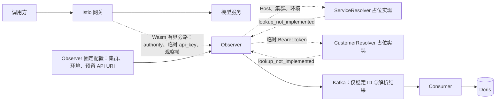

# 通过第三方 API 解析服务、供应商与客户归属的实现计划

日期：2026-10-16。状态：P0–P7 已实现并完成本地范围验收。功能尚未上线，直接调整唯一有效的协议、代码及开发建表定义，不设计双版本或历史数据兼容。本次按下述范围完成代码、Schema、配置及 DDL；验证结果见本地验证记录的本次增量，真实第三方仍未实现。用户已确认密钥来自 Authorization: Bearer；第三方协议和鉴权尚未确定，本次实施范围只定义查询接口并提供明确返回“未实现”的占位实现，不实现真实 API 调用。

依据：[采集组件实现计划](gateway-collection-implementation.md)、[采集开发方案](../../gateway-request-collection-implementation.md)、[Kafka 事件接入说明](../../kafka-event-integration-guide.md)、[日/月汇总设计](../../daily-monthly-summary-design.md)。

## 1. 目标与边界

采集归属预留两个第三方 API 查询接口：

- 服务归属：`request_host + cluster_name + deployment_environment → service_id、provider_id`。
- 客户归属：`api_key → api_key_id、customer_id`。api_key 固定取自 Authorization: Bearer 中的 token，api_key_id 是接口将来返回的稳定标识，两者不能混用。

集群名称和部署环境由 Observer 配置固定，不能从业务请求或 Wasm 覆盖；两个 API 的 URI 配置项分别保留在 Observer 中，目前允许留空，填写 URI 也不会启用未实现的 HTTP 调用。部署环境使用 `production`、`test`、`development`，分别对应生产、测试、开发。移除先前计划中的 PostgreSQL 查询、连接池、SQL/视图适配、完整目录刷新、PG Secret 和 PG fixture，不实现数据库回退路径。

彻底删除客户下属应用维度 application_id，包括协议字段、代码类型、身份校验、配置、数据库列、汇总分组和 Auth 应用层级。Wasm 不再上报 api_key_id、customer_id 或完整身份状态；Observer 以客户 API 返回的两项 ID 为准，不使用客户端自报 ID 或残留鉴权元数据补值。

已确认的边界：

- 业务继续直接经过 Istio 网关到模型服务。查询接口只属于 Observer 采集链路，占位实现立即返回未实现；将来接入的外部 API 也不能成为业务转发或 Wasm 放行的必要条件。
- 入口继续只按启用开关、POST、去掉 query 后的精确路径 `/v1/chat/completions` 筛选。`route_name: "*"` 保持现有语义，Host 用于归属解析，不新增 Host 采集白名单。
- route_name 继续是实际路由名或 unknown，仅供诊断，不作为服务或供应商来源。
- 只保留 request_started、usage_observed 两类事件；正文仍临时处理，未知用量保持 null/unknown。
- api_key 只在必要的内存与受保护链路中短暂存在，不写入 Kafka、Doris、日志、指标、追踪、异常文本或磁盘；API URI 及查询参数也不得包含密钥。
- 只维护一套事件及配置契约，直接更新当前 schema、样例和摘要；开发验证使用新契约合成数据，不接入旧格式开发消息。
- 同一契约下的事件重放去重、内容冲突检查和 Consumer 位点屏障继续有效。

本次计划覆盖协议、采集组件、查询接口及占位实现、建表及汇总定义、部署与验证。真实 HTTP 适配、第三方鉴权、网络缓存及外部联调等到协议确定后实施，不作为当前工作的前置条件。真实 Auth 服务、汇总 Worker、查询 API、扣款和账单按各自工作包交付。

## 2. 调整前后对照

| 位置 | 调整前行为 | 本次实现行为 |
| --- | --- | --- |
| Wasm 规则 | 从命中规则取得固定 service_id | 规则只决定选择及 adapter_id，发送入口 authority 与临时 api_key |
| 调用方身份 | customer_id、api_key_id、application_id 三项元数据齐全才为 known | 删除应用字段，由客户 API 同时解析 api_key_id、customer_id |
| Observer | 接纳 Start 中登记的服务，不访问归属 API | 通过类型明确的接口传入 Host/集群/环境及 Bearer token；当前占位返回未实现，固定未知归属快照 |
| Kafka 事件 | 有 application_id，无供应商及映射依据 | 删除应用字段，增加集群/环境、供应商及两类解析状态，不保存 api_key |
| Consumer / Doris | service_id 非空，身份比较和汇总包含应用 | 支持未知归属，删除应用列，加入供应商及部署上下文 |
| Auth 设计 | 客户 → 应用 → API Key | 客户 → API Key；鉴权与统计归属解析分别履责 |

主要代码位置为 plugins/gateway-observer/main.go、pkg/gatewayconfig/、pkg/observationwire/、internal/observation/、internal/events/、internal/consumer/、internal/doris/、internal/ingestworker/。实现没有引入 PG 依赖，不改动无关系统数据库。

## 3. 数据流与职责



1. Wasm 仅在命中 method/path 后读取入口 authority，以及单个 Authorization: Bearer 的 token，通过受保护的 Observe 链路发送 Start；不调用第三方 API，不等待归属结果，不上报归属 ID。
2. Observer 为有效 Start 生成一次逻辑请求 ID，将规范 Host 和固定集群/环境传给 ServiceResolver，将临时 api_key 传给 CustomerResolver。本次提供的两个占位实现立即返回 ErrLookupNotImplemented，不创建 HTTP 客户端、缓存刷新任务或等待队列。
3. 输入缺失/非法先固定为对应 invalid 状态；合法输入的占位查询结果为 lookup_not_implemented。Observer 固定小型服务/客户快照，释放临时密钥引用，再发送 request_started。不得将空返回值当成功，也不得制造默认归属。
4. ACK、正文处理、超时和资源预算保持现有边界，占位查询不延迟业务或额外保留正文。未来真实网络调用必须在有界异步执行器中完成，不能把阻塞 HTTP 塞入 gRPC 接收/ACK 路径。
5. request_started 与 usage_observed 共用冻结快照；占位部署后均为未知归属及 identity_status=invalid，保留原始观察用量，usage_eligible=false。成功路径只在测试中注入合成 resolver 验证，不能在正常配置下启用假数据。
6. Consumer 只校验和持久化事件，不调用第三方 API，不用最新归属重写历史事件。

provider_id 表达 API 根据入口服务返回的归属，不能证明服务内部另外选择的供应商或隐藏重试消耗。未来若需要观察实际执行方，须另行扩展协议。

## 4. 查询接口、Bearer 提取与配置

### 4.1 只定义类型明确的查询接口

第三方请求/响应、HTTP 方法和鉴权尚无约定，不预设 POST JSON、字段路径、状态码或鉴权头。本次只定义内部业务接口及占位实现，不使用无类型的 Go interface{}：

```go
type ServiceLookupRequest struct {
    RequestHost           string
    ClusterName           string
    DeploymentEnvironment string
}

type ServiceIdentity struct {
    ServiceID  string
    ProviderID string
}

type CustomerIdentity struct {
    APIKeyID   string
    CustomerID string
}

type ServiceResolver interface {
    Resolve(context.Context, ServiceLookupRequest) (ServiceIdentity, error)
}

type CustomerResolver interface {
    Resolve(context.Context, []byte) (CustomerIdentity, error)
}

var ErrLookupNotImplemented = errors.New("lookup_not_implemented")
```

接口位于 internal/identitylookup/。ServiceIdentity 不能缺少任一 ID，CustomerIdentity 也必须成对成功；ID 均要求非空、合法 UTF-8、最多 128 字节。对于同一部署上下文，一个 Host 对应一个服务，一个服务归属一个供应商；允许一个服务多个域名、多个密钥归属同一客户。

- UnimplementedServiceResolver 和 UnimplementedCustomerResolver 始终返回空结果及 ErrLookupNotImplemented，不发网络请求、不猜测归属、不返回空值加 nil error。错误文本固定，不包含输入。
- Observer 默认注入这两个占位实现；不要求提供真实 URI 或第三方凭据，不因接口未实现而启动失败，也不影响 Wasm 下载和采集健康检查。
- 单元测试可注入纯内存 fake resolver，验证成功、失败和快照冻结；fake 只在测试中存在，不增加正常配置可启用的假服务/假客户模式。
- 两个接口保留 context.Context，方便未来增加取消/超时；占位实现不创建异步任务、HTTP 连接、缓存或重试。接口不接收/保存整个 Start 或请求头集合。
- 客户输入必须是 Bearer token 原文，不能以 api_key_id、普通哈希或残留元数据替代。占位方法不得保留传入的字节切片或将其格式化到错误中。

### 4.2 入口 Host 处理

- 读取网关用于入口路由的 authority，不使用 X-Forwarded-Host、客户端 service/provider 声明、DNS 反查或模型名称补值。
- 原 authority 最多 512 UTF-8 字节，规范域名最多 253 ASCII 字节；校验并剥离端口、转小写、移除一个结尾根点，接受 ASCII DNS 域名和已编码 Punycode。IP 字面量、缺失、非法或超长输入为 invalid_host，不调用服务查询接口。
- Wasm 对非法或超长输入发空值，不截断后尝试匹配，不把非法字符串放入 Protobuf string。Kafka 只保存合法规范域名或 null，不保存原始非法 authority、完整 URL 或 query。
- Host 不解释通配符。实施前核对端口处理和 Host 重写，证明捕获的是入口路由所用 Host；若相同 Host/集群/环境仍区分多个服务，先补充映射键。

### 4.3 Authorization: Bearer 与临时密钥

api_key 来源已确认，固定为 `Authorization: Bearer <token>` 的 token；不增加其他请求头来源或来源切换配置。

- 只读取单个 Authorization 值，Bearer 方案名按大小写不敏感识别，剥离方案名及分隔空格，保留 token 本身的大小写和字节内容；不把完整 Authorization 值交给客户查询接口。
- 缺失、空 token、其他认证方案、重复 Authorization、逗号拼接或多凭证、token 内含空白或超长均为 invalid_api_key，不尝试回退到 x-api-key、URL/query/正文、客户端自报 ID 或 ext_authz 身份元数据。
- api_key 最大长度初始为 4096 字节，协同校验请求头、wire、Start 帧和总内存上限。解析不修改业务原 Authorization；鉴权服务继续决定业务访问，统计归属解析不代替鉴权。
- 检查现有 ext_authz 与 Wasm 的顺序以及头改写行为，保证 Wasm 能读取实际用于此次请求的 Bearer token；若上游鉴权会删除它，需要调整集成以保留该受保护输入，不能悄悄改用其他来源。
- Wasm → Observer 的原始 token 只通过验证过的网格 mTLS/TLS 临时传输，不写入 Kafka、Doris、日志、指标、追踪、错误或磁盘，不打印 Start/wire 消息全文。成功、失败及取消均及时释放引用，可控缓冲尽力清零，不承诺运行时全部副本可擦除。
- 当前占位查询不把 token 发给任何第三方，不保存 token 用于重试或后台刷新。客户未实现或失败时 api_key_id/customer_id 为 null、identity_status=invalid、usage_eligible=false，保留原始 usage 和已知服务/供应商。

### 4.4 Observer 配置与以后接入的边界

固定配置位置为 observer.cluster_name、observer.deployment_environment、observer.service_lookup.uri 和 observer.customer_lookup.uri。集群名称非空、合法 UTF-8、最多 128 字节，环境只接受 production、test、development。集群/环境缺失或非法仍按固定错误拒绝启动，接口未实现不属于配置错误。

当前配置片段：

```json
{
  "observer": {
    "cluster_name": "cluster-a",
    "deployment_environment": "test",
    "service_lookup": {"uri": ""},
    "customer_lookup": {"uri": ""}
  }
}
```

两个 URI 允许为空；非空时仅验证配置地址的合法性，不发探测请求、不启用真实查询。URI 不能包含密钥、用户密码或其他凭据，不进入 Kafka 事件。删除先前的 observer.postgresql、observer.service_catalog、observer.customer_catalog、METERING_PG_DSN 及拟议 credential_source，不接纳为兼容别名。Bearer 来源固定，无需新增可配置的任意密钥头。

以下属于真实接口确定后的后续接入工作，不阻塞当前实施，也不在本次创建虚假的配置或默认凭据：

- 确认两个 API 的方法、序列化、鉴权、成功/不存在/故障语义及调用配额后，再实现专用 HTTP 适配器。第三方 API 访问凭据与业务 token 分开管理。
- 实现经验证的 HTTPS、禁止密钥进入 URL/query、禁止跟随重定向泄漏凭据，并检查 HTTP/代理日志与追踪。本次验收只覆盖 Wasm → Observer 的 TLS，不宣称第三方 TLS 已验收。
- 外部查询使用有界异步执行、共享解析截止时间、速率/并发/响应体限制及有限待定稿预算，保持 ACK 和正文接收不等待外部请求，不引入无界队列或整段正文缓存。
- 有需要时实现按键缓存：服务键为 `[cluster_name, deployment_environment, request_host]`；客户键使用进程随机密钥的 HMAC-SHA-256(api_key)，不保留或输出原始密钥。TTL、负缓存及内存预算待接口约定和规模确认后确定，本次不实现缓存。

成功解析结果的版本摘要已加入唯一事件模型：mapping_version 为 `[规则版本, cluster_name, deployment_environment, request_host, service_id, provider_id]` 的规范 JSON SHA-256，customer_mapping_version 为 `[规则版本, cluster_name, deployment_environment, api_key_id, customer_id]` 的同类摘要。二者均为 64 字符小写十六进制，排除密钥原文及进程随机值；占位结果版本均为 null。测试成功结果可生成摘要，不能将其称为第三方目录发布版本。

## 5. 协议、事件与语义

### 5.1 直接调整当前协议

- 保持单一 schema，沿用当前 schema_version=1、RPC 及目录位置，直接修改定义、校验和编码，不引入第二套格式或旧格式解码。
- 从所有采集模型删除 application_id。从 Start 删除 Wasm 上报的 service_id、api_key_id、customer_id、identity_status，将编号 5、7、8、9、10 及对应名字标记 reserved；保留编号不是保留旧字段。
- 新增 Start.request_authority=16、Start.api_key=17；api_key 使用有严格字节上限的 bytes，仅用于临时传输，绝不加入事件类型、规范 JSON、摘要或持久化模型。同步调整最大 Start/frame 大小，不放大正文预算。
- 删除 metering 的 identity_fields、identity_namespace、规则静态 service_id 及相应校验，固定解析 Authorization: Bearer，不新增 credential_source 配置。这不删除网关已有的 ext_authz 鉴权过滤器，也不复制其身份字段作为失败回退。
- cluster_name、deployment_environment 和第三方 URI 的配置来源仅限 Observer；Start 不能覆盖它们。事件中的部署上下文和所有归属 ID 均由 Observer 填写，URI 不进入事件。
- Wasm、Observer、Consumer、配置和数据表按同一开发提交统一部署；未知字段仍严格拒绝，未知 schema 仍拒收/暂停，只实现当前一套协议。
- 同步 .proto、手写 wire、生成代码、事件 Schema、序列化器、Python 校验器、渲染器和合成样例；执行 make generate，不手改 gen/。

### 5.2 Kafka 事件字段

| 字段 | 类型及规则 |
| --- | --- |
| application_id | 从定义中删除，不输出、不接收，不设 null 占位 |
| api_key | 不属于 Kafka 事件，不能输出、不允许接收 |
| request_host | string 或 null，合法规范域名，作为解析输入和诊断维度 |
| cluster_name | 非空 string，由 Observer 固定配置填写 |
| deployment_environment | production、test、development 之一，由 Observer 固定配置填写 |
| service_id / provider_id | string 或 null，只采用服务 API 的完整成功结果 |
| mapping_version | 64 字符小写十六进制或 null，成功服务解析结果的版本摘要 |
| mapping_status | mapped、unknown_host、invalid_host、lookup_not_implemented、lookup_timeout、lookup_unavailable、lookup_invalid_response、lookup_overloaded、lookup_rate_limited 之一 |
| api_key_id / customer_id | string 或 null，只采用客户 API 的完整成功结果 |
| customer_mapping_version | 64 字符小写十六进制或 null，成功客户解析结果的版本摘要 |
| customer_mapping_status | mapped、unknown_api_key、invalid_api_key、lookup_not_implemented、lookup_timeout、lookup_unavailable、lookup_invalid_response、lookup_overloaded、lookup_rate_limited 之一 |
| identity_status | 客户解析成功且两项 ID 有效时 known，否则 invalid；不代表鉴权决策 |

服务 mapped 要求 request_host、service_id、provider_id、mapping_version 全部有效；其余服务状态两个 ID 和版本均为 null。客户 mapped 要求 api_key_id、customer_id、customer_mapping_version 全部有效；其余客户状态三者均为 null。不能保留非法/半成功响应中的 ID。

正常占位路径中，合法输入产生 lookup_not_implemented，相关 ID 和版本均为 null；缺失/非法输入先产生 invalid_host 或 invalid_api_key，不能误报成未登记。两个查询的结果各自独立，占位错误不导致进程退出、网络等待或业务拒绝。

其余查询状态在单一模型中保留定义，真实传输/错误映射延后实现：只有未来接口明确不存在才为 unknown_host/unknown_api_key；超时为 lookup_timeout，连接/TLS/鉴权/服务错误为 lookup_unavailable，非法响应为 lookup_invalid_response，预算不足和限流分别为 lookup_overloaded/lookup_rate_limited。本次不实现 HTTP 状态码映射，不使用旧的 catalog_unavailable/catalog_stale 枚举。

服务归属失败不清除客户或已观察 usage，不改变客户 identity_status。客户失败保留已知服务/供应商和 usage，但 identity_status=invalid、identity_invalid 异常、usage_eligible=false，不进入客户汇总。usage_eligible 仍是统计候选，不等于供应商已知或可收费。

accepted_service_ids 对已映射服务继续精确检查。未映射服务可用两个 ID 均为 null 入质量诊断；已映射但未登记的服务不能伪装未知绕过准入，Observer 拒绝该观察并计固定配置错误，业务继续。Consumer 只做事件一致性及登记校验，不调用 API。

### 5.3 规范编码、摘要及冲突

- 仅维护一套序列化器，重建全部现有合成 JSON、.canonical、.hashes；删除应用字段，加入部署上下文、供应商及解析状态，不保留旧金样或 legacy 分支。
- 稳定请求摘要元组顺序为 `[service_id, provider_id, api_key_id, customer_id, identity_status, config_version, gateway_instance_id, adapter_id, x_request_id, cluster_name, deployment_environment, mapping_status, mapping_version, customer_mapping_status, customer_mapping_version]`，使用规范 JSON 和 SHA-256，明确保留 null。原始密钥、密钥指纹、Host、route_name、模型名称不作为独立摘要字段；服务解析版本已经绑定 Host 与部署上下文。
- Consumer 跨日期证据、启动/周期审计、Doris 请求投影统一使用该元组，Go、Python 和 SQL 的顺序纳入契约检查，不保留旧摘要重建路径。
- 同一 event_id 的不同规范内容仍为冲突，即使差异仅在诊断字段；同内容重放幂等。同请求两个事件的客户、服务、上下文或解析快照不一致时隔离。
- API 归属变化不回写既有事件；迟到结果不得造成同请求 start/usage 归属不同，不新增第三类修正事件。

## 6. 存储、汇总与开发数据准备

### 6.1 Doris 原始事件

功能尚未上线，直接更新开发初始化定义，不新增面向已上线模型的兼容迁移链：

1. 更新 001_init.sql 的 events_raw，删除 application_id，增加 request_host、cluster_name、deployment_environment、provider_id、mapping_version、mapping_status、customer_mapping_version、customer_mapping_status。service_id 改为可空；api_key_id/customer_id 保持可空。部署上下文和两类状态必填，其余字段按事件语义保留 NULL。
2. 沿用原始唯一键、365 个 UTC 日期保留、Kafka 坐标和去重机制，payload_hash/identity_hash 统一按新模型生成。任何原始 api_key 或其缓存指纹不得成为 Doris 列或 event_json 内容。
3. 同步 event_details、requests、request_statistics，以及 006_optional_route_identity.sql 中重复定义的请求视图和身份比较，避免初始化末尾再次引用应用列或旧摘要。
4. Consumer 同步入库、证据查询及启动/周期巡检，仍在原始/拒收记录、冲突、日期通知和批次凭据全部可见后提交 Kafka offset。非法消息只保存坐标/摘要/固定原因，不落原始敏感消息。
5. 在锁定的 Doris 4.1.3 上从空库执行完整初始化链，验证视图、Stream Load、NULL 和摘要。CREATE TABLE IF NOT EXISTS 不会更新已有开发表，使用新隔离库或仅含可重生成合成数据的本项目专用环境。

P4 已统一 Consumer 数据库校验、DSN 一致性、Store 可见性/证据、巡检与 Stream Load 的库名；render_doris_sql.py 为全部初始化/参考 SQL 渲染经过验证的库名。本地默认 metering_development，K8s 每次独立 metering_k8s_<run-id>；旧共享 metering 表保留，不接收新契约写入。

### 6.2 服务与供应商统计

日/月维度改为 `cluster_name、deployment_environment、customer_id、api_key_id、service_id、provider_id、model、usage_source`。更新 002_usage_summaries.sql，从 usage_daily/usage_monthly 的列、唯一键及分组中删除应用维度，加入供应商及部署上下文；沿用现有表名，不建版本后缀表。

- 日/月参考 SQL 与查询模板显式按集群/环境分组或过滤，生产数据不能混入测试/开发数据；跨集群或环境合并必须为明确查询选择。
- 原始 provider_id/service_id 保持 NULL；仅在需要非空汇总键时用空串表示未知桶，真实 ID 禁止为空，展示明确为“供应商未知/服务未知”。
- 已知客户的总量包含该客户的未知服务/供应商桶，具体供应商统计不把未知桶归给任意供应商，并返回归属覆盖信息。
- 未知客户只进入原始质量统计，不创建空客户或默认客户桶；客户汇总要求 customer_mapping_status=mapped、identity_status=known 且无冲突。
- 汇总使用事件快照，不重新调用 API。保留 token NULL/零、未知用量、迟到结果、冲突撤销和日期通知语义。
- 本工作包交付 DDL、参考 SQL 和合成执行验证，不因此启动尚未实现的汇总 Worker；未生成或未覆盖的数据不能报已确认零值。

### 6.3 Auth 与第三方 API 的职责

Auth 设计直接调整为客户 → API Key，删除应用表设计、application_id、应用外键、状态校验、缓存及管理接口示例。鉴权服务仍决定凭证、主体状态和访问授权；Observer 的归属以两个 API 为准，不读取可能残留的 customer_id/api_key_id 元数据。真实 Auth 尚未实现，测试 fixture 不替代生产鉴权。

Observer 不依赖 PG 获取任何归属；Consumer 和汇总也不查询 PG 或第三方 API。第三方服务内部的数据来源由其负责，不进入本项目部署依赖。删除仅针对本项目原计划及新增实现，不删除其他系统数据库或已有数据。

## 7. 实施工作包

以下为本次代码交付范围；第三方请求/响应及鉴权约定不作为当前实施的阻塞项。

| 工作包 | 主要交付与完成条件 |
| --- | --- |
| P0：已确认输入与初始化边界 | 固定 Authorization: Bearer 提取规则，核对 Host、集群/环境、ext_authz 顺序、Wasm → Observer TLS 及资源预算；在 Doris 4.1.3 验证空库初始化，不要求第三方接口合同 |
| P1：统一契约 | 更新事件/配置 Schema、Start 和 wire，删除 application_id 及上报 ID，新增临时 api_key、部署上下文和 lookup_not_implemented；生成 Proto/金样，覆盖敏感字段拒收 |
| P2：查询接口与占位 | 新增例如 internal/identitylookup/ 的类型明确接口及两个未实现 resolver，立即返回固定错误且不保留 token；测试注入 fake 验证结果校验/快照，不实现 HTTP、鉴权、网络缓存或重试 |
| P3：Wasm / Observer | Wasm 固定提取 Bearer token；Observer 按输入调用占位接口，固定两类快照并及时释放密钥；保持两事件、ACK、预算、fail-open 和下载服务，非法输入不调用对应接口 |
| P4：Consumer / Doris | 更新原始/汇总 DDL、视图、摘要及启动审计，删除应用模型；统一配置、Store/巡检、DSN/Stream Load 和初始化 SQL 的隔离库支持；支持未知归属、供应商/部署维度及重放/冲突，保持写入/位点屏障 |
| P5：配置与部署 | Observer 固定集群/环境并保留两个可空 URI；去除 PG 与任意凭证头配置，更新渲染器、Auth/模型 fixture、Consumer 登记、本地/K8s 测试和清理，不部署第三方 HTTP/PG fixture，不要求其 Secret |
| P6：文档与 SQL 模板 | 同步 README、总体/采集/Auth、Kafka、组件运行、汇总/协调、部署示例及样例；明确 Bearer 来源、占位状态、未知身份及真实对接尚未完成 |
| P7：当前范围验收 | 完成下节测试、隔离开发部署与清理，记录镜像/Wasm 和占位事件证据；不宣称完成真实第三方查询或客户/供应商归属验收 |

后续真实对接另行补充工作包：HTTP 协议和鉴权确定后再实现适配、缓存/限流/超时、异步定稿与第三方测试，不能以本次接口占位交付替代这些工作。

重点调整 api/observation/v1/observation.proto、api/events/v1/、pkg/gatewayconfig/、pkg/observationwire/、internal/config/、采集运行模块、migrations/doris/metering/、scripts/validate_collection_contracts.py、scripts/render_gateway_filter.py、scripts/local_collection.py、scripts/k8s_collection.py、scripts/cleanup_k8s_collection.py、scripts/sql/、deploy/、tests/ 和 testdata/collection/。沿用现有事件目录，不为占位接口引入 PG 驱动或 HTTP 客户端依赖。

## 8. 验证与验收

本次范围已完成：52 项 Python 测试、Go 竞态/契约/构建/ABI、真实 Compose 完整链路及 K8S-WASM-001 均通过，清理已完成。具体结果和边界见[2026-10-16 验证记录](gateway-collection-verification.md#2026-10-16-host--bearer-归属接口与唯一事件模型)。下面为本次验收断言，不表示真实第三方 HTTP 已实现。

| 场景 | 当前范围必须满足的断言 |
| --- | --- |
| 占位查询 | 合法输入立即返回 ErrLookupNotImplemented；没有网络请求、重试、缓存、等待队列；URI 空/非空均不启用第三方调用，不能返回默认 ID 或空值加成功 |
| Bearer 提取 | 单个 Authorization: Bearer 提取 token，不带方案名前缀、不改变 token；覆盖方案名大小写、空值、非 Bearer、重复/拼接、多凭证、空白及超长；不读取 x-api-key 或伪造身份元数据 |
| Host 和部署上下文 | 规范 Host、固定集群/环境准确传入服务接口；覆盖端口、大小写、尾点、Punycode、非法/超长、转发头及重写；客户端/Start 不得覆盖上下文 |
| 未知归属 | 合法输入的两个状态均为 lookup_not_implemented，四项 ID 和两个版本均为 null；非法输入为对应 invalid 状态；两个事件一致、identity_status=invalid、usage_eligible=false，原始 usage 保留 |
| 注入成功/失败 | 仅测试中 fake resolver 返回合成 ID，验证一类成功/另一类失败、半成功/非法 ID 拒绝、不同 Host/集群/环境和密钥归属、多服务/多域名；验证成功摘要与冻结快照，不代表外部 API 已实现 |
| 入口过滤 | POST 精确路径含 query 正常采集；既有八类忽略请求 selected 不增加、Doris 事件为零，也不读取/发送密钥或调用 resolver |
| 两事件与资源 | JSON、SSE、快速结束、取消、无 End/watchdog 和多实例均不因占位改变 ACK/预算；两事件同一快照，不保留请求密钥/完整请求对象或无界后台任务 |
| 配置和依赖 | 集群/环境缺失或非法拒绝启动，接口未实现不影响健康与 Wasm 下载；两个 URI 可空且不出网，无 PG/第三方 Secret/HTTP fixture 依赖或旧配置别名 |
| Consumer 一致性 | 当前规范编码/摘要/生成代码一致，重放不增量，未知 schema 暂停；不同快照/上下文和跨日期冲突被隔离，启动审计一致，失败/rebalance 不越过写入屏障 |
| 隔离数据库 | 新契约 DDL、载入、证据/水位巡检、通知/凭据和汇总 SQL 全部使用配置的独立库；现有共享 metering 表结构、行及 Consumer 进度不受影响，非法库名在拼接 SQL 前拒绝 |
| 汇总 | 用新契约合成事件验证供应商/部署维度、未知桶、NULL/零及冲突语义；占位产生的未知客户只进入质量统计，不生成有效客户汇总 |
| 密钥保护 | 使用仅供测试的随机哨兵 token，验证 Kafka key/value、Doris 各表/拒收、日志/追踪/错误/URL/指标均不包含它；token 只交给客户接口，接口返回后释放，验证 Wasm → Observer 真实 TLS 保护 |

实施后运行 make test build wasm、make generate 差异核对及 `GOFLAGS='-count=1' make local-test`，另运行扩展后的 make k8s-test 和 make k8s-clean。实施后的本地/K8s 链路验证真实网关→Observer 占位→Kafka→Consumer→Doris 的原始事件与已观察 usage，不能要求占位路径生成已知客户或可归属供应商。已知身份消费、冲突及汇总 SQL 可用新契约合成 Kafka 事件另测，不能把合成输入描述为网关成功解析的身份。

Kubernetes 用例固定使用本地 Kubernetes 1.22.17 + Istio 1.13.5。网关、Observer、Consumer、模型/Auth fixture 在独立命名空间，Kafka/Doris 可复用本地 Compose，Consumer 不复用 Compose；不创建第三方 HTTP 或 PG 服务。使用新隔离 Doris 库、独立 Kafka topic/group，保留 Consumer 缩容/恢复归属证明。清理只删除本次归属命名空间、专属测试资源和 topic/group，不删除共享卷或无关数据。

证据记录镜像版本、Wasm SHA-256、固定集群/环境、占位状态、请求/事件 ID、Consumer 位点、清理前后资源及“无第三方出站调用”的验证；不记录 token。镜像 tag 继续 Git tag 优先，否则使用 commit 短 hash。实际结果追加在本地验证记录，本地验证与生产 G0–G5 仍然区分。

## 9. 开发初始化与部署

1. 核对 Bearer 提取、Host 行为、固定集群/环境及网格 TLS，按当前配置保留两个 URI，未知时留空；不等待第三方接口或申请其鉴权凭据。
2. 停止本项目开发采集写入，创建全新隔离 Doris 库和 Kafka topic/group，不创建 PG、第三方 HTTP fixture 或假归属目录。
3. 使用更新后的 SQL 初始化 Doris，构建同一提交的 Observer、Consumer、模型/Auth fixture 和 Wasm；模型请求携带合成 Authorization: Bearer token，Auth fixture 只模拟访问判定，不再提供采集归属 ID。
4. 先部署 Consumer、Observer 和模型/Auth fixture，检查占位接口、固定配置、TLS 与 Wasm 下载，再启用 Wasm；按实际 Pod 渲染、等待 XDS 收敛并验证 JSON/SSE/快速结束与未知归属事件。
5. 在单元测试注入合成 resolver 验证已知归属分支，在独立合成事件链路验证 Consumer/DDL/汇总；报告明确标注正常部署的 API 仍未实现，不调用第三方、不验证真实客户/供应商归属。
6. 失败时关闭采集并保留脱敏诊断，修复后重新初始化隔离数据并统一部署；完成后运行清理脚本并记录资源核对，未来真实对接与正式灰度另行验收。

已确认：api_key 固定来自 Authorization: Bearer，第三方接口允许先占位。尚未确定的 URI 实际值、HTTP 请求/响应、鉴权、错误码、配额和轮换语义，只影响未来真实适配，不阻塞当前接口与采集模型实施。不能以占位通过声称第三方集成或有效客户归属已经完成。
