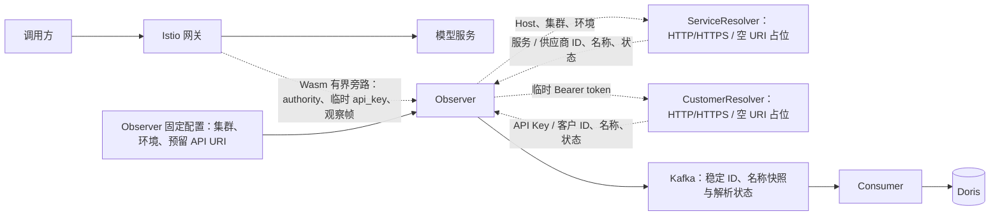

# 通过第三方 API 解析服务、供应商与客户归属的实现计划

修订日期：2026-10-19。状态：P0–P7 的占位链路及本次 HTTP 查询、请求头认证、prd/stg/dev 环境枚举、名称快照持久化增量均已实现；本地验证结果见第 8 节和验证记录。功能尚未上线，生产第三方地址、凭据及完整 G0–G5 尚待真实环境验收。

Observer 在配置非空 HTTP/HTTPS URI 后启用真实 POST JSON 查询，使用独立的 x-remote-data 凭据；空 URI 继续返回 lookup_not_implemented。service_name、provider_name、customer_name 与 ID 一起冻结，经 Kafka、Consumer 写入 Doris 独立列及 event_json。环境仅接受 prd/stg/dev，不接受旧值或别名；不回填既有事件。业务 api_key 仍固定来自 Authorization: Bearer。

依据：[采集组件实现计划](gateway-collection-implementation.md)、[采集开发方案](../../gateway-request-collection-implementation.md)、[Kafka 事件接入说明](../../kafka-event-integration-guide.md)、[日/月汇总设计](../../daily-monthly-summary-design.md)。

## 1. 目标与边界

采集归属预留两个第三方 API 查询接口：

- 服务归属：`request_host + cluster_name + deployment_environment → service_id、service_name、provider_id、provider_name`。
- 客户归属：`api_key → api_key_id、customer_id、customer_name`。api_key 固定取自 Authorization: Bearer 中的 token，api_key_id 是接口将来返回的稳定标识，两者不能混用。

三个名称须保存为请求发生时的归属快照，经 Observer → Kafka → Consumer 写入 Doris 明细，供后续查询使用。保存与查询规则见第 6.4 节。

集群名称和部署环境由 Observer 配置固定，不能从业务请求或 Wasm 覆盖；两个 API 的 URI 配置项分别保留在 Observer 中，允许留空；非空时按第 4 节启用 HTTP 查询。部署环境仅接受 `prd`、`stg`、`dev`，分别对应生产、预发布、开发，不接受旧值或别名；当前实现与目标的切换边界见第 4.4 节。移除先前计划中的 PostgreSQL 查询、连接池、SQL/视图适配、完整目录刷新、PG Secret 和 PG fixture，不实现数据库回退路径。

彻底删除客户下属应用维度 application_id，包括协议字段、代码类型、身份校验、配置、数据库列、汇总分组和 Auth 应用层级。Wasm 不再上报 api_key_id、customer_id 或完整身份状态；Observer 以客户 API 返回的两项 ID 为准，不使用客户端自报 ID 或残留鉴权元数据补值。

已确认的边界：

- 业务继续直接经过 Istio 网关到模型服务。查询接口只属于 Observer 采集链路，占位实现立即返回未实现；将来接入的外部 API 也不能成为业务转发或 Wasm 放行的必要条件。
- 入口继续只按启用开关、POST、去掉 query 后的精确路径 `/v1/chat/completions` 筛选。`route_name: "*"` 保持现有语义，Host 用于归属解析，不新增 Host 采集白名单。
- route_name 继续是实际路由名或 unknown，仅供诊断，不作为服务或供应商来源。
- 只保留 request_started、usage_observed 两类事件；正文仍临时处理，未知用量保持 null/unknown。
- api_key 只在必要的内存与受保护链路中短暂存在，不写入 Kafka、Doris、日志、指标、追踪、异常文本或磁盘；API URI 及查询参数也不得包含密钥。
- 只维护一套事件及配置契约，直接更新当前 schema、样例和摘要；开发验证使用新契约合成数据，不接入旧格式开发消息。
- 同一契约下的事件重放去重、内容冲突检查和 Consumer 位点屏障继续有效。

P0–P7 覆盖采集组件和占位链路；本次增量实现 HTTP 适配、请求头认证、环境枚举切换及名称存储。当前不实现缓存或自动重试，真实第三方业务联调由实际部署环境完成。真实 Auth 服务、汇总 Worker、统计查询 API、扣款和账单按各自工作包交付。

## 2. 调整前后对照

| 位置 | 调整前行为 | 本次实现行为 |
| --- | --- | --- |
| Wasm 规则 | 从命中规则取得固定 service_id | 规则只决定选择及 adapter_id，发送入口 authority 与临时 api_key |
| 调用方身份 | customer_id、api_key_id、application_id 三项元数据齐全才为 known | 删除应用字段，由客户 API 同时解析 api_key_id、customer_id |
| Observer | 接纳 Start 中登记的服务，不访问归属 API | 通过类型明确的接口传入 Host/集群/环境及 Bearer token；当前占位返回未实现，固定未知归属快照 |
| Kafka 事件 | 有 application_id，无供应商及映射依据 | 删除应用字段，增加集群/环境、供应商及两类解析状态，不保存 api_key |
| Consumer / Doris | service_id 非空，身份比较和汇总包含应用 | 支持未知归属，删除应用列，加入供应商及部署上下文 |
| Auth 设计 | 客户 → 应用 → API Key | 客户 → API Key；鉴权与统计归属解析分别履责 |

主要代码位置为 plugins/gateway-observer/main.go、pkg/gatewayconfig/、pkg/observationwire/、internal/observation/、internal/events/、internal/consumer/、internal/doris/、internal/ingestworker/。实现没有引入 PG 依赖，不改动无关系统数据库。

## 3. 数据流与职责



1. Wasm 仅在命中 method/path 后读取入口 authority，以及单个 Authorization: Bearer 的 token，通过受保护的 Observe 链路发送 Start；不调用第三方 API，不等待归属结果，不上报归属 ID。
2. Observer 为有效 Start 生成一次逻辑请求 ID，将规范 Host 和固定集群/环境传给 ServiceResolver，将临时 api_key 传给 CustomerResolver。两个查询在有界异步任务中并行执行，使用共享截止时间；空 URI 对应的占位立即返回 ErrLookupNotImplemented，无缓存、重试或等待队列。
3. 输入缺失/非法先固定为对应 invalid 状态；合法输入的占位查询结果为 lookup_not_implemented。Observer 固定小型服务/客户快照，释放临时密钥引用，再发送 request_started。不得将空返回值当成功，也不得制造默认归属。
4. ACK、正文处理、超时和资源预算保持现有边界，占位查询不延迟业务或额外保留正文。真实网络调用在有界异步执行器中完成；Start 和 End 的 accepted 进度 ACK 不等待查询，正文继续按既有预算解析。名称和归属定稿前暂缓事件发送，最多等待共享查询截止时间，不额外缓存完整正文。End 先回 accepted 进度 ACK，定稿后再回 CloseStream ACK，避免 Wasm 提前取消尚未完成的归属查询。
5. request_started 与 usage_observed 共用冻结快照；占位部署后均为未知归属及 identity_status=invalid，保留原始观察用量，usage_eligible=false。成功路径只在测试中注入合成 resolver 验证，不能在正常配置下启用假数据。
6. Consumer 只校验和持久化事件，不调用第三方 API，不用最新归属重写历史事件。

provider_id 表达 API 根据入口服务返回的归属，不能证明服务内部另外选择的供应商或隐藏重试消耗。未来若需要观察实际执行方，须另行扩展协议。

## 4. 查询接口、Bearer 提取与配置

### 4.1 内部查询接口与占位实现

当前已实现以下类型明确的内部业务接口、HTTP/HTTPS 适配器及空 URI 占位实现。第 4.5–4.8 节为适配器实际遵循的请求、响应和认证契约：

```go
type ServiceLookupRequest struct {
    RequestHost           string
    ClusterName           string
    DeploymentEnvironment string
}

type ServiceIdentity struct {
    ServiceID    string
    ServiceName  string
    ProviderID   string
    ProviderName string
}

type CustomerIdentity struct {
    APIKeyID     string
    CustomerID   string
    CustomerName string
}

type ServiceResolver interface {
    Resolve(context.Context, ServiceLookupRequest) (ServiceIdentity, error)
}

type CustomerResolver interface {
    Resolve(context.Context, []byte) (CustomerIdentity, error)
}

var ErrLookupNotImplemented = errors.New("lookup_not_implemented")
```

接口位于 internal/identitylookup/。ServiceIdentity 不能缺少任一 ID，CustomerIdentity 也必须成对成功；ID 均要求非空、合法 UTF-8、最多 128 字节。对于同一部署上下文，一个 Host 对应一个服务，一个服务归属一个供应商；允许一个服务多个域名、多个密钥归属同一客户。

ServiceIdentity 和 CustomerIdentity 保留接口返回的名称，Observer 校验后连同 ID 冻结。Wasm 和 Start 无需增加名称字段，名称来源仅为归属接口。

- UnimplementedServiceResolver 和 UnimplementedCustomerResolver 始终返回空结果及 ErrLookupNotImplemented，不发网络请求、不猜测归属、不返回空值加 nil error。错误文本固定，不包含输入。
- 每个 URI 独立选择适配器：空 URI 注入占位，不要求凭据；非空 URI 必须为 HTTP 或 HTTPS，credential_env 必须指向非空且适合 HTTP 请求头的凭据，错误配置按固定原因拒绝启动。不探测第三方可用性，运行时查询故障不使业务请求依赖第三方。
- 单元测试可注入纯内存 fake resolver，验证成功、失败和快照冻结；fake 只在测试中存在，不增加正常配置可启用的假服务/假客户模式。
- 两个接口使用 context.Context 执行查询取消和超时；占位实现不创建异步任务、HTTP 连接、缓存或重试。接口不接收/保存整个 Start 或请求头集合。
- 客户输入必须是 Bearer token 原文，不能以 api_key_id、普通哈希或残留元数据替代。占位方法不得保留传入的字节切片或将其格式化到错误中。

### 4.2 入口 Host 处理

- 读取网关用于入口路由的 authority，不使用 X-Forwarded-Host、客户端 service/provider 声明、DNS 反查或模型名称补值。
- 原 authority 最多 512 UTF-8 字节，规范域名最多 253 ASCII 字节；校验并剥离端口、转小写、移除一个结尾根点，接受 ASCII DNS 域名和已编码 Punycode。IP 字面量、缺失、非法或超长输入为 invalid_host，不调用服务查询接口。
- Wasm 对非法或超长输入发空值，不截断后尝试匹配，不把非法字符串放入 Protobuf string。Kafka 只保存合法规范域名或 null，不保存原始非法 authority、完整 URL 或 query。
- Host 不解释通配符。实施前核对端口处理和 Host 重写，证明捕获的是入口路由所用 Host；若相同 Host/集群/环境仍区分多个服务，先补充映射键。

### 4.3 Authorization: Bearer 与临时密钥

api_key 来源已确认，固定为 `Authorization: Bearer <token>` 的 token；不增加其他请求头来源或来源切换配置。

- 只读取单个 Authorization 值，Bearer 方案名按大小写不敏感识别，剥离方案名及分隔空格，保留 token 本身的大小写和字节内容；不把完整 Authorization 值交给客户查询接口。
- 缺失、空 token、其他认证方案、重复 Authorization、逗号拼接或多凭证、token 内含空白或超长均为 invalid_api_key，不尝试回退到 x-api-key、URL/query/正文、客户端自报 ID 或 ext_authz 身份元数据。
- api_key 最大长度初始为 4096 字节，协同校验请求头、wire、Start 帧和总内存上限。解析不修改业务原 Authorization；鉴权服务继续决定业务访问，统计归属解析不代替鉴权。
- 检查现有 ext_authz 与 Wasm 的顺序以及头改写行为，保证 Wasm 能读取实际用于此次请求的 Bearer token；若上游鉴权会删除它，需要调整集成以保留该受保护输入，不能悄悄改用其他来源。
- Wasm → Observer 的原始 token 只通过验证过的网格 mTLS/TLS 临时传输，不写入 Kafka、Doris、日志、指标、追踪、错误或磁盘，不打印 Start/wire 消息全文。成功、失败及取消均及时释放引用，可控缓冲尽力清零，不承诺运行时全部副本可擦除。
- 当前占位查询不把 token 发给任何第三方，不保存 token 用于重试或后台刷新。客户未实现或失败时 api_key_id/customer_id 为 null、identity_status=invalid、usage_eligible=false，保留原始 usage 和已知服务/供应商。

### 4.4 Observer 配置与以后接入的边界

固定配置位置为 observer.cluster_name、observer.deployment_environment、observer.service_lookup.uri 和 observer.customer_lookup.uri。集群名称非空、合法 UTF-8、最多 128 字节；环境枚举仅为 `prd`、`stg`、`dev`。集群/环境缺失或非法仍按固定错误拒绝启动，接口未实现不属于配置错误。

配置片段（空 URI 保持占位；启用时填写完整 HTTP/HTTPS URI 并通过环境变量提供凭据）：

```json
{
  "observer": {
    "cluster_name": "cluster-a",
    "deployment_environment": "stg",
    "service_lookup": {"uri": ""},
    "customer_lookup": {"uri": ""}
  }
}
```

配置、事件 Schema、样例及部署上下文现已统一使用 `prd/stg/dev`。旧值没有兼容别名；历史记录不重写，旧格式开发消息不接入新契约。

每个 service_lookup/customer_lookup 支持 uri、credential_env、ca_file、max_requests_per_second。uri 为空时不调用第三方；非空时将完整 HTTP/HTTPS 端点直接使用，不拼接路径。URI 禁止 userinfo、query 和 fragment；地址、认证凭据不进入 Kafka 事件。credential_env 为环境变量名，ca_file 仅在 HTTPS 下用于补充私有 CA，HTTP 不读取该文件；HTTPS 不关闭证书或主机名校验。凭据轮换后重启 Observer 读取新值。

执行与资源配置：

| 字段 | 默认值 | 约束与行为 |
| --- | --- | --- |
| observer.lookup_timeout_ms | 200 | 1–2000 ms；两个查询并行使用同一请求级截止时间 |
| observer.lookup_max_concurrency | 64 | 1–256；最多同时保留这些请求的临时 token，每请求最多两个 HTTP 调用；不排队，超出立即 lookup_overloaded |
| observer.service_lookup.max_requests_per_second / customer_lookup.max_requests_per_second | 1000 | 每接口独立令牌桶，容量与每秒速率相同；0 表示使用默认值，上限 100000；不足时 lookup_overloaded，不等待 |
| HTTP 响应正文 / 响应头上限 | 各 8192 字节 | 正文超限为 lookup_invalid_response；HTTP 连接、TLS、鉴权和服务错误按第 4.8 节分类 |

HTTP 客户端总超时为 2 秒；拨号（含 DNS 解析）和 TLS 握手另各设独立的 2 秒超时。请求仍按查询截止时间返回；Transport 在请求结束后继续执行的连接建立流程受上述阶段超时约束，失败连接关闭后释放每主机连接额度。阶段超时归类为 lookup_timeout。

查询取得并发额度时开始计时，查询上下文独立于观察流取消及观察截止时间。观察取消或超时后停止处理观察数据，已接纳查询继续到两侧完成或原查询截止时间；截止时先收取已提交结果，仅未返回侧为 lookup_timeout。成功侧的 ID、名称和版本保留，两事件共用冻结快照，迟到结果不回写。底层任务真正退出后才释放查询额度，客户任务返回后清理其借用的 token；收尾不无限等待不响应取消的 resolver。所有退出路径仅定稿一次，ACK 失败不丢弃已校验的 End。查询成功不恢复观察完整性或有效统计资格。

HTTP 不读取 ca_file；其 x-remote-data 和业务 api_key 的传输保护由部署链路提供。HTTPS 使用至少 TLS 1.2、系统 CA 及可选附加 CA，Observer 运行镜像包含系统 CA bundle，证书和主机名验证始终启用。两种协议均不使用环境代理、不跟随重定向、不自动重试；HTTPS 失败不自动降级到 HTTP。不采集正文日志/追踪，不保存 token 用于刷新，当前不实现正负缓存。第三方实际调用配额需在部署时据实调整，采集失败继续 fail-open；本地合成服务验证不等于真实第三方或生产 TLS 已验收。上述收尾保证限于 Observer 正常运行期间，不扩大进程退出、Kafka 投递或 Doris 可见性保证。

成功解析结果的版本摘要已加入唯一事件模型：mapping_version 为 `[规则版本, cluster_name, deployment_environment, request_host, service_id, provider_id]` 的规范 JSON SHA-256，customer_mapping_version 为 `[规则版本, cluster_name, deployment_environment, api_key_id, customer_id]` 的同类摘要。二者均为 64 字符小写十六进制，排除密钥原文及进程随机值；占位结果版本均为 null。测试成功结果可生成摘要，不能将其称为第三方目录发布版本。

### 4.5 HTTP 公共协议与请求头认证

两个接口统一使用 HTTP/HTTPS、POST 和 UTF-8 JSON，字段命名为 snake_case。每次查询返回唯一归属，不提供批量或分页。请求与响应的 JSON 根节点为对象；成功响应直接包含归属 ID 及对应名称，不增加 code、message、data 包装。请求头示例：

```http
Content-Type: application/json
Accept: application/json
x-remote-data: <接口访问凭据>
```

- `x-remote-data` 是两个接口均必填的单值请求头，直接传入凭据，不加 `Bearer` 前缀。请求头名称按 HTTP 规则大小写不敏感；凭据值不做大小写转换。
- 该凭据认证 Observer 的接口调用身份，与客户查询正文中的业务 `api_key` 分开管理；不得使用业务 token 作为该请求头的值，也不得从业务请求透传同名头。
- 缺少、为空、重复或无效的认证凭据返回 `401 + unauthenticated`；认证成功但无接口调用权限返回 `403 + forbidden`。这两个状态不表示待查询业务 api_key 无效或不存在。
- 实际访问凭据通过环境变量或 Secret 提供，本文只使用占位值；通过每个 lookup 的 credential_env 指定环境变量名，不把凭据硬编码到普通配置、文档或源码。
- 请求头凭据和业务 api_key 均不得进入 URL/query、响应、日志、指标、追踪、异常文本、Kafka 或 Doris。请求体和认证头不得被 HTTP/代理日志及追踪完整采集；业务 api_key 仅临时进入客户查询 JSON 正文，不进入服务查询。
- 响应使用 `Content-Type: application/json`；失败采用第 4.8 节的 HTTP 状态和固定错误体，不以 HTTP 200 包装业务失败，不跟随重定向传递凭据。

### 4.6 服务归属查询

端点：`POST /v1/lookup/service`。调用方先完成第 4.2 节的 Host 规范化，以 Observer 固定部署上下文查询服务及供应商。

| 请求字段 | 类型 | 必填 | 约束 |
| --- | --- | --- | --- |
| request_host | string | 是 | 非空规范域名，最多 253 ASCII 字节；小写、无端口、无结尾根点，接受 DNS 域名和 Punycode，不接受 IP、URL 或通配符 |
| cluster_name | string | 是 | Observer 固定配置，非空、合法 UTF-8，最多 128 字节 |
| deployment_environment | string | 是 | Observer 固定配置，仅接受 `prd`（生产）、`stg`（预发布）、`dev`（开发），不接受旧值、别名或大小写变体 |

请求示例（同时携带第 4.5 节请求头）：

```json
{
  "request_host": "model.example.com",
  "cluster_name": "cluster-a",
  "deployment_environment": "stg"
}
```

HTTP 200 响应：

```json
{
  "service_id": "service-a",
  "service_name": "模型服务 A",
  "provider_id": "provider-a",
  "provider_name": "供应商 A"
}
```

| 响应字段 | 类型 | 必填 | 约束 |
| --- | --- | --- | --- |
| service_id | string | 是 | 稳定服务 ID，非空、合法 UTF-8，最多 128 字节 |
| service_name | string | 是 | 服务展示名称，非空、合法 UTF-8，最多 512 字节 |
| provider_id | string | 是 | 该服务所属供应商的稳定 ID，非空、合法 UTF-8，最多 128 字节 |
| provider_name | string | 是 | 供应商展示名称，非空、合法 UTF-8，最多 512 字节 |

请求和成功响应的上述字段均不接受 null、数字或数组；两项 ID 及两项名称必须同时有效。相同 `[cluster_name, deployment_environment, request_host]` 必须解析出唯一服务和供应商，不能从多条冲突映射中任取一条；允许多个 Host 对应同一服务。无登记映射返回 `404 + not_found`，存在歧义返回 `409 + ambiguous_mapping`，目录内部缺失必要关联或名称返回 `500 + internal_error`，不返回半成功结果。provider_id 仅表达服务所属供应商，不推断隐藏后端或重试的实际执行方。

### 4.7 客户归属查询

端点：`POST /v1/lookup/customer`。该接口只接受业务 token，不接收客户端自报归属或部署上下文作为查询条件。

| 请求字段 | 类型 | 必填 | 约束 |
| --- | --- | --- | --- |
| api_key | string | 是 | Authorization: Bearer 中的原始 token，不含方案名前缀；1–4096 字节，仅接受可见 ASCII（0x21–0x7E）且排除逗号，保留大小写及原文内容 |

请求示例（使用合成 token，同时携带独立的 `x-remote-data` 请求头）：

```json
{
  "api_key": "synthetic-example-token"
}
```

HTTP 200 响应：

```json
{
  "api_key_id": "key-a",
  "customer_id": "customer-a",
  "customer_name": "客户 A"
}
```

| 响应字段 | 类型 | 必填 | 约束 |
| --- | --- | --- | --- |
| api_key_id | string | 是 | 稳定 API Key ID，非空、合法 UTF-8，最多 128 字节；不是原始 token 或其普通哈希 |
| customer_id | string | 是 | 所属客户的稳定 ID，非空、合法 UTF-8，最多 128 字节 |
| customer_name | string | 是 | 客户展示名称，非空、合法 UTF-8，最多 512 字节 |

请求和成功响应的上述字段均不接受 null、数字或数组；两项 ID 及客户名称必须同时有效。JSON 字符串按正常规则转义，长度和字符限制针对解码后的 token，不能截断、修剪或改变原文。Observer 不得以 api_key_id、摘要或残留身份元数据代替查询输入。

已停用、过期或吊销的密钥，只要仍能确定归属，就返回上述 HTTP 200 结果；该结果不表示允许业务访问，业务权限由独立鉴权决定。未登记的 token 返回 `404 + not_found`；存在多项冲突归属返回 `409 + ambiguous_mapping`；已登记但目录内部缺少必要关联或客户名称返回 `500 + internal_error`。查询不返回密钥状态、业务授权或部分归属，不承诺目录已删除记录的历史恢复能力。

service_name、provider_name、customer_name 均为查询时的展示名称，可以随重命名变化；归属唯一性仍以稳定 ID 为准，名称不参与 mapping_version、customer_mapping_version 或事件身份摘要。内部 Go 类型、Kafka 事件及 Doris 字段已扩展，名称连同 ID 保存为请求快照，具体要求见第 5.2、5.3 和 6.4 节。名称按解码后的 UTF-8 字节数限制为 512 字节，以保持事件和冻结快照有界；超长不能截断后当成功。当前代码已实现上述校验和保存。

### 4.8 错误契约与 Observer 映射

失败统一返回固定错误码，不返回输入回显、凭据、动态异常文本或部分归属 ID/名称。以 HTTP 404 为例：

```json
{
  "error": {
    "code": "not_found"
  }
}
```

| HTTP 状态 | error.code | 语义 | Observer 状态 |
| --- | --- | --- | --- |
| 400 | invalid_request | 必填字段缺失、空值、类型或格式不符合契约，包括非法环境值 | lookup_unavailable |
| 401 | unauthenticated | x-remote-data 缺失、为空、重复或凭据无效 | lookup_unavailable |
| 403 | forbidden | 接口调用身份认证成功但无调用权限 | lookup_unavailable |
| 404 | not_found | 服务映射未登记或业务 token 未登记 | 服务为 unknown_host，客户为 unknown_api_key |
| 409 | ambiguous_mapping | 无法唯一确定服务/供应商或密钥/客户归属 | lookup_invalid_response |
| 429 | rate_limited | 第三方接口限流 | lookup_rate_limited |
| 500 | internal_error | 第三方内部错误或必要关联、名称缺失 | lookup_unavailable |
| 503 | unavailable | 第三方暂不可用 | lookup_unavailable |

HTTP 适配器按以下规则分类；空 URI 占位仍直接返回 lookup_not_implemented：

- 仅 HTTP 200 且成功响应完整有效时为 mapped。缺少任一必填 ID 或名称、空串/null、非法 UTF-8、非法类型、超长 ID/名称或非法 JSON 均为 lookup_invalid_response，不采纳部分结果，也不制造默认归属。
- 只有符合契约的 `404 + not_found` 才表示 unknown_host/unknown_api_key；普通网关 404 页面、空响应或其他错误码均为 lookup_invalid_response，不能误认为不存在。
- 查询自身超时或取消为 lookup_timeout；观察流取消仍按第 4.4 节等待原查询截止时间。连接/TLS 故障、HTTP 401/403 和任意 HTTP 5xx 为 lookup_unavailable。上述故障按传输或 HTTP 状态分类，不依赖错误正文，且不得记录原始正文。
- 对其余已定义状态，校验 JSON 错误体及对应 code 后按表映射；状态与错误码不匹配、错误体畸形或其他未约定响应（包括其他 2xx、3xx）为 lookup_invalid_response。
- HTTP 400 表示出站请求与第三方契约不一致，按 lookup_unavailable 处理；本地非法 Host/token 仍在调用前分别产生 invalid_host/invalid_api_key，不发送对应请求。
- 本地执行预算不足为 lookup_overloaded，第三方 `429 + rate_limited` 为 lookup_rate_limited；当前实现不排队、不自动重试。
- lookup_not_implemented 仅表示当前内部占位实现，不能由第三方 HTTP 501 推导；HTTP 501 按 5xx 故障处理。

两类查询独立保留成功结果。失败侧的两项 ID 和版本均为 null；成功结果的 mapping_version/customer_mapping_version 仍由 Observer 计算，不要求第三方返回。两个事件共用同一冻结快照，不使用迟到查询结果重写历史事件。

## 5. 协议、事件与语义

### 5.1 直接调整当前协议

- 保持单一 schema，沿用当前 schema_version=1、RPC 及目录位置，直接修改定义、校验和编码，不引入第二套格式或旧格式解码。
- 从所有采集模型删除 application_id。从 Start 删除 Wasm 上报的 service_id、api_key_id、customer_id、identity_status，将编号 5、7、8、9、10 及对应名字标记 reserved；保留编号不是保留旧字段。
- 新增 Start.request_authority=16、Start.api_key=17；api_key 使用有严格字节上限的 bytes，仅用于临时传输，绝不加入事件类型、规范 JSON、摘要或持久化模型。同步调整最大 Start/frame 大小，不放大正文预算。
- 删除 metering 的 identity_fields、identity_namespace、规则静态 service_id 及相应校验，固定解析 Authorization: Bearer，不新增 credential_source 配置。这不删除网关已有的 ext_authz 鉴权过滤器，也不复制其身份字段作为失败回退。
- cluster_name、deployment_environment 和第三方 URI 的配置来源仅限 Observer；Start 不能覆盖它们。事件中的部署上下文和所有归属 ID 均由 Observer 填写，URI 不进入事件。
- Wasm、Observer、Consumer、配置和数据表按同一开发提交统一部署；未知字段仍严格拒绝，未知 schema 仍拒收/暂停，只实现当前一套协议。
- 同步 .proto、手写 wire、生成代码、事件 Schema、序列化器、Python 校验器、渲染器和合成样例；执行 make generate，不手改 gen/。

### 5.2 Kafka 事件字段

下表为当前唯一事件模型；三个名称字段为必填键，按对应解析结果取字符串或 null。

| 字段 | 类型及规则 |
| --- | --- |
| application_id | 从定义中删除，不输出、不接收，不设 null 占位 |
| api_key | 不属于 Kafka 事件，不能输出、不允许接收 |
| request_host | string 或 null，合法规范域名，作为解析输入和诊断维度 |
| cluster_name | 非空 string，由 Observer 固定配置填写 |
| deployment_environment | 仅为 prd、stg、dev 之一，由 Observer 固定配置填写 |
| service_id / provider_id | string 或 null，只采用服务 API 的完整成功结果 |
| service_name / provider_name | string 或 null，服务 API 返回的名称快照；非空、合法 UTF-8、最多 512 字节；服务解析失败为 null |
| mapping_version | 64 字符小写十六进制或 null，成功服务解析结果的版本摘要 |
| mapping_status | mapped、unknown_host、invalid_host、lookup_not_implemented、lookup_timeout、lookup_unavailable、lookup_invalid_response、lookup_overloaded、lookup_rate_limited 之一 |
| api_key_id / customer_id | string 或 null，只采用客户 API 的完整成功结果 |
| customer_name | string 或 null，客户 API 返回的名称快照；非空、合法 UTF-8、最多 512 字节；客户解析失败为 null |
| customer_mapping_version | 64 字符小写十六进制或 null，成功客户解析结果的版本摘要 |
| customer_mapping_status | mapped、unknown_api_key、invalid_api_key、lookup_not_implemented、lookup_timeout、lookup_unavailable、lookup_invalid_response、lookup_overloaded、lookup_rate_limited 之一 |
| identity_status | 客户解析成功且两项 ID 有效时 known，否则 invalid；不代表鉴权决策 |

服务 mapped 要求 request_host、service_id、provider_id、mapping_version 全部有效；其余服务状态两个 ID 和版本均为 null。客户 mapped 要求 api_key_id、customer_id、customer_mapping_version 全部有效；其余客户状态三者均为 null。不能保留非法/半成功响应中的 ID。

mapped 还要求对应名称完整有效：服务的 service_name/provider_name 与 service_id/provider_id 同次成功，客户的 customer_name 与 api_key_id/customer_id 同次成功。失败侧名称与 ID 一起设为 null，不影响另一侧成功快照。三个名称键在 request_started 和 usage_observed 中均为必填键，可按解析状态取 null，不能省略、填空串、用 ID 代替名称或制造默认名称。Observer 对同一请求只冻结一次名称快照，两类事件携带完全一致的名称；当前占位路径也显式输出三个 null 键。

正常占位路径中，合法输入产生 lookup_not_implemented，相关 ID 和版本均为 null；缺失/非法输入先产生 invalid_host 或 invalid_api_key，不能误报成未登记。两个查询的结果各自独立，占位错误不导致进程退出、网络等待或业务拒绝。

其余查询状态在单一模型中保留定义，HTTP 状态码及错误体映射已在第 4.8 节约定，HTTP 适配器已实现该映射：仅符合契约的 `404 + not_found` 为 unknown_host/unknown_api_key；超时为 lookup_timeout，连接/TLS/接口认证/服务错误为 lookup_unavailable，非法响应为 lookup_invalid_response，预算不足和限流分别为 lookup_overloaded/lookup_rate_limited。不使用旧的 catalog_unavailable/catalog_stale 枚举。

服务归属失败不清除客户或已观察 usage，不改变客户 identity_status。客户失败保留已知服务/供应商和 usage，但 identity_status=invalid、identity_invalid 异常、usage_eligible=false，不进入客户汇总。usage_eligible 仍是统计候选，不等于供应商已知或可收费。

accepted_service_ids 对已映射服务继续精确检查。未映射服务可用两个 ID 均为 null 入质量诊断；已映射但未登记的服务不能伪装未知绕过准入，Observer 拒绝该观察并计固定配置错误，业务继续。Consumer 只做事件一致性及登记校验，不调用 API。

### 5.3 规范编码、摘要及冲突

- 仅维护一套序列化器，重建全部现有合成 JSON、.canonical、.hashes；删除应用字段，加入部署上下文、供应商及解析状态，不保留旧金样或 legacy 分支。
- 稳定请求摘要元组顺序为 `[service_id, provider_id, api_key_id, customer_id, identity_status, config_version, gateway_instance_id, adapter_id, x_request_id, cluster_name, deployment_environment, mapping_status, mapping_version, customer_mapping_status, customer_mapping_version]`，使用规范 JSON 和 SHA-256，明确保留 null。原始密钥、密钥指纹、Host、route_name、模型名称不作为独立摘要字段；服务解析版本已经绑定 Host 与部署上下文。
- Consumer 跨日期证据、启动/周期审计、Doris 请求投影统一使用该元组，Go、Python 和 SQL 的顺序纳入契约检查，不保留旧摘要重建路径。
- 同一 event_id 的不同规范内容仍为冲突，即使差异仅在诊断字段；同内容重放幂等。同请求两个事件的客户、服务、上下文或解析快照不一致时隔离。
- API 归属变化不回写既有事件；迟到结果不得造成同请求 start/usage 归属不同，不新增第三类修正事件。

三个名称进入规范事件 JSON 和 payload_hash；只修改名称的同 event_id 消息仍属于内容冲突。名称不加入既有 identity_hash 或两类 mapping_version，但 Consumer 与请求视图须独立比较同请求的名称元组 `[service_name, provider_name, customer_name]`（保留 null），不一致时按请求快照冲突隔离，不能任取一个名称。不同请求可保存同一 ID 重命名前后的不同名称。同步更新事件 Schema、Go 类型及校验器、Python 契约校验、合成 JSON、规范编码和摘要金样。

## 6. 存储、汇总与开发数据准备

### 6.1 Doris 原始事件

功能尚未上线，直接更新开发初始化定义，不新增面向已上线模型的兼容迁移链：

1. 更新 001_init.sql 的 events_raw，删除 application_id，增加 request_host、cluster_name、deployment_environment、provider_id、mapping_version、mapping_status、customer_mapping_version、customer_mapping_status。service_id 改为可空；api_key_id/customer_id 保持可空。部署上下文和两类状态必填，其余字段按事件语义保留 NULL。
2. 沿用原始唯一键、365 个 UTC 日期保留、Kafka 坐标和去重机制，payload_hash/identity_hash 统一按新模型生成。任何原始 api_key 或其缓存指纹不得成为 Doris 列或 event_json 内容。
3. 同步 event_details、requests、request_statistics，以及 006_optional_route_identity.sql 中重复定义的请求视图和身份比较，避免初始化末尾再次引用应用列或旧摘要。
4. Consumer 同步入库、证据查询及启动/周期巡检，仍在原始/拒收记录、冲突、日期通知和批次凭据全部可见后提交 Kafka offset。非法消息只保存坐标/摘要/固定原因，不落原始敏感消息。
5. 在锁定的 Doris 4.1.3 上从空库执行完整初始化链，验证视图、Stream Load、NULL 和摘要。CREATE TABLE IF NOT EXISTS 不会更新已有开发表，使用新隔离库或仅含可重生成合成数据的本项目专用环境。

P4 已统一 Consumer 数据库校验、DSN 一致性、Store 可见性/证据、巡检与 Stream Load 的库名；render_doris_sql.py 为全部初始化/参考 SQL 渲染经过验证的库名。本地默认 metering_development，K8s 每次独立 metering_k8s_<run-id>；旧共享 metering 表保留，不接收新契约写入。

### 6.2 服务与供应商统计

日/月维度改为 `cluster_name、deployment_environment、customer_id、api_key_id、service_id、provider_id、model、usage_source`。更新 002_usage_summaries.sql，从 usage_daily/usage_monthly 的列、唯一键及分组中删除应用维度，加入供应商及部署上下文；沿用现有表名，不建版本后缀表。

- 日/月参考 SQL 与查询模板显式按集群/环境分组或过滤，生产数据不能混入测试/开发数据；跨集群或环境合并必须为明确查询选择。
- 原始 provider_id/service_id 保持 NULL；仅在需要非空汇总键时用空串表示未知桶，真实 ID 禁止为空，展示明确为“供应商未知/服务未知”。
- 已知客户的总量包含该客户的未知服务/供应商桶，具体供应商统计不把未知桶归给任意供应商，并返回归属覆盖信息。
- 未知客户只进入原始质量统计，不创建空客户或默认客户桶；客户汇总要求 customer_mapping_status=mapped、identity_status=known 且无冲突。
- 汇总使用事件快照，不重新调用 API。保留 token NULL/零、未知用量、迟到结果、冲突撤销和日期通知语义。
- 本工作包交付 DDL、参考 SQL 和合成执行验证，不因此启动尚未实现的汇总 Worker；未生成或未覆盖的数据不能报已确认零值。

### 6.3 Auth 与第三方 API 的职责

Auth 设计直接调整为客户 → API Key，删除应用表设计、application_id、应用外键、状态校验、缓存及管理接口示例。鉴权服务仍决定凭证、主体状态和访问授权；Observer 的归属以两个 API 为准，不读取可能残留的 customer_id/api_key_id 元数据。真实 Auth 尚未实现，测试 fixture 不替代生产鉴权。

Observer 不依赖 PG 获取任何归属；Consumer 和汇总也不查询 PG 或第三方 API。第三方服务内部的数据来源由其负责，不进入本项目部署依赖。删除仅针对本项目原计划及新增实现，不删除其他系统数据库或已有数据。

### 6.4 名称快照持久化与后续查询

实施前检查发现事件类型、Schema 和开发库均没有名称。现已扩展 internal/identitylookup/、internal/events/、事件 Schema、Consumer 写入和 Doris 表/视图；当前开发库 metering_development 已添加名称列，并保留既有行和原 event_json，历史名称保持 NULL。legacy metering 和历史 metering_k8s_* 不做结构更新。

保存与查询行为：

1. Observer 将归属接口返回的名称与 ID 冻结在同一请求快照中，写入 request_started 和 usage_observed。占位或失败侧名称为 null；即使先完成字段接入，真实归属接口尚未启用时也不能产生已知名称。
2. Consumer 按新事件契约校验名称，将三个字段同时写入 Doris 独立列和 event_json，保证两者一致；仍在 Doris 可见后提交 Kafka offset。名称从 Kafka 原始快照读取，不在消费时回源查询或补充最新名称。
3. events_raw 增加 service_name、provider_name、customer_name，均为 `VARCHAR(512) NULL`，注释注明“请求发生时的名称快照，解析未知时为 NULL”。它们不进入表唯一键；可按稳定 ID 检索并返回当时名称，也可对名称快照作明细过滤。
4. 同步 event_variants、events_valid、event_details、usage_effective 的透传投影，以及 requests、request_statistics 的请求级投影；在名称一致性检查通过后输出冻结名称。更新初始化 SQL 和重复定义视图的 SQL，避免后续初始化步骤覆盖新增列。通过这些视图查询请求明细时，无需再次调用归属 API。
5. 新名称与 events_raw 明细共用现有 365 个 UTC 请求日期保留策略；日/月汇总仍按稳定 ID 分组，不将名称加入分组或唯一键，防止重命名拆分统计。该工作包提供明细期内的历史名称查询，不承诺明细过期后仍可从日/月汇总恢复名称；更长期的名称历史需另行设计。
6. 名称变更只影响后续请求，不能用最新目录名称覆盖历史事件。已有数据没有名称证据时保留未知，不按当前 ID 查询结果伪造历史名称，也不回填修改既有 event_json 或 payload_hash。
7. 新库通过 001 创建名称列；已有当前模型开发库通过 008_name_snapshots.sql 添加缺失的可空列并重建视图，再用 007 更新注释。local_collection.py 仅对 metering_development 自动补列，按实际列检查跳过已完成步骤；保留原始行、分区、键及摘要。007 本身不添加实体列。数据库字典由 scripts/doris_schema.py 基于源 DDL 和实际元数据生成。

类型/Schema、Observer 快照、Consumer 校验与写入、Doris 列及视图、样例与摘要和测试均已接入，实际验证边界见第 8 节。

## 7. 实施工作包

以下为 2026-10-16 已完成的 P0–P7 代码交付范围。2026-10-19 另行实现 HTTP 契约、认证、资源边界、环境切换及名称持久化增量；不扩大原记录的验证范围。

| 工作包 | 主要交付与完成条件 |
| --- | --- |
| P0：已确认输入与初始化边界 | 固定 Authorization: Bearer 提取规则，核对 Host、集群/环境、ext_authz 顺序、Wasm → Observer TLS 及资源预算；在 Doris 4.1.3 验证空库初始化，不要求第三方接口合同 |
| P1：统一契约 | 更新事件/配置 Schema、Start 和 wire，删除 application_id 及上报 ID，新增临时 api_key、部署上下文和 lookup_not_implemented；生成 Proto/金样，覆盖敏感字段拒收 |
| P2：查询接口与占位 | 新增例如 internal/identitylookup/ 的类型明确接口及两个未实现 resolver，立即返回固定错误且不保留 token；测试注入 fake 验证结果校验/快照，不实现 HTTP、鉴权、网络缓存或重试 |
| P3：Wasm / Observer | Wasm 固定提取 Bearer token；Observer 按输入调用占位接口，固定两类快照并及时释放密钥；保持两事件、ACK、预算、fail-open 和下载服务，非法输入不调用对应接口 |
| P4：Consumer / Doris | 更新原始/汇总 DDL、视图、摘要及启动审计，删除应用模型；统一配置、Store/巡检、DSN/Stream Load 和初始化 SQL 的隔离库支持；支持未知归属、供应商/部署维度及重放/冲突，保持写入/位点屏障 |
| P5：配置与部署 | Observer 固定集群/环境并保留两个可空 URI；去除 PG 与任意凭证头配置，更新渲染器、Auth/模型 fixture、Consumer 登记、本地/K8s 测试和清理，不部署第三方 HTTP/PG fixture，不要求其 Secret |
| P6：文档与 SQL 模板 | 同步 README、总体/采集/Auth、Kafka、组件运行、汇总/协调、部署示例及样例；明确 Bearer 来源、占位状态、未知身份及真实对接尚未完成 |
| P7：当前范围验收 | 完成下节测试、隔离开发部署与清理，记录镜像/Wasm 和占位事件证据；不宣称完成真实第三方查询或客户/供应商归属验收 |

本次增量已贯通第 4 节 HTTP 适配、x-remote-data 凭据注入、错误映射、有界异步定稿，以及第 6.4 节的名称存储和查询视图。未实现缓存或自动重试；真实第三方地址、生产凭据和实际配额仍须部署时提供，并在生产 G0–G5 中独立验收。

重点调整 api/observation/v1/observation.proto、api/events/v1/、pkg/gatewayconfig/、pkg/observationwire/、internal/config/、采集运行模块、migrations/doris/metering/、scripts/validate_collection_contracts.py、scripts/render_gateway_filter.py、scripts/local_collection.py、scripts/k8s_collection.py、scripts/cleanup_k8s_collection.py、scripts/sql/、deploy/、tests/ 和 testdata/collection/。沿用现有事件目录，不为占位接口引入 PG 驱动或 HTTP 客户端依赖。

## 8. 验证与验收

2026-10-16 的 P0–P7 范围已完成：52 项 Python 测试、Go 竞态/契约/构建/ABI、真实 Compose 完整链路及 K8S-WASM-001 均通过，清理已完成。具体结果和边界见[2026-10-16 验证记录](gateway-collection-verification.md#2026-10-16-host--bearer-归属接口与唯一事件模型)。下面为该次验收断言，不表示真实第三方 HTTP 或新环境枚举已实现。

| 场景 | 2026-10-16 占位验收断言（历史） |
| --- | --- |
| 占位查询 | 合法输入立即返回 ErrLookupNotImplemented；没有网络请求、重试、缓存、等待队列；URI 空/非空均不启用第三方调用，不能返回默认 ID 或空值加成功 |
| Bearer 提取 | 单个 Authorization: Bearer 提取 token，不带方案名前缀、不改变 token；覆盖方案名大小写、空值、非 Bearer、重复/拼接、多凭证、空白及超长；不读取 x-api-key 或伪造身份元数据 |
| Host 和部署上下文 | 规范 Host、固定集群/环境准确传入服务接口；覆盖端口、大小写、尾点、Punycode、非法/超长、转发头及重写；客户端/Start 不得覆盖上下文 |
| 未知归属 | 合法输入的两个状态均为 lookup_not_implemented，四项 ID 和两个版本均为 null；非法输入为对应 invalid 状态；两个事件一致、identity_status=invalid、usage_eligible=false，原始 usage 保留 |
| 注入成功/失败 | 仅测试中 fake resolver 返回合成 ID，验证一类成功/另一类失败、半成功/非法 ID 拒绝、不同 Host/集群/环境和密钥归属、多服务/多域名；验证成功摘要与冻结快照，不代表外部 API 已实现 |
| 入口过滤 | POST 精确路径含 query 正常采集；既有八类忽略请求 selected 不增加、Doris 事件为零，也不读取/发送密钥或调用 resolver |
| 两事件与资源 | JSON、SSE、快速结束、取消、无 End/watchdog 和多实例均不因占位改变 ACK/预算；两事件同一快照，不保留请求密钥/完整请求对象或无界后台任务 |
| 配置和依赖 | 集群/环境缺失或非法拒绝启动，接口未实现不影响健康与 Wasm 下载；两个 URI 可空且不出网，无 PG/第三方 Secret/HTTP fixture 依赖或旧配置别名 |
| Consumer 一致性 | 当前规范编码/摘要/生成代码一致，重放不增量，未知 schema 暂停；不同快照/上下文和跨日期冲突被隔离，启动审计一致，失败/rebalance 不越过写入屏障 |
| 隔离数据库 | 新契约 DDL、载入、证据/水位巡检、通知/凭据和汇总 SQL 全部使用配置的独立库；现有共享 metering 表结构、行及 Consumer 进度不受影响，非法库名在拼接 SQL 前拒绝 |
| 汇总 | 用新契约合成事件验证供应商/部署维度、未知桶、NULL/零及冲突语义；占位产生的未知客户只进入质量统计，不生成有效客户汇总 |
| 密钥保护 | 使用仅供测试的随机哨兵 token，验证 Kafka key/value、Doris 各表/拒收、日志/追踪/错误/URL/指标均不包含它；token 只交给客户接口，接口返回后释放，验证 Wasm → Observer 真实 TLS 保护 |

实施后运行 make test build wasm、make generate 差异核对及 `GOFLAGS='-count=1' make local-test`，另运行扩展后的 make k8s-test 和 make k8s-clean。实施后的本地/K8s 链路验证真实网关→Observer 占位→Kafka→Consumer→Doris 的原始事件与已观察 usage，不能要求占位路径生成已知客户或可归属供应商。已知身份消费、冲突及汇总 SQL 可用新契约合成 Kafka 事件另测，不能把合成输入描述为网关成功解析的身份。

Kubernetes 用例固定使用本地 Kubernetes 1.22.17 + Istio 1.13.5。网关、Observer、Consumer、模型/Auth fixture 在独立命名空间，Kafka/Doris 可复用本地 Compose，Consumer 不复用 Compose；不创建第三方 HTTP 或 PG 服务。使用新隔离 Doris 库、独立 Kafka topic/group，保留 Consumer 缩容/恢复归属证明。清理只删除本次归属命名空间、专属测试资源和 topic/group，不删除共享卷或无关数据。

证据记录镜像版本、Wasm SHA-256、固定集群/环境、占位状态、请求/事件 ID、Consumer 位点、清理前后资源及“无第三方出站调用”的验证；不记录 token。镜像 tag 继续 Git tag 优先，否则使用 commit 短 hash。实际结果追加在本地验证记录，本地验证与生产 G0–G5 仍然区分。

2026-10-19 增量执行代码、Schema、SQL、文档一致性、HTTP 适配和真实本地链路验证；下表为验收要求，具体命令和结果另记于验证记录。合成归属服务不代表真实第三方目录已验收：

| 场景 | 预期结果 |
| --- | --- |
| 两接口成功与字段边界 | 服务返回双 ID 及 service_name/provider_name，客户返回双 ID 及 customer_name；验证 ID 的 128 UTF-8 字节上限、名称非空且为合法 UTF-8、Host/集群限制及 token 的 1–4096 字节和字符限制；缺失必填 ID/名称、半成功、空值、错类型、非法 JSON 为 lookup_invalid_response |
| 名称持久化 | 注入含中文名称的合成 resolver，核对 start/usage Kafka 事件、Doris 独立列、event_json 及请求视图的三个名称逐字一致；覆盖 512 UTF-8 字节边界、超长和两侧独立失败；未启用真实 API 时仅证明合成链路 |
| 名称变更 | 同一请求冻结名称；重命名后的新请求保存新名称，旧请求仍可查到旧名称；不改变稳定 ID 或两类映射版本、事件身份摘要；名称不拆分日/月统计 |
| 名称重放与冲突 | 同内容重放幂等；同 event_id 仅名称不同仍触发内容冲突；同请求 start/usage 名称不一致触发快照冲突，不能静默选取其一 |
| 名称未知与数据库结构 | 占位/失败侧的名称键显式为 null；原有无名称数据不回填最新名称；验证新库初始化、视图和注释，确认列真实存在，保留无关数据库 |
| 请求头认证 | 缺少、空值、重复或无效 x-remote-data 返回 401；无权限返回 403，均为 lookup_unavailable；业务 token 不作为接口访问凭据 |
| 环境值 | prd/stg/dev 贯通配置、事件和出站请求；旧值、别名和大小写变体拒绝，不仅在 HTTP 出站时转换 |
| 未找到与歧义 | 仅 404 + not_found 映射 unknown；普通 404 页面为 lookup_invalid_response；409 + ambiguous_mapping 不选择任意归属 |
| 停用密钥 | 停用、过期或吊销但仍能确定归属时返回双 ID，不作为业务访问授权 |
| 限流与故障 | 429 + rate_limited、超时/取消、连接/TLS、5xx 分别映射约定状态；501 不映射 lookup_not_implemented；状态/错误码不匹配按第 4.8 节处理 |
| 敏感数据与快照 | 认证头和业务 token 不回显、不落日志/事件/数据库、不跟随重定向；两类查询独立，两个事件共享冻结快照 |

## 9. 开发初始化与部署

以下步骤描述本地占位验证；启用 HTTP 查询时，先配置两个 HTTP/HTTPS URI、credential_env 及环境变量/Secret，可按需要配置 ca_file 和实际配额。统一使用 prd/stg/dev；新增名称列及视图须先于新版 Consumer 生效。

1. 核对 Bearer 提取、Host 行为、固定集群/环境及网格 TLS，按当前配置保留两个 URI，未知时留空；不等待第三方接口或申请其鉴权凭据。
2. 停止本项目开发采集写入，创建全新隔离 Doris 库和 Kafka topic/group，不创建 PG、第三方 HTTP fixture 或假归属目录。
3. 使用更新后的 SQL 初始化 Doris，构建同一提交的 Observer、Consumer、模型/Auth fixture 和 Wasm；模型请求携带合成 Authorization: Bearer token，Auth fixture 只模拟访问判定，不再提供采集归属 ID。
4. 先部署 Consumer、Observer 和模型/Auth fixture，检查占位接口、固定配置、TLS 与 Wasm 下载，再启用 Wasm；按实际 Pod 渲染、等待 XDS 收敛并验证 JSON/SSE/快速结束与未知归属事件。
5. 在单元测试注入合成 resolver 验证已知归属分支，在独立合成事件链路验证 Consumer/DDL/汇总；默认占位部署不调用第三方；HTTP 合成测试证明适配和保存链路，不代表真实第三方目录及客户/供应商数据已验收。
6. 失败时关闭采集并保留脱敏诊断，修复后重新初始化隔离数据并统一部署；完成后运行清理脚本并记录资源核对，未来真实对接与正式灰度另行验收。

已确认：api_key 固定来自 Authorization: Bearer；两个查询 API 采用第 4 节的 POST JSON 请求/响应、x-remote-data 认证及错误契约，目标环境仅接受 prd/stg/dev。默认 URI 为空时运行占位；配置实际 HTTP/HTTPS URI 和凭据后启用真实适配。环境枚举和名称保存已实现，实际地址、凭据及配额按部署环境提供。不能以占位通过或契约定义完成声称第三方集成或有效客户归属已经完成。

2026-10-16 注释增量：当前模型初始化链增加 007_schema_comments.sql，为已有当前模型补数据库注释；完整对象职责与字段字典见[数据库表文档](../../doris-database-schema.md)。该增量不为旧模型提供升级或兼容。

2026-10-19 实施增量：HTTP 适配、有界并行查询、环境枚举、名称快照存储及 008 结构更新均已实现并完成本地与 Kubernetes 隔离验证；详见[本次验证记录](gateway-collection-verification.md#2026-10-19https-归属查询环境枚举与名称快照)。真实第三方与生产 G0–G5 的验收边界保持独立。

同日修复增量：HTTP/HTTPS 双协议、运行镜像系统 CA、独立查询截止时间、取消保留单侧结果及 End ACK 故障定稿均已实现。无缓存全量测试、镜像 CA 检查和完整本地链路已通过，详见[修复验证记录](gateway-collection-verification.md)。
