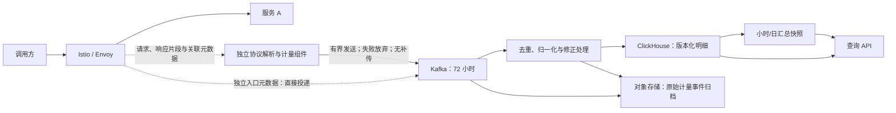

# LLM 请求用量计量与统计设计

状态：评审稿。业务约束已通过访谈确认；本文未代表代码实现、部署兼容性验证或性能验收完成。

## 1. 目标与已确认边界

建设面向未来 token 计费的用量明细与统计能力。首期不扣款、不执行 quota，也不承诺已经具备完整的结算系统。

| 项目 | 已确认决策 |
| --- | --- |
| 规模 | 日均约 50,000,000 次调用，Kubernetes 部署，网关为 Istio |
| 归属主体 | 稳定的 `api_key_id`；密钥轮换不改变归属，撤销不删除历史 |
| 采集层级 | 只统计入口直接访问的服务 A；不追踪 A 内部调用的 B、C |
| 调用边界 | 区分一次逻辑请求和对 A 的各次执行；平台内部重试的额外消耗由平台承担 |
| 客户端重试 | 首期不按正文去重，不承诺通用客户端幂等；每次到达平台的请求分别记录 |
| 协议 | 首期覆盖兼容 Chat Completions 的 JSON / SSE，包括工具调用内容 |
| 暂不覆盖 | Embedding、Rerank 和未适配协议的 token 计量；仍记录可取得的请求元数据 |
| 多模态 | 首期不实现多模态计量，数据模型预留计量单位扩展 |
| 用量来源 | 有效的服务 usage 优先；缺失或无效字段分别估算或标记未知 |
| 估算地位 | 单独可查；未来收费默认接受服务上报及经过验证的模型匹配估算，通用估算待核对 |
| 故障策略 | 计量故障继续业务，接受漏计；不得把未知用量记成零 |
| 采集侧 | 不设置用于故障恢复的事件缓冲、落盘、积压或补传队列 |
| 队列保留 | Kafka 中的事件保留 72 小时，供消费者恢复和重放 |
| 正文 | 仅处理时临时使用，默认不持久化 |
| 修正 | 常规修正窗口为 24 小时；只有已验证提供历史用量查询的服务才启用自动补取，普通 Chat Completions 默认不支持；更晚数据采用可追溯补正 |
| 时间归属 | 请求与用量归属请求开始时间；存储 UTC，报表首期默认 UTC |
| 数据保留 | 在线明细 30 天，归档明细 1 年，小时/日汇总 2 年 |

服务 A 上报的用量被视为 A 这一入口服务的用量。若其中包含 A 的内部调用，平台不再拆分或重复累加；若 A 未报告内部消耗，平台也不主动还原。

## 2. 总体架构

首选 Envoy `ext_proc` 的观察模式，通过 gRPC 向独立组件发送片段，正文使用 `STREAMED`。观察模式不等待处理器返回，不用它改写业务请求或响应。当前官方文档支持这一能力，但 `latest` 文档可能对应开发版本，不能据此断言现有 Istio 所携带的 Envoy 支持。[Envoy 配置说明][1]、[正文模式][2]。

接入前必须验证：实际版本、扩展编译情况、Istio 注入方式、过滤器位置、慢处理器对数据面的资源影响，以及请求结束时观察流的关闭行为。观察模式不等待回复，并不等于零开销或数据必达。

若版本兼容性或性能不满足要求，采用已经讨论过的备选：Istio → 独立 LLM 代理 → A。它增加串行转发节点；代理自身死亡可能中断现有连接，不能把旁路处理器故障隔离的保证直接搬到这一方案上。

### 2.1 鉴权与关联信息

- 使用平台鉴权结果产生的 `api_key_id`，不把客户端自填的归属请求头当作可信身份。
- 在可信入口生成 `logical_request_id`；客户端传入的关联 ID 另存，不能覆盖平台唯一标识。
- 保留稳定 `service_id`、请求指定模型、实际返回模型及已知模型版本，避免服务改名或模型别名切换影响历史。
- 向计量组件传递必要元数据；不持久化 API Key 原文、Authorization 或 Cookie。
- 查询和导出沿用平台权限体系，校验调用者对 API Key、服务及所属租户的访问范围。

### 2.2 A 的多次尝试不能靠最终响应还原

“只统计 A 一层”不代表忽略网关对 A 的重试。Downstream 过滤器观察逻辑请求；要观察每次对 A 的尝试，需要在 upstream attempt 所在位置接入并关联 `attempt_id`。不能将最终响应的 usage 分配给全部尝试。[Envoy HTTP 过滤器说明][3]。

实现要求：

1. 入口记录一次逻辑调用；对 A 的每次可观测尝试记录独立执行。
2. 验证 upstream 观察的实际可配置性，以及重试、超时、取消时的关联传播。
3. 失败尝试没有 usage 时标记未知，不能伪造零消耗；最终成功尝试与平台额外尝试分别归属。
4. 若只能拿到总尝试次数，明确保存“尝试明细不完整”，不宣称已完成逐执行计量。
5. 此能力作为接入验收条件；未满足前，只能灰度展示可见调用，不能宣称完整支持重试计量。

服务 A 内部自行发起的重试仍属于 A 的内部行为，由 A 的 usage 表达，不展开追踪。

## 3. 请求生命周期与事件

事件不包含 SSE 原始片段或完整正文。网络传输片段与业务计量事件是两种不同数据。

| 事件 | 作用 |
| --- | --- |
| `request_started` | 记录可信入口身份、路由及开始时间；使后续有机会识别缺少终态的请求 |
| `attempt_observed` | 记录对 A 的可观测执行、结果、用量及完整性；可有多个版本 |
| `request_finished` | 独立入口终态：HTTP 状态、响应标志、结束时间、已知尝试数 |
| `usage_corrected` | 补到服务 usage 或完成审核后，追加修正依据，保留旧事件 |

入口元数据路径与正文解析路径分别观测，可互相核对，但都直接投递 Kafka，不增加落盘或补传链路。开始事件和结束事件也可能丢失，它们不能提供零漏采保证。

正常流转：

1. 可信入口产生 ID 和开始事件，业务继续转发。
2. 计量组件按请求维护有界解析状态，接收请求正文和响应片段。
3. 解析服务 usage；需要时在正文仍可见的时间内完成估算。
4. 生成包含累计用量的事件并尝试发送 Kafka；结束或发送失败后释放状态，不保留等待恢复的副本。
5. 消费者保存原始事件、更新最新有效明细，触发受影响汇总桶刷新。
6. 若确有独立的可信补正来源，可产生新修正事件，不依赖原采集进程补传。首期普通 Chat Completions 不假设存在历史 usage 查询接口；没有新证据时保持原估算或未知。

观察流终止不必然等于用户取消。HTTP 结果、Envoy 响应标志和解析流状态分别保存；无法区分平台故障、用户取消或观察链路故障时，原因标记未知。

## 4. 无采集缓冲的精确定义

不建立业务事件待发送队列，不写本地日志文件作为恢复源，不使用 WAL、spool、磁盘缓存或故障后的后台补传。发送任务没有空闲执行容量时立即放弃，不排队等待恢复。

JSON/SSE 解析状态、临时正文、序列化内存和网络在途数据无法完全消除。它们只用于正在进行的处理，设置硬性资源上限和发送期限，不能用来积压故障期间的事件。

Kafka producer 自带内存、批处理和重试机制。实现时必须核查所选客户端，避免默认配置在后台长时间积压：不以批处理等待积累事件，限制在途发送及等待时间，禁用跨故障持续重试。发送失败或超过期限就放弃，不在恢复后重新提交。Kafka 客户端的具体参数需按所选语言与版本验证，不能把“无业务缓冲”写成“producer 零内存”。[Kafka producer 参数][4]。

Kafka 写入采用充分副本确认，例如 `acks=all`，并配置适当的 `min.insync.replicas`。生产者去重能力可以作为补充，但消费者仍须按事件 ID 去重。客户端超时可能发生在服务端已写入但确认未到达之后，这属于“结果不确定”，不能全部统计为确认丢失。

**72 小时恢复范围从 Kafka 接收事件开始。写入前遗失的数据不能通过 Kafka 重放恢复。**副本故障、磁盘满及队列到期仍有独立风险；72 小时也不意味着无限存储容量。按峰值事件量配足空间，监控磁盘与最旧未消费事件年龄。

## 5. 用量归一化与估算

### 5.1 每个字段分别标记来源

| 来源 | 含义 |
| --- | --- |
| `reported` | 服务提供且通过协议字段校验的值；表示采信服务报告，不表示平台独立证明真实计算量 |
| `estimated_model` | 使用登记并验证过的模型 tokenizer、模板及估算规则 |
| `estimated_generic` | 无匹配配置时使用通用估算；不能当作模型真实计数 |
| `unknown` | 缺失、超出资源限制、片段不全或无法合理推算 |

来源与完整性分开：模型匹配估算也可能只覆盖断连前观察到的部分输出。不要用一个整行标签掩盖“输入已上报、输出仅估算”的情况。

### 5.2 协议与字段语义

- 校验数值类型、非负性、范围和协议字段关系；有效零值不能因为真假值判断被误当作缺失。
- 保存原始 usage 对象与归一化版本，限制对象大小；如截断必须记录截断状态。
- `input_tokens`、`output_tokens` 为归一化总量；缓存读取、缓存写入、推理 token 为细分字段。是否已包含在总量中，由协议适配器声明。
- 缓存或推理字段缺失时保留 null，不能当作零，也不能仅由可见文本推断。
- 保留服务报告的总量与平台可推导总量；冲突时记录异常，不凭猜测修正为一个看似一致的数字。
- 工具定义、工具参数、角色及消息模板等影响输入计量，不能只对 `content` 字符串计数。
- 多候选输出按候选重建可见文本并按服务语义归一化，避免只计算 `choices[0]`。

### 5.3 流式处理

处理器跨传输片段处理 UTF-8、SSE 事件和 JSON。一个网络片段不保证是一条 SSE 消息，更不保证对应一个 token。

输出估算采用经过验证的增量分词算法，或有界拼接后分词。不能把每个片段单独分词后直接相加。只有计量完整时才标记完整估算；超过内存/CPU/时间上限时保留部分估算或未知，并记录原因。

保留服务报告优先级，但上报的新旧值还需依据来源序号、终态和协议语义判定。不能简单取最大值，也不能让晚到的旧占位值覆盖完整终态。

用户断开时，由业务转发路径及时取消上游；不为取得 usage 主动延长生成。取消可能未立即阻止后端执行，未观察到的部分不能补猜。若服务提供独立查询接口，消费者可在 24 小时窗口内异步补取；此能力按服务登记，不承诺所有服务都具备。

LiteLLM 官方文档和部分流式聚合代码证明本地分词兜底有实际先例，但这不能推导出它能恢复全部隐藏推理、缓存或断连后用量。其代码中使用真假值兜底的做法也不应直接照搬为本平台的零值语义。[LiteLLM 文档][5]、[流式聚合源码][6]。

## 6. 逻辑数据模型

以下是逻辑字段，不是未经验证的建表 SQL。

| 字段组 | 核心字段 |
| --- | --- |
| 事件身份 | `event_id`、`event_type`、`schema_version`、`source_id` |
| 请求与执行 | `logical_request_id`、`attempt_id`、`service_id`、`api_key_id`、已知尝试数及尝试覆盖状态 |
| 模型 | 请求模型、实际模型、模型版本、协议适配器版本 |
| 时间 | 请求开始、执行开始/结束、入口结束、事件生成、入库时间 |
| 请求结果 | HTTP 状态、入口响应标志、执行结果、取消/故障原因及其可信程度 |
| 用量 | 输入、输出、缓存读/写、推理、服务总量；数值可空 |
| 计量依据 | 每字段来源、完整性、tokenizer/模板/估算器版本、原始 usage |
| 修正 | 修订版本、被替代版本/来源事件、修正原因、生效状态 |
| 费用归属准备 | 用户正常消耗、平台重试/故障消耗、待核对；首期不产生实际扣费 |
| 扩展 | `measurement_unit`、多模态扩展项、平台元数据引用 |

事件 ID 在重放时保持不变；同一业务状态的修订版本在重放时也保持不变。数值为累计绝对量，不能将多个修订当成多个独立消耗。

入口请求量、A 的执行量和用户应收候选用量是三组不同统计：

- 请求量：按逻辑请求计一次。
- 服务消耗：统计可确认的各次 A 执行，未知部分另列。
- 应收候选：按已确认的异常收费规则归属，不把平台重试额外量计给用户；实际扣款后续实现。

异常归属规则：用户主动取消只将已确认消耗列为用户应收候选；平台故障造成的失败归平台承担；原因或用量不能确认的部分保持待核对。估算单独列示，不因其有数值就自动变成已确认消耗。后续收费上线时，再落地已接受的模型匹配估算规则与价格版本。

## 7. 队列、明细与汇总

### 7.1 Kafka

- 同一逻辑请求的相关事件使用同一分区键，方便关联；不同生产者的先后顺序仍不能替代业务版本规则。
- 保留原始事件流与稳定的归一化结果流，作为归档和恢复依据；各相关 topic 的保留策略按 72 小时配置。
- 消费处理至少允许重放；不要声称 Kafka 自动提供到 ClickHouse 的端到端“恰好一次”。跨系统正确性需要消费进度、处理状态与落库共同配合。[Kafka 投递语义][7]。
- 消费恢复状态持久化在服务端，不能只在消费进程内存保存已处理 ID 和修订版本。可使用 Kafka 事务/状态日志实现，但写入外部数据库仍需幂等。

### 7.2 ClickHouse 明细

保存版本化的逻辑请求与执行明细，在线保留 30 天。以稳定实体键和修订版本选择最新有效记录；查询必须显式执行最新版本选择，不能等后台合并后才正确。

`ReplacingMergeTree` 等引擎的后台替换是最终发生的操作，查询需使用 `FINAL` 或等价的版本选择逻辑。实际排序键、分区、请求 ID 查询路径和大范围过滤效率均需压测。[ClickHouse 版本选择说明][8]。

原始事件审计和“最新请求状态”是不同视图。查询层封装版本规则，避免业务方直接对所有版本求和。

### 7.3 首期汇总采用可替换快照

首期优先从最新有效明细，按受影响的小时桶生成完整聚合快照；日统计由有效小时快照生成。桶内维度包括 API Key、服务、模型，以及相应的用量来源和状态指标。

刷新只处理新数据或修正影响的桶，不持续重算全部 30 天。正常刷新频率以满足 60 秒可见目标为约束，通过压测确定。

每次刷新绑定明确的数据版本/消费水位；先完整写入新快照，再发布可见版本。旧版本仍可追溯；归零和被移除的维度不能遗漏。查询只读取已完整发布的快照，避免部分结果与新旧结果混读。

例如估算 500 被上报 560 替代，新快照贡献为 560；重复回放旧事件后仍为 560。若后续采用实时差额聚合，则必须把旧值、新值、状态更新和幂等输出纳入同一可靠处理流程。

ClickHouse 增量物化视图处理新插入的数据块，不能假设源表后台去重会自动撤销已累加的旧版本。因此首期不把原始修订事件直接接到求和物化视图。[ClickHouse 增量物化视图说明][9]。

## 8. 归档、修正与查询

原始计量事件和归一化修订归档为可分区读取的文件，保留 1 年；没有正文，不支持将来更换 tokenizer 后重算历史文本。

自动补取默认关闭，只面向确有查询能力且通过验证的服务，在 24 小时常规窗口内执行。24 小时是平台接受常规修正的窗口，不是推理框架保证保存历史请求 24 小时的承诺。缺失记录维持未知或估算状态，不能因窗口结束变为“已确认”。更晚的可信补正保留审计记录，并重建原归属时间的汇总。

### 8.1 历史 usage 查询的实际适用范围

2026-09-16 核查官方当前文档与 `main` 源码后，需要明确区分普通 Chat Completions 与有状态 Responses API：

- vLLM 普通 `/v1/chat/completions`：核查的路由提供创建接口，未提供按该请求 ID 事后读取 usage 的接口。不能将存在请求 ID 等同于存在历史用量查询。[vLLM Chat 路由][10]。
- vLLM `/v1/responses`：存在 `GET /v1/responses/{response_id}`，可读取已经存储的响应及其中可用的 usage。需启用 `VLLM_ENABLE_RESPONSES_API_STORE=1` 并保存该 Responses 请求；核查的实现以进程内字典存储，不能当作跨重启、跨 Pod 的持久化用量账本，也不保证取消请求一定有最终 usage。[vLLM Responses 路由][11]、[存储实现][12]。
- SGLang SRT：当前源码同样有 Responses 的取回接口，存储需显式启用；这是 `/v1/responses` 对应的响应存储，不是普通 `/v1/chat/completions` 或 `/generate` 请求的通用 usage 查询接口。核查实现使用进程内字典，且服务模式存在限制。[SGLang HTTP 路由][13]、[Responses 实现][14]。

这些能力不自动适用于已部署版本。首期已经限定 Chat Completions，因此补取不作为默认恢复路径。若以后接入 Responses 或平台自建历史计量查询，需要验证响应 ID 映射、存储启用条件、保留期、重启/多副本行为、取消后的 usage 完整性及权限。

Responses 存储还可能保存输入/输出内容，不是纯 token 明细；不能仅为补查用量而自动启用，需重新评估与正文不持久化决策的关系。保留 `usage_corrected` 作为修正事件类型，不表示推理框架会自动补报，也不表示每个请求必然产生该事件。

### 8.2 历史修正与查询

历史补正超过 30 天时从归档重建受影响数据；超过 1 年、明细已删除后，不能承诺逐请求自动重算。两年汇总的第二年部分不具备完整的一年期明细下钻能力，应在产品中明确保留边界。

查询 API 提供：

- 请求 ID 精确查询，以及关联的 A 执行明细。
- 按时间、API Key、服务、模型、状态、计量来源筛选和分页。
- 小时/日趋势与服务/API Key 排行。
- 上报、估算、未知及不完整请求分别展示。
- 大范围结果异步导出；超过在线保留期的明细异步检索。

显示数据水位、更新时间、修正状态和已知异常时段。常用在线查询 P95 目标不超过 3 秒，具体数据范围和并发数纳入验收负载。

## 9. 故障行为

| 场景 | 业务行为 | 数据行为 |
| --- | --- | --- |
| 计量处理器不可用 | 观察模式下继续转发 | 可能只剩入口元数据，也可能完全缺失；不补传正文 |
| 解析/估算资源耗尽 | 继续转发 | 尽可能保留上报值；其余未知并记录原因 |
| Kafka 写入失败 | 继续转发 | 不缓冲、不落盘、不排队补传；记录可观测失败/不确定计数 |
| 消费者不可用 | 继续转发 | 已入 Kafka 的事件积压，72 小时保留窗口内恢复 |
| ClickHouse 不可用 | 继续转发 | 消费落库进度不前移，恢复后幂等重放；页面提示延迟 |
| 归档消费者故障 | 继续转发 | 在 Kafka 到期前恢复；若归档和重放窗口都错过，不能承诺一年归档完整 |
| 用户断流 | 传播取消 | 服务计数优先，剩余按可见内容部分估算或未知 |
| Envoy 自身死亡 | 可能中断已有连接 | 无法保证发送最后事件；后续只能依据已持久化信息判定 |
| 旧修订重放 | 无业务影响 | 不覆盖新版本、不重复增加汇总 |

“计量故障不阻断业务”不表示 Envoy、网络或备选串行代理故障也能无损继续已有流。

## 10. 容量测算方法

已知日均量只能得到平均约 579 请求/秒，不能直接确定节点数。

### 10.1 数量级示例

以下使用十进制 KB/GB/TB，未计压缩、副本、索引、修订及额外执行：

| 假设 | 数量级 |
| --- | --- |
| 每请求一条 1 KB 明细 | 约 50 GB/日 |
| 30 天同样明细 | 约 1.5 TB |
| 365 天同样明细 | 约 18.25 TB |
| 每请求 3 条、每条 1 KB 队列事件 | 约 150 GB/日 |
| 上述事件保留 72 小时 | 约 450 GB 逻辑数据；3 副本约 1.35 TB，另加运行余量 |

这不是资源采购清单。事件数、实际序列化大小、压缩率和重试量均需实测。

### 10.2 计量处理器的主要负载

- 正文侧路吞吐约为观测请求率 × 平均请求及响应字节数，不是最终计量事件的字节数。
- 稳态在途请求数约为到达率 × 平均持续时间。例如平均 579 请求/秒、平均 30 秒，约有 17,370 个在途请求；不代表实际流时长已知。
- 分词 CPU 取决于文本总量、tokenizer 和估算比例，要覆盖 usage 全部缺失的压力场景。
- 临时正文内存与并发、正文大小有关。设置请求级和实例级上限，不能随长连接无限增长。

性能验收使用实测峰值两倍的请求率，并重现真实的流时长、输入/输出大小、模型、估算比例、查询并发及 API Key/服务维度数量。版本、硬件和流量样本目前未提供，因此不填未经验证的 Pod 数或 CPU/内存规格。

## 11. 指标与验收

### 11.1 正确区分完整率与用量已知率

正常运行按日请求记录完整率目标为 99.99%，其分母必须是独立、同口径的入口请求基数，而不是计量组件已经收到的请求数。

应同时报告：入口请求数、已记录逻辑请求数、具有终态的记录数、有效上报比例、估算比例、未知比例、采集失败/结果不确定计数、消费延迟及归档延迟。请求有记录但 token 未知，不等于完整计量。

独立入口计数本身也可能因进程死亡或指标导出中断而不完整。没有可靠基数时将真实漏采率标为未知；不能用“已收到终态/已收到开始事件”自证 99.99%。计数差不能还原漏掉的 token。

正常与故障时段分别展示，同时保留全日总体结果，不能通过隐藏故障时段美化完整率。日均 5,000 万次下，0.01% 对应 5,000 次，这一记录缺失预算不等于允许重复收费。

### 11.2 性能目标

- 正常运行请求结束后 60 秒内可查用量及刷新后的常用统计。
- 计量引入的 P99 首包额外延迟不超过 10 毫秒；另测流式输出吞吐与持续延迟，避免只优化首包。
- 常用在线查询 P95 不超过 3 秒。
- 已入 Kafka 的事件在保留窗口内可恢复消费；恢复速度要高于新事件到达速度，否则仍会错过窗口。

### 11.3 必测场景

1. JSON 与 SSE 正常响应；UTF-8、JSON 和 SSE 事件跨任意传输片段。
2. usage 完整、部分缺失、合法零值、非法值、缓存/推理缺失与总量冲突。
3. 工具调用、多候选输出、长上下文和 usage 全缺失。
4. 用户取消、平台超时、上游失败、响应头发出后的断流。
5. 对 A 的多次尝试可关联；失败尝试没有 usage 时保持未知。
6. 处理器退出、发送容量耗尽、Kafka 不可用；业务继续且无本地积压/补传。
7. Kafka 已写入但确认丢失；消费者重启、重复事件、乱序修订、全量重放。
8. 估算 500 → 上报 560 → 旧事件重放，明细和汇总始终选择有效版本，最终为 560。
9. 跨天请求和迟到修正归属请求开始时间；历史桶更新不重复累加。
10. 在线 TTL、归档查询、超过明细保留期的能力边界。
11. 独立入口基数故障时不输出虚假的完整率。
12. 真实负载特征的两倍峰值压测，以及故障恢复时的追赶能力。

## 12. 实施顺序与待验证项

1. 接入验证：检查实际 Istio/Envoy 版本，验证观察模式、upstream 尝试、终态关联、故障放行及慢消费者行为。
2. 最小闭环：一个 JSON 服务、一个 SSE 服务，打通可信身份、usage、Kafka、版本化明细和查询。
3. 估算与异常：接入 tokenizer/模板登记，验证部分结果与资源上限，不启用正文持久化。
4. 修正与汇总：事件幂等、汇总快照发布、归档与历史补正；历史用量补取仅为经过服务能力验证后的可选适配，不作为普通 Chat Completions 的前提。
5. 验收与灰度：故障注入、容量测算、对照入口统计，再逐步覆盖服务。

尚需实测的项目是技术验证项，不是已经批准的性能事实：网关版本能力、各次 A 尝试可见性、独立入口事件可取得的终态信息、流量分布、查询并发、资源上限、写入截止时间和具体资源规格。

未来计费在此基础上新增版本化价格、金额计算、账单/调整流水及结算规则；quota 新增同步预留、结算和释放。本文的 ClickHouse 统计结果不直接充当余额或扣款账本。

## 参考资料

以下一手资料用于核查机制，不表示选定或验证了文档所对应的软件版本。

1. [Envoy ext_proc 配置：观察模式、失败放行及 gRPC 接口](https://www.envoyproxy.io/docs/envoy/latest/api-v3/extensions/filters/http/ext_proc/v3/ext_proc.proto)
2. [Envoy 请求/响应正文处理模式](https://www.envoyproxy.io/docs/envoy/latest/api-v3/extensions/filters/http/ext_proc/v3/processing_mode.proto)
3. [Envoy downstream 与 upstream HTTP 过滤器](https://www.envoyproxy.io/docs/envoy/latest/intro/arch_overview/http/http_filters)
4. [Kafka producer 参数](https://kafka.apache.org/43/configuration/producer-configs/)
5. [LiteLLM tokenizer 与用量工具](https://docs.litellm.ai/docs/completion/token_usage)
6. [LiteLLM 流式用量聚合源码](https://github.com/BerriAI/litellm/blob/main/litellm/litellm_core_utils/streaming_chunk_builder_utils.py)
7. [Kafka 消息投递与跨系统语义](https://kafka.apache.org/41/design/design/)
8. [ClickHouse ReplacingMergeTree 与查询时版本选择](https://clickhouse.com/docs/concepts/features/operations/update/replacing-merge-tree)
9. [ClickHouse 增量物化视图](https://clickhouse.com/docs/concepts/features/materialized-views/incremental-materialized-view)
10. [vLLM Chat Completions 路由源码](https://raw.githubusercontent.com/vllm-project/vllm/main/vllm/entrypoints/openai/chat_completion/api_router.py)
11. [vLLM Responses 路由源码](https://raw.githubusercontent.com/vllm-project/vllm/main/vllm/entrypoints/openai/responses/api_router.py)
12. [vLLM Responses 存储与用量实现](https://docs.vllm.ai/en/latest/api/vllm/entrypoints/openai/responses/serving/)
13. [SGLang SRT HTTP 路由源码](https://raw.githubusercontent.com/sgl-project/sglang/main/python/sglang/srt/entrypoints/http_server.py)
14. [SGLang SRT Responses 存储实现](https://raw.githubusercontent.com/sgl-project/sglang/main/python/sglang/srt/entrypoints/openai/serving_responses.py)

[1]: https://www.envoyproxy.io/docs/envoy/latest/api-v3/extensions/filters/http/ext_proc/v3/ext_proc.proto
[2]: https://www.envoyproxy.io/docs/envoy/latest/api-v3/extensions/filters/http/ext_proc/v3/processing_mode.proto
[3]: https://www.envoyproxy.io/docs/envoy/latest/intro/arch_overview/http/http_filters
[4]: https://kafka.apache.org/43/configuration/producer-configs/
[5]: https://docs.litellm.ai/docs/completion/token_usage
[6]: https://github.com/BerriAI/litellm/blob/main/litellm/litellm_core_utils/streaming_chunk_builder_utils.py
[7]: https://kafka.apache.org/41/design/design/
[8]: https://clickhouse.com/docs/concepts/features/operations/update/replacing-merge-tree
[9]: https://clickhouse.com/docs/concepts/features/materialized-views/incremental-materialized-view
[10]: https://raw.githubusercontent.com/vllm-project/vllm/main/vllm/entrypoints/openai/chat_completion/api_router.py
[11]: https://raw.githubusercontent.com/vllm-project/vllm/main/vllm/entrypoints/openai/responses/api_router.py
[12]: https://docs.vllm.ai/en/latest/api/vllm/entrypoints/openai/responses/serving/
[13]: https://raw.githubusercontent.com/sgl-project/sglang/main/python/sglang/srt/entrypoints/http_server.py
[14]: https://raw.githubusercontent.com/sgl-project/sglang/main/python/sglang/srt/entrypoints/openai/serving_responses.py
